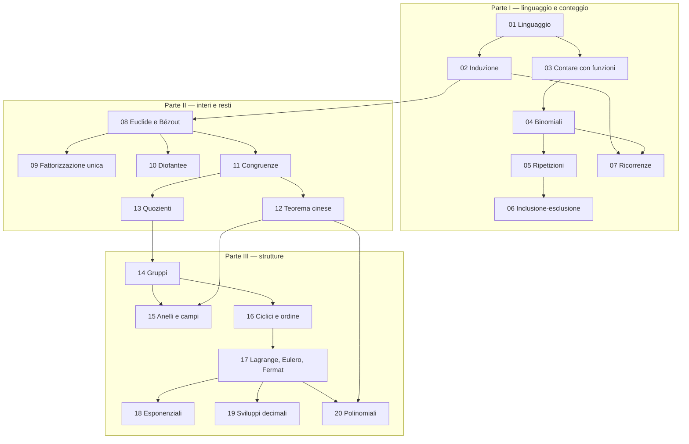
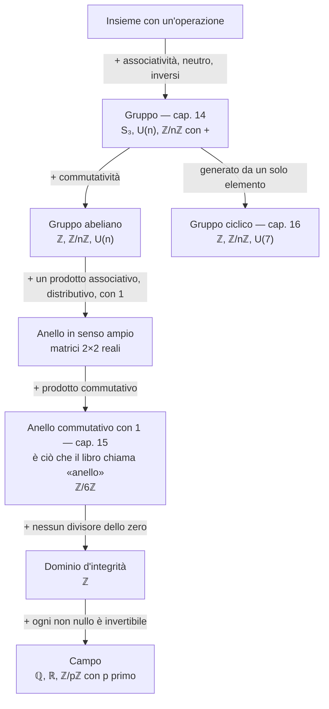

# Aritmetica I — Dalle idee alle dimostrazioni

Questo libro nasce da tutto il materiale di Aritmetica presente nel vault: 15 note e 14 trascrizioni, dal 23 settembre al 1° novembre 2026. Il percorso segue le dipendenze fra le idee. Il suo filo conduttore è imparare a trasformare una domanda in un problema più semplice, senza perdere informazioni: contare attraverso una corrispondenza, sostituire due interi con resti più piccoli, studiare un'equazione attraverso le sue classi di soluzioni.

Le spiegazioni e gli esercizi redazionali sono una nuova esposizione didattica; una selezione di esercizi è riformulata dalla raccolta fornita, con riferimenti puntuali. I raccordi e i completamenti delle dimostrazioni sono indicati nelle fonti dei capitoli; non sono citazioni dei docenti. I materiali originari rimangono consultabili: [[Books/Aritmetica-I/90 - Fonti e criteri editoriali|fonti e criteri editoriali]].

## Come studiare

Il percorso è organizzato per studiare a ritroso: **domanda → tentativo di esercizio → concetto necessario → nuovo tentativo → riscontro**. Ogni capitolo comincia con domande guida collegate agli esercizi e alle sezioni della teoria; gli enunciati precedono la spiegazione, mentre i riscontri richiudibili sono raccolti dopo la teoria.

Parti dal problema, annota che cosa sai e dove ti fermi. Segui il collegamento «Se ti blocchi» per leggere la definizione o la dimostrazione necessaria; richiudi la spiegazione e riprova. Il concetto fra parentesi nel titolo ti permette di scegliere la pratica mirata. Per mettere alla prova la scelta autonoma del metodo, rileggi poi il solo enunciato senza usare il titolo come suggerimento.

Gli esercizi 1–8 di ogni capitolo mantengono la loro numerazione. Le integrazioni dal 9 coprono anche le dimostrazioni, le definizioni, i casi limite e gli approfondimenti della teoria presente. Le domande iniziali costituiscono la mappa di copertura: non basta saper fare un calcolo, occorre saper spiegare le ipotesi e ricostruire la prova associata. Le aggiunte tratte dalla raccolta fornita riportano numero originale e pagina; i riscontri sono scritti per questo libro.

Puoi considerare acquisito un capitolo quando sai rispondere a tutte le domande iniziali, risolvere i relativi esercizi senza suggerimenti e giustificare i passaggi. Tieni aperte le soluzioni soltanto durante il controllo finale.

### Domande da cui partire

Queste domande danno un ingresso rapido a ogni capitolo. La tabella iniziale del capitolo contiene il percorso completo per tutta la sua teoria.

| Capitolo | Domanda di ingresso | Primo tentativo | Controllo della teoria |
|---|---|---|---|
| [[Books/Aritmetica-I/01 - Il linguaggio delle dimostrazioni\|01 - Il linguaggio delle dimostrazioni]] | Come si passa da esempi a una prova per tutti gli interi? | [[Books/Aritmetica-I/01 - Il linguaggio delle dimostrazioni#Esercizio 1 — Operare sugli insiemi (unione, intersezione, differenza e inclusione)\|esercizio 1]] | [[Books/Aritmetica-I/01 - Il linguaggio delle dimostrazioni#Domande per iniziare dagli esercizi\|domande e mappa completa]] · [[Books/Aritmetica-I/01 - Il linguaggio delle dimostrazioni#Esercizio 9 — Tre modi di provare (prova diretta, contrapposizione e assurdo)\|esercizio 9]] |
| [[Books/Aritmetica-I/02 - Naturali e induzione\|02 - Naturali e induzione]] | Come puoi provare infiniti casi con un ragionamento finito? | [[Books/Aritmetica-I/02 - Naturali e induzione#Esercizio 1 — Cercare il primo elemento (minimo e buon ordinamento)\|esercizio 1]] | [[Books/Aritmetica-I/02 - Naturali e induzione#Domande per iniziare dagli esercizi\|domande e mappa completa]] · [[Books/Aritmetica-I/02 - Naturali e induzione#Esercizio 9 — Ricostruire i principi (successore, minimo controesempio e induzione forte)\|esercizio 9]] |
| [[Books/Aritmetica-I/03 - Contare attraverso le funzioni\|03 - Contare attraverso le funzioni]] | Come traduci una sistemazione in una funzione? | [[Books/Aritmetica-I/03 - Contare attraverso le funzioni#Esercizio 1 — Numerare i pari (cardinalità e biiezione)\|esercizio 1]] | [[Books/Aritmetica-I/03 - Contare attraverso le funzioni#Domande per iniziare dagli esercizi\|domande e mappa completa]] · [[Books/Aritmetica-I/03 - Contare attraverso le funzioni#Esercizio 9 — Perché una cardinalità è unica (iniezioni finite, cardinalità e principi di conteggio)\|esercizio 9]] |
| [[Books/Aritmetica-I/04 - Sottoinsiemi e coefficienti binomiali\|04 - Sottoinsiemi e coefficienti binomiali]] | Che cosa cambia se scegli un gruppo anziché assegnare posti? | [[Books/Aritmetica-I/04 - Sottoinsiemi e coefficienti binomiali#Esercizio 1 — Scrivere sì oppure no (funzioni caratteristiche e insieme delle parti)\|esercizio 1]] | [[Books/Aritmetica-I/04 - Sottoinsiemi e coefficienti binomiali#Domande per iniziare dagli esercizi\|domande e mappa completa]] · [[Books/Aritmetica-I/04 - Sottoinsiemi e coefficienti binomiali#Esercizio 9 — Perché si divide per un fattoriale (formula binomiale e simmetria)\|esercizio 9]] |
| [[Books/Aritmetica-I/05 - Distribuzioni e ripetizioni\|05 - Distribuzioni e ripetizioni]] | Quali oggetti o scatole restano distinguibili nel risultato? | [[Books/Aritmetica-I/05 - Distribuzioni e ripetizioni#Esercizio 1 — Riordinare BANANA (anagrammi e multinomiali)\|esercizio 1]] | [[Books/Aritmetica-I/05 - Distribuzioni e ripetizioni#Domande per iniziare dagli esercizi\|domande e mappa completa]] · [[Books/Aritmetica-I/05 - Distribuzioni e ripetizioni#Esercizio 9 — Contare attraverso le fibre (sovraconteggio uniforme, multinomiali e stelle e sbarre)\|esercizio 9]] |
| [[Books/Aritmetica-I/06 - Inclusione ed esclusione\|06 - Inclusione ed esclusione]] | Come correggi una somma che conta più volte gli stessi elementi? | [[Books/Aritmetica-I/06 - Inclusione ed esclusione#Esercizio 1 — Multipli che si sovrappongono (inclusione-esclusione per due insiemi)\|esercizio 1]] | [[Books/Aritmetica-I/06 - Inclusione ed esclusione#Domande per iniziare dagli esercizi\|domande e mappa completa]] · [[Books/Aritmetica-I/06 - Inclusione ed esclusione#Esercizio 9 — Perché i segni si alternano (funzioni caratteristiche e dimostrazione di inclusione-esclusione)\|esercizio 9]] |
| [[Books/Aritmetica-I/07 - Ricorrenze e successioni\|07 - Ricorrenze e successioni]] | Quali casi disgiunti descrivono la prima colonna di una tassellazione? | [[Books/Aritmetica-I/07 - Ricorrenze e successioni#Esercizio 1 — Prime tassellazioni e Fibonacci (dati iniziali e ricorrenza)\|esercizio 1]] | [[Books/Aritmetica-I/07 - Ricorrenze e successioni#Domande per iniziare dagli esercizi\|domande e mappa completa]] · [[Books/Aritmetica-I/07 - Ricorrenze e successioni#Esercizio 9 — Formule e casi dimenticati (Binet, radici complesse e coefficienti degeneri)\|esercizio 9]] |
| [[Books/Aritmetica-I/08 - Divisione euclidea e identità di Bezout\|08 - Divisione euclidea e identità di Bezout]] | Quale informazione conservi sostituendo un numero con un resto? | [[Books/Aritmetica-I/08 - Divisione euclidea e identità di Bezout#Esercizio 1 — Dividere anche lo zero (divisibilità e ordine parziale)\|esercizio 1]] | [[Books/Aritmetica-I/08 - Divisione euclidea e identità di Bezout#Domande per iniziare dagli esercizi\|domande e mappa completa]] · [[Books/Aritmetica-I/08 - Divisione euclidea e identità di Bezout#Esercizio 9 — Perché Euclide funziona (ordine di divisibilità, divisione euclidea e Bézout)\|esercizio 9]] |
| [[Books/Aritmetica-I/09 - Primi e fattorizzazione unica\|09 - Primi e fattorizzazione unica]] | Che cosa significano primo, composto, unità e fattorizzazione del segno? | [[Books/Aritmetica-I/09 - Primi e fattorizzazione unica#Esercizio 1 — Leggere una fattorizzazione (primi e numero dei divisori)\|esercizio 1]] | [[Books/Aritmetica-I/09 - Primi e fattorizzazione unica#Domande per iniziare dagli esercizi\|domande e mappa completa]] · [[Books/Aritmetica-I/09 - Primi e fattorizzazione unica#Esercizio 9 — Dai primi agli esponenti (unicità, infinità dei primi e valutazioni)\|esercizio 9]] |
| [[Books/Aritmetica-I/10 - Equazioni diofantee\|10 - Equazioni diofantee]] | Perché una retta reale può non avere punti interi? | [[Books/Aritmetica-I/10 - Equazioni diofantee#Esercizio 1 — Esiste un punto intero (criterio di risolubilità diofantea)\|esercizio 1]] | [[Books/Aritmetica-I/10 - Equazioni diofantee#Domande per iniziare dagli esercizi\|domande e mappa completa]] · [[Books/Aritmetica-I/10 - Equazioni diofantee#Esercizio 9 — Una retta dentro un quadrato (vincoli sul parametro e cambi di parametrizzazione)\|esercizio 9]] |
| [[Books/Aritmetica-I/11 - Congruenze e inversi modulari\|11 - Congruenze e inversi modulari]] | Che cosa conserva il resto di una divisione? | [[Books/Aritmetica-I/11 - Congruenze e inversi modulari#Esercizio 1 — Leggere un resto negativo (classi di congruenza)\|esercizio 1]] | [[Books/Aritmetica-I/11 - Congruenze e inversi modulari#Domande per iniziare dagli esercizi\|domande e mappa completa]] · [[Books/Aritmetica-I/11 - Congruenze e inversi modulari#Esercizio 9 — Giustificare i calcoli modulari (equivalenza, compatibilità, cancellazione e congruenze lineari)\|esercizio 9]] |
| [[Books/Aritmetica-I/12 - Sistemi e teorema cinese del resto\|12 - Sistemi e teorema cinese del resto]] | Come traduci due calendari in un sistema di resti? | [[Books/Aritmetica-I/12 - Sistemi e teorema cinese del resto#Esercizio 1 — Un appuntamento comune (sistemi di congruenze)\|esercizio 1]] | [[Books/Aritmetica-I/12 - Sistemi e teorema cinese del resto#Domande per iniziare dagli esercizi\|domande e mappa completa]] · [[Books/Aritmetica-I/12 - Sistemi e teorema cinese del resto#Esercizio 9 — Costruire e provare l’unicità (teorema cinese e coordinate idempotenti)\|esercizio 9]] |
| [[Books/Aritmetica-I/13 - Equivalenze e insiemi quoziente\|13 - Equivalenze e insiemi quoziente]] | Quando rappresentazioni diverse devono indicare un unico oggetto? | [[Books/Aritmetica-I/13 - Equivalenze e insiemi quoziente#Esercizio 1 — Raccogliere i rappresentanti (classi, quoziente e proiezione)\|esercizio 1]] | [[Books/Aritmetica-I/13 - Equivalenze e insiemi quoziente#Domande per iniziare dagli esercizi\|domande e mappa completa]] · [[Books/Aritmetica-I/13 - Equivalenze e insiemi quoziente#Esercizio 9 — Quando una formula scende alle classi (equivalenze, fattorizzazione attraverso il quoziente e razionali)\|esercizio 9]] |
| [[Books/Aritmetica-I/14 - Gruppi sottogruppi e permutazioni\|14 - Gruppi sottogruppi e permutazioni]] | Quali azioni si possono comporre e annullare? | [[Books/Aritmetica-I/14 - Gruppi sottogruppi e permutazioni#Esercizio 1 — Le unità modulo quattordici (gruppo e inversi)\|esercizio 1]] | [[Books/Aritmetica-I/14 - Gruppi sottogruppi e permutazioni#Domande per iniziare dagli esercizi\|domande e mappa completa]] · [[Books/Aritmetica-I/14 - Gruppi sottogruppi e permutazioni#Esercizio 9 — Da assiomi a strumenti (assiomi di gruppo, inversi e criterio del sottogruppo)\|esercizio 9]] |
| [[Books/Aritmetica-I/15 - Anelli campi e omomorfismi\|15 - Anelli campi e omomorfismi]] | Quando cambiare coordinate conserva davvero tutti i calcoli? | [[Books/Aritmetica-I/15 - Anelli campi e omomorfismi#Esercizio 1 — Dividere modulo dieci (unità di un anello)\|esercizio 1]] | [[Books/Aritmetica-I/15 - Anelli campi e omomorfismi#Domande per iniziare dagli esercizi\|domande e mappa completa]] · [[Books/Aritmetica-I/15 - Anelli campi e omomorfismi#Esercizio 9 — Dagli assiomi al campo (anelli, domini, campi e omomorfismi)\|esercizio 9]] |
| [[Books/Aritmetica-I/16 - Gruppi ciclici e ordine\|16 - Gruppi ciclici e ordine]] | Quando un solo passo genera tutto il gruppo? | [[Books/Aritmetica-I/16 - Gruppi ciclici e ordine#Esercizio 1 — Camminare per multipli (ordine e sottogruppo generato)\|esercizio 1]] | [[Books/Aritmetica-I/16 - Gruppi ciclici e ordine#Domande per iniziare dagli esercizi\|domande e mappa completa]] · [[Books/Aritmetica-I/16 - Gruppi ciclici e ordine#Esercizio 9 — Classificare con un minimo (ordine infinito, sottogruppi ciclici e radici dell’unità)\|esercizio 9]] |
| [[Books/Aritmetica-I/17 - Lagrange Eulero e Fermat\|17 - Lagrange Eulero e Fermat]] | Come prevedi una potenza mediante il gruppo delle unità? | [[Books/Aritmetica-I/17 - Lagrange Eulero e Fermat#Esercizio 1 — Contare le unità (funzione di Eulero e moltiplicatività)\|esercizio 1]] | [[Books/Aritmetica-I/17 - Lagrange Eulero e Fermat#Domande per iniziare dagli esercizi\|domande e mappa completa]] · [[Books/Aritmetica-I/17 - Lagrange Eulero e Fermat#Esercizio 9 — Dalla partizione ai teoremi (dimostrazione di Lagrange, formula di Eulero e Fermat)\|esercizio 9]] |
| [[Books/Aritmetica-I/18 - Congruenze esponenziali\|18 - Congruenze esponenziali]] | Che cosa cambia quando l’incognita è l’esponente? | [[Books/Aritmetica-I/18 - Congruenze esponenziali#Esercizio 1 — Trovare un esponente (ordine e logaritmo discreto)\|esercizio 1]] | [[Books/Aritmetica-I/18 - Congruenze esponenziali#Domande per iniziare dagli esercizi\|domande e mappa completa]] · [[Books/Aritmetica-I/18 - Congruenze esponenziali#Esercizio 9 — Perché la classe è completa (periodo esatto, ordini locali e periodicità eventuale)\|esercizio 9]] |
| [[Books/Aritmetica-I/19 - Frazioni e sviluppi decimali\|19 - Frazioni e sviluppi decimali]] | Perché una divisione può ricominciare da capo? | [[Books/Aritmetica-I/19 - Frazioni e sviluppi decimali#Esercizio 1 — Quando finisce la divisione (sviluppi finiti e denominatore ridotto)\|esercizio 1]] | [[Books/Aritmetica-I/19 - Frazioni e sviluppi decimali#Domande per iniziare dagli esercizi\|domande e mappa completa]] · [[Books/Aritmetica-I/19 - Frazioni e sviluppi decimali#Esercizio 9 — Perché le cifre diventano periodiche (resti finiti, conversione e sviluppo canonico)\|esercizio 9]] |
| [[Books/Aritmetica-I/20 - Congruenze polinomiali e sollevamento\|20 - Congruenze polinomiali e sollevamento]] | Perché conviene risolvere primo per primo e poi ricomporre? | [[Books/Aritmetica-I/20 - Congruenze polinomiali e sollevamento#Esercizio 1 — Due radici in un campo (quadratiche modulo un primo)\|esercizio 1]] | [[Books/Aritmetica-I/20 - Congruenze polinomiali e sollevamento#Domande per iniziare dagli esercizi\|domande e mappa completa]] · [[Books/Aritmetica-I/20 - Congruenze polinomiali e sollevamento#Esercizio 9 — Tutte le correzioni possibili (dimostrazione del sollevamento e conteggio delle radici)\|esercizio 9]] |

### Come leggere i blocchi

| Blocco | A che cosa serve |
|---|---|
| **Domande per iniziare dagli esercizi** | Collegano ogni sezione della teoria agli esercizi da tentare prima della lettura. |
| **In questo capitolo** | All'inizio: che cosa imparerai a fare e l'idea che lega il capitolo. |
| **Concetto chiave** | Un pilastro del libro: un risultato o una definizione che verrà riusato molte volte. Se ripassi in fretta, parti da qui. |
| **Esempi e controesempi** | Subito dopo una definizione: casi che la soddisfano e casi che violano *una sola* condizione, per vedere perché ogni condizione serve. |
| **Attenzione** | Un errore frequente, con il motivo per cui è un errore. |
| **Riscontro** | La soluzione di un esercizio, chiusa e raccolta dopo la teoria: aprila solo dopo averci provato. |

## La mappa del percorso

Le frecce indicano «serve per». Le tre parti non sono compartimenti stagni: il linguaggio delle funzioni (01) e l'induzione (02) reggono tutto, la divisione euclidea (08) è la radice di tutta l'aritmetica modulare, e le strutture della Parte III rileggono come casi di un'unica teoria i calcoli fatti nella Parte II.

## La mappa delle strutture

Nella Parte III compaiono molte parole nuove: gruppo, abeliano, anello, dominio, campo, unità, omomorfismo. Non sono definizioni slegate: ognuna aggiunge una regola alla precedente. Lo schema si legge dall'alto: scendendo, le strutture rispettano più regole, quindi ci sono meno esempi ma si può calcolare con più libertà.

Due ponti collegano i due rami. Ogni anello, dimenticando il prodotto, è un gruppo abeliano rispetto alla somma. E gli elementi invertibili di un anello, le sue **unità**, formano un gruppo rispetto al prodotto: da $\mathbb Z/n\mathbb Z$ nasce così $U(n)$, il gruppo su cui lavorano Eulero, Fermat e le congruenze esponenziali.

| Struttura | Operazioni | Che cosa puoi fare | Esempio tipico | Capitolo |
|---|---|---|---|---|
| Gruppo | una | risolvere $ax=b$ e cancellare | $U(10)$, $S_3$ | [[Books/Aritmetica-I/14 - Gruppi sottogruppi e permutazioni\|14]] |
| Gruppo ciclico | una | descrivere tutto con le potenze di un elemento | $\mathbb Z/n\mathbb Z$ | [[Books/Aritmetica-I/16 - Gruppi ciclici e ordine\|16]] |
| Anello | due | sommare, sottrarre, moltiplicare | $\mathbb Z$, $\mathbb Z/n\mathbb Z$ | [[Books/Aritmetica-I/15 - Anelli campi e omomorfismi\|15]] |
| Campo | due | anche dividere per ogni elemento non nullo | $\mathbb Q$, $\mathbb Z/p\mathbb Z$ | [[Books/Aritmetica-I/15 - Anelli campi e omomorfismi\|15]] |
| Omomorfismo | — | trasportare i calcoli da una struttura a un'altra | riduzione modulo $n$ | [[Books/Aritmetica-I/15 - Anelli campi e omomorfismi\|15]] |

## I pilastri del libro

Ogni capitolo segnala con un blocco **Concetto chiave** i risultati su cui si regge il resto. Questa è la loro lista completa: se sai enunciarli, spiegare perché valgono e dire a che cosa servono, hai lo scheletro del corso. Usala per ripassare prima di un esame.

**Parte I**

| Capitolo | Concetti chiave |
|---|---|
| [[Books/Aritmetica-I/01 - Il linguaggio delle dimostrazioni\|01 · Il linguaggio delle dimostrazioni]] | Doppia inclusione · Negazione dei quantificatori · Inversa e biiezione |
| [[Books/Aritmetica-I/02 - Naturali e induzione\|02 · Naturali e induzione]] | Buon ordinamento · Principio di induzione · Esistenza della fattorizzazione in primi |
| [[Books/Aritmetica-I/03 - Contare attraverso le funzioni\|03 · Contare attraverso le funzioni]] | Principio di corrispondenza · Principio della somma e del prodotto · Funzioni, iniezioni, permutazioni |
| [[Books/Aritmetica-I/04 - Sottoinsiemi e coefficienti binomiali\|04 · Sottoinsiemi e coefficienti binomiali]] | Formula del coefficiente binomiale · Identità di Pascal · Doppio conteggio |
| [[Books/Aritmetica-I/05 - Distribuzioni e ripetizioni\|05 · Distribuzioni e ripetizioni]] | Sovraconteggio uniforme · Coefficiente multinomiale · Stelle e sbarre |
| [[Books/Aritmetica-I/06 - Inclusione ed esclusione\|06 · Inclusione ed esclusione]] | Principio di inclusione-esclusione · Il contributo di un elemento vale 1 · Numero di suriezioni |
| [[Books/Aritmetica-I/07 - Ricorrenze e successioni\|07 · Ricorrenze e successioni]] | Unicità da ricorrenza e dati iniziali · Equazione caratteristica |

**Parte II**

| Capitolo | Concetti chiave |
|---|---|
| [[Books/Aritmetica-I/08 - Divisione euclidea e identità di Bezout\|08 · Divisione euclidea e identità di Bézout]] | Divisione euclidea · Identità di Bézout · Lemma di Euclide (forma coprima) |
| [[Books/Aritmetica-I/09 - Primi e fattorizzazione unica\|09 · Primi e fattorizzazione unica]] | Lemma del primo · Teorema fondamentale dell'aritmetica · Valutazioni: prodotto e divisibilità |
| [[Books/Aritmetica-I/10 - Equazioni diofantee\|10 · Equazioni diofantee]] | Criterio di esistenza · Tutte le soluzioni di $ax+by=c$ |
| [[Books/Aritmetica-I/11 - Congruenze e inversi modulari\|11 · Congruenze e inversi modulari]] | Compatibilità con somma e prodotto · Quando esiste l'inverso · Congruenza lineare |
| [[Books/Aritmetica-I/12 - Sistemi e teorema cinese del resto\|12 · Sistemi e teorema cinese del resto]] | Teorema cinese del resto (due moduli) · Ricostruzione da più resti · Teorema generale per due moduli |
| [[Books/Aritmetica-I/13 - Equivalenze e insiemi quoziente\|13 · Equivalenze e insiemi quoziente]] | Classi uguali o disgiunte · Buona definizione |

**Parte III**

| Capitolo | Concetti chiave |
|---|---|
| [[Books/Aritmetica-I/14 - Gruppi sottogruppi e permutazioni\|14 · Gruppi, sottogruppi e permutazioni]] | Gruppo · Criterio del sottogruppo · Ordine di una permutazione |
| [[Books/Aritmetica-I/15 - Anelli campi e omomorfismi\|15 · Anelli, campi e omomorfismi]] | $\mathbb Z/n\mathbb Z$ è un campo se e solo se $n$ è primo · Omomorfismo: una funzione che conserva le operazioni · Teorema cinese come isomorfismo |
| [[Books/Aritmetica-I/16 - Gruppi ciclici e ordine\|16 · Gruppi ciclici e ordine]] | Una potenza vale l'identità se e solo se l'esponente è multiplo dell'ordine · Ordine di una potenza · I sottogruppi di un gruppo ciclico sono ciclici |
| [[Books/Aritmetica-I/17 - Lagrange Eulero e Fermat\|17 · Lagrange, Eulero e Fermat]] | Teorema di Lagrange · Teorema di Eulero (e Fermat) |
| [[Books/Aritmetica-I/18 - Congruenze esponenziali\|18 · Congruenze esponenziali]] | Le potenze sono uguali se e solo se gli esponenti sono congrui modulo l'ordine · Ordine modulo un prodotto di moduli coprimi |
| [[Books/Aritmetica-I/19 - Frazioni e sviluppi decimali\|19 · Frazioni e sviluppi decimali]] | Razionale equivale a eventualmente periodico · Antiperiodo e periodo dal denominatore ridotto |
| [[Books/Aritmetica-I/20 - Congruenze polinomiali e sollevamento\|20 · Congruenze polinomiali e sollevamento]] | Si risolve primo per primo e si ricompone · Sollevamento di Hensel |

Per ritrovare rapidamente dove è definita una parola, usa il [[Books/Aritmetica-I/91 - Glossario|glossario]].

## Parte I — Il linguaggio e l'arte di contare

| Capitolo | Domanda guida | Che cosa costruisce |
|---|---|---|
| [[Books/Aritmetica-I/01 - Il linguaggio delle dimostrazioni\|01 · Il linguaggio delle dimostrazioni]] | Come si rende controllabile un ragionamento? | Insiemi, quantificatori, implicazioni, funzioni, corrispondenze e controesempi. |
| [[Books/Aritmetica-I/02 - Naturali e induzione\|02 · Naturali e induzione]] | Come si dimostrano infiniti casi con un argomento finito? | Buon ordinamento, induzione debole e forte, proprietà cumulative, esistenza della fattorizzazione. |
| [[Books/Aritmetica-I/03 - Contare attraverso le funzioni\|03 · Contare attraverso le funzioni]] | Quando due collezioni hanno lo stesso numero di oggetti? | Cardinalità, somma e prodotto, cassetti, funzioni, iniezioni e permutazioni. |
| [[Books/Aritmetica-I/04 - Sottoinsiemi e coefficienti binomiali\|04 · Sottoinsiemi e coefficienti binomiali]] | Come si toglie l'ordine da una scelta? | Insieme delle parti, coefficienti binomiali, Pascal, Newton, doppio conteggio. |
| [[Books/Aritmetica-I/05 - Distribuzioni e ripetizioni\|05 · Distribuzioni e ripetizioni]] | Che cosa cambia se gli oggetti si possono ripetere? | Anagrammi, multinomiali, scatole distinguibili, stelle e sbarre, vincoli. |
| [[Books/Aritmetica-I/06 - Inclusione ed esclusione\|06 · Inclusione ed esclusione]] | Come si contano insiemi che si sovrappongono? | Complementari, funzioni caratteristiche, inclusione-esclusione, suriezioni. |
| [[Books/Aritmetica-I/07 - Ricorrenze e successioni\|07 · Ricorrenze e successioni]] | Come si riconosce un problema più piccolo dentro quello iniziale? | Tassellazioni, Fibonacci, unicità da dati iniziali, equazione caratteristica. |

I capitoli 03–07 formano una catena: prima si contano scelte semplici, poi si controllano ripetizioni e sovrapposizioni, infine si conta costruendo una ricorrenza.

## Parte II — Gli interi e i loro resti

| Capitolo | Domanda guida | Che cosa costruisce |
|---|---|---|
| [[Books/Aritmetica-I/08 - Divisione euclidea e identità di Bezout\|08 · Divisione euclidea e identità di Bézout]] | Perché sostituire un numero con un resto conserva il problema? | Divisibilità, divisione con segni, MCD, algoritmo di Euclide, Bézout e lemma di Euclide. |
| [[Books/Aritmetica-I/09 - Primi e fattorizzazione unica\|09 · Primi e fattorizzazione unica]] | In che senso i primi sono i mattoni degli interi? | Unicità della fattorizzazione, valutazioni, MCD e mcm, divisori, formula di Legendre. |
| [[Books/Aritmetica-I/10 - Equazioni diofantee\|10 · Equazioni diofantee]] | Quando una retta passa per punti a coordinate intere? | Equazioni lineari, tutte le soluzioni, vincoli, differenze di quadrati. |
| [[Books/Aritmetica-I/11 - Congruenze e inversi modulari\|11 · Congruenze e inversi modulari]] | Quale informazione conserviamo quando guardiamo solo il resto? | Operazioni modulari, criteri di divisibilità, inversi, cancellazione e congruenze lineari. |
| [[Books/Aritmetica-I/12 - Sistemi e teorema cinese del resto\|12 · Sistemi e teorema cinese del resto]] | Come si ricostruisce un numero da più resti? | Due e più moduli coprimi, costruzione esplicita, compatibilità e caso generale. |
| [[Books/Aritmetica-I/13 - Equivalenze e insiemi quoziente\|13 · Equivalenze e insiemi quoziente]] | Come si trattano come un solo oggetto rappresentazioni diverse? | Relazioni e partizioni, classi, quozienti, razionali e buona definizione. |

Questa parte può essere iniziata dopo 01–02. Il capitolo 09 usa anche i conteggi di 03–05 nelle applicazioni ai divisori. Le congruenze vengono prima usate concretamente e poi rilette come un esempio di quoziente: l'astrazione avrà così un oggetto familiare a cui riferirsi.

## Parte III — Le strutture spiegano i calcoli

| Capitolo | Domanda guida | Che cosa costruisce |
|---|---|---|
| [[Books/Aritmetica-I/14 - Gruppi sottogruppi e permutazioni\|14 · Gruppi, sottogruppi e permutazioni]] | Che cosa hanno in comune sommare, ruotare e comporre simmetrie? | Assiomi di gruppo, inversi, sottogruppi, centro, permutazioni e cicli disgiunti. |
| [[Books/Aritmetica-I/15 - Anelli campi e omomorfismi\|15 · Anelli, campi e omomorfismi]] | Quali calcoli si conservano cambiando rappresentazione? | Anelli e campi, unità, divisori dello zero, omomorfismi e teorema cinese strutturale. |
| [[Books/Aritmetica-I/16 - Gruppi ciclici e ordine\|16 · Gruppi ciclici e ordine]] | Quanto si può costruire ripetendo una sola operazione? | Ordine, ordine di una potenza, generatori, sottogruppi ciclici finiti e infiniti. |
| [[Books/Aritmetica-I/17 - Lagrange Eulero e Fermat\|17 · Lagrange, Eulero e Fermat]] | Perché alcune potenze sono obbligate a tornare a uno? | Classi laterali e Lagrange, funzione di Eulero, teoremi di Eulero e Fermat, ordini possibili. |
| [[Books/Aritmetica-I/18 - Congruenze esponenziali\|18 · Congruenze esponenziali]] | Come si trova un esponente quando le potenze si ripetono? | Appartenenza al sottogruppo generato, tutte le soluzioni, moduli composti e compatibilità degli esponenti. |
| [[Books/Aritmetica-I/19 - Frazioni e sviluppi decimali\|19 · Frazioni e sviluppi decimali]] | Perché una frazione produce un periodo? | Divisione come processo a stati finiti, razionalità, denominatore, antiperiodo e ordine di 10. |
| [[Books/Aritmetica-I/20 - Congruenze polinomiali e sollevamento\|20 · Congruenze polinomiali e sollevamento]] | Come si passa da una soluzione approssimata a una più precisa? | Quadratiche modulo primi, potenze prime, sollevamenti semplici e singolari, ricomposizione con il teorema cinese. |

Lagrange è sviluppato come raccordo didattico: permette di giustificare le proprietà degli ordini richiamate nelle lezioni. Le radici dell'unità sono un esempio geometrico; la loro lettura trigonometrica è un approfondimento, non un prerequisito per l'aritmetica modulare.

## Tre momenti di verifica

Dopo 07, prova a risolvere un conteggio spiegando quali oggetti conti e perché ogni oggetto compare il numero di volte dichiarato. Dopo 13, prova a risolvere una diofantea e un sistema modulare distinguendo esistenza, costruzione e completezza delle soluzioni. Dopo 20, prova un problema con modulo composto scegliendo autonomamente fra fattorizzazione, ordini, sollevamento e teorema cinese.

## Checklist di avanzamento

Spunta un capitolo solo dopo aver risolto senza aiuto almeno gli esercizi 1–6 e aver spiegato con parole tue l’idea centrale. Gli esercizi 7–8 indicano che sai trasferire il metodo a una situazione nuova.

- [ ] [[Books/Aritmetica-I/01 - Il linguaggio delle dimostrazioni|01 · Il linguaggio delle dimostrazioni]]
- [ ] [[Books/Aritmetica-I/02 - Naturali e induzione|02 · Naturali e induzione]]
- [ ] [[Books/Aritmetica-I/03 - Contare attraverso le funzioni|03 · Contare attraverso le funzioni]]
- [ ] [[Books/Aritmetica-I/04 - Sottoinsiemi e coefficienti binomiali|04 · Sottoinsiemi e coefficienti binomiali]]
- [ ] [[Books/Aritmetica-I/05 - Distribuzioni e ripetizioni|05 · Distribuzioni e ripetizioni]]
- [ ] [[Books/Aritmetica-I/06 - Inclusione ed esclusione|06 · Inclusione ed esclusione]]
- [ ] [[Books/Aritmetica-I/07 - Ricorrenze e successioni|07 · Ricorrenze e successioni]]
- [ ] [[Books/Aritmetica-I/08 - Divisione euclidea e identità di Bezout|08 · Divisione euclidea e identità di Bézout]]
- [ ] [[Books/Aritmetica-I/09 - Primi e fattorizzazione unica|09 · Primi e fattorizzazione unica]]
- [ ] [[Books/Aritmetica-I/10 - Equazioni diofantee|10 · Equazioni diofantee]]
- [ ] [[Books/Aritmetica-I/11 - Congruenze e inversi modulari|11 · Congruenze e inversi modulari]]
- [ ] [[Books/Aritmetica-I/12 - Sistemi e teorema cinese del resto|12 · Sistemi e teorema cinese del resto]]
- [ ] [[Books/Aritmetica-I/13 - Equivalenze e insiemi quoziente|13 · Equivalenze e insiemi quoziente]]
- [ ] [[Books/Aritmetica-I/14 - Gruppi sottogruppi e permutazioni|14 · Gruppi, sottogruppi e permutazioni]]
- [ ] [[Books/Aritmetica-I/15 - Anelli campi e omomorfismi|15 · Anelli, campi e omomorfismi]]
- [ ] [[Books/Aritmetica-I/16 - Gruppi ciclici e ordine|16 · Gruppi ciclici e ordine]]
- [ ] [[Books/Aritmetica-I/17 - Lagrange Eulero e Fermat|17 · Lagrange, Eulero e Fermat]]
- [ ] [[Books/Aritmetica-I/18 - Congruenze esponenziali|18 · Congruenze esponenziali]]
- [ ] [[Books/Aritmetica-I/19 - Frazioni e sviluppi decimali|19 · Frazioni e sviluppi decimali]]
- [ ] [[Books/Aritmetica-I/20 - Congruenze polinomiali e sollevamento|20 · Congruenze polinomiali e sollevamento]]

Il percorso copre il materiale attualmente disponibile. Eventuali lezioni successive potranno diventare nuovi capitoli senza cambiare le fonti originarie.
