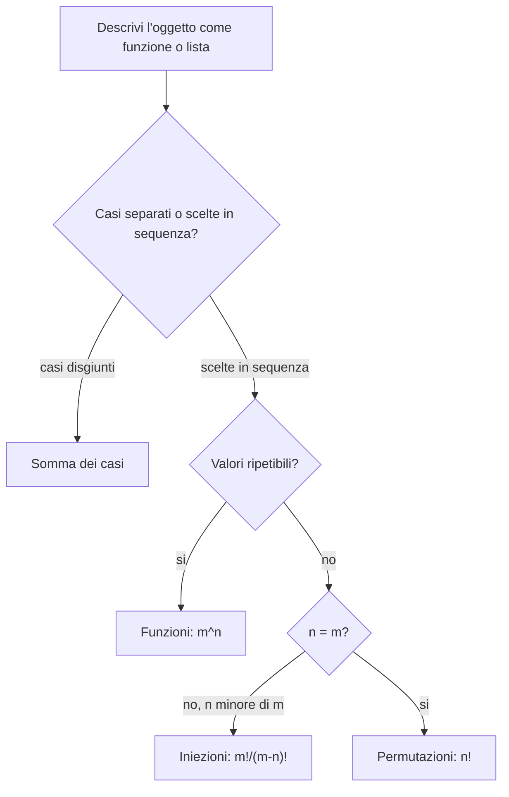

# Contare attraverso le funzioni

Prerequisiti: [[Books/Aritmetica-I/01 - Il linguaggio delle dimostrazioni|funzioni e dimostrazioni]] e [[Books/Aritmetica-I/02 - Naturali e induzione|induzione]]. Torna all'[[Books/Aritmetica-I/00 - Indice e piano di studio|indice del libro]].

> [!info] In questo capitolo
> - Imparerai a definire che cosa significa «contare» un insieme: una numerazione completa, cioè una biezione con $\{1,\ldots,n\}$.
> - Userai somma, prodotto e cassetti per ridurre un conteggio a casi più semplici.
> - Saprai contare le funzioni ($m^n$), le iniezioni ($m!/(m-n)!$) e le permutazioni ($n!$).
> - L'idea che lega tutto: descrivi l'oggetto come una funzione, poi chiediti quali restrizioni (immagini distinte, tutte raggiunte) impone il problema.

## Un posto per ogni persona

Tre persone devono occupare tre sedie numerate. Per descrivere una sistemazione possiamo disegnare una freccia da ciascuna persona alla sua sedia. Nessuna persona deve rimanere senza posto, nessuna sedia può ospitare due persone e tutte le sedie vengono occupate. Abbiamo costruito una biezione (una funzione iniettiva e suriettiva, nel senso del [[Books/Aritmetica-I/01 - Il linguaggio delle dimostrazioni|capitolo 01]]).

Se le sedie fossero cinque, potremmo sistemare le tre persone lasciando due sedie libere: avremmo un'iniezione (una funzione iniettiva, non necessariamente suriettiva). Se invece volessimo assegnare a ciascuna persona una delle cinque bevande disponibili, più persone potrebbero scegliere la stessa bevanda: avremmo una funzione qualsiasi.

Queste tre domande si somigliano, ma contano oggetti diversi. Il primo passo di un problema combinatorio consiste nel dire precisamente che cosa distingue due risultati. Le persone sono riconoscibili? Le sedie hanno un numero? Una bevanda può essere scelta più volte? Quando le risposte sono chiare, una funzione spesso traduce il problema in un conteggio semplice.

## La cardinalità è una numerazione completa

Per $n\in\mathbb N$ poniamo

$$
[n]=\{1,\ldots,n\},\qquad [0]=\varnothing.
$$

Che cosa significa dire che un insieme ha «cinque elementi»? Significa che possiamo etichettarli con i numeri $1,2,3,4,5$ senza ripetizioni e senza dimenticarne nessuno. Questa idea diventa la definizione stessa di cardinalità. Un insieme $X$ è **finito** se esiste una biezione $u:[n]\to X$ per qualche naturale $n$. Scriviamo allora $|X|=n$ e chiamiamo $n$ la sua **cardinalità**. La biezione assegna il numero $i$ all'oggetto $u(i)$: nessuna ripetizione e nessuna omissione. In particolare $|\varnothing|=0$.

Dobbiamo però giustificare che due numerazioni complete non possano dare numeri diversi. Il fatto elementare che serve è questo:

**Lemma.** Se esiste un'iniezione $f:[r]\to[s]$, allora $r\leq s$.

Lo dimostriamo per induzione su $s$. Se $s=0$, nessun elemento può avere immagine nel vuoto, quindi anche $r=0$. Supponiamo ora il risultato vero per $s-1$. Se $r=0$ non c'è nulla da provare. Altrimenti togliamo dal dominio l'elemento $r$ e dal codominio la sua immagine $f(r)$. L'iniettività garantisce che le immagini degli elementi rimasti evitino $f(r)$: otteniamo un'iniezione da $[r-1]$ in un insieme con $s-1$ etichette. Possiamo rinumerare queste etichette, conservandone l'ordine, con $1,\ldots,s-1$. L'ipotesi induttiva dà $r-1\leq s-1$, dunque $r\leq s$.

Se $[r]$ e $[s]$ sono in biezione, sia la biezione sia la sua inversa sono iniettive. Il lemma dà $r\leq s$ e $s\leq r$, quindi $r=s$. Applicandolo alla composizione di due numerazioni di $X$ otteniamo l'unicità di $|X|$.

Ora possiamo usare con sicurezza il **principio di corrispondenza**.

> [!abstract] Concetto chiave — Principio di corrispondenza
> $$
> |X|=|Y|\quad\Longleftrightarrow\quad
> \text{esiste una biezione }X\longrightarrow Y
> \qquad(X,Y\text{ finiti}).
> $$
> Per contare un insieme complicato basta trovare una biezione con uno più semplice. È la tecnica dei doppi conteggi e delle biezioni dei capitoli successivi ([[Books/Aritmetica-I/04 - Sottoinsiemi e coefficienti binomiali|04]], [[Books/Aritmetica-I/06 - Inclusione ed esclusione|06]]).

Infatti, se $u:[n]\to X$ e $v:[n]\to Y$ sono numerazioni, $v\circ u^{-1}$ è una biezione da $X$ a $Y$. Viceversa una biezione $h:X\to Y$ trasferisce la numerazione di $X$ a $Y$ mediante $h\circ u$.

> [!example] Esempi e controesempi — Cardinalità e numerazioni
> **Insieme finito:** $\{a,b,c\}$, con numerazione $u(1)=a$, $u(2)=b$, $u(3)=c$, quindi $|\{a,b,c\}|=3$; $\varnothing$ è finito, con $|\varnothing|=0$ (e $[0]=\varnothing$).
> **Non è una numerazione completa di $\{a,b\}$:**
> - $u:[3]\to\{a,b\}$ con $u(1)=a$, $u(2)=b$, $u(3)=a$ ripete $a$: non è iniettiva;
> - $u:[1]\to\{a,b\}$ con $u(1)=a$ dimentica $b$: non è suriettiva.
> **Non è finito:** $\mathbb N$. Se esistesse una biezione $u:[n]\to\mathbb N$, la sua inversa restringerebbe a un'iniezione $\{0,\ldots,n\}\to[n]$; l'insieme di partenza ha $n+1$ elementi, quindi si rinumera come $[n+1]$ e il lemma sopra darebbe $n+1\le n$, assurdo.

Per esempio, le caselle di una scacchiera con $4$ righe e $3$ colonne corrispondono alle coppie $(i,j)\in[4]\times[3]$: la casella determina un'unica coppia, e la coppia permette di ritrovare la casella. Questa traduzione conserva tutte le informazioni; il problema geometrico diventa il conteggio di coppie.

## Separare i casi: il principio della somma

Quando un problema si può dividere in casi che non si sovrappongono e che esauriscono tutte le possibilità, basta contare ogni caso e sommare.

> [!abstract] Concetto chiave — Principio della somma e del prodotto
> **Somma.** Se $A$ e $B$ sono finiti e **disgiunti**, cioè $A\cap B=\varnothing$, allora $|A\cup B|=|A|+|B|$.
> **Prodotto.** Per $A,B$ finiti, $|A\times B|=|A|\,|B|$; più in generale, se a ogni passo ogni storia (sequenza delle scelte già fatte) ammette lo stesso numero $r_i$ di proseguimenti, le storie complete sono $r_1\cdots r_k$.
> Sono i due mattoni di base dei conteggi: i capitoli [[Books/Aritmetica-I/04 - Sottoinsiemi e coefficienti binomiali|04]] e [[Books/Aritmetica-I/05 - Distribuzioni e ripetizioni|05]] li combinano, e il [[Books/Aritmetica-I/06 - Inclusione ed esclusione|06]] corregge la somma quando i casi si sovrappongono.

Ecco l'enunciato della somma in formule: se $A,B$ sono finiti e disgiunti,

$$
|A\cup B|=|A|+|B|.
$$

Per dimostrarlo, numeriamo prima gli elementi di $A$ con $1,\ldots,a$ e poi quelli di $B$ con $a+1,\ldots,a+b$, dove $a=|A|$ e $b=|B|$. La disgiunzione impedisce di assegnare due numeri allo stesso oggetto; l'unione assicura che nessun oggetto venga omesso. Abbiamo una biezione $[a+b]\to A\cup B$.

Ripetendo il ragionamento, per insiemi $A_1,\ldots,A_k$ a due a due disgiunti otteniamo

$$
\left|\bigcup_{i=1}^k A_i\right|=\sum_{i=1}^k|A_i|.
$$

In un problema concreto significa dividere i risultati in casi che non si sovrappongono e che li comprendono tutti.

**Esempio svolto.** Un biglietto può essere rosso, con uno dei numeri $1,2,3,4$, oppure blu, con uno dei numeri $1,2,3$. I biglietti sono identificati da colore e numero. Ci sono $4+3=7$ biglietti: il rosso numero $1$ e il blu numero $1$ sono oggetti distinti. I due casi sono quindi disgiunti.

> [!warning] Attenzione — Prima di sommare, controlla le sovrapposizioni
> Se $A=\{1,2\}$ e $B=\{2,3\}$, allora $|A|+|B|=4$, mentre $|A\cup B|=3$. L'elemento $2$ è stato contato due volte. Il principio della somma richiede casi disgiunti; la semplice parola «oppure» non garantisce questa condizione.

> [!example] Esempi e controesempi — Principio della somma
> **Si può sommare:** biglietti rossi (4) e blu (3), perché nessun biglietto è sia rosso sia blu: $4+3=7$.
> **Non si può sommare, perché i casi non sono disgiunti** (violata la disgiunzione): numeri da $1$ a $10$ che sono pari *oppure* multipli di $3$. I pari sono $5$, i multipli di $3$ sono $3$, ma l'unione ha $7$ elementi, non $8$: il $6$ è contato due volte (la correzione sistematica è nel [[Books/Aritmetica-I/06 - Inclusione ed esclusione|capitolo 06]]).
> **Non si può sommare, perché i casi non esauriscono tutto** (violata l'esaustività): in $X=\{1,2,3\}$ i casi $A=\{1\}$ e $B=\{2\}$ sono disgiunti, ma $|A|+|B|=2\ne3=|X|$: manca l'elemento $3$.

Una conseguenza utile è che, per $C\subseteq X$ finito,

$$
|X|=|C|+|X\setminus C|.
$$

Dunque $|C|\leq|X|$; se le cardinalità sono uguali, il complementare è vuoto e $C=X$.

## Costruire per passi: il principio del prodotto

Se un oggetto si costruisce con scelte successive, il numero di oggetti si ottiene moltiplicando il numero di scelte a ogni passo. Per insiemi finiti $A$ e $B$, il prodotto cartesiano (definito nel [[Books/Aritmetica-I/01 - Il linguaggio delle dimostrazioni|capitolo 01]]) contiene le coppie ordinate $(a,b)$ con $a\in A$ e $b\in B$. Vale

$$
|A\times B|=|A|\,|B|.
$$

Per ogni $a\in A$ consideriamo la riga $\{a\}\times B$. Essa è in biezione con $B$ tramite $b\mapsto(a,b)$. Le righe sono disgiunte e ricoprono il prodotto: se $|A|=r$ e $|B|=s$, il principio della somma dà $s+\cdots+s=rs$, con $r$ addendi. Se uno dei due insiemi è vuoto, il prodotto è vuoto e la stessa formula dà zero.

La scacchiera dell'esempio precedente ha dunque $4\cdot3=12$ caselle. Analogamente,

$$
|A_1\times\cdots\times A_k|=|A_1|\cdots|A_k|.
$$

Il prodotto vale anche per scelte successive in cui le possibilità concrete cambiano. Chiamiamo **storia** la sequenza delle scelte già fatte e **proseguimenti** le scelte possibili al passo successivo. Supponiamo di avere $r$ possibili primi passi e che **ogni** primo passo ammetta esattamente $s$ possibili secondi passi. Se ogni coppia di passi identifica un risultato e ogni risultato si ottiene una sola volta, i risultati sono $rs$. Li abbiamo divisi secondo il primo passo in $r$ classi disgiunte, ciascuna di cardinalità $s$.

Più in generale, se a ogni passo $i$ ogni storia consentita ammette esattamente $r_i$ proseguimenti, il totale delle storie complete è $r_1\cdots r_k$. Il numero $r_i$ deve essere uniforme rispetto alla storia precedente; gli oggetti disponibili possono dipendere da essa.

**Esempio svolto.** Fra cinque studenti distinti scegliamo un presidente e un segretario, che devono essere persone diverse. Il presidente si sceglie in $5$ modi. Scelto lui, il segretario si sceglie fra gli altri $4$: le persone disponibili cambiano, ma sono sempre quattro. Perciò ci sono

$$
5\cdot4=20
$$

assegnazioni. Scambiare presidente e segretario cambia l'assegnazione, quindi ogni risultato è una coppia ordinata.

> [!warning] Attenzione — Il prodotto richiede un numero uniforme di proseguimenti
> Non serve un'ipotesi di indipendenza probabilistica. Nell'esempio, la prima scelta condiziona la seconda. Se invece un primo passo ammette $2$ completamenti e un altro ne ammette $5$, il totale è $2+5=7$: non possiamo moltiplicare $2$ primi passi per un unico numero di completamenti senza giustificarlo.

> [!example] Esempi e controesempi — Principio del prodotto
> **Si può moltiplicare:** presidente e segretario fra $5$ persone, $5\cdot4=20$: il numero di proseguimenti è sempre $4$, anche se i candidati cambiano.
> **Non si può moltiplicare, perché i proseguimenti non sono uniformi:** coppie $(a,b)$ in $\{1,2,3\}^2$ con $b>a$. Dopo $a=1$ restano $2$ scelte per $b$, dopo $a=2$ ne resta $1$, dopo $a=3$ ne restano $0$. Il totale è $2+1+0=3$, non $3\cdot2$ né $3\cdot3$.
> **Non si può moltiplicare, perché lo stesso risultato si ottiene più volte:** scegliere un *sottoinsieme* di $2$ persone fra $3$ non è «prima una, poi un'altra»: $3\cdot2=6$ conta ogni coppia due volte (prima $A$ poi $B$, e prima $B$ poi $A$), mentre i sottoinsiemi sono $3$.

## Troppi oggetti: il principio dei cassetti

Il principio dei cassetti permette di dimostrare che una coincidenza avviene, senza dire dove né quale. Dieci oggetti vengono riposti in sette cassetti. È impossibile che ogni cassetto contenga al massimo un oggetto: in quel caso potremmo aver riposto al massimo sette oggetti. Almeno un cassetto ne contiene almeno due.

Formalmente, se $X,Y$ sono finiti e $|X|>|Y|$, ogni funzione $f:X\to Y$ **non è iniettiva**. Gli elementi di $X$ sono gli oggetti; $f(x)$ indica il cassetto assegnato a $x$.

Ecco una dimostrazione che rende esplicito il conteggio. Per ogni $y\in Y$ poniamo

$$
X_y=\{x\in X:f(x)=y\}.
$$

Questi insiemi, detti **fibre**, sono disgiunti e ricoprono $X$: ogni oggetto ha un solo cassetto. Se $f$ fosse iniettiva, ogni fibra avrebbe cardinalità al massimo $1$. Quindi

$$
|X|=\sum_{y\in Y}|X_y|\leq\sum_{y\in Y}1=|Y|,
$$

contrariamente all'ipotesi. Se $Y$ è vuoto e $X$ non lo è, non esiste neppure una funzione $X\to Y$.

Lo stesso argomento dà una versione più forte: se $k\in\mathbb N_{>0}$, $q\in\mathbb N$ e più di $qk$ oggetti sono distribuiti in $k$ cassetti, almeno un cassetto contiene almeno $q+1$ oggetti. Altrimenti il totale sarebbe al massimo $qk$. Per esempio, fra $17$ studenti suddivisi in $5$ gruppi, un gruppo ne contiene almeno $4$, perché $17>3\cdot5$.

> [!example] Esempi e controesempi — Cassetti
> **Si applica:** $10$ oggetti in $7$ cassetti ($10>7$): due oggetti coincidono nel cassetto.
> **Non si applica se $|X|\le|Y|$:** $3$ oggetti in $5$ cassetti possono stare in cassetti tutti distinti. La conclusione «due condividono» può quindi fallire.
> **Non dice quanti:** fra $17$ studenti in $5$ gruppi un gruppo ha almeno $4$ studenti, ma non è garantito che ne abbia $5$: le dimensioni $4,4,3,3,3$ sommano a $17$.

I cassetti possono essere categorie nascoste. Scegliamo sei numeri distinti da $\{1,\ldots,10\}$. Raggruppiamo i dieci numeri nelle cinque coppie

$$
\{1,10\},\ \{2,9\},\ \{3,8\},\ \{4,7\},\ \{5,6\}.
$$

Associamo ogni numero scelto alla coppia che lo contiene. Sei numeri e cinque coppie obbligano due numeri scelti a cadere nella stessa coppia: la loro somma è $11$. Con soli cinque numeri il trucco non funziona: $\{1,2,3,4,5\}$ non contiene due numeri con somma $11$. Non abbiamo dovuto conoscere i sei numeri; abbiamo scelto i cassetti in modo che una collisione producesse esattamente la proprietà cercata.

## Contare tutte le funzioni

Tutti i conteggi di questo capitolo si possono riassumere in una domanda sola: quante funzioni da un insieme $X$ a un insieme $Y$ soddisfano certe condizioni? Cominciamo da quelle senza condizioni. Siano $|X|=n$ e $|Y|=m$. Indichiamo con $Y^X$ l'insieme delle funzioni $X\to Y$. Se $X=\{x_1,\ldots,x_n\}$, una funzione è completamente descritta dalla lista ordinata

$$
\bigl(f(x_1),\ldots,f(x_n)\bigr).
$$

La corrispondenza fra funzioni e liste è biunivoca: dalla funzione leggiamo la lista; dalla lista assegniamo a ogni $x_i$ la sua componente. Ogni posizione può contenere uno qualsiasi degli $m$ elementi di $Y$, anche già usato. Per il prodotto,

> [!abstract] Concetto chiave — Funzioni, iniezioni, permutazioni
> Con $|X|=n$ e $|Y|=m$: le funzioni $X\to Y$ sono $m^n$; le iniezioni sono $m!/(m-n)!$ se $n\le m$ (e $0$ se $n>m$); le biezioni fra insiemi di $n$ elementi, cioè le permutazioni, sono $n!$.
> Il modo per leggere un conteggio come funzione ritorna con i sottoinsiemi ([[Books/Aritmetica-I/04 - Sottoinsiemi e coefficienti binomiali|capitolo 04]]), le distribuzioni ([[Books/Aritmetica-I/05 - Distribuzioni e ripetizioni|05]]) e le suriezioni ([[Books/Aritmetica-I/06 - Inclusione ed esclusione|06]]).

$$
\boxed{|Y^X|=m^n.}
$$

Per esempio, le risposte di quattro studenti riconoscibili a una domanda con tre opzioni sono funzioni da un insieme di quattro elementi a uno di tre elementi. Le configurazioni sono $3^4=81$. Non chiediamo che tutte le opzioni siano usate.

I casi vuoti meritano di essere letti direttamente dalla definizione:

- Da $\varnothing$ a qualsiasi $Y$ esiste **una sola funzione**, la funzione vuota: non ci sono valori da assegnare. È iniettiva; è suriettiva esattamente quando anche $Y=\varnothing$.
- Da un insieme non vuoto a $\varnothing$ non esistono funzioni, perché manca un possibile valore per ciascun elemento del dominio.

Pertanto il numero di funzioni è $1$ se $n=0$, ed è $0$ se $n>0$ e $m=0$. **Nel conteggio delle funzioni adottiamo $0^0=1$**, così la formula comprende anche $\varnothing\to\varnothing$. Questa convenzione non decide il valore di espressioni o limiti in altri contesti.

> [!example] Esempi e controesempi — Conteggio delle funzioni
> **Funzioni da $X=\{x_1,x_2\}$ a $Y=\{0,1,2\}$:** $3^2=9$ (liste $(f(x_1),f(x_2))$ con ripetizioni ammesse).
> **Non sono contate da $m^n$**, perché non sono funzioni: le liste con una sola componente (manca il valore per $x_2$) e quelle con valori fuori da $Y$, come $(0,5)$.
> **Scambio di ruoli:** da $\{0,1,2\}$ a $X$ le funzioni sono $2^3=8$, non $9$: la formula $m^n$ non è simmetrica in $m$ e $n$.

## Vietare le ripetizioni: iniezioni e permutazioni

Che cosa cambia se due elementi non possono avere la stessa immagine? Ogni valore usato diminuisce le scelte successive.

Per contare le iniezioni $f:X\to Y$, con $|X|=n$ e $|Y|=m$, imponiamo che le immagini siano distinte. Se $n\leq m$, dopo aver ordinato il dominio come prima abbiamo $m$ possibilità per $f(x_1)$, $m-1$ per $f(x_2)$ e, al passo $i$, $m-i+1$ possibilità. Ogni scelta parziale consente lo stesso numero di proseguimenti al passo successivo, dunque

$$
\#\{f:X\to Y\text{ iniettive}\}
=m(m-1)\cdots(m-n+1)
=\frac{m!}{(m-n)!}.
$$

Qui $m!=1\cdot2\cdots m$ per $m\geq1$ e $0!=1$. Se $n=0$, il prodotto senza fattori vale $1$, come richiede l'unica funzione vuota. Se $n>m$, il principio dei cassetti esclude ogni iniezione. La formula con il quoziente di fattoriali va usata soltanto per $n\leq m$: un fattoriale negativo non è definito qui.

Per assegnare tre persone distinte a cinque sedie numerate otteniamo quindi

$$
\frac{5!}{2!}=5\cdot4\cdot3=60.
$$

> [!example] Esempi e controesempi — Iniezioni
> **Iniezioni:** da $\{a,b\}$ a $\{1,2,3\}$ sono $3\cdot2=6$; per esempio $a\mapsto1,b\mapsto3$.
> **Non è un'iniezione:** $a\mapsto2,b\mapsto2$ ripete l'immagine. Sono $3$ delle $9$ funzioni; le altre $6$ sono iniettive.
> **Nessuna iniezione quando $n>m$:** da $\{a,b,c\}$ a $\{1,2\}$ la formula $m!/(m-n)!$ non va applicata (fattoriale di $-1$); per i cassetti le iniezioni sono $0$.

Lo schema seguente riassume il percorso: parti dalla descrizione dell'oggetto come funzione, rispondi alle domande nei rombi e arrivi alla formula.

La stessa informazione in tabella, con un esempio per ogni riga:

| Cosa conto | Condizione su $f:X\to Y$ | Formula ($\lvert X\rvert=n$, $\lvert Y\rvert=m$) | Esempio |
|---|---|---|---|
| Funzioni | nessuna | $m^n$ | 4 studenti, 3 opzioni: $3^4=81$ |
| Iniezioni | immagini distinte ($n\le m$) | $m!/(m-n)!$ | 3 persone, 5 sedie: $5\cdot4\cdot3=60$ |
| Biezioni, permutazioni | iniettiva e suriettiva ($n=m$) | $n!$ | 4 libri in fila: $24$ |
| Suriezioni | tutti i valori raggiunti | non è una formula elementare qui | [[Books/Aritmetica-I/06 - Inclusione ed esclusione\|capitolo 06]] |

Che cosa cambia quando dominio e codominio hanno la stessa cardinalità finita $n$? Per ogni $f:X\to Y$ vale

$$
f\text{ iniettiva}\ \Longleftrightarrow\
f\text{ suriettiva}\ \Longleftrightarrow\
f\text{ biettiva}.
$$

Se $f$ è iniettiva, è una biezione da $X$ alla sua immagine, perciò $|f(X)|=n$. Ma $f(X)\subseteq Y$ e $|Y|=n$: la conseguenza del principio della somma dimostrata sopra dà $f(X)=Y$.

Viceversa, supponiamo $f$ suriettiva. Le sue $n$ fibre sono tutte non vuote. La loro somma di cardinalità è $n$, quindi ognuna deve avere esattamente un elemento: se una ne avesse almeno due, il totale sarebbe almeno $n+1$. Pertanto $f$ è iniettiva. Per $n=0$ l'unica funzione vuota è direttamente una biezione.

Le biezioni tra due insiemi di $n$ elementi sono dunque

$$
\frac{n!}{(n-n)!}=n!.
$$

Una **permutazione** di $X$ è una biezione $X\to X$ (si riordinano gli elementi dell'insieme). Anche ordinare tutti gli elementi distinti di $X$ corrisponde a una biezione $[n]\to X$: entrambe le famiglie hanno $n!$ elementi. Per esempio quattro libri distinti si dispongono in fila in $4\cdot3\cdot2\cdot1=24$ modi. L'insieme vuoto ha una sola permutazione, coerentemente con $0!=1$.

> [!warning] Attenzione — L'equivalenza richiede la finitezza
> Su $\mathbb N=\{0,1,2,\ldots\}$, la funzione $s(t)=t+1$ è iniettiva ma non suriettiva: manca $0$. Inoltre $p(0)=0$, $p(t)=t-1$ per $t\geq1$ è suriettiva, perché $p(y+1)=y$ per ogni $y$, ma non iniettiva, perché $p(0)=p(1)$. Dominio e codominio sono lo stesso insieme in entrambi gli esempi.

Prima di scegliere una formula, descrivi quindi l'oggetto come assegnazione: quali sono il dominio e il codominio? Sono ammesse immagini ripetute? Ogni posizione ha un ruolo distinto? Se smettiamo di distinguere le posizioni, cambia il problema: sarà il punto di partenza del [[Books/Aritmetica-I/04 - Sottoinsiemi e coefficienti binomiali|capitolo sui sottoinsiemi]].

## Fonti

Il nucleo del capitolo segue [[Notes/Aritmetica/Lectures/2026-09-29 - Cardinalità e tecniche fondamentali del calcolo combinatorio|la nota del 29 settembre]], confrontata con [[_transcripts/Aritmetica/2026-09-29 - Cardinalità e tecniche fondamentali del calcolo combinatorio|la relativa trascrizione]] nelle parti su cardinalità, prodotto, cassetti, funzioni e iniezioni. Sono stati consultati anche [[Notes/Aritmetica/Lectures/2026-10-06 - Conteggio combinatorio e principio di inclusione-esclusione|la nota del 6 ottobre]] e [[_transcripts/Aritmetica/2026-10-06 - Conteggio combinatorio e principio di inclusione-esclusione|la relativa trascrizione]], nelle parti sugli ordinamenti di oggetti distinti e sulle funzioni fra insiemi della stessa cardinalità.

La dimostrazione dell'unicità della cardinalità, la formulazione del prodotto tramite proseguimenti uniformi, i casi vuoti, la versione estesa dei cassetti e gli esempi ed esercizi sono sviluppi didattici di questa esposizione. Le dimostrazioni sono ricostruite esplicitamente per rendere il percorso autonomo.

## Esercizi per verificare la comprensione

Gli esercizi 1–6 sono fondamentali; 7–8 collegano i metodi e li trasferiscono a nuovi problemi.

1. Per $n\in\mathbb N$ sia $E_n=\{2,4,\ldots,2n\}$, con $E_0=\varnothing$. Costruisci una biezione $[n]\to E_n$ e la sua inversa. Qual è $|E_n|$?

> [!tip]- Riscontro 1
> Usa $f(i)=2i$ e $f^{-1}(j)=j/2$. La seconda formula ha valori in $[n]$ perché ogni $j\in E_n$ è pari e compreso fra $2$ e $2n$. Le composizioni restituiscono l'elemento iniziale, quindi $|E_n|=n$. Per $n=0$ entrambe sono la funzione vuota.

2. Un pranzo prevede o un piatto fra $2$ primi seguito da uno fra $3$ secondi, oppure una pizza fra $4$ pizze. Le due forme di pranzo sono distinte. Quanti pranzi sono possibili? Spiega dove usi prodotto e somma.

> [!tip]- Riscontro 2
> Le coppie primo-secondo sono $2\cdot3=6$. Sono un caso disgiunto dalle quattro scelte di pizza, quindi il totale è $6+4=10$. Ogni coppia identifica un pranzo diverso; i piatti non vengono confusi con le pizze.

3. Un codice è una sequenza di quattro cifre di $\{0,1,\ldots,9\}$. Conta i codici: (a) senza vincoli; (b) con cifre tutte distinte; (c) con cifre tutte distinte e prima cifra diversa da zero.

> [!tip]- Riscontro 3
> (a) Ogni posizione ammette dieci cifre: $10^4=10000$. (b) Le scelte successive sono $10,9,8,7$: $5040$. (c) La prima cifra ha $9$ possibilità; la seconda ne ha ancora $9$, perché lo zero è ora consentito e solo la prima cifra è vietata. Il totale è $9\cdot9\cdot8\cdot7=4536$.

4. Sia $A=\{a,b\}$. Quante funzioni e quante iniezioni esistono in ciascuno dei casi $\varnothing\to A$, $A\to\varnothing$, $\varnothing\to\varnothing$? Quali delle funzioni esistenti sono suriettive?

> [!tip]- Riscontro 4
> Da $\varnothing$ ad $A$ c'è una funzione, iniettiva e non suriettiva. Da $A$ al vuoto ci sono zero funzioni e zero iniezioni. Dal vuoto al vuoto c'è una funzione, sia iniettiva sia suriettiva. Una funzione vuota non deve assegnare valori; la suriettività richiede invece che ogni elemento del codominio venga raggiunto.

5. Ventuno studenti vengono divisi in cinque gruppi etichettati, ciascuno studente in un solo gruppo. Dimostra che un gruppo contiene almeno cinque studenti. È necessariamente vero che un gruppo ne contenga almeno sei?

> [!tip]- Riscontro 5
> Se tutti i gruppi contenessero al massimo quattro studenti, il totale sarebbe al massimo $5\cdot4=20$, impossibile. Non sono garantiti sei studenti in un gruppo: le dimensioni $5,4,4,4,4$ sommano a $21$ e forniscono un controesempio.

6. Siano $X,Y$ finiti con $|X|=|Y|=n$. Ricostruisci la dimostrazione che una suriezione $f:X\to Y$ è iniettiva. Poi conta le biezioni fra $\{a,b,c\}$ e $\{1,2,3\}$.

> [!tip]- Riscontro 6
> Per $n>0$, suddividi $X$ nelle fibre dei singoli elementi di $Y$. Sono $n$ fibre non vuote e hanno in totale $n$ elementi: nessuna può averne due. Per $n=0$ la funzione vuota è iniettiva. Le biezioni richieste sono $3!=6$: prima immagine in $3$ modi, seconda in $2$, ultima obbligata.

7. Un lettore sostiene: «Le parole di lunghezza tre su $\{a,b,c\}$ con lettere consecutive diverse non si possono contare con un prodotto, perché la seconda lettera dipende dalla prima». Individua l'errore e conta le parole. Sono ammesse prima e terza lettera uguali.

> [!tip]- Riscontro 7
> Per la prima posizione ci sono $3$ possibilità. Per la seconda, qualunque sia la prima, ne restano esattamente $2$. Per la terza ne restano esattamente $2$, perché è vietata solo la seconda. Il totale è $3\cdot2\cdot2=12$. Cambiano le lettere disponibili, ma il numero di proseguimenti a ogni passo è uniforme: questo basta per il prodotto.

8. Sei libri tutti distinti devono essere messi in fila. Due libri fissati, $A$ e $B$, devono stare vicini, in uno qualsiasi dei due ordini. Conta le disposizioni e giustifica il conteggio mediante una corrispondenza reversibile.

> [!tip]- Riscontro 8
> Sostituisci i due libri vicini con un unico blocco: rimangono cinque oggetti distinti da ordinare, in $5!$ modi. Scegli poi se il blocco contiene $AB$ o $BA$, in $2$ modi. La corrispondenza è reversibile: ogni disposizione valida determina l'ordine dei cinque oggetti e l'ordine interno del blocco, che permettono di ricostruirla. Il totale è $5!\cdot2=240$.

Il capitolo è acquisito quando sai costruire la corrispondenza che giustifica un conteggio, distinguere casi disgiunti da passi successivi e controllare i casi vuoti. Negli esercizi nuovi, prova a spiegare perché ogni risultato viene contato esattamente una volta prima di calcolare il numero.

---

[[Books/Aritmetica-I/02 - Naturali e induzione|← 02 · Naturali e induzione]] · [[Books/Aritmetica-I/00 - Indice e piano di studio|Indice]] · [[Books/Aritmetica-I/04 - Sottoinsiemi e coefficienti binomiali|04 · Sottoinsiemi e coefficienti binomiali →]]
