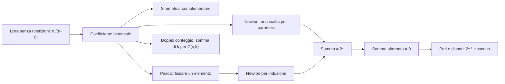

# Sottoinsiemi e coefficienti binomiali

Prerequisiti: [[Books/Aritmetica-I/03 - Contare attraverso le funzioni|cardinalità, prodotto e permutazioni]] e [[Books/Aritmetica-I/02 - Naturali e induzione|induzione]]. Torna all'[[Books/Aritmetica-I/00 - Indice e piano di studio|indice del libro]].

> [!info] In questo capitolo
> - Distinguerai una **lista** (l'ordine conta) da un **sottoinsieme** (l'ordine non conta) e saprai passare dall'una all'altro.
> - Conterai tutti i sottoinsiemi di un insieme e quelli di una data cardinalità: i coefficienti binomiali.
> - Dimostrerai le identità di Pascal, di Newton e le somme binomiali con un solo schema: nominare l'oggetto contato e contarlo in due modi.
> - L'idea che lega tutto: una descrizione può contenere più informazione dell'oggetto cercato, e si può dividere solo se ogni oggetto compare lo stesso numero di volte.
> - Per scegliere il metodo giusto davanti a un problema nuovo, c'è la [[Books/Aritmetica-I/05 - Distribuzioni e ripetizioni#Mappa decisionale del conteggio|mappa decisionale del capitolo 05]].

> [!note] Parole del capitolo 03 che useremo
> **Cardinalità** $|X|$: il numero di elementi di $X$. **Iniezione** $f:A\to B$: elementi diversi hanno immagini diverse. **Biezione**: corrispondenza uno a uno tra due insiemi, che ne mostra la stessa cardinalità. Due insiemi si dicono **disgiunti** se non hanno elementi in comune; se $A$ e $B$ sono disgiunti, $|A\cup B|=|A|+|B|$. Se non le ricordi, rivedi il [[Books/Aritmetica-I/03 - Contare attraverso le funzioni|capitolo 03]].

## Domande per iniziare dagli esercizi

Prova prima gli esercizi indicati dalla domanda. Se ti manca uno strumento, apri soltanto la sezione collegata, poi torna al problema e ricostruisci il passaggio senza guardare. Per le prove, scrivi ipotesi, tesi e motivo di ogni implicazione. I riscontri sono raccolti dopo la teoria.

La tabella copre tutte le sezioni teoriche del capitolo, compresi casi limite e approfondimenti. Gli esercizi 1–8 conservano la numerazione originaria; dal 9 trovi le integrazioni. Gli esercizi tratti dal PDF fornito hanno un riferimento esplicito alla fonte; gli altri sono redazionali.

| Domanda guida | Esercizi da tentare | Teoria da recuperare |
|---|---|---|
| Che cosa cambia se scegli un gruppo anziché assegnare posti? | [[#Esercizio 1 — Scrivere sì oppure no (funzioni caratteristiche e insieme delle parti)\|1]] | [[#Scegliere un gruppo, senza assegnare posti\|Scegliere un gruppo, senza assegnare posti]] |
| Come descrivi un sottoinsieme con una sequenza di sì e no? | [[#Esercizio 1 — Scrivere sì oppure no (funzioni caratteristiche e insieme delle parti)\|1]], [[#Esercizio 7 — Intersezione prescritta (sottoinsiemi e principio del prodotto)\|7]], [[#Esercizio 9 — Perché si divide per un fattoriale (formula binomiale e simmetria)\|9]] | [[#Tutti i sottoinsiemi come risposte sì o no\|Tutti i sottoinsiemi come risposte sì o no]] |
| Perché le scelte senza ordine si contano dividendo per un fattoriale? | [[#Esercizio 2 — Una commissione con portavoce (coefficienti binomiali e scelta marcata)\|2]], [[#Esercizio 7 — Intersezione prescritta (sottoinsiemi e principio del prodotto)\|7]], [[#Esercizio 8 — Scegliere da due gruppi (identità di Vandermonde)\|8]], [[#Esercizio 9 — Perché si divide per un fattoriale (formula binomiale e simmetria)\|9]] | [[#Togliere l'ordine: i coefficienti binomiali\|Togliere l'ordine: i coefficienti binomiali]] |
| Come distingui un elemento per ricavare Pascal? | [[#Esercizio 3 — Ricostruire una riga (identità di Pascal)\|3]] | [[#Pascal: distinguere un elemento\|Pascal: distinguere un elemento]] |
| Come trovi un coefficiente senza sviluppare tutto il binomio? | [[#Esercizio 4 — Un coefficiente senza sviluppare (binomio di Newton e somme binomiali)\|4]], [[#Esercizio 9 — Perché si divide per un fattoriale (formula binomiale e simmetria)\|9]], [[#Esercizio 10 — Una somma con due segni (doppio conteggio e identità binomiali)\|10]] | [[#Newton: scegliere un termine da ogni parentesi\|Newton: scegliere un termine da ogni parentesi]] |
| Perché metà dei sottoinsiemi ha cardinalità pari, salvo il caso vuoto? | [[#Esercizio 4 — Un coefficiente senza sviluppare (binomio di Newton e somme binomiali)\|4]], [[#Esercizio 5 — Scambiare la parità (biiezione fra sottoinsiemi pari e dispari)\|5]], [[#Esercizio 10 — Una somma con due segni (doppio conteggio e identità binomiali)\|10]] | [[#Somme binomiali e parità\|Somme binomiali e parità]] |
| Come nasce un’identità contando oggetti con un elemento segnato? | [[#Esercizio 2 — Una commissione con portavoce (coefficienti binomiali e scelta marcata)\|2]], [[#Esercizio 6 — Scegliere e segnare (doppio conteggio)\|6]], [[#Esercizio 8 — Scegliere da due gruppi (identità di Vandermonde)\|8]], [[#Esercizio 10 — Una somma con due segni (doppio conteggio e identità binomiali)\|10]] | [[#Contare sottoinsiemi con un elemento segnato\|Contare sottoinsiemi con un elemento segnato]] |
| Come scegli fra Pascal, Newton e doppio conteggio? | [[#Esercizio 8 — Scegliere da due gruppi (identità di Vandermonde)\|8]], [[#Esercizio 9 — Perché si divide per un fattoriale (formula binomiale e simmetria)\|9]], [[#Esercizio 10 — Una somma con due segni (doppio conteggio e identità binomiali)\|10]] | [[#Mappa delle identità\|Mappa delle identità]] |

## Esercizi per verificare la comprensione

Gli esercizi 1–6 allenano gli strumenti di base; 7–8 li collegano ad altri problemi. Le integrazioni successive completano il controllo della teoria; quelle dalla raccolta fornita sono segnalate con numero e pagina. Non serve riuscire subito: individua che cosa ti manca, studia il passaggio collegato e riprova.

### Esercizio 1 — Scrivere sì oppure no (funzioni caratteristiche e insieme delle parti)

Per $X=\{a,b,c\}$, elenca i sottoinsiemi di cardinalità $2$ e scrivi per ciascuno la terna $(\chi_A(a),\chi_A(b),\chi_A(c))$. Quanti elementi ha $\mathcal P(X)$? Quanti ne ha $\mathcal P(\varnothing)$?

Se ti blocchi: [[#Scegliere un gruppo, senza assegnare posti|Scegliere un gruppo, senza assegnare posti]] · [[#Tutti i sottoinsiemi come risposte sì o no|Tutti i sottoinsiemi come risposte sì o no]].

Controllo dopo il tentativo: [[#Riscontro 1|riscontro 1]].

### Esercizio 2 — Una commissione con portavoce (coefficienti binomiali e scelta marcata)

Fra otto studenti distinti, di cui due fissati sono Anna e Bruno, scegli una commissione di tre persone che contenga Anna ed escluda Bruno. Quante commissioni esistono? Quante assegnazioni ottieni se devi anche designare un portavoce nella commissione?

Se ti blocchi: [[#Togliere l'ordine: i coefficienti binomiali|Togliere l'ordine: i coefficienti binomiali]] · [[#Contare sottoinsiemi con un elemento segnato|Contare sottoinsiemi con un elemento segnato]].

Controllo dopo il tentativo: [[#Riscontro 2|riscontro 2]].

### Esercizio 3 — Ricostruire una riga (identità di Pascal)

Ricostruisci la prova combinatoria di Pascal per $n\geq0$ e $0\leq r\leq n+1$. Usala per calcolare $\binom53$, partendo dalla riga $1,4,6,4,1$ del triangolo.

Se ti blocchi: [[#Pascal: distinguere un elemento|Pascal: distinguere un elemento]].

Controllo dopo il tentativo: [[#Riscontro 3|riscontro 3]].

### Esercizio 4 — Un coefficiente senza sviluppare (binomio di Newton e somme binomiali)

Trova il coefficiente di $x^3$ in $(2x-1)^5$ senza sviluppare l'intero polinomio. Calcola inoltre $\sum_{k=0}^5\binom5k$ e $\sum_{k=0}^5(-1)^k\binom5k$.

Se ti blocchi: [[#Newton: scegliere un termine da ogni parentesi|Newton: scegliere un termine da ogni parentesi]] · [[#Somme binomiali e parità|Somme binomiali e parità]].

Controllo dopo il tentativo: [[#Riscontro 4|riscontro 4]].

### Esercizio 5 — Scambiare la parità (biiezione fra sottoinsiemi pari e dispari)

Un lettore sostiene: «Il complementare mette sempre in biezione i sottoinsiemi pari con quelli dispari». Trova un controesempio con $|X|=4$, correggi la dimostrazione per ogni insieme finito non vuoto e spiega il caso $X=\varnothing$.

Se ti blocchi: [[#Somme binomiali e parità|Somme binomiali e parità]].

Controllo dopo il tentativo: [[#Riscontro 5|riscontro 5]].

### Esercizio 6 — Scegliere e segnare (doppio conteggio)

Siano $n\geq1$ e $1\leq k\leq n$. Conta in due modi le coppie $(A,a)$ con $A\subseteq[n]$, $|A|=k$ e $a\in A$, per dimostrare $k\binom nk=n\binom{n-1}{k-1}$. Verifica per $n=6$, $k=3$.

Se ti blocchi: [[#Contare sottoinsiemi con un elemento segnato|Contare sottoinsiemi con un elemento segnato]].

Controllo dopo il tentativo: [[#Riscontro 6|riscontro 6]].

### Esercizio 7 — Intersezione prescritta (sottoinsiemi e principio del prodotto)

Sia $X$ un insieme di sei elementi. Quante coppie **ordinate** $(A,B)$ di sottoinsiemi di $X$ soddisfano $|A\cap B|=2$? Non sono imposti altri vincoli sulle cardinalità di $A$ e $B$.

Se ti blocchi: [[#Tutti i sottoinsiemi come risposte sì o no|Tutti i sottoinsiemi come risposte sì o no]] · [[#Togliere l'ordine: i coefficienti binomiali|Togliere l'ordine: i coefficienti binomiali]].

Controllo dopo il tentativo: [[#Riscontro 7|riscontro 7]].

### Esercizio 8 — Scegliere da due gruppi (identità di Vandermonde)

Due gruppi disgiunti hanno rispettivamente $m$ e $n$ persone, con $m,n\in\mathbb N$. Per $0\leq r\leq m+n$, conta le commissioni di $r$ persone classificandole per il numero di membri del primo gruppo e dimostra l'**identità di Vandermonde**
   $$
   \binom{m+n}r=\sum_{k=0}^r\binom mk\binom n{r-k}.
   $$
   Verifica il conteggio per $m=4$, $n=3$, $r=3$. Usa i coefficienti nulli per le scelte impossibili.

Se ti blocchi: [[#Togliere l'ordine: i coefficienti binomiali|Togliere l'ordine: i coefficienti binomiali]] · [[#Contare sottoinsiemi con un elemento segnato|Contare sottoinsiemi con un elemento segnato]] · [[#Mappa delle identità|Mappa delle identità]].

Controllo dopo il tentativo: [[#Riscontro 8|riscontro 8]].

### Esercizio 9 — Perché si divide per un fattoriale (formula binomiale e simmetria)

Per $0\le k\le n$, passa dalle liste ordinate di $k$ elementi distinti ai sottoinsiemi di $k$ elementi. Quante liste producono ciascun sottoinsieme? Ricava la formula di $\binom nk$, compresi $k=0,n$, e dimostra $\binom nk=\binom n{n-k}$ con il complementare. Spiega le convenzioni per $k<0$ e $k>n$ e ricostruisci Newton scegliendo fra i due termini di ogni fattore.

Se ti blocchi: [[#Tutti i sottoinsiemi come risposte sì o no|Tutti i sottoinsiemi come risposte sì o no]] · [[#Togliere l'ordine: i coefficienti binomiali|Togliere l'ordine: i coefficienti binomiali]] · [[#Newton: scegliere un termine da ogni parentesi|Newton: scegliere un termine da ogni parentesi]] · [[#Mappa delle identità|Mappa delle identità]].

Controllo dopo il tentativo: [[#Riscontro 9|riscontro 9]].

### Esercizio 10 — Una somma con due segni (doppio conteggio e identità binomiali)

*Dalla raccolta fornita: esercizio 44, p. 74 stampata / [[Books/Aritmetica-I/Fonti/Esercizi algebra 1 2.pdf#page=84|p. 84 del PDF]]. Enunciato riformulato; riscontro redazionale.*

Per $n\ge1$ dimostra $\sum_{k=0}^n k\binom nk=n2^{n-1}$ e $\sum_{k=0}^n k^2\binom nk=(n+n^2)2^{n-2}$. Nel secondo conteggio considera una coppia ordinata di elementi segnati nel sottoinsieme e separa il caso in cui coincidono. Tratta $n=1$ direttamente.

Se ti blocchi: [[#Newton: scegliere un termine da ogni parentesi|Newton: scegliere un termine da ogni parentesi]] · [[#Somme binomiali e parità|Somme binomiali e parità]] · [[#Contare sottoinsiemi con un elemento segnato|Contare sottoinsiemi con un elemento segnato]] · [[#Mappa delle identità|Mappa delle identità]].

Controllo dopo il tentativo: [[#Riscontro 10|riscontro 10]].

## Teoria da recuperare

Usa i collegamenti della tabella iniziale per leggere lo strumento che ti serve. Dopo la lettura, torna all’esercizio e prova a risolverlo senza suggerimenti.

## Scegliere un gruppo, senza assegnare posti

Fra sei studenti vogliamo scegliere una commissione di tre persone. Se scriviamo prima Anna, poi Bruno, poi Carla, abbiamo scelto la stessa commissione che otterremmo scrivendo Carla, Anna, Bruno. Il risultato è un sottoinsieme: l'ordine con cui lo abbiamo costruito non ne fa parte.

Possiamo comunque cominciare contando le liste ordinate, perché sappiamo farlo: ci sono $6\cdot5\cdot4=120$ liste di tre studenti distinti. Ogni commissione compare però in $3!=6$ liste, una per ogni ordine dei suoi tre membri. Le commissioni sono quindi

$$
\frac{120}{6}=20.
$$

Questo esempio contiene il passaggio centrale del capitolo: una descrizione può avere più informazioni dell'oggetto che vogliamo contare. Possiamo dimenticare l'informazione superflua, purché controlliamo quante descrizioni corrispondano a ogni risultato.

## Tutti i sottoinsiemi come risposte sì o no

Prima di contare i sottoinsiemi con una proprietà (per esempio di una data cardinalità) ci serve un oggetto che li raccolga tutti: da qui si parte per contarli.

L'**insieme delle parti** di un insieme $X$ è

$$
\mathcal P(X)=\{A:A\subseteq X\}.
$$

Se $X=\{a,b\}$, allora $\mathcal P(X)=\{\varnothing,\{a\},\{b\},X\}$. I suoi elementi sono insiemi. In particolare il vuoto è un elemento di $\mathcal P(X)$, perché è un sottoinsieme di $X$.

> [!example] Esempi e controesempi — insieme delle parti
> **È un elemento di $\mathcal P(X)$**, con $X=\{a,b,c\}$: $\{a,c\}$ (è contenuto in $X$); $\varnothing$ (il vuoto è contenuto in ogni insieme); $X$ stesso (ogni insieme è contenuto in sé).
> **Non è un elemento di $\mathcal P(X)$:** $a$, perché è un elemento di $X$ e non un sottoinsieme (la condizione «essere un insieme» fallisce: giusto sarebbe $\{a\}$); $\{a,d\}$ con $d\notin X$, perché non è contenuto in $X$ (la condizione «$\subseteq X$» fallisce).

Per specificare $A\subseteq X$, basta rispondere per ogni $x\in X$ alla domanda «$x$ appartiene ad $A$?». Registriamo le risposte mediante la **funzione caratteristica**

$$
\chi_A:X\longrightarrow\{0,1\},\qquad
\chi_A(x)=
\begin{cases}
1,&x\in A,\\
0,&x\notin A.
\end{cases}
$$

La corrispondenza $A\mapsto\chi_A$ è una biezione fra $\mathcal P(X)$ e l'insieme $\{0,1\}^X$ delle funzioni da $X$ a $\{0,1\}$. Per provarlo, costruiamo l'inversa: a una funzione $f:X\to\{0,1\}$ associamo

$$
A_f=\{x\in X:f(x)=1\}.
$$

Partendo da $A$, questa operazione restituisce $A$, perché raccoglie esattamente gli elementi sui quali $\chi_A$ vale $1$. Partendo da $f$, restituisce $f$: la caratteristica di $A_f$ vale $1$ proprio dove $f$ vale $1$, e altrove entrambe valgono $0$.

Se $|X|=n$, il conteggio delle funzioni del capitolo precedente (due valori possibili per ciascuno degli $n$ elementi) dà dunque

$$
\boxed{|\mathcal P(X)|=2^n.}
$$

Per $n=0$ la formula dice $|\mathcal P(\varnothing)|=1$: infatti $\mathcal P(\varnothing)=\{\varnothing\}$. C'è un solo modo di non scegliere alcun elemento.

## Togliere l'ordine: i coefficienti binomiali

Ora vogliamo contare solo i sottoinsiemi con un numero prefissato di elementi. Il problema è che sappiamo contare bene le liste ordinate, non i gruppi senza ordine: la risposta sarà un numero che si ottiene dalle liste correggendo il sovraconteggio. Il numero che cerchiamo ha un nome.

Fissiamo $n\in\mathbb N$ e un insieme $X$ di $n$ elementi. Per $0\leq r\leq n$, chiamiamo **coefficiente binomiale**

$$
\binom nr=\bigl|\{A\subseteq X:|A|=r\}\bigr|.
$$

Il numero dipende soltanto da $n$ e $r$: una biezione fra due insiemi di $n$ elementi trasferisce, tramite le immagini, i sottoinsiemi di cardinalità $r$ dell'uno in quelli dell'altro.

> [!example] Esempi e controesempi — coefficiente binomiale
> **È contato da $\binom nr$**, per $n=4$, $r=2$, $X=\{1,2,3,4\}$: i sei sottoinsiemi $\{1,2\},\{1,3\},\{1,4\},\{2,3\},\{2,4\},\{3,4\}$, quindi $\binom42=6$.
> **Non è contato da $\binom nr$**, e ciascun controesempio viola una sola condizione della definizione:
> - le liste ordinate di due elementi distinti, che sono $4\cdot3=12$ (viola «l'ordine non conta»: $(1,2)$ e $(2,1)$ sono la stessa coppia);
> - i «sottoinsiemi» con un elemento ripetuto, come $\{1,1\}$, che è soltanto $\{1\}$ (viola «elementi distinti»: un insieme non registra le ripetizioni);
> - i sottoinsiemi con **al più** due elementi, che sono $1+4+6=11$ (viola «cardinalità esattamente $r$»).

Per calcolarlo consideriamo le iniezioni $f:[r]\to X$, dove $[r]=\{1,\ldots,r\}$ e $[0]=\varnothing$. Esse descrivono liste di $r$ elementi distinti. Il loro numero è

$$
\frac{n!}{(n-r)!}.
$$

Mandiamo ogni iniezione nella sua immagine $f([r])$. Quali iniezioni producono un sottoinsieme fissato $A$ di $r$ elementi? Precisamente le biezioni $[r]\to A$, cioè i suoi $r!$ ordinamenti. Dividendo le iniezioni in famiglie secondo l'immagine, otteniamo $\binom nr$ famiglie disgiunte, tutte di cardinalità $r!$. Pertanto

$$
\frac{n!}{(n-r)!}=r!\binom nr.
$$

La divisione è giustificata dall'uniformità: ogni sottoinsieme ha esattamente lo stesso numero di descrizioni ordinate. Il ragionamento comprende $r=0$, perché esiste una sola iniezione vuota e $0!=1$.

> [!abstract] Concetto chiave — Formula del coefficiente binomiale
> Per $0\leq r\leq n$:
> $$
> \binom nr=\frac{n!}{r!\,(n-r)!}
> $$
> I sottoinsiemi si contano dividendo le liste senza ripetizioni per i $r!$ ordinamenti di ciascuno. Questo schema «conta troppo, poi dividi per un sovraconteggio uniforme» ritorna per gli anagrammi e i gruppi senza nome nel [[Books/Aritmetica-I/05 - Distribuzioni e ripetizioni|capitolo 05]].

Per scegliere fra lista e sottoinsieme conviene chiedersi due cose: l'ordine conta? gli elementi possono ripetersi? Per ora abbiamo due delle quattro risposte possibili (le altre due, con ripetizione, stanno nel capitolo 05):

| Il risultato è… | L'ordine conta? | Ripetizioni? | Quanti sono | Esempio ($n=6$, $r=3$) |
|---|---|---|---|---|
| una lista di $r$ elementi di $X$ | sì | no | $\dfrac{n!}{(n-r)!}$ | $6\cdot5\cdot4=120$ |
| un sottoinsieme di $r$ elementi | no | no | $\binom nr$ | $120/3!=20$ |

La [[Books/Aritmetica-I/05 - Distribuzioni e ripetizioni#Mappa decisionale del conteggio|mappa decisionale]] completa la tabella con ripetizioni, oggetti uguali e vincoli.

I casi estremi hanno anche una lettura immediata:

$$
\binom n0=\binom nn=1,\qquad
\binom n1=n\quad(n\geq1).
$$

Per ogni intero $r$ fuori dall'intervallo $0\leq r\leq n$ poniamo inoltre $\binom nr=0$. Un sottoinsieme non può avere cardinalità negativa o maggiore di $n$. La formula con i fattoriali si usa soltanto nell'intervallo consentito: qui non definiamo fattoriali negativi.

> [!warning] Attenzione — Dividere richiede una molteplicità uniforme
> «Ho contato troppo» non basta a giustificare una divisione. Bisogna spiegare quante volte compare **ciascun** risultato. Nella scelta della commissione il divisore è $3!$, perché ogni commissione ha sei ordinamenti. Se assegniamo invece tre cariche diverse, quegli ordinamenti sono risultati diversi e il numero resta $120$.

Il complementare dà una prima identità senza calcoli. Se $|A|=r$, allora $|X\setminus A|=n-r$. L'operazione $A\mapsto X\setminus A$ è la propria inversa, quindi è una biezione e dimostra la **simmetria**

$$
\boxed{\binom nr=\binom n{n-r}}\qquad(0\leq r\leq n).
$$

Scegliere chi entra equivale a scegliere chi rimane fuori. Per esempio, scegliere sette persone fra nove richiede lo stesso numero di scelte che escluderne due: $\binom97=\binom92=9\cdot8/2=36$.

## Pascal: distinguere un elemento

Il fattoriale permette di calcolare $\binom nr$, ma non dice come i coefficienti siano legati fra loro. Ci serve una relazione che calcoli i coefficienti di $n+1$ elementi da quelli di $n$: basta guardare che cosa fa un elemento fissato.

Prendiamo un insieme $X$ con $n+1$ elementi e fissiamo $x\in X$. Per contare i suoi sottoinsiemi di $r$ elementi, separiamoli secondo la presenza di $x$.

Quelli che non contengono $x$ sono i sottoinsiemi di $r$ elementi di $X\setminus\{x\}$: sono $\binom nr$. Per quelli che contengono $x$, togliere $x$ dà una biezione con i sottoinsiemi di $r-1$ elementi di $X\setminus\{x\}$: sono $\binom n{r-1}$. I casi sono disgiunti ed esauriscono le possibilità. Abbiamo dimostrato l'**identità di Pascal**:

> [!abstract] Concetto chiave — Identità di Pascal
> Per $n\geq0$ e $0\leq r\leq n+1$:
> $$
> \binom{n+1}r=\binom nr+\binom n{r-1}
> $$
> I sottoinsiemi si dividono in quelli che escludono un elemento fissato e quelli che lo includono. È il motore dell'induzione per Newton qui sotto e delle somme di binomiali del [[Books/Aritmetica-I/07 - Ricorrenze e successioni|capitolo 07]].

Ai bordi la convenzione dei coefficienti nulli esprime il caso impossibile: per $r=0$ nessun sottoinsieme contiene $x$; per $r=n+1$ nessuno lo esclude.

> [!example] Esempi e controesempi — identità di Pascal
> **Vale:** $\binom52=\binom42+\binom41=6+4=10$. In concreto, nel gruppo $\{1,2,3,4,x\}$ i sottoinsiemi di due elementi sono 6 senza $x$ e 4 con $x$ (si sceglie l'altro elemento fra i quattro).
> **Non vale se si sbaglia l'indice:** $\binom52\neq\binom42+\binom42=12$. Una volta incluso $x$, restano da scegliere $r-1=1$ elementi fra i quattro rimasti, cioè $\binom41=4$ modi, non $\binom42$. Anche l'intervallo delle ipotesi conta: ai bordi ($r=0$ o $r=n+1$) compare un coefficiente con indice fuori da $0,\ldots,n$, che va letto come $0$ per la convenzione data sopra.

Partendo da $\binom00=1$, Pascal permette di costruire tutte le righe successive:

$$
\begin{array}{c|rrrrr}
n=0&1\\
n=1&1&1\\
n=2&1&2&1\\
n=3&1&3&3&1\\
n=4&1&4&6&4&1
\end{array}
$$

Ogni numero interno è la somma dei due numeri della riga precedente che hanno indice inferiore uguale o diminuito di uno. La tabella, chiamata triangolo di Pascal o di Tartaglia, conserva così la memoria di una scelta: prendere oppure escludere l'elemento fissato.

## Newton: scegliere un termine da ogni parentesi

Finora i coefficienti binomiali contano sottoinsiemi. Vediamo che compaiono anche nei polinomi: questo collegamento serve per le somme alternate del capitolo 06.

Perché gli stessi numeri compaiono nello sviluppo di una potenza? Consideriamo $n$ parentesi, distinguendole con le etichette $1,\ldots,n$:

$$
(a+b)^n=\underbrace{(a+b)\cdots(a+b)}_{n\text{ fattori}}.
$$

La distributività costruisce ogni termine scegliendo $a$ oppure $b$ da ciascuna parentesi. Per ottenere $a^k b^{n-k}$ dobbiamo scegliere le $k$ parentesi dalle quali prendere $a$. Le scelte sono i sottoinsiemi di $k$ elementi di $[n]$, quindi sono $\binom nk$. Raggruppando tutti i termini uguali troviamo il **binomio di Newton**:

$$
\boxed{(a+b)^n=\sum_{k=0}^n\binom nk a^k b^{n-k}}.
$$

È un'identità fra polinomi e vale, in particolare, per ogni $a,b\in\mathbb R$ e $n\in\mathbb N$. I fattori con esponente zero si interpretano come il polinomio costante $1$, anche nelle successive sostituzioni numeriche. Per $n=0$ entrambi i membri sono il prodotto vuoto $1$ (il prodotto di nessun fattore vale $1$, come la somma di nessun addendo vale $0$).

> [!example] Esempi e controesempi — binomio di Newton
> **Vale:** $(a+b)^3=a^3+3a^2b+3ab^2+b^3$; con $a=b=1$ la somma dei coefficienti è $1+3+3+1=8=2^3$.
> **Non vale se si cambia la regola dei termini:**
> - togliendo i coefficienti, $(a+b)^2\neq a^2+b^2$: per $a=b=1$ si ha $4\neq2$;
> - se i fattori **non commutano** ($ab\neq ba$, come accade componendo funzioni in ordine diverso), il raggruppamento dei termini uguali non è lecito: $(a+b)^2=a^2+ab+ba+b^2$, non $a^2+2ab+b^2$. La prova combinatoria usa $ab=ba$ quando raccoglie «le scelte con $k$ volte $a$».

Possiamo anche dimostrarla per induzione, usando Pascal. Il caso $n=0$ è appena verificato. Supponiamo vera la formula per $n$. Moltiplicando per $a+b$ otteniamo

$$
(a+b)^{n+1}
=\sum_{i=0}^n\binom ni a^{i+1}b^{n-i}
+\sum_{i=0}^n\binom ni a^i b^{n+1-i}.
$$

Vogliamo riunire i monomi con la stessa potenza di $a$. Nella prima somma poniamo $j=i+1$: quando $i$ va da $0$ a $n$, $j$ va da $1$ a $n+1$, e $n-i=n+1-j$. Nella seconda basta rinominare $i$ in $j$. Dunque

$$
(a+b)^{n+1}
=\sum_{j=1}^{n+1}\binom n{j-1}a^j b^{n+1-j}
+\sum_{j=0}^n\binom nj a^j b^{n+1-j}.
$$

La prima somma può includere $j=0$ perché $\binom n{-1}=0$; la seconda può includere $j=n+1$ perché $\binom n{n+1}=0$. Ora gli estremi coincidono e possiamo raccogliere:

$$
\begin{aligned}
(a+b)^{n+1}
&=\sum_{j=0}^{n+1}
\left(\binom n{j-1}+\binom nj\right)a^j b^{n+1-j}\\
&=\sum_{j=0}^{n+1}\binom{n+1}j a^j b^{n+1-j}.
\end{aligned}
$$

L'ultima uguaglianza è Pascal. È proprio la formula richiesta per $n+1$, quindi l'induzione è conclusa.

**Esempio svolto: un coefficiente senza sviluppare tutto.** Cerchiamo il coefficiente di $x^2$ in $(2x-1)^4$. In Newton poniamo $a=2x$, $b=-1$. Il termine di indice $k$ è $\binom4k 2^k x^k(-1)^{4-k}$; soltanto $k=2$ produce $x^2$. Il coefficiente è

$$
\binom42 2^2(-1)^2=6\cdot4=24.
$$

Il controllo completo dà $(2x-1)^4=16x^4-32x^3+24x^2-8x+1$. Il segno dipende da quante volte abbiamo scelto $-1$, non dall'esponente di $x$ preso isolatamente.

## Somme binomiali e parità

Newton e Pascal producono identità numeriche utili quando serve sommare i coefficienti. Ne ricaviamo due importanti, scegliendo valori particolari per $a$ e $b$.

Dividiamo $\mathcal P(X)$ in famiglie secondo la cardinalità dei sottoinsiemi. Sono famiglie disgiunte, con cardinalità $\binom n0,\ldots,\binom nn$. Siccome $|\mathcal P(X)|=2^n$,

$$
\boxed{\sum_{k=0}^n\binom nk=2^n}\qquad(n\geq0).
$$

È anche Newton con $a=b=1$. Più in generale, mettendo $a=t$, $b=1$, otteniamo $\sum_{k=0}^n\binom nk t^k=(1+t)^n$: scegliere una sostituzione può trasformare una somma in una potenza.

Che cosa succede con $t=-1$? Per $n\geq1$ troviamo

$$
\sum_{k=0}^n(-1)^k\binom nk=0.
$$

Gli indici pari contribuiscono positivamente, quelli dispari negativamente. Se $E$ e $O$ sono rispettivamente il numero di sottoinsiemi di cardinalità pari e dispari, le due identità dicono $E+O=2^n$ ed $E-O=0$. Pertanto

$$
\boxed{E=O=2^{n-1}}\qquad(n\geq1).
$$

Una biezione spiega direttamente questa uguaglianza. Fissiamo $x\in X$ e cambiamo soltanto la sua presenza:

$$
T(A)=
\begin{cases}
A\cup\{x\},&x\notin A,\\
A\setminus\{x\},&x\in A.
\end{cases}
$$

La cardinalità cambia di $1$ o di $-1$, quindi la parità si inverte. Inoltre $T(T(A))=A$: la seconda applicazione annulla la prima. La restrizione di $T$ è dunque una biezione fra sottoinsiemi di cardinalità pari e dispari. In termini di funzioni caratteristiche, abbiamo invertito una sola risposta sì/no.

> [!warning] Attenzione — Complementare e cambio di parità
> Il complementare ha cardinalità $n-|A|$: inverte la parità soltanto quando $n$ è dispari. Se $n=4$, il complementare di un sottoinsieme di due elementi ha ancora due elementi. Cambiare la presenza di **un solo elemento** funziona invece per ogni $n\geq1$. Per $n=0$ non possiamo fissare quell'elemento: c'è un sottoinsieme pari e nessuno dispari, e la somma alternata vale $1$.

## Contare sottoinsiemi con un elemento segnato

Alcune somme, come $\sum_k k\binom nk$, non si lasciano ricondurre a Newton con una sostituzione. Si risolvono dando un significato a ciascun fattore. Il metodo si chiama doppio conteggio.

Il **doppio conteggio** consiste nel descrivere uno stesso insieme finito in due modi. La parte decisiva è scegliere che cosa contare. Consideriamo, per $|X|=n\geq1$,

$$
\mathcal D=\{(A,a):A\subseteq X,\ a\in A\}.
$$

Un suo elemento è un sottoinsieme con un membro segnato. Se scegliamo prima $|A|=k$, ci sono $\binom nk$ sottoinsiemi e $k$ modi di segnare un elemento. Sommando sui valori possibili,

$$
|\mathcal D|=\sum_{k=0}^n k\binom nk.
$$

Se scegliamo prima $a$, abbiamo $n$ possibilità. Poi $a$ deve appartenere ad $A$, mentre ciascuno degli altri $n-1$ elementi può essere inserito oppure escluso. Equivalentemente, scegliamo un sottoinsieme qualsiasi di $X\setminus\{a\}$ e aggiungiamo $a$. Le possibilità sono $2^{n-1}$ per ogni $a$. Perciò

> [!abstract] Concetto chiave — Doppio conteggio
> Se due procedimenti contano lo stesso insieme, i due risultati sono uguali: per esempio
> $$
> \sum_{k=0}^n k\binom nk=n2^{n-1}\qquad(n\geq1).
> $$
> È il modo per dimostrare identità senza algebra: si nomina un oggetto e lo si conta in due ordini. Ritorna nell'inclusione-esclusione e nelle suriezioni del [[Books/Aritmetica-I/06 - Inclusione ed esclusione|capitolo 06]].

> [!example] Esempi e controesempi — doppio conteggio
> **Funziona:** contare le coppie $(A,a)$ con $a\in A$ prima per $A$ e poi per $a$ (qui sopra): i due conteggi descrivono esattamente la stessa famiglia.
> **Non funziona** se i due conteggi non contano lo stesso insieme. Se dimentichiamo la condizione $a\in A$, le coppie $(A,a)$ sono $n\cdot2^n$ (un elemento qualsiasi e un sottoinsieme qualsiasi), un numero diverso. Non funziona neppure se uno dei due procedimenti conta alcune coppie più di una volta: ogni coppia deve comparire esattamente una volta in ciascun conteggio.

**Esempio svolto: commissione con portavoce.** Da quattro studenti scegliamo una commissione non vuota e un suo portavoce. Classificando per dimensione otteniamo

$$
1\binom41+2\binom42+3\binom43+4\binom44
=4+12+12+4=32.
$$

Scegliendo prima il portavoce, ci sono $4$ possibilità, poi $2^3=8$ modi di decidere quali altri studenti partecipino: $4\cdot8=32$. Il portavoce può anche restare solo. Per $n=0$ l'insieme delle coppie è vuoto e la somma vale $0$; teniamo quel caso separato dalla formula con $2^{n-1}$.

Quando una somma contiene un coefficiente binomiale moltiplicato per un indice, prova quindi a dare all'indice un ruolo: scegliere un membro, un posto, un elemento speciale. Una formula diventa più comprensibile quando entrambi i membri hanno lo stesso oggetto da contare.

## Mappa delle identità

Il diagramma mostra da dove viene ciascun risultato del capitolo: leggi le frecce come «si usa per ottenere».

## Fonti

La costruzione dell'insieme delle parti, le funzioni caratteristiche e il conteggio uniforme degli ordinamenti seguono [[Notes/Aritmetica/Lectures/2026-09-29 - Cardinalità e tecniche fondamentali del calcolo combinatorio|la nota del 29 settembre]], confrontata nelle parti pertinenti con [[_transcripts/Aritmetica/2026-09-29 - Cardinalità e tecniche fondamentali del calcolo combinatorio|la trascrizione del 29 settembre]]. Newton, il cambio d'indice e le somme binomiali sono sviluppati a partire da [[Notes/Aritmetica/Lectures/2026-09-30 - Successioni ricorrenti e formule combinatorie|la nota del 30 settembre]] e [[_transcripts/Aritmetica/2026-09-30 - Successioni ricorrenti e formule combinatorie|la relativa trascrizione]]. Il metodo del doppio conteggio e l'esercizio sulle intersezioni riprendono [[Notes/Aritmetica/Lectures/2026-10-06 - Conteggio combinatorio e principio di inclusione-esclusione|la nota del 6 ottobre]], confrontata con [[_transcripts/Aritmetica/2026-10-06 - Conteggio combinatorio e principio di inclusione-esclusione|la trascrizione del 6 ottobre]].

Le dimostrazioni sono ricostruite con ipotesi e casi limite espliciti. Per l'identità $\sum_{k=0}^n k\binom nk=n2^{n-1}$, proposta nella lezione del 6 ottobre, viene esplicitata la dimostrazione mediante sottoinsiemi con un membro segnato. La distinzione fra complementare e cambio della presenza di un elemento, gli esempi e i riscontri sono sviluppi didattici di questa esposizione. L'identità di Vandermonde dell'ultimo esercizio estende il metodo dei casi disgiunti a due gruppi di oggetti.

## Riscontri degli esercizi

Apri il riscontro soltanto dopo aver scritto un tentativo. Per una dimostrazione, confronta anche le ipotesi e la completezza, non soltanto il risultato.

### Riscontro 1

> [!tip]- Riscontro 1
> I sottoinsiemi sono $\{a,b\}$, $\{a,c\}$, $\{b,c\}$; le terne corrispondenti sono $(1,1,0)$, $(1,0,1)$, $(0,1,1)$. Ogni terna di zeri e uni identifica un unico sottoinsieme, quindi $|\mathcal P(X)|=2^3=8$. L'insieme delle parti del vuoto ha un elemento, il vuoto stesso: la sua cardinalità è $1$.

Torna a [[#Esercizio 1 — Scrivere sì oppure no (funzioni caratteristiche e insieme delle parti)|esercizio 1]].

### Riscontro 2

> [!tip]- Riscontro 2
> Anna occupa già un posto e Bruno non è disponibile. Scegli gli altri due membri fra i sei studenti rimasti: $\binom62=15$. Ogni commissione ammette tre portavoce, quindi le assegnazioni sono $15\cdot3=45$. La scelta del portavoce distingue risultati con gli stessi membri.

Torna a [[#Esercizio 2 — Una commissione con portavoce (coefficienti binomiali e scelta marcata)|esercizio 2]].

### Riscontro 3

> [!tip]- Riscontro 3
> Fissa un elemento in un insieme di $n+1$ elementi. I sottoinsiemi che lo escludono sono $\binom nr$; quelli che lo includono corrispondono, togliendolo, ai sottoinsiemi di $r-1$ elementi degli altri $n$. I casi sono disgiunti. Per il calcolo, $\binom53=\binom43+\binom42=4+6=10$. Ai bordi il caso impossibile ha coefficiente zero.

Torna a [[#Esercizio 3 — Ricostruire una riga (identità di Pascal)|esercizio 3]].

### Riscontro 4

> [!tip]- Riscontro 4
> Il termine che contiene $x^3$ ha indice $k=3$: il coefficiente è $\binom53 2^3(-1)^2=10\cdot8=80$. Le due somme sono rispettivamente $(1+1)^5=32$ e $(1-1)^5=0$, per Newton. Il segno positivo del coefficiente nasce dai due fattori $-1$.

Torna a [[#Esercizio 4 — Un coefficiente senza sviluppare (binomio di Newton e somme binomiali)|esercizio 4]].

### Riscontro 5

> [!tip]- Riscontro 5
> Per $X=\{1,2,3,4\}$, $\{1,2\}$ e il suo complementare $\{3,4\}$ hanno entrambi cardinalità pari. Fissa invece $x\in X$ e inseriscilo se manca, oppure toglilo se è presente. L'operazione inverte la parità ed è la propria inversa: dà la biezione cercata. Nel vuoto c'è un solo sottoinsieme, pari, e nessuno dispari; l'uguaglianza non vale.

Torna a [[#Esercizio 5 — Scambiare la parità (biiezione fra sottoinsiemi pari e dispari)|esercizio 5]].

### Riscontro 6

> [!tip]- Riscontro 6
> Scegliendo prima $A$ ottieni $\binom nk$ possibilità e poi $k$ scelte per $a$. Scegliendo prima $a$ ottieni $n$ possibilità; gli altri $k-1$ membri di $A$ si scelgono fra i restanti $n-1$, in $\binom{n-1}{k-1}$ modi. I due conteggi descrivono le stesse coppie. Numericamente, $3\binom63=3\cdot20=60$ e $6\binom52=6\cdot10=60$.

Torna a [[#Esercizio 6 — Scegliere e segnare (doppio conteggio)|esercizio 6]].

### Riscontro 7

> [!tip]- Riscontro 7
> Scegli prima $I=A\cap B$: ci sono $\binom62=15$ possibilità. Ogni elemento dei quattro rimanenti appartiene soltanto ad $A$, soltanto a $B$, oppure a nessuno dei due: tre possibilità. Non può appartenere a entrambi. Ottieni $\binom62 3^4=15\cdot81=1215$. Ogni coppia determina univocamente $I$ e le quattro scelte, quindi non c'è sovraconteggio. Scambiare $A$ e $B$ è consentito e, in generale, cambia la coppia.

Torna a [[#Esercizio 7 — Intersezione prescritta (sottoinsiemi e principio del prodotto)|esercizio 7]].

### Riscontro 8

> [!tip]- Riscontro 8
> Il conteggio diretto sceglie $r$ persone dall'unione: $\binom{m+n}r$. Fissato $k$, scegli $k$ persone dal primo gruppo e $r-k$ dal secondo, ottenendo $\binom mk\binom n{r-k}$ commissioni. Ogni commissione ha un unico valore di $k$, perciò i casi sono disgiunti ed esaustivi. Nell'esempio, la somma è $1\cdot1+4\cdot3+6\cdot3+4\cdot1=1+12+18+4=35=\binom73$. Per $r=0$ entrambi i membri valgono $1$, anche se uno o entrambi i gruppi sono vuoti.

Torna a [[#Esercizio 8 — Scegliere da due gruppi (identità di Vandermonde)|esercizio 8]].

### Riscontro 9

> [!tip]- Riscontro 9
> Ogni sottoinsieme ha $k!$ ordinamenti, dunque $\binom nk=n!/[k!(n-k)!]$. Per $k=0$ la lista vuota è unica e $0!=1$; per $k=n$ si sceglie tutto. Il complementare è una biiezione con inversa sé stesso. Fuori da $0\le k\le n$ non ci sono sottoinsiemi, perciò il coefficiente vale zero. In $(x+y)^n$ scegliere i $k$ fattori che forniscono $x$ dà $\binom nk x^ky^{n-k}$; sommando su $k$ si ottiene Newton.

Torna a [[#Esercizio 9 — Perché si divide per un fattoriale (formula binomiale e simmetria)|esercizio 9]].

### Riscontro 10

> [!tip]- Riscontro 10
> Le coppie $(A,a)$ si contano scegliendo $a$ in $n$ modi e gli altri elementi di $A$ liberamente, in $2^{n-1}$ modi. Le terne $(A,a,b)$ con $a,b\in A$ danno $\sum k^2\binom nk$. Se $a=b$ ci sono $n2^{n-1}$ scelte, se $a\ne b$ ci sono $n(n-1)2^{n-2}$ scelte per $n\ge2$. La somma è $(n+n^2)2^{n-2}$. Per $n=1$ entrambi i membri valgono uno.

Torna a [[#Esercizio 10 — Una somma con due segni (doppio conteggio e identità binomiali)|esercizio 10]].

Sai usare queste idee quando distingui una lista da un sottoinsieme e giustifichi ogni divisione contando le descrizioni di ciascun risultato. Per le identità, prova a nominare gli oggetti contati e a ricostruire entrambi i conteggi: è questo che permette di trasferire il metodo a una somma nuova.

---

[[Books/Aritmetica-I/03 - Contare attraverso le funzioni|← 03 · Contare attraverso le funzioni]] · [[Books/Aritmetica-I/00 - Indice e piano di studio|Indice]] · [[Books/Aritmetica-I/05 - Distribuzioni e ripetizioni|05 · Distribuzioni e ripetizioni →]]
