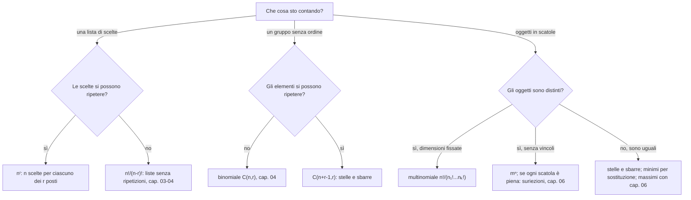

# Distribuzioni e ripetizioni

Prerequisiti: [[Books/Aritmetica-I/03 - Contare attraverso le funzioni|conteggi, biezioni e permutazioni]] e [[Books/Aritmetica-I/04 - Sottoinsiemi e coefficienti binomiali|coefficienti binomiali]]. Torna all’[[Books/Aritmetica-I/00 - Indice e piano di studio|indice e piano di studio]].

> [!info] In questo capitolo
> - Imparerai a dichiarare **che cosa distingue due risultati** (oggetti distinti o uguali, scatole con o senza nome) prima di scrivere qualunque formula.
> - Conterai gli anagrammi e le distribuzioni con dimensioni fissate: il coefficiente multinomiale.
> - Conterai le distribuzioni di oggetti uguali con la tecnica di stelle e sbarre, anche con vincoli inferiori.
> - Troverai in fondo la **mappa decisionale del conteggio**: un diagramma e due tabelle che riuniscono i capitoli 03–06 e dicono quale formula usare.
> - L'idea che lega il capitolo: ogni divisione e ogni sostituzione di variabili va giustificata con una corrispondenza precisa.

> [!note] Vocabolario che useremo
> **Molteplicità** di una lettera: quante volte compare in una parola. **Scatole etichettate**: scatole con un nome (A, B, C…), per cui scambiare i contenuti di due scatole dà un risultato diverso. **Suriettiva** (cap. [[Books/Aritmetica-I/03 - Contare attraverso le funzioni|03]]): ogni elemento del codominio è immagine di almeno un elemento. In questo capitolo $\mathbb N$ contiene lo zero.

## Domande per iniziare dagli esercizi

Prova prima gli esercizi indicati dalla domanda. Se ti manca uno strumento, apri soltanto la sezione collegata, poi torna al problema e ricostruisci il passaggio senza guardare. Per le prove, scrivi ipotesi, tesi e motivo di ogni implicazione. I riscontri sono raccolti dopo la teoria.

La tabella copre tutte le sezioni teoriche del capitolo, compresi casi limite e approfondimenti. Gli esercizi 1–8 conservano la numerazione originaria; dal 9 trovi le integrazioni. Gli esercizi tratti dal PDF fornito hanno un riferimento esplicito alla fonte; gli altri sono redazionali.

| Domanda guida | Esercizi da tentare | Teoria da recuperare |
|---|---|---|
| Quali oggetti o scatole restano distinguibili nel risultato? | [[#Esercizio 5 — Scatole indistinguibili (fibre di cardinalità non uniforme)\|5]], [[#Esercizio 9 — Contare attraverso le fibre (sovraconteggio uniforme, multinomiali e stelle e sbarre)\|9]], [[#Esercizio 10 — Squadre senza etichette (multinomiali e sovraconteggio uniforme)\|10]] | [[#Che cosa rende diverse due distribuzioni?\|Che cosa rende diverse due distribuzioni?]] |
| Quando ogni parola è stata contata lo stesso numero di volte? | [[#Esercizio 1 — Riordinare BANANA (anagrammi e multinomiali)\|1]], [[#Esercizio 7 — Molteplicità delle lettere (multinomiali con vincoli)\|7]], [[#Esercizio 9 — Contare attraverso le fibre (sovraconteggio uniforme, multinomiali e stelle e sbarre)\|9]], [[#Esercizio 10 — Squadre senza etichette (multinomiali e sovraconteggio uniforme)\|10]] | [[#Anagrammi: quando si può dividere\|Anagrammi: quando si può dividere]] |
| Che cosa cambia togliendo il nome a gruppi di uguale dimensione? | [[#Esercizio 2 — Dare un nome ai gruppi (gruppi etichettati e sovraconteggio uniforme)\|2]], [[#Esercizio 5 — Scatole indistinguibili (fibre di cardinalità non uniforme)\|5]], [[#Esercizio 9 — Contare attraverso le fibre (sovraconteggio uniforme, multinomiali e stelle e sbarre)\|9]], [[#Esercizio 10 — Squadre senza etichette (multinomiali e sovraconteggio uniforme)\|10]] | [[#Scatole etichettate e gruppi senza nome\|Scatole etichettate e gruppi senza nome]] |
| Qual è la biiezione, anche con scatole vuote, dietro stelle e sbarre? | [[#Esercizio 3 — Sette oggetti in quattro scatole (stelle e sbarre)\|3]], [[#Esercizio 6 — Una somma binomiale (doppio conteggio delle distribuzioni)\|6]], [[#Esercizio 8 — Misurare le distanze (stelle e sbarre e sequenze ordinate)\|8]], [[#Esercizio 9 — Contare attraverso le fibre (sovraconteggio uniforme, multinomiali e stelle e sbarre)\|9]] | [[#Stelle e sbarre: una biezione completa\|Stelle e sbarre: una biezione completa]] |
| Come assorbi positività e vincoli inferiori senza perdere soluzioni? | [[#Esercizio 3 — Sette oggetti in quattro scatole (stelle e sbarre)\|3]], [[#Esercizio 4 — Assorbire i vincoli inferiori (cambio di variabili e distribuzioni)\|4]], [[#Esercizio 7 — Molteplicità delle lettere (multinomiali con vincoli)\|7]], [[#Esercizio 8 — Misurare le distanze (stelle e sbarre e sequenze ordinate)\|8]], [[#Esercizio 9 — Contare attraverso le fibre (sovraconteggio uniforme, multinomiali e stelle e sbarre)\|9]] | [[#Porzioni positive e vincoli inferiori\|Porzioni positive e vincoli inferiori]] |
| Come trasformi una terna di somma fissata in un sottoinsieme? | [[#Esercizio 6 — Una somma binomiale (doppio conteggio delle distribuzioni)\|6]], [[#Esercizio 9 — Contare attraverso le fibre (sovraconteggio uniforme, multinomiali e stelle e sbarre)\|9]] | [[#Dalle terne ai sottoinsiemi: una somma uguale a cento\|Dalle terne ai sottoinsiemi: una somma uguale a cento]] |
| Come scegli il modello e controlli ogni divisione? | [[#Esercizio 9 — Contare attraverso le fibre (sovraconteggio uniforme, multinomiali e stelle e sbarre)\|9]], [[#Esercizio 10 — Squadre senza etichette (multinomiali e sovraconteggio uniforme)\|10]] | [[#Mappa decisionale del conteggio\|Mappa decisionale del conteggio]] |

## Esercizi per verificare la comprensione

Gli esercizi 1–6 allenano gli strumenti di base; 7–8 li collegano ad altri problemi. Le integrazioni successive completano il controllo della teoria; quelle dalla raccolta fornita sono segnalate con numero e pagina. Non serve riuscire subito: individua che cosa ti manca, studia il passaggio collegato e riprova.

### Esercizio 1 — Riordinare BANANA (anagrammi e multinomiali)

Quanti anagrammi distinti ha `BANANA`? Spiega anche come ottenere lo stesso numero scegliendo successivamente le posizioni delle lettere.

Se ti blocchi: [[#Anagrammi: quando si può dividere|Anagrammi: quando si può dividere]].

Controllo dopo il tentativo: [[#Riscontro 1|riscontro 1]].

### Esercizio 2 — Dare un nome ai gruppi (gruppi etichettati e sovraconteggio uniforme)

Otto studenti distinti vanno divisi in tre gruppi chiamati A, B e C, di dimensioni rispettivamente $3,3,2$. Quante assegnazioni ci sono? Quante divisioni rimangono se i due gruppi di tre non hanno nome e il gruppo di due è riconoscibile dalla dimensione?

Se ti blocchi: [[#Scatole etichettate e gruppi senza nome|Scatole etichettate e gruppi senza nome]].

Controllo dopo il tentativo: [[#Riscontro 2|riscontro 2]].

### Esercizio 3 — Sette oggetti in quattro scatole (stelle e sbarre)

Distribuisci sette oggetti uguali in quattro scatole etichettate. Conta le distribuzioni ammettendo scatole vuote e quelle in cui ogni scatola è nonvuota. Descrivi la sequenza di stelle e sbarre associata a $(0,2,1,4)$.

Se ti blocchi: [[#Stelle e sbarre: una biezione completa|Stelle e sbarre: una biezione completa]] · [[#Porzioni positive e vincoli inferiori|Porzioni positive e vincoli inferiori]].

Controllo dopo il tentativo: [[#Riscontro 3|riscontro 3]].

### Esercizio 4 — Assorbire i vincoli inferiori (cambio di variabili e distribuzioni)

Conta le soluzioni intere di $x_1+x_2+x_3+x_4=15$ soggette a $x_1\geq2$, $x_2\geq0$, $x_3\geq4$, $x_4\geq1$. Scrivi il cambio di variabili e la sua inversa.

Se ti blocchi: [[#Porzioni positive e vincoli inferiori|Porzioni positive e vincoli inferiori]].

Controllo dopo il tentativo: [[#Riscontro 4|riscontro 4]].

### Esercizio 5 — Scatole indistinguibili (fibre di cardinalità non uniforme)

Una studentessa conta le terne nonnegative di somma $4$, trova $15$ e divide per $3!$ per contare le distribuzioni di quattro oggetti uguali in tre scatole indistinguibili. Diagnostica l’errore e calcola il numero corretto, ammettendo scatole vuote.

Se ti blocchi: [[#Che cosa rende diverse due distribuzioni?|Che cosa rende diverse due distribuzioni?]] · [[#Scatole etichettate e gruppi senza nome|Scatole etichettate e gruppi senza nome]].

Controllo dopo il tentativo: [[#Riscontro 5|riscontro 5]].

### Esercizio 6 — Una somma binomiale (doppio conteggio delle distribuzioni)

Per $N\in\mathbb N$ e $r\in\mathbb N_{>0}$, dimostra contando soluzioni che

   $$\sum_{j=0}^{N}\binom{j+r-1}{r-1}=\binom{N+r}{r}.$$

Se ti blocchi: [[#Stelle e sbarre: una biezione completa|Stelle e sbarre: una biezione completa]] · [[#Dalle terne ai sottoinsiemi: una somma uguale a cento|Dalle terne ai sottoinsiemi: una somma uguale a cento]].

Controllo dopo il tentativo: [[#Riscontro 6|riscontro 6]].

### Esercizio 7 — Molteplicità delle lettere (multinomiali con vincoli)

Quante parole di lunghezza otto sull’alfabeto $\{a,b,c\}$ contengono ciascuna lettera almeno due volte? Non si richiede che siano parole italiane. Spiega perché contare soltanto i vettori delle molteplicità non risolve il problema.

Se ti blocchi: [[#Anagrammi: quando si può dividere|Anagrammi: quando si può dividere]] · [[#Porzioni positive e vincoli inferiori|Porzioni positive e vincoli inferiori]].

Controllo dopo il tentativo: [[#Riscontro 7|riscontro 7]].

### Esercizio 8 — Misurare le distanze (stelle e sbarre e sequenze ordinate)

Conta le terne intere $1\leq a\leq b\leq c\leq8$ usando variabili che misurino le distanze successive. Come cambia la risposta imponendo $a<b<c$?

Se ti blocchi: [[#Stelle e sbarre: una biezione completa|Stelle e sbarre: una biezione completa]] · [[#Porzioni positive e vincoli inferiori|Porzioni positive e vincoli inferiori]].

Controllo dopo il tentativo: [[#Riscontro 8|riscontro 8]].

### Esercizio 9 — Contare attraverso le fibre (sovraconteggio uniforme, multinomiali e stelle e sbarre)

Sia $f:X\to Y$ suriettiva fra insiemi finiti, con ogni fibra di $d>0$ elementi: dimostra $|X|=d|Y|$. Applica il risultato alle parole con molteplicità $n_1,\ldots,n_r$. Poi costruisci la biiezione completa fra $x_1+\cdots+x_r=N$, $x_i\ge0$, e stringhe di stelle e sbarre, includendo $N=0$ e $r=1$. Per terne positive di somma $100$, usa anche $(a,b,c)\mapsto\{a,a+b\}$ e scrivi l'inversa. Come decidi se l'ordine o il nome delle scatole distingue due risultati?

Se ti blocchi: [[#Che cosa rende diverse due distribuzioni?|Che cosa rende diverse due distribuzioni?]] · [[#Anagrammi: quando si può dividere|Anagrammi: quando si può dividere]] · [[#Scatole etichettate e gruppi senza nome|Scatole etichettate e gruppi senza nome]] · [[#Stelle e sbarre: una biezione completa|Stelle e sbarre: una biezione completa]] · [[#Porzioni positive e vincoli inferiori|Porzioni positive e vincoli inferiori]] · [[#Dalle terne ai sottoinsiemi: una somma uguale a cento|Dalle terne ai sottoinsiemi: una somma uguale a cento]] · [[#Mappa decisionale del conteggio|Mappa decisionale del conteggio]].

Controllo dopo il tentativo: [[#Riscontro 9|riscontro 9]].

### Esercizio 10 — Squadre senza etichette (multinomiali e sovraconteggio uniforme)

*Dalla raccolta fornita: esercizio 38, p. 73 stampata / [[Books/Aritmetica-I/Fonti/Esercizi algebra 1 2.pdf#page=83|p. 83 del PDF]]. Enunciato riformulato; riscontro redazionale.*

Fra $4n$ persone distinte, $n\ge1$, conta le divisioni in $n$ squadre di quattro senza nomi. Ripeti il conteggio quando ci sono $2n$ uomini e $2n$ donne e ogni squadra deve contenere due uomini e due donne. Spiega ogni fattoriale per cui dividi.

Se ti blocchi: [[#Che cosa rende diverse due distribuzioni?|Che cosa rende diverse due distribuzioni?]] · [[#Anagrammi: quando si può dividere|Anagrammi: quando si può dividere]] · [[#Scatole etichettate e gruppi senza nome|Scatole etichettate e gruppi senza nome]] · [[#Mappa decisionale del conteggio|Mappa decisionale del conteggio]].

Controllo dopo il tentativo: [[#Riscontro 10|riscontro 10]].

## Teoria da recuperare

Usa i collegamenti della tabella iniziale per leggere lo strumento che ti serve. Dopo la lettura, torna all’esercizio e prova a risolverlo senza suggerimenti.

## Che cosa rende diverse due distribuzioni?

Vogliamo distribuire sei biscotti a tre persone, Anna, Bruno e Carla. Prima di contare dobbiamo decidere quali differenze ci interessano. Se i biscotti sono tutti uguali, dare due biscotti a ciascuno descrive una sola distribuzione. Se invece ogni biscotto porta un nome diverso, sapere che ciascuno ne riceve due non basta: occorre sapere anche quali.

La stessa distinzione compare nelle parole. Scambiare due lettere diverse cambia una parola; scambiare le due `o` di `nonno` non produce una parola nuova. Il calcolo combinatorio deve rispettare esattamente le differenze che il problema considera visibili.

In questo capitolo incontreremo due mosse complementari. Per gli anagrammi, rendiamo provvisoriamente distinguibili copie uguali e poi controlliamo quante volte abbiamo contato ogni risultato. Per distribuire oggetti uguali, descriviamo invece direttamente le quantità assegnate ai destinatari. In entrambi i casi, la giustificazione viene da una corrispondenza precisa.

## Anagrammi: quando si può dividere

Le parole con lettere ripetute sono liste in cui l'ordine conta, ma scambiare due lettere uguali non produce una lista diversa. Il fattoriale conta quindi «troppo», e dobbiamo capire di quanto.

Un **anagramma** è qui una sequenza che usa tutte le lettere assegnate, con le loro molteplicità. Non chiediamo che formi una parola italiana.

> [!example] Esempi e controesempi — anagramma
> **È un anagramma di `nonno`:** `nonno` stesso, `onnon`, `nnnoo`: usano tutte le lettere, tre `n` e due `o`.
> **Non è un anagramma di `nonno`:** `nnoo` (viola «usa tutte le lettere»: manca una `n`); `nnnoa` (viola «con le loro molteplicità»: c'è una `a` al posto di una `o`).

Consideriamo `nonno`: ci sono tre `n` e due `o`. Diamo alle copie nomi provvisori,

$$
n_1,n_2,n_3,o_1,o_2.
$$

Ora i cinque oggetti sono distinti e si possono ordinare in $5!$ modi. Cancellando gli indici otteniamo gli anagrammi cercati, ma più ordinamenti producono lo stesso risultato. Fissiamo, per esempio, l’anagramma `nonno`. Le tre posizioni occupate dalle `n` possono ricevere gli indici $1,2,3$ in $3!$ modi; per ciascuna scelta, le due posizioni delle `o` possono ricevere i loro indici in $2!$ modi. Dunque questo anagramma proviene da $3!2!$ ordinamenti distinti.

Il punto decisivo è che il ragionamento vale per **ogni** anagramma: la disposizione delle lettere cambia, ma il numero delle posizioni di ciascun tipo resta lo stesso. Pertanto

$$
\#\{\text{anagrammi di nonno}\}
=\frac{5!}{3!2!}=\frac{120}{12}=10.
$$

Un controllo diverso consiste nello scegliere le due posizioni delle `o`: sono $\binom52=10$; tutte le altre posizioni devono contenere `n`.

Il principio usato merita una formulazione generale. Una funzione $f:E\to F$ è **suriettiva** se ogni elemento di $F$ è immagine di almeno un elemento di $E$. La **fibra** sopra $y\in F$ è l’insieme $f^{-1}(\{y\})$ degli elementi di $E$ che $f$ manda in $y$.

> [!abstract] Concetto chiave — Sovraconteggio uniforme
> Se $f:E\to F$ è suriettiva fra insiemi finiti e ogni fibra ha esattamente $q\geq1$ elementi, allora
> $$
> |E|=q|F|,\qquad |F|=\frac{|E|}{q}.
> $$
> È la giustificazione di ogni «conto troppo e divido». Torna negli anagrammi, nei gruppi senza nome e nelle suriezioni del [[Books/Aritmetica-I/06 - Inclusione ed esclusione|capitolo 06]].

Il motivo è questo: gli insiemi $f^{-1}(\{y\})$, al variare di $y\in F$, sono disgiunti, ricoprono $E$ e hanno tutti cardinalità $q$. Basta applicare il principio della somma. Nel nostro esempio $f$ cancella gli indici delle lettere.

> [!example] Esempi e controesempi — sovraconteggio uniforme
> **Si può dividere:** le liste ordinate di due lettere distinte scelte fra $\{a,b,c\}$ sono $3\cdot2=6$; dimenticando l’ordine, ogni coppia ha $2$ liste, quindi le coppie sono $6/2=3$.
> **Non si può dividere** quando le fibre hanno cardinalità diverse (viola «esattamente $q$ per ogni fibra»). Le liste di due lettere da $\{a,b\}$ sono $4$: $aa,ab,ba,bb$. Dimenticando l’ordine restano $3$ risultati ($\{a,a\},\{a,b\},\{b,b\}$) con fibre di cardinalità $1,2,1$; dividere $4/2=2$ sarebbe sbagliato.

> [!warning] Attenzione — Dividere richiede un sovraconteggio uniforme
> Non basta dire «l’ordine non conta» e dividere per un fattoriale. Occorre dimostrare che ogni oggetto finale ha lo stesso numero di rappresentazioni iniziali. Una terna con tre elementi distinti ha sei riordinamenti; una con due elementi uguali ne ha tre; una con tre elementi uguali ne ha uno.

Supponiamo ora di avere $k\geq1$ tipi di lettere, con molteplicità $n_1,\ldots,n_k\in\mathbb N$, e poniamo $n=n_1+\cdots+n_k$. Etichettando tutte le copie otteniamo $n!$ ordinamenti. Sopra ciascun anagramma ci sono esattamente

$$
n_1!\cdots n_k!
$$

ordinamenti etichettati: si possono assegnare gli indici alle posizioni del primo tipo in $n_1!$ modi, a quelle del secondo in $n_2!$ modi, e così via. Il numero cercato è quindi il **coefficiente multinomiale**:

> [!abstract] Concetto chiave — Coefficiente multinomiale
> Gli anagrammi di $n=n_1+\cdots+n_k$ lettere, con $n_i$ copie del tipo $i$, sono
> $$
> \binom{n}{n_1,\ldots,n_k}=\frac{n!}{n_1!\cdots n_k!}.
> $$
> Generalizza il coefficiente binomiale ($k=2$) e conta anche le assegnazioni di oggetti distinti a scatole etichettate con dimensioni fissate. Ritorna nei coefficienti dello sviluppo di $(a+b+c)^n$: ogni monomio $a^ib^jc^k$ compare con coefficiente $\binom{n}{i,j,k}$.

La convenzione $0!=1$ permette di includere tipi assenti. Se $n=0$, c’è un solo anagramma, la sequenza vuota, e la formula restituisce $1$.

> [!example] Esempi e controesempi — coefficiente multinomiale
> **Vale:** gli anagrammi di `MAMMA` sono $5!/(3!\,2!)=10$.
> **Non vale** se si omette una condizione: dividere per un solo fattoriale dà $5!/3!=20\neq10$ (si è ignorata la molteplicità delle `A`, cioè il fattore $2!$). E se tutte le lettere sono diverse, come in `LIBRO`, nessun fattoriale cancella nulla: le liste sono $5!=120$, perché ogni anagramma ha un solo ordinamento etichettato.

## Scatole etichettate e gruppi senza nome

Il multinomiale conta anche distribuzioni di **oggetti distinti** in scatole etichettate, quando il numero di oggetti in ogni scatola è fissato.

Sia $X=\{x_1,\ldots,x_n\}$. Vogliamo assegnare gli elementi a $k$ scatole, chiamate $1,\ldots,k$, in modo che la scatola $i$ contenga esattamente $n_i$ elementi. Equivalentemente cerchiamo liste $(X_1,\ldots,X_k)$ di sottoinsiemi disgiunti con unione $X$ e $|X_i|=n_i$. Ammettiamo scatole vuote se $n_i=0$.

Per costruire la corrispondenza con gli anagrammi, scriviamo nella posizione $j$ il simbolo $i$ se $x_j\in X_i$. La parola ottenuta ha esattamente $n_i$ copie del simbolo $i$. Viceversa, dalla parola recuperiamo la scatola di ogni $x_j$. Le due costruzioni si annullano a vicenda: abbiamo una biezione, dunque lo stesso multinomiale.

Per esempio, sei studenti distinti devono occupare tre laboratori chiamati A, B e C, con rispettivamente due, uno e tre studenti. Le assegnazioni sono

$$
\frac{6!}{2!1!3!}=60.
$$

Possiamo verificarlo scegliendo prima i due studenti di A, poi quello di B fra i quattro rimasti:

$$
\binom62\binom41=15\cdot4=60.
$$

In generale, scegliendo successivamente il contenuto delle scatole si ottiene

$$
\binom{n}{n_1}\binom{n-n_1}{n_2}\cdots
\binom{n-n_1-\cdots-n_{k-1}}{n_k}
=\frac{n!}{n_1!\cdots n_k!},
$$

perché i fattoriali intermedi si cancellano. Questo è anche un secondo modo di dimostrare la formula.

> [!example] Esempi e controesempi — scatole etichettate con dimensioni fissate
> **Vale:** sei studenti distinti nei laboratori A, B, C con $2,1,3$ posti: $60$ assegnazioni.
> **Non vale** quando cambia una condizione:
> - gli oggetti sono **uguali** (viola «oggetti distinti»): tre biscotti uguali nelle scatole A e B, con $2$ e $1$ biscotti, danno una sola distribuzione, mentre tre biscotti distinti ne danno $3!/(2!\,1!)=3$;
> - le dimensioni **non sono fissate** (viola «numero in ciascuna scatola assegnato»): sei studenti liberi di scegliere fra tre laboratori danno $3^6=729$ assegnazioni;
> - le scatole **non hanno nome**: due gruppi di due fra quattro persone sono $6/2!=3$, non $6$.

Se i gruppi non hanno nome, cambia l’oggetto da contare. Dividere quattro persone distinte in due coppie chiamate A e B dà $\binom42=6$ risultati. Se le coppie non hanno nome, ogni divisione è stata contata due volte: una per ciascun modo di dare i due nomi ai gruppi. Le divisioni sono quindi $6/2!=3$.

Non bisogna però dividere automaticamente per il numero delle scatole fattoriale. Se chiediamo un gruppo di tre persone e uno di una persona, la dimensione distingue già i due gruppi: scegliere la persona isolata dà quattro divisioni senza nome. Anche le assegnazioni con tre persone nella scatola A e una nella B sono quattro. Dimenticare i nomi, in questo particolare conteggio con dimensioni assegnate, non introduce una ripetizione.

> [!warning] Attenzione — Due distinzioni diverse
> «Oggetti uguali» e «scatole senza nome» sono condizioni separate. Stelle e sbarre conterà oggetti uguali in scatole etichettate. Non conterà automaticamente distribuzioni in scatole indistinguibili. Anche la presenza di scatole vuote può cambiare il numero di modi in cui si possono assegnare nomi ai gruppi visibili.

## Stelle e sbarre: una biezione completa

Se gli oggetti sono tutti uguali non c’è nulla da ordinare e gli anagrammi non servono: una distribuzione è determinata soltanto da **quanti** oggetti ricevono i destinatari. Contare le liste di quantità con somma fissata è il problema che risolve la tecnica di stelle e sbarre.

Torniamo ai biscotti tutti uguali. Fissiamo $r\geq1$ destinatari distinguibili e un totale $N\in\mathbb N$. Una distribuzione è determinata dalla lista delle quantità

$$
(x_1,\ldots,x_r)\in\mathbb N^r,
\qquad x_1+\cdots+x_r=N.
$$

Non contiamo quali biscotti vengono dati a ciascuno: una volta fissate le quantità, la distribuzione è determinata.

Rappresentiamo i biscotti con $N$ stelle e separiamo le porzioni con $r-1$ sbarre. Per esempio, con $N=6$ e $r=4$,

```text
**||***|*     corrisponde a     (2, 0, 3, 1).
```

La sbarra non rappresenta un biscotto: segna il passaggio al destinatario successivo. Sbarre consecutive significano una porzione vuota; una sbarra iniziale o finale indica una prima o ultima porzione vuota.

Definiamo precisamente le due direzioni della corrispondenza.

1. Data una soluzione $(x_1,\ldots,x_r)$, scriviamo nell’ordine $r$ blocchi, contenenti rispettivamente $x_1,\ldots,x_r$ stelle, e inseriamo una sbarra fra ogni due blocchi consecutivi. Otteniamo esattamente $N$ stelle e $r-1$ sbarre.
2. Data una sequenza di questi simboli, contiamo le stelle nei $r$ blocchi determinati dalle sbarre, inclusi quelli vuoti. Le quantità ottenute sono nonnegative e sommano a $N$.

Partendo da una soluzione e rileggendo i blocchi recuperiamo la soluzione iniziale. Partendo da una sequenza e riscrivendo i blocchi recuperiamo la sequenza iniziale. La corrispondenza è dunque biettiva.

Per contare le sequenze scegliamo quali $r-1$ posizioni, fra le $N+r-1$ disponibili, siano occupate dalle sbarre. Tutte le altre conterranno stelle. Pertanto

> [!abstract] Concetto chiave — Stelle e sbarre
> Il numero di soluzioni nonnegative di $x_1+\cdots+x_r=N$ è
> $$
> \#\{(x_1,\ldots,x_r)\in\mathbb N^r:x_1+\cdots+x_r=N\}=\binom{N+r-1}{r-1}.
> $$
> Conta oggetti **uguali** in scatole **etichettate**, anche vuote. Ritorna nelle equazioni con vincoli, nel conteggio delle terne dell’ultimo paragrafo e nei divisori del [[Books/Aritmetica-I/09 - Primi e fattorizzazione unica|capitolo 09]].

I casi estremi aiutano a capire la formula. Se $N=0$, la sola soluzione è $(0,\ldots,0)$ e la sola sequenza contiene tutte le sbarre consecutive: $\binom{r-1}{r-1}=1$. Se $r=1$, non occorrono sbarre: la sola soluzione è $x_1=N$, contata da $\binom N0=1$.

Per sei biscotti e tre persone, consentendo porzioni vuote, troviamo

$$
\binom{6+3-1}{3-1}=\binom82=28.
$$

> [!example] Esempi e controesempi — soluzione nonnegativa di una somma
> **È una distribuzione contata da $\binom{N+r-1}{r-1}$**, con $N=6$ e $r=3$: $(2,0,4)$, $(0,0,6)$, $(1,3,2)$.
> **Non lo è**, e ciascun esempio viola una condizione:
> - $(-1,3,4)$: un valore è negativo (non appartiene a $\mathbb N^3$);
> - $(2,2,3)$: la somma è $7$, non $6$;
> - i sei biscotti sono **tutti diversi**: allora non contano le quantità ma anche quali biscotti, e le assegnazioni sono $3^6=729$, non $28$;
> - le tre persone **non si distinguono**: $(6,0,0)$, $(0,6,0)$ e $(0,0,6)$ sarebbero la stessa distribuzione.

## Porzioni positive e vincoli inferiori

Se ogni persona deve ricevere almeno un biscotto, poniamo

$$
y_i=x_i-1.
$$

Questa scelta sottrae la dotazione minima obbligatoria a ciascun destinatario. Le nuove variabili sono nonnegative e soddisfano

$$
y_1+\cdots+y_r=N-r.
$$

Viceversa, ogni soluzione nonnegativa di questa equazione restituisce una soluzione positiva ponendo $x_i=y_i+1$. Abbiamo di nuovo una biezione. Se $N\geq r$, il numero è

$$
\binom{(N-r)+r-1}{r-1}=\boxed{\binom{N-1}{r-1}}.
$$

Se $N<r$, non ci sono soluzioni positive: la somma di $r$ interi almeno uguali a $1$ è almeno $r$. In particolare, per $N=0$ il risultato è zero; non occorre usare coefficienti binomiali con indice superiore negativo.

Nel caso di sei biscotti a tre persone con porzioni positive otteniamo $\binom52=10$, anziché $28$. L’errore tipico è applicare la formula $\binom{N+r-1}{r-1}$ senza prima sottrarre la dotazione minima: si contano anche le distribuzioni in cui qualcuno riceve zero biscotti, che il vincolo esclude.

La stessa idea tratta minimi diversi. Fissiamo $b_1,\ldots,b_r\in\mathbb N$ e imponiamo $x_i\geq b_i$. Posto $B=b_1+\cdots+b_r$, la sostituzione

$$
y_i=x_i-b_i
$$

trasforma il problema in $y_i\geq0$ e $\sum_i y_i=N-B$. Perciò il numero di soluzioni è zero se $N<B$ e, altrimenti, è

$$
\boxed{\binom{N-B+r-1}{r-1}}.
$$

Per esempio, distribuiamo dodici gettoni uguali in quattro scatole etichettate, con minimi rispettivamente $1,2,0,3$. I minimi assorbono sei gettoni. Scrivendo

$$
(y_1,y_2,y_3,y_4)=(x_1-1,x_2-2,x_3,x_4-3)
$$

restano sei gettoni da distribuire liberamente. Le possibilità sono $\binom93=84$. Non abbiamo eliminato il vincolo: lo abbiamo incorporato nella scelta delle variabili.

Un limite superiore si può talvolta trattare con una sottrazione: contiamo tutte le soluzioni senza il limite e togliamo quelle che lo violano (nel capitolo 06 chiameremo «complementare» l’insieme di ciò che resta fuori da una proprietà). Quante terne nonnegative sommano a $10$ e soddisfano $x_1\leq3$? Senza il limite sono $\binom{12}2=66$. Quelle vietate hanno $x_1\geq4$: sottraendo quattro alla prima variabile diventano terne nonnegative di somma $6$, dunque sono $\binom82=28$. Il risultato è

$$
66-28=38.
$$

Con più limiti superiori gli insiemi da escludere possono sovrapporsi; il [[Books/Aritmetica-I/06 - Inclusione ed esclusione|capitolo 06]] svilupperà il metodo che controlla tali sovrapposizioni.

## Dalle terne ai sottoinsiemi: una somma uguale a cento

Contiamo i sottoinsiemi di tre interi positivi la cui somma è $100$. Un sottoinsieme ha elementi distinti e non possiede un ordine. Conviene iniziare dalle terne ordinate positive

$$
a+b+c=100.
$$

Stelle e sbarre le conta in $\binom{99}2=4851$ modi. Prima di dimenticare l’ordine, eliminiamo però le terne con ripetizioni.

Se $a=b$, la condizione diventa $2a+c=100$. Si può scegliere $a$ fra $1$ e $49$; per ogni scelta $c=100-2a$ è determinato e positivo. Abbiamo $49$ terne. Anche i casi $a=c$ e $b=c$ ne danno $49$ ciascuno.

Questi tre casi sono disgiunti: soddisfare due delle uguaglianze costringerebbe ad avere $a=b=c$, dunque $3a=100$, impossibile negli interi. Possiamo quindi sottrarre la somma dei tre conteggi. Le terne con elementi a due a due distinti sono

$$
4851-3\cdot49=4704.
$$

Adesso ciascun sottoinsieme di tre elementi ha esattamente $3!=6$ ordinamenti. Il sovraconteggio è uniforme, perciò la risposta è

$$
\boxed{\frac{4704}{6}=784.}
$$

La divisione per $6$ sarebbe stata ingiustificata prima di eliminare le ripetizioni. Anche la sottrazione richiede una verifica: con somma $99$ esisterebbe la terna $(33,33,33)$, appartenente a tutti e tre i casi vietati, che non sarebbero più disgiunti.

## Mappa decisionale del conteggio

Davanti a un problema non cercare subito la formula. Chiediti che cosa è un singolo risultato e quali differenze fra due risultati sono visibili. Il diagramma ordina le domande: scegli il ramo che descrive il tuo problema e leggi in fondo la formula e il capitolo dove è dimostrata.



La tabella seguente è una versione semplificata del cosiddetta «via dei dodici modi» (in inglese *twelvefold way*) per contare. Mette in colonna le tre condizioni più comuni su una distribuzione di $n$ oggetti in $m$ scatole. Nelle celle c’è la formula e, dopo il segno $=$, il valore per $n=4$ oggetti e $m=3$ scatole, così puoi controllare di avere letto bene la riga. Qui $S(n,m)$ è il numero di suriezioni da $n$ a $m$ elementi, definito nel [[Books/Aritmetica-I/06 - Inclusione ed esclusione|capitolo 06]].

| Oggetti | Scatole | Nessun vincolo | Al più un oggetto per scatola | Almeno un oggetto per scatola |
|---|---|---|---|---|
| distinti | etichettate | $m^n=81$ | $m(m-1)\cdots(m-n+1)=0$ (un fattore è nullo se $n>m$) | $S(n,m)=36$ |
| uguali | etichettate | $\binom{n+m-1}{m-1}=15$ | $\binom mn=0$ (zero se $n>m$) | $\binom{n-1}{m-1}=3$ |
| distinti | senza nome | si somma sul numero di scatole piene: $1+7+6=14$ | $1$ se $n\leq m$, altrimenti $0$ | $S(n,m)/m!=6$ |
| uguali | senza nome | partizioni di $n$ in al più $m$ parti: $4$ | $1$ se $n\leq m$, altrimenti $0$ | partizioni di $n$ in esattamente $m$ parti: $1$ |

Le prime due righe hanno formule chiuse. Nelle ultime due si divide o si elenca. Dividere per $m!$ nella riga «distinti, senza nome, tutte piene» è lecito perché, con ogni scatola non vuota, i $m!$ modi di dare nomi alle scatole producono suriezioni sempre diverse (sovraconteggio uniforme). Nella riga degli oggetti uguali non esiste una divisione uniforme: per $n=4$ e tre scatole, $(4,0,0)$ ha tre riordinamenti ma $(3,1,0)$ ne ha sei (esercizio 5), e si elencano le partizioni. Nella letteratura il numero $S(n,m)/m!$ si chiama numero di Stirling di seconda specie.

Le stesse quattro idee si traducono nei nomi classici per le scelte di $r$ elementi fra $n$ tipi:

| L’ordine conta? | Ripetizioni? | Nome classico | Quanti sono |
|---|---|---|---|
| sì | no | disposizioni semplici | $n!/(n-r)!$ |
| sì | sì | disposizioni con ripetizione | $n^r$ |
| no | no | combinazioni | $\binom nr$ |
| no | sì | combinazioni con ripetizione | $\binom{n+r-1}{r}$ |

Le liste in cui alcuni elementi sono uguali (gli anagrammi) richiedono un terzo ingrediente, i multinomiali.

**Esempi di lettura.** Per ciascun problema indica il ramo del diagramma e controlla il numero.

| Problema | Ramo | Risposta |
|---|---|---|
| PIN di quattro cifre | lista, ripetizioni ammesse | $10^4=10000$ |
| Comitato di $3$ persone fra $10$ | gruppo, senza ripetizioni | $\binom{10}3=120$ |
| Otto gelati scegliendo fra $5$ gusti (si può ripetere un gusto) | gruppo, con ripetizioni | $\binom{12}4=495$ |
| Anagrammi di `MAMMA` | oggetti con molteplicità | $5!/(3!\,2!)=10$ |
| Sei studenti distinti in tre aule, nessuna vuota | oggetti distinti, ogni scatola piena | $S(6,3)=540$ |

Il collegamento con i capitoli precedenti e successivi è questo: il capitolo [[Books/Aritmetica-I/04 - Sottoinsiemi e coefficienti binomiali|04]] costruisce la riga dei sottoinsiemi, questo capitolo le righe con oggetti uguali e dimensioni fissate, il [[Books/Aritmetica-I/06 - Inclusione ed esclusione|capitolo 06]] la colonna delle suriezioni e i limiti superiori.

## Fonti

Il punto di partenza per anagrammi, multinomiali e distribuzioni con cardinalità fissate è la [[Notes/Aritmetica/Lectures/2026-10-06 - Conteggio combinatorio e principio di inclusione-esclusione|nota del 6 ottobre]], verificata nelle parti pertinenti della [[_transcripts/Aritmetica/2026-10-06 - Conteggio combinatorio e principio di inclusione-esclusione|trascrizione del 6 ottobre]]. L’esempio `nonno` e il collegamento fra anagrammi e suddivisioni di un insieme compaiono nella trascrizione.

Per stelle e sbarre e per il conteggio dei sottoinsiemi di somma $100$ sono state consultate la [[Notes/Aritmetica/Lectures/2026-10-13 - Divisori, algoritmo di Euclide e conteggio combinatorio|nota del 13 ottobre]] e le parti combinatorie della [[_transcripts/Aritmetica/2026-10-13 - Divisori, algoritmo di Euclide e conteggio combinatorio|trascrizione del 13 ottobre]]. La biezione generale con le sue due inverse, i casi estremi, la distinzione fra scatole etichettate e gruppi senza nome e gli ulteriori esempi ed esercizi sono completamenti didattici di questa esposizione. L’applicazione alle terne di prodotto $2000$, presente nelle fonti, viene sviluppata nel [[Books/Aritmetica-I/09 - Primi e fattorizzazione unica|capitolo 09]], dopo la prova della fattorizzazione unica.

## Riscontri degli esercizi

Apri il riscontro soltanto dopo aver scritto un tentativo. Per una dimostrazione, confronta anche le ipotesi e la completezza, non soltanto il risultato.

### Riscontro 1

> [!tip]- Riscontro 1
> Ci sono tre A, due N e una B: $6!/(3!2!1!)=60$. Scegliendo le tre posizioni delle A e poi le due delle N fra le tre rimaste si ottiene $\binom63\binom32=20\cdot3=60$; la posizione della B è obbligata.

Torna a [[#Esercizio 1 — Riordinare BANANA (anagrammi e multinomiali)|esercizio 1]].

### Riscontro 2

> [!tip]- Riscontro 2
> Con i nomi: $8!/(3!3!2!)=560$. Dimenticando i nomi dei due gruppi di tre, ciascuna divisione ha esattamente due rappresentazioni, ottenute scambiando A e B. Si ottengono $560/2=280$ divisioni. Il gruppo di due non può essere scambiato con un gruppo di tre mantenendo le dimensioni prescritte.

Torna a [[#Esercizio 2 — Dare un nome ai gruppi (gruppi etichettati e sovraconteggio uniforme)|esercizio 2]].

### Riscontro 3

> [!tip]- Riscontro 3
> Nel primo caso $\binom{10}3=120$; nel secondo $\binom63=20$, dopo aver assegnato un oggetto a ogni scatola. La sequenza richiesta è `|**|*|****`: sette stelle e tre sbarre.

Torna a [[#Esercizio 3 — Sette oggetti in quattro scatole (stelle e sbarre)|esercizio 3]].

### Riscontro 4

> [!tip]- Riscontro 4
> Poni $(y_1,y_2,y_3,y_4)=(x_1-2,x_2,x_3-4,x_4-1)$. Allora $y_i\geq0$ e la somma è $15-7=8$. Le soluzioni sono $\binom{11}3=165$. L’inversa aggiunge rispettivamente $2,0,4,1$; questo verifica che non si perdono né si aggiungono soluzioni.

Torna a [[#Esercizio 4 — Assorbire i vincoli inferiori (cambio di variabili e distribuzioni)|esercizio 4]].

### Riscontro 5

> [!tip]- Riscontro 5
> Le molteplicità dei riordinamenti non sono uguali: $(4,0,0)$ ne ha tre, $(3,1,0)$ sei. Le distribuzioni si rappresentano in modo unico ordinando le quantità in senso decrescente: $(4,0,0)$, $(3,1,0)$, $(2,2,0)$, $(2,1,1)$. Sono quindi quattro. I rispettivi numeri di terne ordinate sono $3,6,3,3$, la cui somma è $15$.

Torna a [[#Esercizio 5 — Scatole indistinguibili (fibre di cardinalità non uniforme)|esercizio 5]].

### Riscontro 6

> [!tip]- Riscontro 6
> Conta le soluzioni nonnegative di $x_1+\cdots+x_r+t=N$. Stelle e sbarre dà il membro destro, perché ci sono $r+1$ variabili. Se la somma delle prime $r$ è $j$, allora $t=N-j$ è obbligato e le prime variabili si scelgono in $\binom{j+r-1}{r-1}$ modi. I casi $j=0,\ldots,N$ sono disgiunti ed esaustivi: sommandoli ottieni il membro sinistro.

Torna a [[#Esercizio 6 — Una somma binomiale (doppio conteggio delle distribuzioni)|esercizio 6]].

### Riscontro 7

> [!tip]- Riscontro 7
> Dopo aver riservato due copie per lettera, rimangono due copie da assegnare. Le molteplicità hanno forma $(4,2,2)$, in tre modi, oppure $(3,3,2)$, in tre modi. Per ciascun vettore bisogna contare le parole corrispondenti. Il totale è
> $$3\frac{8!}{4!2!2!}+3\frac{8!}{3!3!2!}=1260+1680=2940.$$
> I sei vettori descrivono quantità di lettere; ciascuno corrisponde a molte sequenze, con numeri diversi nei due casi.

Torna a [[#Esercizio 7 — Molteplicità delle lettere (multinomiali con vincoli)|esercizio 7]].

### Riscontro 8

> [!tip]- Riscontro 8
> Poni $d_1=a-1$, $d_2=b-a$, $d_3=c-b$, $d_4=8-c$. Sono nonnegative e sommano a $7$. Viceversa una tale quadrupla ricostruisce $a=d_1+1$, $b=d_1+d_2+1$, $c=d_1+d_2+d_3+1$; la quarta variabile garantisce $c\leq8$. Le terne sono dunque $\binom{10}3=120$. Per disuguaglianze strette richiedi $d_2,d_3\geq1$: sottrai uno da ciascuna e ottieni somma $5$, quindi $\binom83=56$. Il secondo numero coincide con la scelta di un sottoinsieme di tre elementi fra otto.

Torna a [[#Esercizio 8 — Misurare le distanze (stelle e sbarre e sequenze ordinate)|esercizio 8]].

### Riscontro 9

> [!tip]- Riscontro 9
> Le fibre sono disgiunte e ricoprono $X$, quindi la somma delle loro cardinalità è $d|Y|$. Etichettando temporaneamente le copie di ogni lettera, ciascuna parola ha $\prod_i n_i!$ antecedenti: il numero è $(\sum_i n_i)!/\prod_i n_i!$. I blocchi di stelle separati da $r-1$ sbarre registrano e ricostruiscono ogni $x_i$, anche nullo: $\binom{N+r-1}{r-1}$. Per $N=0$ o $r=1$ c'è una sola distribuzione. Alle terne positive corrispondono $1\le u<v\le99$, con inversa $(u,v-u,100-v)$, dunque $\binom{99}{2}$. Scambiare due scatole etichettate cambia l'assegnazione; per scatole senza nome occorre controllare quante descrizioni rappresentano ogni risultato prima di dividere.

Torna a [[#Esercizio 9 — Contare attraverso le fibre (sovraconteggio uniforme, multinomiali e stelle e sbarre)|esercizio 9]].

### Riscontro 10

> [!tip]- Riscontro 10
> Ordinando tutte le persone e tagliando in blocchi di quattro, ogni divisione compare $(4!)^n n!$ volte: il numero è $(4n)!/[(4!)^n n!]$. Con il vincolo, suddividi prima gli uomini in coppie senza nome: $(2n)!/[(2!)^n n!]$; alle coppie ormai distinte assegna coppie di donne in $(2n)!/(2!)^n$ modi. Risultato $((2n)!)^2/[(2!)^{2n}n!]$. Non si divide una seconda volta per $n!$: l'assegnazione delle coppie di donne ha già scelto gli abbinamenti.

Torna a [[#Esercizio 10 — Squadre senza etichette (multinomiali e sovraconteggio uniforme)|esercizio 10]].

Hai acquisito il metodo quando sai dichiarare che cosa distingue due risultati, costruire entrambe le direzioni della corrispondenza usata e giustificare ogni divisione con un numero uniforme di rappresentazioni. Prova in particolare a spiegare perché lo stesso insieme di quantità può descrivere una sola distribuzione di oggetti uguali e molti anagrammi.

---

[[Books/Aritmetica-I/04 - Sottoinsiemi e coefficienti binomiali|← 04 · Sottoinsiemi e coefficienti binomiali]] · [[Books/Aritmetica-I/00 - Indice e piano di studio|Indice]] · [[Books/Aritmetica-I/06 - Inclusione ed esclusione|06 · Inclusione ed esclusione →]]
