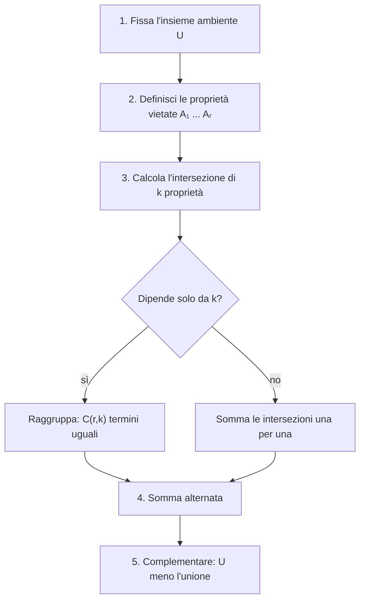

# Inclusione ed esclusione

Prerequisiti: [[Books/Aritmetica-I/03 - Contare attraverso le funzioni|cardinalità e conteggio delle funzioni]] e [[Books/Aritmetica-I/04 - Sottoinsiemi e coefficienti binomiali|coefficienti binomiali e binomio di Newton]]. Torna all'[[Books/Aritmetica-I/00 - Indice e piano di studio|indice del libro]].

> [!info] In questo capitolo
> - Imparerai a contare unioni di insiemi che si sovrappongono senza contare due volte lo stesso elemento.
> - Vedrai perché i segni alternano, seguendo il contributo di un singolo elemento: una dimostrazione che vale per qualunque numero di insiemi.
> - Conterai le funzioni suriettive, cioè le assegnazioni in cui nessuna scatola resta vuota.
> - Troverai uno schema per impostare ogni problema e un esempio che mostra cosa succede se si dimentica un termine.
> - Per decidere se un problema richiede questo metodo, usa la [[Books/Aritmetica-I/05 - Distribuzioni e ripetizioni#Mappa decisionale del conteggio|mappa decisionale del capitolo 05]].

> [!note] Notazione insiemistica
> Per due insiemi $A,B$: $A\cup B$ (unione) contiene gli elementi che stanno in almeno uno dei due; $A\cap B$ (intersezione) quelli che stanno in entrambi; $A\setminus B$ quelli di $A$ che non sono in $B$. Due insiemi sono **disgiunti** se $A\cap B=\varnothing$. In tutto il capitolo fissiamo un insieme finito $U$, l'**insieme ambiente**, che contiene tutto ciò che stiamo considerando. Rivedi il [[Books/Aritmetica-I/01 - Il linguaggio delle dimostrazioni|capitolo 01]] se serve.

## Domande per iniziare dagli esercizi

Prova prima gli esercizi indicati dalla domanda. Se ti manca uno strumento, apri soltanto la sezione collegata, poi torna al problema e ricostruisci il passaggio senza guardare. Per le prove, scrivi ipotesi, tesi e motivo di ogni implicazione. I riscontri sono raccolti dopo la teoria.

La tabella copre tutte le sezioni teoriche del capitolo, compresi casi limite e approfondimenti. Gli esercizi 1–8 conservano la numerazione originaria; dal 9 trovi le integrazioni. Gli esercizi tratti dal PDF fornito hanno un riferimento esplicito alla fonte; gli altri sono redazionali.

| Domanda guida | Esercizi da tentare | Teoria da recuperare |
|---|---|---|
| Come correggi una somma che conta più volte gli stessi elementi? | [[#Esercizio 1 — Multipli che si sovrappongono (inclusione-esclusione per due insiemi)\|1]], [[#Esercizio 2 — Tre insiemi di persone (inclusione-esclusione per tre insiemi)\|2]], [[#Esercizio 8 — Nessuno al proprio posto (inclusione-esclusione sulle permutazioni)\|8]], [[#Esercizio 9 — Perché i segni si alternano (funzioni caratteristiche e dimostrazione di inclusione-esclusione)\|9]], [[#Esercizio 10 — Nessun punto fisso per qualunque dimensione (formula generale di inclusione-esclusione)\|10]] | [[#Quando una somma conta troppo\|Quando una somma conta troppo]] |
| Come trasformi appartenenza e differenza in prodotti di zero e uno? | [[#Esercizio 3 — Appartenenza come numero (funzioni caratteristiche)\|3]], [[#Esercizio 9 — Perché i segni si alternano (funzioni caratteristiche e dimostrazione di inclusione-esclusione)\|9]], [[#Esercizio 10 — Nessun punto fisso per qualunque dimensione (formula generale di inclusione-esclusione)\|10]] | [[#Trasformare l'appartenenza in un numero\|Trasformare l'appartenenza in un numero]] |
| Perché un elemento nell’unione deve contribuire esattamente uno? | [[#Esercizio 2 — Tre insiemi di persone (inclusione-esclusione per tre insiemi)\|2]], [[#Esercizio 4 — Il termine dimenticato (contributo di un elemento)\|4]], [[#Esercizio 8 — Nessuno al proprio posto (inclusione-esclusione sulle permutazioni)\|8]], [[#Esercizio 9 — Perché i segni si alternano (funzioni caratteristiche e dimostrazione di inclusione-esclusione)\|9]], [[#Esercizio 10 — Nessun punto fisso per qualunque dimensione (formula generale di inclusione-esclusione)\|10]] | [[#La formula generale e il contributo di un elemento\|La formula generale e il contributo di un elemento]] |
| Come scegli ambiente ed eventi vietati prima di fare i conti? | [[#Esercizio 1 — Multipli che si sovrappongono (inclusione-esclusione per due insiemi)\|1]], [[#Esercizio 8 — Nessuno al proprio posto (inclusione-esclusione sulle permutazioni)\|8]], [[#Esercizio 9 — Perché i segni si alternano (funzioni caratteristiche e dimostrazione di inclusione-esclusione)\|9]], [[#Esercizio 10 — Nessun punto fisso per qualunque dimensione (formula generale di inclusione-esclusione)\|10]] | [[#Come impostare un problema\|Come impostare un problema]] |
| Come conti le funzioni che raggiungono ogni valore? | [[#Esercizio 5 — Raggiungere ogni valore (conteggio delle suriezioni e casi vuoti)\|5]], [[#Esercizio 7 — Una somma che vale un fattoriale (suriezioni e doppio conteggio)\|7]], [[#Esercizio 9 — Perché i segni si alternano (funzioni caratteristiche e dimostrazione di inclusione-esclusione)\|9]] | [[#Suriezioni: vietare che manchi un valore\|Suriezioni: vietare che manchi un valore]] |
| Come conti direttamente una suriezione con una sola fibra doppia? | [[#Esercizio 6 — Una sola fibra doppia (suriezioni su un codominio con un elemento in meno)\|6]] | [[#Un caso leggibile senza una somma alternata\|Un caso leggibile senza una somma alternata]] |

## Esercizi per verificare la comprensione

Gli esercizi 1–6 allenano gli strumenti di base; 7–8 li collegano ad altri problemi. Le integrazioni successive completano il controllo della teoria; quelle dalla raccolta fornita sono segnalate con numero e pagina. Non serve riuscire subito: individua che cosa ti manca, studia il passaggio collegato e riprova.

### Esercizio 1 — Multipli che si sovrappongono (inclusione-esclusione per due insiemi)

Fra gli interi di $\{1,\ldots,60\}$, quanti sono divisibili per $3$ oppure per $5$? Quanti non sono divisibili per nessuno dei due? Quanti sono divisibili per esattamente uno dei due?

Se ti blocchi: [[#Quando una somma conta troppo|Quando una somma conta troppo]] · [[#Come impostare un problema|Come impostare un problema]].

Controllo dopo il tentativo: [[#Riscontro 1|riscontro 1]].

### Esercizio 2 — Tre insiemi di persone (inclusione-esclusione per tre insiemi)

In un insieme $U$ di $36$ persone, tre sottoinsiemi $A,B,C$ hanno cardinalità $20,18,12$. Si sa che $|A\cap B|=9$, $|A\cap C|=6$, $|B\cap C|=5$ e $|A\cap B\cap C|=3$. Quante persone appartengono ad almeno uno dei tre insiemi? Quante a nessuno?

Se ti blocchi: [[#Quando una somma conta troppo|Quando una somma conta troppo]] · [[#La formula generale e il contributo di un elemento|La formula generale e il contributo di un elemento]].

Controllo dopo il tentativo: [[#Riscontro 2|riscontro 2]].

### Esercizio 3 — Appartenenza come numero (funzioni caratteristiche)

Siano $A,B\subseteq U$ con $U$ finito. Dimostra l'identità $\chi_{A\setminus B}=\chi_A(1-\chi_B)$ e ricavane una formula per $|A\setminus B|$.

Se ti blocchi: [[#Trasformare l'appartenenza in un numero|Trasformare l'appartenenza in un numero]].

Controllo dopo il tentativo: [[#Riscontro 3|riscontro 3]].

### Esercizio 4 — Il termine dimenticato (contributo di un elemento)

Un lettore propone la formula $|A\cup B\cup C|=|A|+|B|+|C|-|A\cap B|-|A\cap C|-|B\cap C|$. Trova un controesempio con un insieme ambiente di un solo elemento e spiega quale contributo è sbagliato.

Se ti blocchi: [[#La formula generale e il contributo di un elemento|La formula generale e il contributo di un elemento]].

Controllo dopo il tentativo: [[#Riscontro 4|riscontro 4]].

### Esercizio 5 — Raggiungere ogni valore (conteggio delle suriezioni e casi vuoti)

Conta le suriezioni da un insieme di $4$ elementi a uno di $2$, e da un insieme di $2$ elementi a uno di $4$. Determina inoltre i numeri di suriezioni $\varnothing\to\{a\}$, $\{a\}\to\varnothing$ e $\varnothing\to\varnothing$.

Se ti blocchi: [[#Suriezioni: vietare che manchi un valore|Suriezioni: vietare che manchi un valore]].

Controllo dopo il tentativo: [[#Riscontro 5|riscontro 5]].

### Esercizio 6 — Una sola fibra doppia (suriezioni su un codominio con un elemento in meno)

Conta le suriezioni $[6]\to[5]$. Uno studente sceglie la coppia con immagine comune in $6\cdot5$ modi e moltiplica per $5!$. Perché il suo risultato è doppio di quello corretto?

Se ti blocchi: [[#Un caso leggibile senza una somma alternata|Un caso leggibile senza una somma alternata]].

Controllo dopo il tentativo: [[#Riscontro 6|riscontro 6]].

### Esercizio 7 — Una somma che vale un fattoriale (suriezioni e doppio conteggio)

Per ogni $n\geq1$, dimostra con un doppio conteggio che $\sum_{k=0}^n(-1)^k\binom nk(n-k)^n=n!$. Specifica la famiglia contata e perché il conteggio diretto dà proprio un fattoriale.

Se ti blocchi: [[#Suriezioni: vietare che manchi un valore|Suriezioni: vietare che manchi un valore]].

Controllo dopo il tentativo: [[#Riscontro 7|riscontro 7]].

### Esercizio 8 — Nessuno al proprio posto (inclusione-esclusione sulle permutazioni)

Cinque persone riconoscibili devono sedere su cinque sedie numerate, una per sedia. La persona $i$ non può occupare la sedia $i$, per $i\in[5]$. Conta le sistemazioni consentite usando inclusione-esclusione. Qual è l'insieme ambiente? Per $0\leq k\leq5$, quante sistemazioni violano simultaneamente un gruppo fissato di $k$ divieti?

Se ti blocchi: [[#Quando una somma conta troppo|Quando una somma conta troppo]] · [[#La formula generale e il contributo di un elemento|La formula generale e il contributo di un elemento]] · [[#Come impostare un problema|Come impostare un problema]].

Controllo dopo il tentativo: [[#Riscontro 8|riscontro 8]].

### Esercizio 9 — Perché i segni si alternano (funzioni caratteristiche e dimostrazione di inclusione-esclusione)

Per una famiglia finita $A_1,\ldots,A_r\subseteq U$ con $U$ finito, scrivi $\chi_{\cup_i A_i}=1-\prod_i(1-\chi_{A_i})$ e sviluppala. Se $x$ sta in esattamente $t\ge1$ insiemi, mostra che il suo contributo è $\sum_{j=1}^t(-1)^{j+1}\binom tj=1$; tratta anche $t=0$. Sommando su $U$, ricava la formula generale. Applica poi lo stesso metodo agli eventi «il valore $i$ non è raggiunto» per ottenere la formula generale delle suriezioni $[n]\to[m]$.

Se ti blocchi: [[#Quando una somma conta troppo|Quando una somma conta troppo]] · [[#Trasformare l'appartenenza in un numero|Trasformare l'appartenenza in un numero]] · [[#La formula generale e il contributo di un elemento|La formula generale e il contributo di un elemento]] · [[#Come impostare un problema|Come impostare un problema]] · [[#Suriezioni: vietare che manchi un valore|Suriezioni: vietare che manchi un valore]].

Controllo dopo il tentativo: [[#Riscontro 9|riscontro 9]].

### Esercizio 10 — Nessun punto fisso per qualunque dimensione (formula generale di inclusione-esclusione)

*Dalla raccolta fornita: esercizio preliminare 2, p. 52 stampata / [[Books/Aritmetica-I/Fonti/Esercizi algebra 1 2.pdf#page=63|p. 63 del PDF]]. Enunciato riformulato; riscontro redazionale.*

Generalizza l'esercizio delle cinque sedie: per $n\ge0$ trova il numero $D_n$ di permutazioni di $[n]$ che non fissano alcun elemento. Scrivi l'insieme ambiente e la cardinalità dell'intersezione di $k$ divieti fissati; ricava una formula finita e controlla $n=0,1,2,5$.

Se ti blocchi: [[#Quando una somma conta troppo|Quando una somma conta troppo]] · [[#Trasformare l'appartenenza in un numero|Trasformare l'appartenenza in un numero]] · [[#La formula generale e il contributo di un elemento|La formula generale e il contributo di un elemento]] · [[#Come impostare un problema|Come impostare un problema]].

Controllo dopo il tentativo: [[#Riscontro 10|riscontro 10]].

## Teoria da recuperare

Usa i collegamenti della tabella iniziale per leggere lo strumento che ti serve. Dopo la lettura, torna all’esercizio e prova a risolverlo senza suggerimenti.

## Quando una somma conta troppo

Quanti interi da $1$ a $100$ sono divisibili per $3$ oppure per $5$? I multipli di $3$ sono $33$, quelli di $5$ sono $20$. Sommando otteniamo $53$, ma il numero $15$ compare in entrambi gli elenchi, come $30$, $45$, $60$, $75$ e $90$. Questi sei numeri sono stati contati due volte.

Per conservare una sola copia di ciascuno basta sottrarre una volta i numeri comuni:

$$
33+20-6=47.
$$

Il problema non dipende dalla divisibilità. Se due elenchi descrivono proprietà che possono verificarsi contemporaneamente, sommare le loro lunghezze produce ripetizioni. Il **principio di inclusione-esclusione** corregge queste ripetizioni, anche quando le proprietà sono molte.

Siano $A,B$ sottoinsiemi di un insieme finito $U$. Le tre regioni $A\setminus B$, $A\cap B$ e $B\setminus A$ sono disgiunte e ricoprono $A\cup B$. Nella somma $|A|+|B|$ la regione centrale compare due volte, mentre le altre compaiono una sola volta. Dunque

$$
\boxed{|A\cup B|=|A|+|B|-|A\cap B|.}
$$

Il **complementare** di $A$ rispetto a $U$ è $A^c=U\setminus A$. Poiché $A$ e $A^c$ sono disgiunti e ricoprono $U$,

$$
|A^c|=|U|-|A|.
$$

> [!example] Esempi e controesempi — unione e complementare
> **Vale:** in $U=\{1,\ldots,10\}$ con $A=\{\text{pari}\}$ e $B=\{\text{multipli di }3\}$ si ha $|A\cup B|=5+3-1=7$ (il $6$ è l'unico comune) e $|A^c|=10-5=5$.
> **Non vale** se si toglie un'ipotesi:
> - $|A\cup B|=|A|+|B|$ vale soltanto se $A\cap B=\varnothing$ (viola «disgiunti»): qui darebbe $8\neq7$;
> - il complementare dipende dall'ambiente: i non multipli di $3$ sono $67$ in $\{1,\ldots,100\}$ ma $34$ in $\{1,\ldots,50\}$. Calcolare $|U|-|A|$ senza dichiarare $U$ non ha senso.

Nell'esempio iniziale, i numeri non divisibili né per $3$ né per $5$ sono quindi $100-47=53$. Abbiamo contato prima quelli con almeno una proprietà e poi li abbiamo tolti dal totale. È una strategia utile quando il vincolo desiderato dice «nessuno», «mai» o «tutti i valori devono comparire».

> [!warning] Attenzione — «Oppure» comprende anche il caso comune
> Nell'unione $A\cup B$, un elemento che appartiene a entrambi gli insiemi viene incluso. Se vogliamo gli elementi che appartengono a **uno solo** dei due insiemi, dobbiamo invece contare $|A|+|B|-2|A\cap B|$. Nell'esempio i numeri divisibili per esattamente uno fra $3$ e $5$ sono $33+20-12=41$.

Con tre insiemi la prima correzione non basta:

$$
\begin{aligned}
|A\cup B\cup C|
={}&|A|+|B|+|C|\\
&-|A\cap B|-|A\cap C|-|B\cap C|\\
&+|A\cap B\cap C|.
\end{aligned}
$$

Perché aggiungere l'intersezione tripla? Un suo elemento è stato sommato tre volte e sottratto tre volte: il suo contributo provvisorio è zero. Bisogna ripristinarlo. Un elemento che sta esattamente in due insiemi contribuisce invece $2-1=1$; uno che sta in un solo insieme contribuisce già $1$.

Per capire il meccanismo conviene vedere le regioni di un diagramma di Venn con tre cerchi. Ogni elemento di $U$ appartiene a una e una sola di queste otto regioni, a seconda che stia o no in $A$, in $B$ e in $C$ (i numeri fra parentesi sono quelli dell'esempio che segue, con $30$ studenti):

```text
U
├── in nessun insieme                      (3)
├── in uno solo
│   ├── solo A                             (7)
│   ├── solo B                             (4)
│   └── solo C                             (3)
├── in esattamente due
│   ├── A e B, non C                       (6)
│   ├── A e C, non B                       (3)
│   └── B e C, non A                       (2)
└── in tutti e tre  (A, B e C)             (2)
```

Ogni riga della tabella seguente dice con quale peso una regione entra nei tre blocchi della formula. L'ultima colonna è sempre $1$ per le regioni dentro l'unione e $0$ fuori: è questa la ragione per cui la formula funziona.

| Regione | in $\lvert A\rvert+\lvert B\rvert+\lvert C\rvert$ | in $-$(intersezioni a due) | in $+\lvert A\cap B\cap C\rvert$ | Peso totale |
|---|---|---|---|---|
| in nessun insieme | $0$ | $0$ | $0$ | $0$ |
| in un solo insieme | $1$ | $0$ | $0$ | $1$ |
| in esattamente due | $2$ | $-1$ | $0$ | $1$ |
| in tutti e tre | $3$ | $-3$ | $+1$ | $1$ |

**Esempio svolto: tre attività.** Fra $30$ studenti, $18$ seguono teatro, $14$ musica e $10$ fotografia. Seguono teatro e musica in $8$, teatro e fotografia in $5$, musica e fotografia in $4$; in $2$ seguono tutte e tre le attività. Le intersezioni a due comprendono anche questi ultimi due studenti. Il numero di studenti con almeno un'attività è

$$
18+14+10-8-5-4+2=27.
$$

Ne restano $30-27=3$ senza attività. Per controllare il ragionamento, gli studenti con esattamente due attività sono $(8-2)+(5-2)+(4-2)=11$; quelli con una sola sono $(18-8-5+2)+(14-8-4+2)+(10-5-4+2)=14$. Ritroviamo $14+11+2=27$.

> [!warning] Attenzione — Cosa va storto se si dimentica un termine
> Con gli stessi dati, vediamo gli effetti di ciascuna omissione. In ogni caso il peso sbagliato dipende dalla regione dell'elemento (tabella sopra).
>
> | Calcolo | Risultato | Che cosa non torna |
> |---|---|---|
> | formula completa | $27$ | corretto |
> | senza $+\lvert A\cap B\cap C\rvert$ | $18+14+10-8-5-4=25$ | i $2$ studenti con tutte e tre le attività hanno peso $3-3=0$: sono spariti dal conteggio |
> | senza $-\lvert B\cap C\rvert$ | $18+14+10-8-5+2=31$ | $31>30$: più studenti dell'intero gruppo, risultato impossibile; i $2$ studenti in $B$ e $C$ ma non in $A$ pesano $2$ anziché $1$, e i $2$ in tutti e tre pesano $2$ anziché $1$: $27+2+2=31$ |
> | solo $\lvert A\rvert+\lvert B\rvert+\lvert C\rvert$ | $42$ | ogni studente con più attività è contato più volte |
>
> Il controllo più rapido è questo: un risultato che supera $\lvert U\rvert$ o è negativo segnala un termine mancante o un segno sbagliato.

## Trasformare l'appartenenza in un numero

Per dimostrare la formula con un numero qualsiasi di insiemi servirà un modo di calcolare con l'appartenenza. Lo abbiamo già incontrato nel [[Books/Aritmetica-I/04 - Sottoinsiemi e coefficienti binomiali|capitolo 04]], dove la funzione caratteristica descriveva i sottoinsiemi; ora la usiamo come strumento di calcolo.

Per $A\subseteq U$, la **funzione caratteristica** di $A$ è

$$
\chi_A:U\longrightarrow\{0,1\},\qquad
\chi_A(x)=
\begin{cases}
1,&x\in A,\\
0,&x\notin A.
\end{cases}
$$

Essa registra se una proprietà è vera. Se $U$ è finito, sommare questi segnali conta gli elementi:

$$
|A|=\sum_{x\in U}\chi_A(x).
$$

> [!example] Esempi e controesempi — funzione caratteristica
> **È una funzione caratteristica:** in $U=\{1,\ldots,6\}$, per $A=\{2,4,6\}$ i valori sono $(0,1,0,1,0,1)$ e la loro somma è $3=|A|$.
> **Non è $\chi_A$:** la funzione che vale $1$ solo su $\{2,4\}$ è la caratteristica di $\{2,4\}$, non di $A$ (viola «vale $1$ su **tutti** gli elementi di $A$»). **Non è la caratteristica di alcun insieme:** $\chi_A+\chi_B$ quando $A\cap B\neq\varnothing$, perché sull'intersezione vale $2$, fuori da $\{0,1\}$ (viola «solo valori $0$ e $1$»): per questo nell'unione si sottrae il prodotto.

Le operazioni fra insiemi diventano operazioni fra numeri. Per ogni $x\in U$ valgono

$$
\chi_{A\cap B}(x)=\chi_A(x)\chi_B(x),
\qquad
\chi_{A^c}(x)=1-\chi_A(x).
$$

Il prodotto vale $1$ esattamente quando entrambi i fattori valgono $1$; ripetendo il ragionamento, il prodotto di più caratteristiche descrive l'intersezione di tutti gli insiemi corrispondenti. La sottrazione da $1$ scambia appartenenza e non appartenenza. Per l'unione otteniamo

$$
\chi_{A\cup B}(x)
=\chi_A(x)+\chi_B(x)-\chi_A(x)\chi_B(x).
$$

Se entrambi i segnali sono $1$, il membro destro vale $1+1-1=1$; se uno solo vale $1$, vale ancora $1$; se entrambi sono zero, vale zero. Sommando questa identità su $U$ ritroviamo la formula per due insiemi.

Queste identità valgono anche su un insieme ambiente infinito: sono uguaglianze verificate in ogni punto. La finitezza entra quando usiamo la somma per ottenere una cardinalità numerica.

## La formula generale e il contributo di un elemento

Siano $r\geq1$ e $A_1,\ldots,A_r\subseteq U$, con $U$ finito. Scriviamo $[r]=\{1,\ldots,r\}$. Per ogni sottoinsieme non vuoto $I\subseteq[r]$, l'intersezione $\bigcap_{i\in I}A_i$ contiene gli elementi che hanno tutte le proprietà indicate da $I$.

Il principio di inclusione-esclusione afferma che:

> [!abstract] Concetto chiave — Principio di inclusione-esclusione
> Per insiemi finiti $A_1,\ldots,A_r$:
> $$
> \left|\bigcup_{i=1}^r A_i\right|
> =\sum_{\varnothing\ne I\subseteq[r]}
> (-1)^{|I|+1}\left|\bigcap_{i\in I}A_i\right|.
> $$
> Si sommano i singoli insiemi, si tolgono le intersezioni a due, si aggiungono quelle a tre e così via, alternando i segni. È lo strumento per ogni conteggio con vincoli sovrapposti: suriezioni, sistemazioni con divieti (esercizio 8), limiti superiori nelle somme di stelle e sbarre ([[Books/Aritmetica-I/05 - Distribuzioni e ripetizioni|capitolo 05]]).

In parole: sommiamo i singoli insiemi, sottraiamo tutte le intersezioni a due, aggiungiamo quelle a tre e continuiamo alternando i segni. Ogni gruppo di indici compare una sola volta: $A_1\cap A_2$ e $A_2\cap A_1$ sono lo stesso termine.

**Dimostrazione.** Fissiamo un elemento $x\in U$ e supponiamo che appartenga esattamente a $m$ degli insiemi dati. Se $m=0$, non appartiene a nessuno degli insiemi e quindi a nessuna intersezione presente nella somma: dà contributo zero a entrambi i membri.

Se $m\geq1$, in quante intersezioni di $k$ insiemi compare? Dobbiamo scegliere $k$ fra i suoi $m$ insiemi: sono $\binom{m}{k}$ possibilità. Il contributo totale di $x$ al membro destro è quindi

$$
\sum_{k=1}^{m}(-1)^{k+1}\binom{m}{k}.
$$

Per il binomio di Newton, già dimostrato nel [[Books/Aritmetica-I/04 - Sottoinsiemi e coefficienti binomiali|capitolo 04]],

$$
0=(1-1)^m=1+\sum_{k=1}^{m}(-1)^k\binom{m}{k}.
$$

Spostando la somma e cambiando segno otteniamo proprio

$$
\sum_{k=1}^{m}(-1)^{k+1}\binom{m}{k}=1.
$$

Ogni elemento dell'unione viene dunque contato una volta, qualunque sia il numero di proprietà che soddisfa; ogni elemento esterno viene contato zero volte. Questo prova la formula.

> [!abstract] Concetto chiave — Il contributo di un elemento vale 1
> Un elemento che appartiene a esattamente $m\geq1$ degli insiemi dati contribuisce al membro destro
> $$
> \sum_{k=1}^{m}(-1)^{k+1}\binom mk=1.
> $$
> Vedere un'identità di conteggio «elemento per elemento» è il metodo che usiamo per controllare ogni formula con segni alternati. Si basa sul binomio di Newton del [[Books/Aritmetica-I/04 - Sottoinsiemi e coefficienti binomiali|capitolo 04]].

> [!example] Esempi e controesempi — inclusione-esclusione
> **Vale:** per $A_1,A_2,A_3$ come nell'esempio dei $30$ studenti, la formula dà $27$, e un elemento in tutti e tre pesa $3-3+1=1$.
> **Non vale** se si cambia l'enunciato:
> - senza i segni alterni (viola «$(-1)^{|I|+1}$»), un elemento in tutti e tre peserebbe $3+3+1=7$;
> - troncando la somma dopo le intersezioni a due, un elemento in tutti e tre pesa $3-3=0$ (è il controesempio dell'esercizio 4);
> - con insiemi **infiniti** (viola «insiemi finiti») le cardinalità non si sottraggono: per $A=B=\mathbb N$, $|A|+|B|-|A\cap B|$ sarebbe «$\infty+\infty-\infty$», che non ha significato.

Possiamo vedere la stessa struttura direttamente nelle funzioni caratteristiche. Non appartenere all'unione significa non appartenere a nessuno degli insiemi: è la legge di De Morgan

$$
\left(\bigcup_{i=1}^r A_i\right)^c=\bigcap_{i=1}^r A_i^c.
$$

Applicando le identità per complementare e intersezione,

$$
\chi_{\cup_i A_i}(x)=1-\prod_{i=1}^r\bigl(1-\chi_{A_i}(x)\bigr).
$$

Nello sviluppo del prodotto scegliamo, da ciascuna parentesi, $1$ oppure $-\chi_{A_i}(x)$. Scegliere il secondo termine esattamente per gli indici di $I$ produce $(-1)^{|I|}\prod_{i\in I}\chi_{A_i}(x)$. Il termine ottenuto scegliendo sempre $1$ si cancella con l'$1$ esterno; gli altri cambiano segno. Poiché il prodotto delle caratteristiche è la caratteristica dell'intersezione, otteniamo

$$
\chi_{\cup_i A_i}(x)
=\sum_{\varnothing\ne I\subseteq[r]}
(-1)^{|I|+1}\chi_{\cap_{i\in I}A_i}(x).
$$

Sommando su $x\in U$ segue nuovamente la formula generale. Il primo argomento spiega perché ogni elemento conserva peso $1$; il prodotto spiega come costruire sistematicamente tutti i termini e i loro segni.

> [!warning] Attenzione — Le intersezioni dello stesso ordine possono avere dimensioni diverse
> In generale non possiamo sostituire la somma delle intersezioni a due con $\binom{r}{2}|A_1\cap A_2|$. Il coefficiente conta quante intersezioni ci sono, ma possiamo moltiplicarlo per una sola cardinalità soltanto dopo aver provato che tutte quelle intersezioni hanno la stessa cardinalità.

## Come impostare un problema

Prima di applicare la formula conviene seguire sempre gli stessi passi. Leggi il diagramma dall'alto: il punto decisivo è se le intersezioni di $k$ proprietà dipendono soltanto da $k$ (come nelle suriezioni qui sotto), perché in quel caso la somma si accorcia.



## Suriezioni: vietare che manchi un valore

Quando si distribuiscono oggetti **distinti** in scatole etichettate pretendendo che nessuna scatola resti vuota, il conteggio diretto è difficile perché i casi da distinguere sono molti. Conviene contare le assegnazioni in cui qualche scatola resta vuota, e sottrarre dal totale. Nella [[Books/Aritmetica-I/05 - Distribuzioni e ripetizioni#Mappa decisionale del conteggio|mappa decisionale]] è la cella «distinti, etichettate, tutte piene».

Siano $X,Y$ finiti, con $|X|=n\geq1$ e $|Y|=m\geq1$. Una funzione $f:X\to Y$ è **suriettiva** quando ogni elemento di $Y$ viene raggiunto. La **fibra** di $y\in Y$ è l'insieme $f^{-1}(\{y\})$ degli elementi di $X$ che $f$ manda in $y$: $f$ è suriettiva se e solo se tutte le fibre sono non vuote. Il conteggio diretto richiederebbe controllare insieme molte fibre non vuote. Proviamo a contare il complementare.

L'insieme ambiente è ora $\Omega=Y^X$, l'insieme di **tutte le funzioni** da $X$ a $Y$, e ha cardinalità $m^n$. Numeriamo $Y=\{y_1,\ldots,y_m\}$ e poniamo

$$
F_i=\{f\in\Omega:y_i\notin f(X)\}.
$$

$F_i$ contiene le funzioni che omettono il particolare valore $y_i$. Una funzione non è suriettiva se e solo se omette almeno un valore; dunque le funzioni non suriettive formano $\bigcup_{i=1}^m F_i$.

Qui gli elementi di $F_i$ sono funzioni. Non stiamo facendo l'unione delle loro immagini nel codominio: stiamo unendo famiglie di possibili assegnazioni. Una funzione costante, per esempio, appartiene a tutti gli $F_i$ tranne quello corrispondente al suo unico valore, quando $m\geq2$.

Fissiamo ora $I\subseteq[m]$ con $|I|=k\geq1$. Una funzione appartiene a $\bigcap_{i\in I}F_i$ se evita tutti i $k$ valori indicati. Per ognuno dei suoi $n$ argomenti restano $m-k$ valori possibili; pertanto

$$
\left|\bigcap_{i\in I}F_i\right|=(m-k)^n.
$$

Questa volta la cardinalità dipende soltanto da $k$: abbiamo giustificato il raggruppamento delle $\binom{m}{k}$ intersezioni dello stesso ordine. Sottraendo dal totale la loro unione otteniamo il numero $S(n,m)$ di suriezioni:

> [!abstract] Concetto chiave — Numero di suriezioni
> Per $n,m\geq1$ il numero $S(n,m)$ di suriezioni da un insieme di $n$ elementi a uno di $m$ è
> $$
> S(n,m)=\sum_{k=0}^{m}(-1)^k\binom{m}{k}(m-k)^n.
> $$
> Conta le assegnazioni di $n$ oggetti distinti a $m$ scatole etichettate con nessuna scatola vuota. Con la divisione per $m!$ dà i gruppi senza nome (tabella nel [[Books/Aritmetica-I/05 - Distribuzioni e ripetizioni#Mappa decisionale del conteggio|capitolo 05]]).

Il termine $k=0$ è il totale $m^n$; il termine $k=m$ è zero perché $n\geq1$. Se $n<m$, la somma vale zero: una funzione non può raggiungere più di $n$ valori distinti. Se $n=m$, le suriezioni sono biezioni, perciò la somma vale $n!$.

**Esempio svolto: cinque persone, tre laboratori.** Cinque persone riconoscibili scelgono ciascuna uno di tre laboratori etichettati. Vogliamo che ogni laboratorio riceva almeno una persona. Le assegnazioni sono le suriezioni da un insieme di cinque elementi a uno di tre:

$$
S(5,3)=3^5-\binom31 2^5+\binom32 1^5-\binom33 0^5
=243-96+3=150.
$$

Sottrarre soltanto $3\cdot2^5$ darebbe $147$: ogni assegnazione in cui tutti scelgono lo stesso laboratorio sarebbe stata sottratta due volte, perché lascia vuoti gli altri due. Le tre intersezioni a due ripristinano queste tre assegnazioni una volta ciascuna.

> [!example] Esempi e controesempi — funzione suriettiva
> **È una suriezione** $f:\{1,\ldots,5\}\to\{a,b,c\}$: $f=(a,a,b,c,c)$, perché raggiunge $a$, $b$ e $c$.
> **Non è una suriezione**, e ciascun esempio viola una condizione:
> - $f=(a,a,b,b,b)$: è una funzione ma non raggiunge $c$ (viola «ogni elemento di $Y$ è raggiunto»);
> - l'assegnazione che manda $1$ sia in $a$ sia in $b$ non è una funzione (viola «un solo valore per ogni argomento»): due scelte per lo stesso oggetto non sono un'unica assegnazione.
> Il caso estremo $n<m$ non ha suriezioni: non si possono raggiungere più valori di quanti sono gli argomenti.

I casi vuoti si leggono dalla definizione, senza usare potenze ambigue:

- $S(0,0)=1$: la funzione vuota dal vuoto al vuoto è suriettiva;
- $S(0,m)=0$ per $m\geq1$: la funzione vuota non raggiunge alcun elemento del codominio;
- $S(n,0)=0$ per $n\geq1$: non esiste una funzione da un insieme non vuoto al vuoto.

Con la convenzione combinatoria $0^0=1$ la formula si può estendere anche ai bordi, ma la giustificazione dei tre casi precedenti resta la definizione di funzione e di suriettività.

## Un caso leggibile senza una somma alternata

Se $|X|=n\geq2$ e $|Y|=n-1$, una suriezione ha una struttura molto rigida. Le sue $n-1$ fibre sono non vuote e contengono in totale $n$ elementi. Dopo aver riservato un elemento a ogni fibra, rimane un solo elemento da collocare: una fibra ha cardinalità $2$ e tutte le altre cardinalità $1$.

Scegliamo la coppia di elementi di $X$ con immagine comune, in $\binom n2$ modi. Trattiamo questa coppia come un blocco e gli altri $n-2$ elementi come blocchi singoli: abbiamo $n-1$ blocchi distinti. Assegnarli biiettivamente ai valori di $Y$ si può fare in $(n-1)!$ modi. La costruzione è reversibile: dalla funzione recuperiamo la sua unica coppia e l'assegnazione dei blocchi. Quindi

$$
\boxed{S(n,n-1)=\binom n2(n-1)!=\frac{n!(n-1)}2\qquad(n\geq2).}
$$

Per $n=4$ otteniamo $\binom42 3!=36$, mentre inclusione-esclusione dà $3^4-3\cdot2^4+3=36$. In generale i due conteggi dimostrano l'identità

$$
\sum_{k=0}^{n-1}(-1)^k\binom{n-1}{k}(n-1-k)^n
=\binom n2(n-1)!.
$$

Non serve trasformare algebricamente un membro nell'altro: abbiamo provato che entrambi contano la stessa famiglia. Questo è il **doppio conteggio**.

## Fonti

Il capitolo rielabora [[Notes/Aritmetica/Lectures/2026-09-30 - Successioni ricorrenti e formule combinatorie|la nota del 30 settembre]] e [[_transcripts/Aritmetica/2026-09-30 - Successioni ricorrenti e formule combinatorie|la relativa trascrizione]], nelle parti su funzioni caratteristiche, complementari e le due dimostrazioni di inclusione-esclusione. Il conteggio delle suriezioni, il caso $n\to n-1$ e il collegamento con il doppio conteggio provengono da [[Notes/Aritmetica/Lectures/2026-10-06 - Conteggio combinatorio e principio di inclusione-esclusione|la nota del 6 ottobre]] e [[_transcripts/Aritmetica/2026-10-06 - Conteggio combinatorio e principio di inclusione-esclusione|la relativa trascrizione]].

Le dimostrazioni sono ricostruite con notazione uniforme. I casi vuoti, le spiegazioni sui diversi insiemi ambiente, gli esempi numerici e gli esercizi sono integrazioni didattiche; non riproducono alla lettera l'esposizione orale.

## Riscontri degli esercizi

Apri il riscontro soltanto dopo aver scritto un tentativo. Per una dimostrazione, confronta anche le ipotesi e la completezza, non soltanto il risultato.

### Riscontro 1

> [!tip]- Riscontro 1
> I multipli di $3$ sono $20$, quelli di $5$ sono $12$, quelli comuni sono i $4$ multipli di $15$. L'unione ha $20+12-4=28$ elementi; il complementare ne ha $60-28=32$. Per esattamente una proprietà togli entrambe le copie dei multipli comuni dalla somma iniziale: $20+12-2\cdot4=24$.

Torna a [[#Esercizio 1 — Multipli che si sovrappongono (inclusione-esclusione per due insiemi)|esercizio 1]].

### Riscontro 2

> [!tip]- Riscontro 2
> Inclusione-esclusione dà $20+18+12-9-6-5+3=33$. Il complementare ha $36-33=3$ elementi. Le intersezioni a due includono le persone dell'intersezione tripla, perciò occorre l'ultimo $+3$.

Torna a [[#Esercizio 2 — Tre insiemi di persone (inclusione-esclusione per tre insiemi)|esercizio 2]].

### Riscontro 3

> [!tip]- Riscontro 3
> Il prodotto vale $1$ esattamente quando $x\in A$ e $x\notin B$, cioè quando $x\in A\setminus B$; in ogni altro caso vale zero. Sviluppando e sommando su $U$ ottieni $|A\setminus B|=|A|-|A\cap B|$.

Torna a [[#Esercizio 3 — Appartenenza come numero (funzioni caratteristiche)|esercizio 3]].

### Riscontro 4

> [!tip]- Riscontro 4
> Prendi $U=\{x\}$ e $A=B=C=U$. L'unione ha cardinalità $1$, mentre il membro proposto vale $3-3=0$. L'elemento comune è stato cancellato del tutto: manca $+|A\cap B\cap C|$.

Torna a [[#Esercizio 4 — Il termine dimenticato (contributo di un elemento)|esercizio 4]].

### Riscontro 5

> [!tip]- Riscontro 5
> Nel primo caso $2^4-2\cdot1^4=14$: si eliminano le due funzioni costanti. Nel secondo $4^2-4\cdot3^2+6\cdot2^2-4\cdot1^2=16-36+24-4=0$, coerentemente con l'impossibilità di raggiungere quattro valori con due argomenti. Nei tre casi vuoti le risposte sono rispettivamente $0,0,1$: esiste una funzione vuota nel primo e nel terzo caso, ma soltanto la seconda di queste è suriettiva.

Torna a [[#Esercizio 5 — Raggiungere ogni valore (conteggio delle suriezioni e casi vuoti)|esercizio 5]].

### Riscontro 6

> [!tip]- Riscontro 6
> Il numero corretto è $\binom62 5!=15\cdot120=1800$. La coppia è un sottoinsieme di due elementi: scambiarli non cambia la funzione. Le $6\cdot5=30$ coppie ordinate contano due volte ogni scelta della coppia; il suo procedimento darebbe erroneamente $3600$.

Torna a [[#Esercizio 6 — Una sola fibra doppia (suriezioni su un codominio con un elemento in meno)|esercizio 6]].

### Riscontro 7

> [!tip]- Riscontro 7
> Conta le suriezioni $[n]\to[n]$. Inclusione-esclusione dà il membro sinistro. Una suriezione fra insiemi finiti della stessa cardinalità è una biezione: le sue $n$ fibre non vuote contengono in totale $n$ elementi, quindi hanno tutte cardinalità $1$. Le biezioni si contano scegliendo immagini successive in $n,n-1,\ldots,1$ modi, per un totale di $n!$.

Torna a [[#Esercizio 7 — Una somma che vale un fattoriale (suriezioni e doppio conteggio)|esercizio 7]].

### Riscontro 8

> [!tip]- Riscontro 8
> L'ambiente è l'insieme delle $5!$ biezioni $[5]\to[5]$. Poni $A_i=\{\sigma:\sigma(i)=i\}$. Se imponi queste uguaglianze per un insieme fissato di $k$ persone, rimane una biezione fra le $5-k$ persone e le $5-k$ sedie restanti: $(5-k)!$ possibilità. Le sistemazioni consentite sono il complementare di $\bigcup_i A_i$, dunque $\sum_{k=0}^5(-1)^k\binom5k(5-k)!=120-120+60-20+5-1=44$. Anche il termine $k=5$ conta una sistemazione: l'identità, che lascia fissate tutte le persone; qui $0!=1$.

Torna a [[#Esercizio 8 — Nessuno al proprio posto (inclusione-esclusione sulle permutazioni)|esercizio 8]].

### Riscontro 9

> [!tip]- Riscontro 9
> Il prodotto vale uno esattamente quando tutte le appartenenze sono zero. Sviluppandolo si ottiene una somma sulle intersezioni non vuote, con segno $(-1)^{j+1}$. Per $t\ge1$, Newton in $(1-1)^t$ dà il contributo uno; fuori dall'unione il contributo è zero. Sommando si ottiene $|\cup_i A_i|=\sum_{\varnothing\ne I\subseteq[r]}(-1)^{|I|+1}|\cap_{i\in I}A_i|$. Per le suriezioni il complementare di $j$ valori vietati consente $(m-j)^n$ funzioni, perciò il numero è $\sum_{j=0}^m(-1)^j\binom mj(m-j)^n$, con $0^0=1$ nel conteggio; per $m=0$ vale uno solo se $n=0$.

Torna a [[#Esercizio 9 — Perché i segni si alternano (funzioni caratteristiche e dimostrazione di inclusione-esclusione)|esercizio 9]].

### Riscontro 10

> [!tip]- Riscontro 10
> L'ambiente ha $n!$ permutazioni. Se imponi che $k$ elementi fissati restino fermi, puoi permutare liberamente gli altri $n-k$, ottenendo $(n-k)!$ casi. Pertanto $D_n=\sum_{k=0}^n(-1)^k\binom nk(n-k)!=n!\sum_{k=0}^n(-1)^k/k!$. I valori sono $D_0=1,D_1=0,D_2=1,D_5=44$. La permutazione vuota soddisfa tutti i divieti, che sono assenti.

Torna a [[#Esercizio 10 — Nessun punto fisso per qualunque dimensione (formula generale di inclusione-esclusione)|esercizio 10]].

Sai usare il capitolo quando, prima della somma alternata, definisci l'insieme ambiente, i casi da escludere e il significato delle loro intersezioni. Per controllare una formula, segui il contributo di un singolo oggetto e verifica che alla fine valga esattamente zero oppure uno, secondo il vincolo richiesto.

---

[[Books/Aritmetica-I/05 - Distribuzioni e ripetizioni|← 05 · Distribuzioni e ripetizioni]] · [[Books/Aritmetica-I/00 - Indice e piano di studio|Indice]] · [[Books/Aritmetica-I/07 - Ricorrenze e successioni|07 · Ricorrenze e successioni →]]
