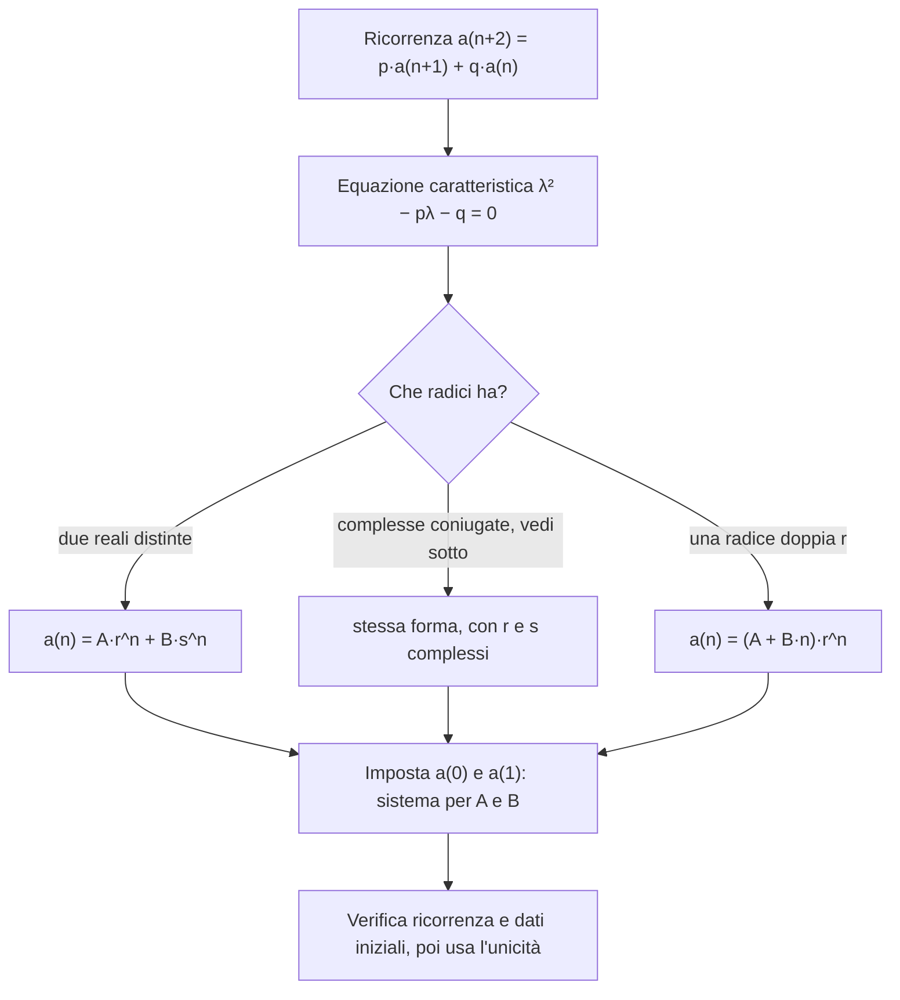

# Ricorrenze e successioni

Prerequisiti: [[Books/Aritmetica-I/02 - Naturali e induzione|induzione]], [[Books/Aritmetica-I/03 - Contare attraverso le funzioni|conteggi e corrispondenze]], [[Books/Aritmetica-I/04 - Sottoinsiemi e coefficienti binomiali|coefficienti binomiali]]. Torna all'[[Books/Aritmetica-I/00 - Indice e piano di studio|indice]].

> [!info] In questo capitolo
> - Costruirai una **ricorrenza** per un problema di conteggio, scegliendo un "primo passo" dopo il quale resta lo stesso problema in formato più piccolo.
> - Capirai perché ricorrenza e dati iniziali bastano a identificare una successione (**unicità**).
> - Imparerai a passare da una ricorrenza lineare a una formula esplicita tramite l'**equazione caratteristica**, distinguendo radici distinte, complesse e coincidenti.
> - Vedrai come una stessa famiglia di oggetti, contata in due modi, dà un'identità fra somme di binomiali e numeri di Fibonacci.

## Domande per iniziare dagli esercizi

Prova prima gli esercizi indicati dalla domanda. Se ti manca uno strumento, apri soltanto la sezione collegata, poi torna al problema e ricostruisci il passaggio senza guardare. Per le prove, scrivi ipotesi, tesi e motivo di ogni implicazione. I riscontri sono raccolti dopo la teoria.

La tabella copre tutte le sezioni teoriche del capitolo, compresi casi limite e approfondimenti. Gli esercizi 1–8 conservano la numerazione originaria; dal 9 trovi le integrazioni. Gli esercizi tratti dal PDF fornito hanno un riferimento esplicito alla fonte; gli altri sono redazionali.

| Domanda guida | Esercizi da tentare | Teoria da recuperare |
|---|---|---|
| Quali casi disgiunti descrivono la prima colonna di una tassellazione? | [[#Esercizio 1 — Prime tassellazioni e Fibonacci (dati iniziali e ricorrenza)\|1]], [[#Esercizio 7 — Nessun consecutivo (ricorrenze e sottoinsiemi)\|7]], [[#Esercizio 8 — Domino colorati (modellazione e formula esplicita)\|8]] | [[#Un rettangolo nasconde rettangoli più piccoli\|Un rettangolo nasconde rettangoli più piccoli]] |
| Perché ricorrenza e dati iniziali determinano una sola successione? | [[#Esercizio 1 — Prime tassellazioni e Fibonacci (dati iniziali e ricorrenza)\|1]], [[#Esercizio 4 — Stessi dati, stessa successione (unicità delle ricorrenze)\|4]], [[#Esercizio 6 — Un’identità di Fibonacci (induzione e identità di Cassini)\|6]], [[#Esercizio 8 — Domino colorati (modellazione e formula esplicita)\|8]], [[#Esercizio 9 — Formule e casi dimenticati (Binet, radici complesse e coefficienti degeneri)\|9]], [[#Esercizio 10 — Un dato iniziale lontano (unicità e successione di Fibonacci)\|10]] | [[#Una regola e i suoi dati iniziali\|Una regola e i suoi dati iniziali]] |
| Come conti le tassellazioni fissando il numero di blocchi larghi due? | [[#Esercizio 2 — Contare per blocchi (somma binomiale delle tassellazioni)\|2]], [[#Esercizio 7 — Nessun consecutivo (ricorrenze e sottoinsiemi)\|7]] | [[#Contare ancora, questa volta per blocchi\|Contare ancora, questa volta per blocchi]] |
| Perché un’equazione quadratica fornisce una formula esplicita? | [[#Esercizio 3 — Due potenze (equazione caratteristica con radici distinte)\|3]], [[#Esercizio 8 — Domino colorati (modellazione e formula esplicita)\|8]], [[#Esercizio 9 — Formule e casi dimenticati (Binet, radici complesse e coefficienti degeneri)\|9]] | [[#Dalla ricorrenza a un'equazione quadratica\|Dalla ricorrenza a un'equazione quadratica]] |
| Come verifichi Binet e come tratti radici complesse? | [[#Esercizio 3 — Due potenze (equazione caratteristica con radici distinte)\|3]], [[#Esercizio 6 — Un’identità di Fibonacci (induzione e identità di Cassini)\|6]], [[#Esercizio 9 — Formule e casi dimenticati (Binet, radici complesse e coefficienti degeneri)\|9]], [[#Esercizio 10 — Un dato iniziale lontano (unicità e successione di Fibonacci)\|10]] | [[#Due formule esplicite, con verifica\|Due formule esplicite, con verifica]] |
| Perché una radice doppia richiede un fattore lineare nell’indice? | [[#Esercizio 5 — Una radice ripetuta (equazione caratteristica con radice doppia)\|5]], [[#Esercizio 9 — Formule e casi dimenticati (Binet, radici complesse e coefficienti degeneri)\|9]] | [[#Approfondimento: quando le radici coincidono\|Approfondimento: quando le radici coincidono]] |

## Esercizi per verificare la comprensione

Gli esercizi 1–6 allenano gli strumenti di base; 7–8 li collegano ad altri problemi. Le integrazioni successive completano il controllo della teoria; quelle dalla raccolta fornita sono segnalate con numero e pagina. Non serve riuscire subito: individua che cosa ti manca, studia il passaggio collegato e riprova.

### Esercizio 1 — Prime tassellazioni e Fibonacci (dati iniziali e ricorrenza)

Calcola $T_n$ per $0\leq n\leq7$ e $F_n$ per $0\leq n\leq8$. Spiega perché $T_0=1$ è compatibile con il conteggio.

Se ti blocchi: [[#Un rettangolo nasconde rettangoli più piccoli|Un rettangolo nasconde rettangoli più piccoli]] · [[#Una regola e i suoi dati iniziali|Una regola e i suoi dati iniziali]].

Controllo dopo il tentativo: [[#Riscontro 1|riscontro 1]].

### Esercizio 2 — Contare per blocchi (somma binomiale delle tassellazioni)

Conta le tassellazioni di una griglia $2\times6$ dividendole per numero $k$ di coppie orizzontali. Quante hanno esattamente due coppie?

Se ti blocchi: [[#Contare ancora, questa volta per blocchi|Contare ancora, questa volta per blocchi]].

Controllo dopo il tentativo: [[#Riscontro 2|riscontro 2]].

### Esercizio 3 — Due potenze (equazione caratteristica con radici distinte)

Risolvi $a_{n+2}=5a_{n+1}-6a_n$ per $n\geq0$, con $a_0=2$ e $a_1=5$. Calcola anche $a_4$.

Se ti blocchi: [[#Dalla ricorrenza a un'equazione quadratica|Dalla ricorrenza a un'equazione quadratica]] · [[#Due formule esplicite, con verifica|Due formule esplicite, con verifica]].

Controllo dopo il tentativo: [[#Riscontro 3|riscontro 3]].

### Esercizio 4 — Stessi dati, stessa successione (unicità delle ricorrenze)

Siano $(a_n)$ e $(b_n)$ successioni reali che soddisfano entrambe $x_{n+2}=px_{n+1}+qx_n$, con $p,q$ fissati. Dimostra che, se $a_0=b_0$ e $a_1=b_1$, allora $a_n=b_n$ per ogni $n$. Occorre supporre $q\ne0$?

Se ti blocchi: [[#Una regola e i suoi dati iniziali|Una regola e i suoi dati iniziali]].

Controllo dopo il tentativo: [[#Riscontro 4|riscontro 4]].

### Esercizio 5 — Una radice ripetuta (equazione caratteristica con radice doppia)

Uno studente risolve $a_{n+2}=2a_{n+1}-a_n$ per $n\geq0$, con $a_0=0,a_1=1$, scrivendo $a_n=A1^n+B1^n$; il sistema iniziale risulta impossibile. Conclude che la successione non esiste. Individua l'errore e trova la successione.

Se ti blocchi: [[#Approfondimento: quando le radici coincidono|Approfondimento: quando le radici coincidono]].

Controllo dopo il tentativo: [[#Riscontro 5|riscontro 5]].

### Esercizio 6 — Un’identità di Fibonacci (induzione e identità di Cassini)

Dimostra per induzione l'identità di Cassini
   $$F_{n+1}F_{n-1}-F_n^2=(-1)^n\qquad(n\geq1).$$

Se ti blocchi: [[#Una regola e i suoi dati iniziali|Una regola e i suoi dati iniziali]] · [[#Due formule esplicite, con verifica|Due formule esplicite, con verifica]].

Controllo dopo il tentativo: [[#Riscontro 6|riscontro 6]].

### Esercizio 7 — Nessun consecutivo (ricorrenze e sottoinsiemi)

Per $n\geq0$, conta i sottoinsiemi di $\{1,\ldots,n\}$ che non contengono due interi consecutivi. Per $n=0$ l'insieme è vuoto. Trova una ricorrenza e il numero per $n=5$; poi conta quelli di cardinalità fissata $k\in\mathbb N$ e ricava una somma binomiale.

Se ti blocchi: [[#Un rettangolo nasconde rettangoli più piccoli|Un rettangolo nasconde rettangoli più piccoli]] · [[#Contare ancora, questa volta per blocchi|Contare ancora, questa volta per blocchi]].

Controllo dopo il tentativo: [[#Riscontro 7|riscontro 7]].

### Esercizio 8 — Domino colorati (modellazione e formula esplicita)

Modifica il problema delle tassellazioni: ogni domino verticale può essere rosso o blu, mentre quelli orizzontali hanno un unico colore. Tutti i colori distinguono le tassellazioni. Per $n\in\mathbb N$, trova dati iniziali, ricorrenza e formula esplicita del numero $P_n$ di tassellazioni colorate di una griglia $2\times n$. Calcola $P_4$.

Se ti blocchi: [[#Un rettangolo nasconde rettangoli più piccoli|Un rettangolo nasconde rettangoli più piccoli]] · [[#Una regola e i suoi dati iniziali|Una regola e i suoi dati iniziali]] · [[#Dalla ricorrenza a un'equazione quadratica|Dalla ricorrenza a un'equazione quadratica]].

Controllo dopo il tentativo: [[#Riscontro 8|riscontro 8]].

### Esercizio 9 — Formule e casi dimenticati (Binet, radici complesse e coefficienti degeneri)

Ricava la formula di Binet da $F_0=0,F_1=1$ e spiega perché è intera. Risolvi $a_{n+2}=-a_n$ con $a_0=1,a_1=0$, prima per ricorrenza e poi con le radici complesse. Risolvi infine $b_{n+2}=3b_{n+1}$ con $b_0=2,b_1=5$, senza usare potenze ambigue di zero. Per la radice doppia non nulla $r$, verifica direttamente che $(A+Bn)r^n$ soddisfa la ricorrenza di polinomio caratteristico $(\lambda-r)^2$.

Se ti blocchi: [[#Una regola e i suoi dati iniziali|Una regola e i suoi dati iniziali]] · [[#Dalla ricorrenza a un'equazione quadratica|Dalla ricorrenza a un'equazione quadratica]] · [[#Due formule esplicite, con verifica|Due formule esplicite, con verifica]] · [[#Approfondimento: quando le radici coincidono|Approfondimento: quando le radici coincidono]].

Controllo dopo il tentativo: [[#Riscontro 9|riscontro 9]].

### Esercizio 10 — Un dato iniziale lontano (unicità e successione di Fibonacci)

*Dalla raccolta fornita: esercizio 5, p. 70 stampata / [[Books/Aritmetica-I/Fonti/Esercizi algebra 1 2.pdf#page=80|p. 80 del PDF]]. Enunciato riformulato; riscontro redazionale.*

Fissato $k>0$, cerca una successione reale con $a_0=0$, $a_k=1$ e $a_{n+1}=a_n+a_{n-1}$ per $n\ge1$. Dimostrane esistenza e unicità e determina $a_1$. Qui $F_0=0,F_1=1$; giustifica che il denominatore ottenuto sia non nullo.

Se ti blocchi: [[#Una regola e i suoi dati iniziali|Una regola e i suoi dati iniziali]] · [[#Due formule esplicite, con verifica|Due formule esplicite, con verifica]].

Controllo dopo il tentativo: [[#Riscontro 10|riscontro 10]].

## Teoria da recuperare

Usa i collegamenti della tabella iniziale per leggere lo strumento che ti serve. Dopo la lettura, torna all’esercizio e prova a risolverlo senza suggerimenti.

## Un rettangolo nasconde rettangoli più piccoli

Abbiamo una griglia di due righe e $n$ colonne. Vogliamo ricoprirla con domino rettangolari, ciascuno formato da due caselle adiacenti, senza sovrapposizioni e senza lasciare vuoti. Possiamo ruotare i domino. Quante tassellazioni esistono?

Disegnare tutte le possibilità funziona per poche colonne, ma diventa presto scomodo. Cerchiamo invece una scelta iniziale dopo la quale rimanga un problema dello stesso tipo, più piccolo. Indichiamo con $T_n$ il numero cercato.

Per $n\geq2$, guardiamo la casella in alto a sinistra. Il domino che la copre può essere verticale oppure orizzontale.

Se è **verticale**, occupa tutta la prima colonna. Togliendolo resta una griglia $2\times(n-1)$. La rimozione è una corrispondenza biunivoca: ogni tassellazione del rettangolo restante si completa in un solo modo aggiungendo il domino verticale. Questo caso conta dunque $T_{n-1}$ tassellazioni.

Se è **orizzontale**, occupa le prime due caselle della riga superiore. La casella in basso a sinistra non può essere coperta verticalmente, perché la casella sopra è già occupata. Deve quindi appartenere a un secondo domino orizzontale. Togliendo i due domino rimane una griglia $2\times(n-2)$, e anche questa rimozione è una biezione. Il secondo caso conta $T_{n-2}$ tassellazioni.

I casi sono disgiunti, perché il primo domino non può avere entrambe le orientazioni, ed esauriscono tutte le possibilità. Per la regola della somma,

$$
\boxed{T_n=T_{n-1}+T_{n-2}\qquad(n\geq2).}
$$

Per avviare il calcolo servono i valori iniziali:

$$
T_0=1,\qquad T_1=1.
$$

Il primo conta l'unica tassellazione del rettangolo vuoto: non mettere alcun domino. Il secondo conta l'unico domino verticale. Il valore $T_0=1$ consente alla ricorrenza di dare correttamente anche $T_2=2$.

### Esempio svolto: cinque colonne

Applichiamo la regola sempre allo stesso modo:

$$
\begin{aligned}
T_2&=T_1+T_0=2,\\
T_3&=T_2+T_1=3,\\
T_4&=T_3+T_2=5,\\
T_5&=T_4+T_3=8.
\end{aligned}
$$

Non abbiamo dovuto disegnare otto figure: abbiamo dimostrato una regola che costruisce e conta tutte le figure, senza ripetizioni. Questa è la funzione di una **ricorrenza** in un problema combinatorio: una regola che esprime ciascun termine mediante quelli precedenti.

## Una regola e i suoi dati iniziali

Una **successione reale** è una funzione

$$
a:\mathbb N\longrightarrow\mathbb R,\qquad n\longmapsto a_n,
$$

dove $\mathbb N=\{0,1,2,\ldots\}$. Il simbolo $a_n$ indica un termine; $(a_n)_{n\geq0}$ indica l'intera successione.

Fin qui la ricorrenza è nata da un conteggio. Ora ci chiediamo in generale: quando una regola di questo tipo, insieme ad alcuni valori di partenza, determina davvero una sola successione? Senza questa garanzia, "la successione definita dalla ricorrenza" non avrebbe senso. Una descrizione per ricorrenza spiega come ottenere nuovi termini da quelli già disponibili. Per esempio, assegnati $p,q,u,v\in\mathbb R$, consideriamo

$$
a_0=u,\qquad a_1=v,\qquad
a_{n+2}=p a_{n+1}+q a_n\quad(n\geq0).
$$

Queste istruzioni definiscono una successione: prima calcoliamo $a_2=pv+qu$, poi $a_3=pa_2+qv$, e continuiamo. Ogni calcolo richiede soltanto valori già definiti e produce un numero reale. Non ci sono scelte da compiere.

Dimostriamo precisamente l'**unicità**. Siano $(a_n)$ e $(b_n)$ due successioni con la stessa ricorrenza e gli stessi dati iniziali. Usiamo l'induzione sulla proprietà

$$
P(n):\quad a_n=b_n\ \text{e}\ a_{n+1}=b_{n+1}.
$$

La base $P(0)$ è data dalle condizioni iniziali. Se vale $P(n)$, allora

$$
a_{n+2}=pa_{n+1}+qa_n=pb_{n+1}+qb_n=b_{n+2}.
$$

Insieme ad $a_{n+1}=b_{n+1}$, questa uguaglianza dà $P(n+1)$. Dunque i termini coincidono per ogni indice.

> [!abstract] Concetto chiave — Unicità da ricorrenza e dati iniziali
> Una ricorrenza $a_{n+2}=pa_{n+1}+qa_n$ con $a_0$ e $a_1$ assegnati determina una e una sola successione. Per identificare una successione basta verificare la ricorrenza e i due dati iniziali.
> È il pilastro di tutto il capitolo: serve per $T_n=F_{n+1}$, per la completezza delle formule esplicite e per la formula di Binet.

La prova ci consegna un criterio molto utile: non serve confrontare uno per uno infiniti termini. Per esempio, basta ricordare che due dati iniziali sono necessari: la ricorrenza $a_{n+2}=a_{n+1}+a_n$ con la sola condizione $a_0=0$ è soddisfatta sia da $F_n$ sia da $2F_n$ (stessa legge, stesso $a_0$, ma $a_1=1$ contro $a_1=2$), quindi la conclusione di unicità cade togliendo un dato.

Definiamo ora i numeri di Fibonacci con la convenzione

$$
F_0=0,\qquad F_1=1,\qquad F_{n+2}=F_{n+1}+F_n.
$$

La successione $G_n=F_{n+1}$ ha $G_0=F_1=1$, $G_1=F_2=1$ e soddisfa la stessa ricorrenza di $T_n$. Per unicità,

$$
\boxed{T_n=F_{n+1}\qquad(n\geq0).}
$$

> [!warning] Attenzione — Stessa legge, successioni diverse
> La relazione $a_{n+2}=a_{n+1}+a_n$ non identifica da sola Fibonacci. I dati $(0,1)$ producono $F_n$; i dati $(1,1)$ producono $T_n=F_{n+1}$. Controllare gli indici iniziali evita uno spostamento di tutta la risposta.

## Contare ancora, questa volta per blocchi

Possiamo descrivere ogni tassellazione leggendo da sinistra a destra due tipi di blocco: un domino verticale, di larghezza $1$, oppure una coppia di domino orizzontali, di larghezza $2$. Il ragionamento sulla prima colonna, ripetuto sul rettangolo restante, dimostra che questa scomposizione esiste ed è unica.

Fissiamo il numero $k$ dei blocchi di larghezza $2$. Questi occupano $2k$ colonne; rimangono $n-2k$ blocchi verticali. I blocchi complessivi sono quindi

$$
k+(n-2k)=n-k.
$$

Per ordinare i blocchi basta scegliere quali $k$ delle $n-k$ posizioni ospitino i blocchi doppi. Si ottengono $\binom{n-k}{k}$ tassellazioni. Il numero $k$ varia da $0$ a $\lfloor n/2\rfloor$, dove $\lfloor x\rfloor$ è il massimo intero non superiore a $x$. Le famiglie corrispondenti a valori diversi di $k$ sono disgiunte. Pertanto

$$
\boxed{T_n=\sum_{k=0}^{\lfloor n/2\rfloor}\binom{n-k}{k}=F_{n+1}.}
$$

Per $n=5$ ritroviamo

$$
T_5=\binom50+\binom41+\binom32=1+4+3=8.
$$

Per $n=0$ la somma contiene soltanto $\binom00=1$, dunque comprende anche il caso vuoto. L'identità non è una coincidenza algebrica: le due espressioni contano la stessa famiglia di oggetti, classificata in due modi diversi.

## Dalla ricorrenza a un'equazione quadratica

La relazione

$$
a_{n+2}=pa_{n+1}+qa_n
$$

è una **ricorrenza lineare omogenea del secondo ordine a coefficienti costanti**. È lineare perché i termini compaiono alla prima potenza e non sono moltiplicati tra loro; è omogenea perché non c'è un termine aggiuntivo indipendente dalla successione. I coefficienti $p,q$ non dipendono da $n$. Quando $q\ne0$, la regola coinvolge effettivamente entrambi i termini precedenti. "Del secondo ordine" significa che ogni termine dipende dai due precedenti.

> [!example] Esempi e controesempi — Ricorrenza lineare omogenea a coefficienti costanti
> **È una ricorrenza di questo tipo:** $a_{n+2}=a_{n+1}+a_n$ (Fibonacci); $a_{n+1}=3a_n-2a_{n-1}$ (stessa forma con indici spostati); $a_{n+2}=-a_n$ (qui $p=0$).
> **Non lo è, violando una sola condizione:**
> - $a_{n+2}=a_{n+1}a_n$ non è *lineare*: i termini sono moltiplicati fra loro. Infatti la successione costante $b_n=1$ la soddisfa ($1=1\cdot1$), ma $d_n=2b_n=2$ no ($2\ne2\cdot2$).
> - $a_{n+2}=a_{n+1}+a_n+1$ non è *omogenea*: c'è il termine aggiuntivo $+1$. La successione costante $b_n=-1$ la soddisfa ($-1=-1-1+1$), ma $2b_n=-2$ no ($-2\ne-2-2+1=-3$).
> - $a_{n+2}=n\,a_{n+1}+a_n$ non ha *coefficienti costanti*: il coefficiente dipende da $n$, e la sostituzione $\lambda^n$ non porta più a un'equazione indipendente dall'indice.

Per trovare una formula esplicita, osserviamo prima una proprietà. Se $(b_n)$ e $(c_n)$ soddisfano la ricorrenza, per ogni $A,B\in\mathbb R$ anche $d_n=Ab_n+Bc_n$ la soddisfa. Infatti

$$
\begin{aligned}
d_{n+2}
&=A(pb_{n+1}+qb_n)+B(pc_{n+1}+qc_n)\\
&=p(Ab_{n+1}+Bc_{n+1})+q(Ab_n+Bc_n)\\
&=pd_{n+1}+qd_n.
\end{aligned}
$$

Cerchiamo dunque alcune soluzioni semplici da combinare. Proviamo con $b_n=\lambda^n$, dove $\lambda\ne0$ è un numero da determinare. La scelta è naturale perché spostare l'indice di una potenza equivale a moltiplicarla per una costante. Sostituendo,

$$
\lambda^{n+2}=p\lambda^{n+1}+q\lambda^n.
$$

Dividendo per $\lambda^n$, otteniamo una condizione che non dipende più dall'indice:

$$
\boxed{\lambda^2-p\lambda-q=0.}
$$

È l'**equazione caratteristica**. Ogni sua radice non nulla fornisce una soluzione esponenziale della ricorrenza (una "radice" è un numero che, sostituito a $\lambda$, rende vera l'equazione).

> [!abstract] Concetto chiave — Equazione caratteristica
> Le soluzioni di $a_{n+2}=pa_{n+1}+qa_n$ della forma $\lambda^n$ sono esattamente quelle con $\lambda^2-p\lambda-q=0$ (e $\lambda\ne0$). Con due radici distinte e non nulle $r,s$, tutte le soluzioni sono $Ar^n+Bs^n$.
> Trasforma un problema su infiniti termini in un'equazione di secondo grado; riappare, in forma più strutturale, nelle potenze e negli ordini dei capitoli successivi.

Il metodo si riassume nello schema seguente. Si legge dall'alto verso il basso: parti dalla ricorrenza, guarda le radici dell'equazione caratteristica, scegli la forma della soluzione e fissa le costanti con i dati iniziali.

Supponiamo ora che l'equazione abbia **due radici reali distinte e non nulle** $r,s$. Allora ogni successione della forma

$$
a_n=Ar^n+Bs^n
$$

soddisfa la ricorrenza. Ma abbiamo trovato davvero tutte le soluzioni? Questa domanda richiede un argomento: produrre molte soluzioni non dimostra che non ne esistano altre.

Prendiamo una soluzione qualunque, con $a_0=u$ e $a_1=v$. Cerchiamo $A,B$ in modo che la formula proposta abbia gli stessi primi termini:

$$
\begin{cases}
A+B=u,\\
Ar+Bs=v.
\end{cases}
$$

Sostituendo $B=u-A$ nella seconda equazione si trova

$$
A=\frac{v-su}{r-s},\qquad B=\frac{ru-v}{r-s}.
$$

I denominatori sono diversi da zero perché $r\ne s$. La successione costruita soddisfa sia la ricorrenza sia i dati iniziali della soluzione scelta. Per l'unicità già provata, coincide con essa a ogni indice. Abbiamo così dimostrato la **completezza della formula**, senza richiedere il linguaggio degli spazi vettoriali.

> [!warning] Attenzione — Una soluzione della legge può fallire i dati
> Per Fibonacci, $\varphi^n$ con $\varphi=(1+\sqrt5)/2$ soddisfa la ricorrenza, ma al posto zero vale $1$, mentre $F_0=0$. L'equazione caratteristica risolve la legge ricorrente; le costanti vanno poi scelte usando tutti i dati iniziali.

## Due formule esplicite, con verifica

### Esempio svolto: una differenza di potenze

Risolviamo

$$
a_{n+1}=3a_n-2a_{n-1}\quad(n\geq1),\qquad a_0=0,\quad a_1=1.
$$

È la stessa forma studiata sopra, riscritta con gli indici spostati. L'equazione caratteristica è

$$
\lambda^2-3\lambda+2=(\lambda-1)(\lambda-2)=0.
$$

Le radici sono distinte e non nulle, quindi scriviamo $a_n=A+B2^n$. Le condizioni iniziali diventano

$$
A+B=0,\qquad A+2B=1.
$$

Sottraendo la prima equazione dalla seconda otteniamo $B=1$, poi $A=-1$. Dunque

$$
\boxed{a_n=2^n-1.}
$$

Controlliamo: $a_0=0$, $a_1=1$ e, per $n\geq1$,

$$
3(2^n-1)-2(2^{n-1}-1)=2^{n+1}-1=a_{n+1}.
$$

I primi termini sono $0,1,3,7,15$. I controlli sui primi termini sono utili per scoprire un errore; la verifica simbolica e l'unicità giustificano la formula per ogni $n$.

### Esempio svolto: la formula di Binet

Per Fibonacci l'equazione caratteristica è

$$
\lambda^2-\lambda-1=0,
$$

con radici reali distinte e non nulle

$$
\varphi=\frac{1+\sqrt5}{2},\qquad
\psi=\frac{1-\sqrt5}{2}.
$$

Scriviamo $F_n=A\varphi^n+B\psi^n$. Da $F_0=0$ segue $B=-A$, mentre $F_1=1$ dà

$$
1=A(\varphi-\psi)=A\sqrt5.
$$

Ne segue la **formula di Binet**:

$$
\boxed{F_n=\frac{\varphi^n-\psi^n}{\sqrt5}\qquad(n\geq0).}
$$

La ricorrenza è soddisfatta perché $\varphi^2=\varphi+1$ e $\psi^2=\psi+1$; i dati iniziali sono stati imposti nel sistema. L'unicità conclude la dimostrazione. In particolare,

$$
\boxed{T_n=\frac{\varphi^{n+1}-\psi^{n+1}}{\sqrt5}.}
$$

La presenza di numeri irrazionali non impedisce al risultato di essere intero: la formula rappresenta la stessa successione costruita sommando interi. Non occorre dimostrare separatamente una cancellazione dei radicali per ogni esponente.

### Se le radici sono complesse

Un **numero complesso** è un numero della forma $x+yi$ con $x,y$ reali e $i$ tale che $i^2=-1$; con questi numeri ogni equazione di secondo grado ha radici. Se li conosci, puoi usare lo stesso metodo anche quando il polinomio non ha radici reali. La verifica delle potenze, il sistema per $A,B$ e la prova di unicità funzionano senza cambiamenti in $\mathbb C$, purché le radici siano distinte e non nulle. Questo è il motivo del richiamo ai complessi nella lezione: permettono di trattare anche equazioni caratteristiche come $\lambda^2+1=0$.

Per esempio, per $a_{n+2}=-a_n$, $a_0=1$, $a_1=0$, le radici sono $i$ e $-i$, dove $i^2=-1$. La formula

$$
a_n=\frac{i^n+(-i)^n}{2}
$$

ha i dati iniziali richiesti e soddisfa la ricorrenza, perché entrambe le basi hanno quadrato $-1$. È dunque la successione $1,0,-1,0,1,0,\ldots$. Benché la scrittura usi numeri complessi, i valori sono reali: lo garantisce anche la costruzione ricorrente a partire da dati e coefficienti reali. Questo esempio è un completamento didattico; il resto del capitolo si può leggere lavorando soltanto nei reali.

## Approfondimento: quando le radici coincidono

Questo paragrafo è un'integrazione didattica. Il teorema precedente richiede due radici distinte; se la radice è doppia, ripetere la stessa potenza non fornisce due soluzioni diverse.

Supponiamo che il polinomio $\lambda^2-p\lambda-q$ (quello dell'equazione caratteristica) sia $(\lambda-r)^2$ con $r\ne0$. La ricorrenza è allora

$$
a_{n+2}=2r a_{n+1}-r^2a_n.
$$

Oltre a $r^n$, proviamo $nr^n$. Sostituendo e portando tutto a sinistra, otteniamo

$$
(n+2)r^{n+2}-2r(n+1)r^{n+1}+r^2nr^n
=r^{n+2}\bigl[(n+2)-2(n+1)+n\bigr]=0.
$$

Le combinazioni hanno quindi forma $(A+Bn)r^n$. Esse rappresentano tutte le soluzioni: dati $a_0=u,a_1=v$, basta porre $A=u$ e $B=v/r-u$, poi applicare l'unicità. Per esempio, $a_{n+2}=2a_{n+1}-a_n$, $a_0=0,a_1=1$, ha soluzione $a_n=n$.

> [!example] Esempi e controesempi — Radici distinte e radice doppia
> **Radici distinte:** $\lambda^2-3\lambda+2=(\lambda-1)(\lambda-2)$ ha radici $1,2$; la formula $A+B2^n$ ammette due dati iniziali arbitrari.
> **Radice doppia (la condizione "distinte" viene meno):** $\lambda^2-2\lambda+1=(\lambda-1)^2$. La formula $A1^n+B1^n=(A+B)$ è costante e non può dare $a_0=0,a_1=1$; serve il termine $nr^n$.

> [!warning] Attenzione — Non applicare una formula fuori dalle ipotesi
> Con radice doppia $r$, la scrittura $Ar^n+Br^n=(A+B)r^n$ non permette di assegnare due dati iniziali arbitrari. La dimostrazione per radici distinte divide per $r-s$: quando $r=s$ quel passaggio non è lecito. Anche i casi con radice nulla richiedono un trattamento specifico; non sono compresi negli enunciati sulle formule risolutive qui dimostrati.

## Fonti

Il percorso sulle ricorrenze, l'esempio $a_{n+1}=3a_n-2a_{n-1}$ e il richiamo a Fibonacci provengono dalla [[Notes/Aritmetica/Lectures/2026-09-30 - Successioni ricorrenti e formule combinatorie|nota del 30 settembre]] e dai passaggi pertinenti della [[_transcripts/Aritmetica/2026-09-30 - Successioni ricorrenti e formule combinatorie|trascrizione del 30 settembre]]. Le tassellazioni e il conteggio per blocchi sono sviluppati nella [[Notes/Aritmetica/Lectures/2026-10-06 - Conteggio combinatorio e principio di inclusione-esclusione|nota combinatoria del 6 ottobre]] e nella [[_transcripts/Aritmetica/2026-10-06 - Conteggio combinatorio e principio di inclusione-esclusione|trascrizione combinatoria del 6 ottobre]].

La prova dettagliata di unicità, la completezza tramite il sistema iniziale, la derivazione completa di Binet, l'approfondimento sulla radice doppia e gli esercizi sono integrazioni dell'esposizione. Le formule sono ricostruite e verificate matematicamente nei punti in cui l'ASR è rumoroso.

## Riscontri degli esercizi

Apri il riscontro soltanto dopo aver scritto un tentativo. Per una dimostrazione, confronta anche le ipotesi e la completezza, non soltanto il risultato.

### Riscontro 1

> [!tip]- Riscontro 1
> Si ottengono $T_0,\ldots,T_7=1,1,2,3,5,8,13,21$ e $F_0,\ldots,F_8=0,1,1,2,3,5,8,13,21$. A ogni passo sommi i due termini precedenti. La tassellazione vuota è un unico oggetto: la scelta di non collocare tessere. Si verifica così anche $T_n=F_{n+1}$ negli indici richiesti.

Torna a [[#Esercizio 1 — Prime tassellazioni e Fibonacci (dati iniziali e ricorrenza)|esercizio 1]].

### Riscontro 2

> [!tip]- Riscontro 2
> I contributi per $k=0,1,2,3$ sono $\binom60=1$, $\binom51=5$, $\binom42=6$, $\binom33=1$. Il totale è $13$; quelle con due coppie sono $6$. Per $k=2$ ordini due blocchi doppi e due verticali, quindi scegli due posizioni su quattro.

Torna a [[#Esercizio 2 — Contare per blocchi (somma binomiale delle tassellazioni)|esercizio 2]].

### Riscontro 3

> [!tip]- Riscontro 3
> Il polinomio $(\lambda-2)(\lambda-3)$ suggerisce $a_n=A2^n+B3^n$. Il sistema $A+B=2$, $2A+3B=5$ dà $A=B=1$. Dunque $a_n=2^n+3^n$ e $a_4=16+81=97$. La formula soddisfa la ricorrenza e i dati, quindi l'unicità la identifica con la successione cercata.

Torna a [[#Esercizio 3 — Due potenze (equazione caratteristica con radici distinte)|esercizio 3]].

### Riscontro 4

> [!tip]- Riscontro 4
> Poni $d_n=a_n-b_n$. Hai $d_0=d_1=0$ e $d_{n+2}=pd_{n+1}+qd_n$. Per induzione sulla coppia di termini consecutivi, da $d_n=d_{n+1}=0$ segue $d_{n+2}=0$. Dunque $d_n=0$ sempre. Non occorre $q\ne0$: non abbiamo diviso per $q$.

Torna a [[#Esercizio 4 — Stessi dati, stessa successione (unicità delle ricorrenze)|esercizio 4]].

### Riscontro 5

> [!tip]- Riscontro 5
> La radice $1$ è doppia: la famiglia proposta contiene soltanto successioni costanti e non comprende tutte le soluzioni. La costruzione ricorrente assicura invece l'esistenza. La formula corretta è $a_n=n$: parte da $0,1$ e verifica $n+2=2(n+1)-n$.

Torna a [[#Esercizio 5 — Una radice ripetuta (equazione caratteristica con radice doppia)|esercizio 5]].

### Riscontro 6

> [!tip]- Riscontro 6
> Per $n=1$ il lato sinistro è $1\cdot0-1=-1$. Poni $D_n=F_{n+1}F_{n-1}-F_n^2$. Usando $F_{n+2}=F_{n+1}+F_n$ e $F_{n-1}=F_{n+1}-F_n$, trovi
> $$D_{n+1}=F_{n+1}F_n+F_n^2-F_{n+1}^2=-D_n.$$
> Da $D_1=-1$, il segno cambia a ogni passo: $D_n=(-1)^n$.

Torna a [[#Esercizio 6 — Un’identità di Fibonacci (induzione e identità di Cassini)|esercizio 6]].

### Riscontro 7

> [!tip]- Riscontro 7
> Se $n\geq2$, separa i sottoinsiemi che non contengono $n$, contati da $C_{n-1}$, da quelli che lo contengono e quindi escludono $n-1$, contati da $C_{n-2}$. Hai $C_0=1,C_1=2$, dunque $C_n=F_{n+2}$ e $C_5=13$. Per $1\leq k\leq\lfloor(n+1)/2\rfloor$, scrivi gli elementi come $x_1<\cdots<x_k$, con $x_{i+1}\geq x_i+2$. La trasformazione $y_i=x_i-(i-1)$ dà una successione strettamente crescente di $k$ elementi in $\{1,\ldots,n-k+1\}$, ed è reversibile. Il numero è $\binom{n-k+1}{k}$; per $k=0$ è $1$, per $k>\lfloor(n+1)/2\rfloor$ è $0$. Quindi
> $$F_{n+2}=\sum_{k=0}^{\lfloor(n+1)/2\rfloor}\binom{n-k+1}{k}.$$

Torna a [[#Esercizio 7 — Nessun consecutivo (ricorrenze e sottoinsiemi)|esercizio 7]].

### Riscontro 8

> [!tip]- Riscontro 8
> Il caso verticale ha due colori e lascia $P_{n-1}$ completamenti per ciascuno; il caso orizzontale lascia $P_{n-2}$ completamenti. Dunque $P_0=1,P_1=2$ e $P_n=2P_{n-1}+P_{n-2}$ per $n\geq2$. Le radici sono $r=1+\sqrt2$, $s=1-\sqrt2$. La formula
> $$P_n=\frac{r^{n+1}-s^{n+1}}{2\sqrt2}$$
> soddisfa la ricorrenza e dà $P_0=1$, $P_1=r+s=2$; l'unicità conclude. I primi termini sono $1,2,5,12,29$, quindi $P_4=29$.

Torna a [[#Esercizio 8 — Domino colorati (modellazione e formula esplicita)|esercizio 8]].

### Riscontro 9

> [!tip]- Riscontro 9
> Poste $\varphi=(1+\sqrt5)/2$, $\psi=(1-\sqrt5)/2$, i dati danno $F_n=(\varphi^n-\psi^n)/\sqrt5$; unicità e ricorrenza intera provano l'integralità. La prima successione è $1,0,-1,0,\ldots$, cioè $(i^n+(-i)^n)/2$. Per la seconda, $b_0=2$ e $b_n=5\cdot3^{n-1}$ per $n\ge1$. Nell'ultimo caso sostituisci in $a_{n+2}=2ra_{n+1}-r^2a_n$: $2(A+B(n+1))-(A+Bn)=A+B(n+2)$. I dati iniziali determinano $A$ e $B$ perché $r\ne0$.

Torna a [[#Esercizio 9 — Formule e casi dimenticati (Binet, radici complesse e coefficienti degeneri)|esercizio 9]].

### Riscontro 10

> [!tip]- Riscontro 10
> Per un valore provvisorio $a_1=t$, l'induzione dà $a_n=tF_n$. Inoltre $F_k>0$ per $k\ge1$, perché $F_1=F_2=1$ e la ricorrenza somma positivi. La condizione $a_k=1$ obbliga $t=1/F_k$; viceversa $a_n=F_n/F_k$ soddisfa tutto. L'unicità della ricorrenza con $a_0,a_1$ prova l'unicità richiesta, benché il secondo dato originario non sia consecutivo al primo.

Torna a [[#Esercizio 10 — Un dato iniziale lontano (unicità e successione di Fibonacci)|esercizio 10]].

Il capitolo è acquisito quando sai giustificare i casi che producono una ricorrenza, fissare correttamente i dati iniziali e dimostrare che una formula trovata descrive tutti i termini. Nei problemi nuovi, prova a spiegare quale parte puoi rimuovere e perché il completamento non introduce omissioni o ripetizioni.

---

[[Books/Aritmetica-I/06 - Inclusione ed esclusione|← 06 · Inclusione ed esclusione]] · [[Books/Aritmetica-I/00 - Indice e piano di studio|Indice]] · [[Books/Aritmetica-I/08 - Divisione euclidea e identità di Bezout|08 · Divisione euclidea e identità di Bézout →]]
