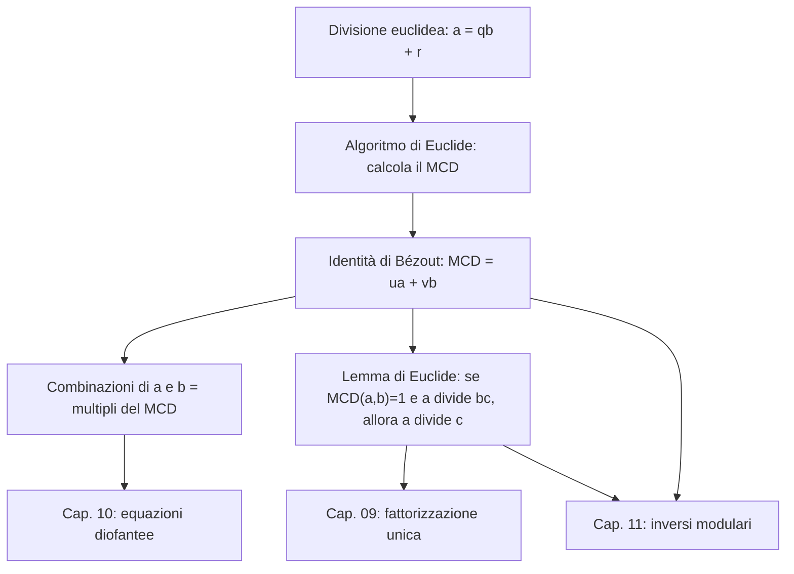

# Divisione euclidea e identità di Bézout

Prerequisiti: [[Books/Aritmetica-I/01 - Il linguaggio delle dimostrazioni|linguaggio delle dimostrazioni]] e [[Books/Aritmetica-I/02 - Naturali e induzione|buon ordinamento dei naturali]]. Torna all'[[Books/Aritmetica-I/00 - Indice e piano di studio|indice e piano di studio]].

> [!info] In questo capitolo
> - Userai la **divisione con resto** per ridurre un problema su numeri grandi a uno su numeri più piccoli, senza perdere i divisori comuni.
> - Calcolerai il **massimo comun divisore** con l'algoritmo di Euclide e imparerai a risalire dalle divisioni per scriverlo come $ua+vb$ (**Bézout**).
> - Descriverai tutte le combinazioni $ax+by$: sono i multipli del MCD.
> - Dedurrai il **lemma di Euclide** (cancellare un fattore coprimo), che regge la fattorizzazione unica e le congruenze dei capitoli seguenti.

## Domande per iniziare dagli esercizi

Prova prima gli esercizi indicati dalla domanda. Se ti manca uno strumento, apri soltanto la sezione collegata, poi torna al problema e ricostruisci il passaggio senza guardare. Per le prove, scrivi ipotesi, tesi e motivo di ogni implicazione. I riscontri sono raccolti dopo la teoria.

La tabella copre tutte le sezioni teoriche del capitolo, compresi casi limite e approfondimenti. Gli esercizi 1–8 conservano la numerazione originaria; dal 9 trovi le integrazioni. Gli esercizi tratti dal PDF fornito hanno un riferimento esplicito alla fonte; gli altri sono redazionali.

| Domanda guida | Esercizi da tentare | Teoria da recuperare |
|---|---|---|
| Quale informazione conservi sostituendo un numero con un resto? | [[#Esercizio 3 — Risalire dalle divisioni (algoritmo di Euclide e Bézout)\|3]] | [[#Un problema grande può lasciare un resto piccolo\|Un problema grande può lasciare un resto piccolo]] |
| Come funziona la divisibilità con zero, segni e numeri incomparabili? | [[#Esercizio 1 — Dividere anche lo zero (divisibilità e ordine parziale)\|1]], [[#Esercizio 9 — Perché Euclide funziona (ordine di divisibilità, divisione euclidea e Bézout)\|9]] | [[#Divisibilità, anche quando compare zero\|Divisibilità, anche quando compare zero]] |
| Perché quoziente e resto esistono e sono unici anche con segni negativi? | [[#Esercizio 2 — Quozienti con segno (divisione euclidea)\|2]], [[#Esercizio 9 — Perché Euclide funziona (ordine di divisibilità, divisione euclidea e Bézout)\|9]] | [[#Divisione euclidea: scegliere un resto una volta per tutte\|Divisione euclidea: scegliere un resto una volta per tutte]] |
| Perché l’ultimo resto non nullo è il MCD e l’algoritmo termina? | [[#Esercizio 3 — Risalire dalle divisioni (algoritmo di Euclide e Bézout)\|3]], [[#Esercizio 5 — Comune non basta (proprietà universale del MCD)\|5]], [[#Esercizio 9 — Perché Euclide funziona (ordine di divisibilità, divisione euclidea e Bézout)\|9]] | [[#Il massimo comun divisore e l'algoritmo di Euclide\|Il massimo comun divisore e l'algoritmo di Euclide]] |
| Come risali ai coefficienti di Bézout? | [[#Esercizio 3 — Risalire dalle divisioni (algoritmo di Euclide e Bézout)\|3]], [[#Esercizio 4 — Dividere per il MCD (coprimalità e combinazioni lineari)\|4]], [[#Esercizio 5 — Comune non basta (proprietà universale del MCD)\|5]], [[#Esercizio 9 — Perché Euclide funziona (ordine di divisibilità, divisione euclidea e Bézout)\|9]] | [[#Bézout: risalire dalle divisioni\|Bézout: risalire dalle divisioni]] |
| Quali interi sono combinazioni dei due numeri iniziali? | [[#Esercizio 4 — Dividere per il MCD (coprimalità e combinazioni lineari)\|4]], [[#Esercizio 5 — Comune non basta (proprietà universale del MCD)\|5]], [[#Esercizio 7 — Muoversi sulla retta (insieme delle combinazioni intere)\|7]], [[#Esercizio 9 — Perché Euclide funziona (ordine di divisibilità, divisione euclidea e Bézout)\|9]] | [[#Quali numeri si ottengono come combinazioni?\|Quali numeri si ottengono come combinazioni?]] |
| Quando puoi cancellare un fattore in una divisibilità? | [[#Esercizio 6 — Cancellare un coprimo (lemma di Euclide)\|6]], [[#Esercizio 9 — Perché Euclide funziona (ordine di divisibilità, divisione euclidea e Bézout)\|9]] | [[#Il lemma di Euclide nella forma coprima\|Il lemma di Euclide nella forma coprima]] |
| Come applichi Euclide agli esponenti senza sviluppare le potenze? | [[#Esercizio 8 — Euclide negli esponenti (MCD di potenze meno uno)\|8]] | [[#Approfondimento: Euclide dentro gli esponenti\|Approfondimento: Euclide dentro gli esponenti]] |

## Esercizi per verificare la comprensione

Gli esercizi 1–6 allenano gli strumenti di base; 7–8 li collegano ad altri problemi. Le integrazioni successive completano il controllo della teoria; quelle dalla raccolta fornita sono segnalate con numero e pagina. Non serve riuscire subito: individua che cosa ti manca, studia il passaggio collegato e riprova.

### Esercizio 1 — Dividere anche lo zero (divisibilità e ordine parziale)

Per ciascuna affermazione stabilisci se è vera: $0\mid0$, $0\mid7$, $-3\mid12$, $7\mid0$. Fra $4,6,12$ indica le coppie di elementi distinti confrontabili per divisibilità.

Se ti blocchi: [[#Divisibilità, anche quando compare zero|Divisibilità, anche quando compare zero]].

Controllo dopo il tentativo: [[#Riscontro 1|riscontro 1]].

### Esercizio 2 — Quozienti con segno (divisione euclidea)

Trova quoziente e resto della divisione euclidea per le coppie $(a,b)=(-38,7),(38,-7),(-38,-7),(0,-7)$.

Se ti blocchi: [[#Divisione euclidea: scegliere un resto una volta per tutte|Divisione euclidea: scegliere un resto una volta per tutte]].

Controllo dopo il tentativo: [[#Riscontro 2|riscontro 2]].

### Esercizio 3 — Risalire dalle divisioni (algoritmo di Euclide e Bézout)

Calcola $\gcd(252,198)$ con Euclide e trova $u,v\in\mathbb Z$ tali che $252u+198v=\gcd(252,198)$.

Se ti blocchi: [[#Un problema grande può lasciare un resto piccolo|Un problema grande può lasciare un resto piccolo]] · [[#Il massimo comun divisore e l'algoritmo di Euclide|Il massimo comun divisore e l'algoritmo di Euclide]] · [[#Bézout: risalire dalle divisioni|Bézout: risalire dalle divisioni]].

Controllo dopo il tentativo: [[#Riscontro 3|riscontro 3]].

### Esercizio 4 — Dividere per il MCD (coprimalità e combinazioni lineari)

Siano $a,b\in\mathbb Z$ non entrambi nulli e $d=\gcd(a,b)$. Dimostra che $\gcd(a/d,b/d)=1$, senza usare la fattorizzazione.

Se ti blocchi: [[#Bézout: risalire dalle divisioni|Bézout: risalire dalle divisioni]] · [[#Quali numeri si ottengono come combinazioni?|Quali numeri si ottengono come combinazioni?]].

Controllo dopo il tentativo: [[#Riscontro 4|riscontro 4]].

### Esercizio 5 — Comune non basta (proprietà universale del MCD)

Uno studente sostiene: «Poiché $6$ divide sia $12$ sia $18$, ogni divisore comune di $12,18$ divide $6$». La conclusione è vera, ma il ragionamento è sufficiente? Correggilo e mostra con un esempio che un divisore comune qualsiasi non possiede necessariamente quella proprietà.

Se ti blocchi: [[#Il massimo comun divisore e l'algoritmo di Euclide|Il massimo comun divisore e l'algoritmo di Euclide]] · [[#Bézout: risalire dalle divisioni|Bézout: risalire dalle divisioni]] · [[#Quali numeri si ottengono come combinazioni?|Quali numeri si ottengono come combinazioni?]].

Controllo dopo il tentativo: [[#Riscontro 5|riscontro 5]].

### Esercizio 6 — Cancellare un coprimo (lemma di Euclide)

Per $c\in\mathbb Z$, dimostra che $35\mid12c$ implica $35\mid c$. Spiega poi perché non puoi sostituire $12$ con $15$ mantenendo la stessa conclusione per tutti i $c$.

Se ti blocchi: [[#Il lemma di Euclide nella forma coprima|Il lemma di Euclide nella forma coprima]].

Controllo dopo il tentativo: [[#Riscontro 6|riscontro 6]].

### Esercizio 7 — Muoversi sulla retta (insieme delle combinazioni intere)

Un dispositivo parte da $0$ e consente mosse di $+18,-18,+30,-30$. Quali posizioni intere può raggiungere? Può raggiungere $42$? E $10$? Giustifica anche che ogni posizione da te dichiarata raggiungibile si ottiene con un numero finito di mosse.

Se ti blocchi: [[#Quali numeri si ottengono come combinazioni?|Quali numeri si ottengono come combinazioni?]].

Controllo dopo il tentativo: [[#Riscontro 7|riscontro 7]].

### Esercizio 8 — Euclide negli esponenti (MCD di potenze meno uno)

Sostituisci la base $3$ con un intero $k\ge2$ e dimostra, per $a,b\in\mathbb N$ non entrambi nulli, che $\gcd(k^a-1,k^b-1)=k^{\gcd(a,b)}-1$. Calcola poi $\gcd(2^{15}-1,2^{21}-1)$.

Se ti blocchi: [[#Approfondimento: Euclide dentro gli esponenti|Approfondimento: Euclide dentro gli esponenti]].

Controllo dopo il tentativo: [[#Riscontro 8|riscontro 8]].

### Esercizio 9 — Perché Euclide funziona (ordine di divisibilità, divisione euclidea e Bézout)

Dimostra che la divisibilità è un ordine parziale su $\mathbb N$, ma non su $\mathbb Z$. Prova esistenza e unicità di $a=qb+r$, $0\le r<|b|$, usando il minimo resto non negativo; indica perché $b\ne0$ è indispensabile. Prova che $(a,b)$ e $(b,a-qb)$ hanno gli stessi divisori comuni, giustifica la terminazione di Euclide e la risalita di Bézout. Deduci $a\mathbb Z+b\mathbb Z=d\mathbb Z$ e il lemma di Euclide senza fattorizzare.

Se ti blocchi: [[#Divisibilità, anche quando compare zero|Divisibilità, anche quando compare zero]] · [[#Divisione euclidea: scegliere un resto una volta per tutte|Divisione euclidea: scegliere un resto una volta per tutte]] · [[#Il massimo comun divisore e l'algoritmo di Euclide|Il massimo comun divisore e l'algoritmo di Euclide]] · [[#Bézout: risalire dalle divisioni|Bézout: risalire dalle divisioni]] · [[#Quali numeri si ottengono come combinazioni?|Quali numeri si ottengono come combinazioni?]] · [[#Il lemma di Euclide nella forma coprima|Il lemma di Euclide nella forma coprima]].

Controllo dopo il tentativo: [[#Riscontro 9|riscontro 9]].

## Teoria da recuperare

Usa i collegamenti della tabella iniziale per leggere lo strumento che ti serve. Dopo la lettura, torna all’esercizio e prova a risolverlo senza suggerimenti.

## Un problema grande può lasciare un resto piccolo

Quali numeri dividono contemporaneamente $45$ e $17$? Elencare tutti i divisori è possibile, ma cerchiamo un metodo che funzioni anche con numeri molto più grandi. La divisione

$$
45=2\cdot17+11
$$

contiene l'idea decisiva: chi divide $45$ e $17$ divide anche $11=45-2\cdot17$. Viceversa, chi divide $17$ e $11$ divide anche $45$. Abbiamo sostituito la coppia $(45,17)$ con $(17,11)$ senza cambiare i suoi divisori comuni.

Ripetendo questa operazione i numeri diminuiscono. Inoltre, leggendo le uguaglianze all'indietro, scopriremo come costruire il massimo comun divisore usando somme e differenze di multipli dei numeri iniziali. Il capitolo sviluppa questi due aspetti: ridurre un problema e conservare abbastanza informazioni da ricostruirne la soluzione.

## Divisibilità, anche quando compare zero

Per $a,b\in\mathbb Z$, scriviamo **$a\mid b$** se esiste $k\in\mathbb Z$ tale che $b=ak$. La lettera a sinistra è il divisore; quella a destra è il multiplo. Così $3\mid12$, mentre $12\nmid3$.

> [!example] Esempi e controesempi — Divisibilità
> **È una divisibilità:** $3\mid12$ ($12=3\cdot4$); $-3\mid12$ ($12=(-3)(-4)$); $7\mid0$ ($0=7\cdot0$); $0\mid0$.
> **Non lo è:** $5\nmid12$, perché $12=5k$ non ha soluzione intera $k$ (sarebbe $k=12/5$); $0\nmid7$, perché $0\cdot k=0\ne7$ per ogni $k$. In entrambi i casi manca esattamente il $k\in\mathbb Z$ richiesto dalla definizione.

La definizione comprende zero: ogni intero divide $0$, perché $0=a\cdot0$; invece $0\mid b$ soltanto se $b=0$. In particolare $0\mid0$. Questo non autorizza a dividere un numero per zero: la relazione di divisibilità e l'operazione di divisione sono concetti diversi. Inoltre cambiare il segno del divisore o del multiplo non cambia la divisibilità.

Una proprietà che useremo continuamente è

$$
c\mid a,\quad c\mid b
\quad\Longrightarrow\quad
c\mid(ua+vb)\qquad(u,v\in\mathbb Z).
$$

Infatti, se $a=ch$ e $b=ck$, allora $ua+vb=c(uh+vk)$. Il numero $ua+vb$ si chiama **combinazione lineare intera** di $a$ e $b$.

La divisibilità offre anche un primo esempio di ordine diverso dall'ordine usuale. Una relazione $R$ su un insieme $X$ è:

- **riflessiva** se $xRx$ per ogni $x\in X$;
- **antisimmetrica** se $xRy$ e $yRx$ implicano $x=y$;
- **transitiva** se $xRy$ e $yRz$ implicano $xRz$.

Una relazione con queste tre proprietà è un **ordine parziale**. La divisibilità su $\mathbb N=\{0,1,2,\ldots\}$ le soddisfa. È riflessiva perché $a=a\cdot1$. È transitiva perché $b=ah$ e $c=bk$ danno $c=a(hk)$. Per l'antisimmetria, se uno fra $a,b$ è zero e i due si dividono reciprocamente, anche l'altro è zero. Se entrambi sono positivi, da $b=ah$ e $a=bk$ segue $hk=1$ con $h,k$ interi positivi, dunque $h=k=1$ e $a=b$.

L'ordine è parziale, ma non totale: $2$ e $3$ sono **incomparabili**, perché $2\nmid3$ e $3\nmid2$. Inoltre $0$ si trova sopra tutti i naturali rispetto alla divisibilità, poiché tutti lo dividono.

Su $\mathbb Z$ l'antisimmetria non vale: $2\mid-2$ e $-2\mid2$, ma $2\ne-2$. La divisibilità reciproca determina soltanto il valore assoluto: $a\mid b$ e $b\mid a$ equivalgono a $|a|=|b|$. Si ottiene quindi un ordine scegliendo rappresentanti non negativi, oppure identificando ogni numero con il suo opposto.

## Divisione euclidea: scegliere un resto una volta per tutte

Scrivere $a=qb+r$ non basta a determinare $q$ e $r$: per esempio $17=3\cdot5+2=2\cdot5+7$. Imponiamo una misura precisa alla piccolezza del resto.

> [!abstract] Concetto chiave — Divisione euclidea
> Per ogni $a\in\mathbb Z$ e $b\ne0$ esistono unici $q,r\in\mathbb Z$ con $a=qb+r$ e $0\le r<|b|$.
> Rende ben definito "il resto" e fonda l'algoritmo di Euclide, le congruenze ([[Books/Aritmetica-I/11 - Congruenze e inversi modulari|capitolo 11]]) e gli insiemi di resti dei capitoli successivi.

**Teorema della divisione euclidea.** Per ogni $a\in\mathbb Z$ e ogni $b\in\mathbb Z\setminus\{0\}$ esistono unici $q,r\in\mathbb Z$ tali che

$$
a=qb+r,\qquad 0\le r<|b|.
$$

### Esistenza mediante un minimo

Poniamo $B=|b|>0$ e consideriamo

$$
S=\{a-kB:k\in\mathbb Z,\ a-kB\ge0\}.
$$

Vogliamo usare il buon ordinamento, quindi dobbiamo controllare che $S$ sia un sottoinsieme non vuoto di $\mathbb N$. Se $a\ge0$, basta scegliere $k=0$. Se $a=-m<0$, con $m>0$, scegliamo $k=-m$: allora $a-kB=m(B-1)\ge0$.

Sia $r=a-k_0B$ il minimo di $S$. Per costruzione $r\ge0$. Se fosse $r\ge B$, avremmo

$$
0\le r-B=a-(k_0+1)B<r,
$$

un elemento di $S$ più piccolo del minimo: assurdo. Dunque $r<B$. Abbiamo $a=k_0B+r$; se $b>0$ prendiamo $q=k_0$, se $b<0$ prendiamo $q=-k_0$.

### Unicità confrontando due rappresentazioni

Supponiamo $a=qb+r=q'b+r'$ con entrambi i resti nell'intervallo richiesto. Allora

$$
(q-q')b=r'-r,\qquad |r'-r|<|b|.
$$

Se $q\ne q'$, il primo membro ha valore assoluto almeno $|b|$, perché $|q-q'|\ge1$. È impossibile. Quindi $q=q'$ e, di conseguenza, $r=r'$.

> [!example] Esempi e controesempi — Ipotesi della divisione euclidea
> **Funziona:** $a=-17$, $b=5$ dà $q=-4$, $r=3$; $a=0$, $b=-7$ dà $q=0$, $r=0$.
> **Senza la condizione $0\le r<|b|$** la coppia non è unica: $17=3\cdot5+2=2\cdot5+7$.
> **Senza $b\ne0$** il teorema fallisce: con $b=0$ si avrebbe $a=r$ con $0\le r<0$, impossibile, e $q$ sarebbe del tutto arbitrario.

### Esempio svolto: dividendo e divisore negativi

Per dividere $-17$ per $5$, il multiplo che lascia un resto non negativo è $-20$:

$$
-17=(-4)\cdot5+3.
$$

Quindi $q=-4$ e $r=3$. Se anche il divisore è negativo, cambia il quoziente:

$$
-17=4\cdot(-5)+3.
$$

Per confronto, $17=(-3)\cdot(-5)+2$. In tutti i casi il resto appartiene a $\{0,1,2,3,4\}$.

> [!warning] Attenzione — Il resto non prende il segno del dividendo
> L'uguaglianza $-17=(-3)\cdot5-2$ è corretta, ma non è la divisione euclidea con la convenzione scelta: il resto $-2$ è negativo. Controlla sempre entrambe le condizioni $0\le r<|b|$.

Per $b\ne0$, la divisibilità $b\mid a$ equivale ad avere resto zero: se $a=bk$, la coppia $(k,0)$ soddisfa il teorema; il viceversa è immediato.

## Il massimo comun divisore e l'algoritmo di Euclide

Per $a,b\in\mathbb Z$ **non entrambi nulli**, il **massimo comun divisore** (MCD), indicato con $\gcd(a,b)$, è il massimo, nell'ordine usuale, dei divisori comuni positivi.

Questo massimo esiste: $1$ è un divisore comune e ogni divisore comune positivo è al più il valore assoluto di uno degli argomenti non nulli. L'insieme considerato è quindi non vuoto e finito. La scelta positiva normalizza il segno:

$$
\gcd(a,b)=\gcd(|a|,|b|),\qquad \gcd(a,0)=|a|\quad(a\ne0).
$$

Ammettere anche divisori negativi non eliminerebbe il massimo nell'ordine usuale; scegliere il segno positivo rende invece univoca la rappresentazione del MCD. Per la sola coppia $(0,0)$ tutti i positivi sono divisori comuni e non esiste un massimo usuale. Quando sarà utile, adotteremo esplicitamente la convenzione $\gcd(0,0)=0$.

> [!example] Esempi e controesempi — MCD
> **È il MCD:** $\gcd(12,18)=6$, perché i divisori comuni positivi sono $1,2,3,6$ e il massimo è $6$; $\gcd(18,6)=6$; $\gcd(7,0)=7$.
> **Non lo è:** $3$ è un divisore comune di $12$ e $18$ ma non il massimo (manca la condizione "massimo"); $36$ è multiplo comune di $12$ e $18$ ma non divide $12$ (non è un divisore comune); $-6$ divide entrambi ma non è positivo, quindi non è il valore scelto; per $(0,0)$ non esiste un massimo.

Come calcolare il MCD senza elencare i divisori? La proprietà delle combinazioni lineari dimostra che, per ogni intero $q$,

$$
\{c:c\mid a,\ c\mid b\}
=\{c:c\mid b,\ c\mid(a-qb)\}.
$$

Infatti un divisore della prima coppia divide $a-qb$; un divisore della seconda divide $a=(a-qb)+qb$. Questa è una conservazione **esatta dei divisori comuni**, non soltanto una somiglianza fra i due problemi.

Partiamo da $A=|a|$ e $B=|b|$, scambiandoli se necessario affinché $A\ge B$. Se $B=0$, abbiamo già finito. Altrimenti dividiamo $A$ per $B$, poi $B$ per il resto, e continuiamo:

$$
\begin{aligned}
A&=q_1B+r_1,\\
B&=q_2r_1+r_2,\\
&\ \vdots
\end{aligned}
$$

A ogni passo la coppia diventa $(B,r_1)$, poi $(r_1,r_2)$ e così via. I secondi termini positivi diminuiscono strettamente. Non possono farlo indefinitamente nei naturali, quindi si raggiunge una coppia $(D,0)$ con $D>0$.

I divisori comuni di questa coppia sono precisamente i divisori di $D$. Per la conservazione appena provata, sono anche i divisori comuni iniziali. Dunque $D$ divide $a,b$, e ogni divisore comune $c$ divide $D$. In particolare, ogni divisore comune positivo è al più $D$: pertanto

$$
D=\gcd(a,b).
$$

Abbiamo dimostrato anche una proprietà più forte del semplice essere il massimo usuale:

$$
c\mid a,\quad c\mid b\quad\Longrightarrow\quad c\mid\gcd(a,b).
$$

Non l'abbiamo presupposta nella definizione: l'abbiamo ricavata dall'algoritmo. Essa caratterizza il MCD insieme alla positività e al fatto di essere divisore comune. Infatti due candidati positivi si dividerebbero reciprocamente e sarebbero uguali.

> [!warning] Attenzione — L'ultimo resto è zero
> Il MCD è l'ultimo resto **non nullo**, cioè il divisore nell'ultima divisione. Se la prima divisione ha già resto zero, il MCD è il divisore iniziale: per esempio $\gcd(18,6)=6$.

## Bézout: risalire dalle divisioni

**Identità di Bézout.** Se $a,b\in\mathbb Z$ non sono entrambi nulli e $d=\gcd(a,b)$, esistono $u,v\in\mathbb Z$ tali che

$$
d=ua+vb.
$$

La prova è già contenuta nell'algoritmo. Ogni divisione riscrive il resto come differenza fra il dividendo e un multiplo del divisore. Partendo dall'ultimo resto non nullo e sostituendo ripetutamente le espressioni delle righe precedenti, si arriva a una combinazione dei due dati iniziali. Formalmente, $A$ e $B$ sono combinazioni di se stessi; se due termini consecutivi lo sono, anche la loro differenza $r_{i-1}-q r_i$ lo è. Quindi lo è l'ultimo termine non nullo $d$.

Il passaggio da $|a|,|b|$ ad $a,b$ si assorbe nei segni dei coefficienti. Se uno degli argomenti è zero, basta $|a|=\operatorname{sgn}(a)a+0\cdot b$, o l'analoga identità per $b$, dove $\operatorname{sgn}(a)$ vale $1$ se $a>0$ e $-1$ se $a<0$.

> [!abstract] Concetto chiave — Identità di Bézout
> Se $d=\gcd(a,b)$, esistono $u,v\in\mathbb Z$ con $d=ua+vb$; equivalentemente, le combinazioni $ax+by$ sono esattamente i multipli di $d$.
> Dà gli inversi modulari ([[Books/Aritmetica-I/11 - Congruenze e inversi modulari|capitolo 11]]), le soluzioni delle diofantee ([[Books/Aritmetica-I/10 - Equazioni diofantee|capitolo 10]]) e il lemma di Euclide, quindi la fattorizzazione unica.

### Esempio svolto: $45$ e $17$

Le divisioni successive sono

$$
\begin{aligned}
45&=2\cdot17+11,\\
17&=11+6,\\
11&=6+5,\\
6&=5+1,\\
5&=5\cdot1+0.
\end{aligned}
$$

Pertanto $\gcd(45,17)=1$. Per trovare i coefficienti non partiamo dall'ultima riga, che ha resto zero, ma dalla precedente:

$$
\begin{aligned}
1&=6-5\\
 &=6-(11-6)=2\cdot6-11\\
 &=2(17-11)-11=2\cdot17-3\cdot11\\
 &=2\cdot17-3(45-2\cdot17)\\
 &=-3\cdot45+8\cdot17.
\end{aligned}
$$

Il controllo finale è immediato: $-135+136=1$. Per $-45$ e $17$ otteniamo invece $1=3(-45)+8\cdot17$.

I coefficienti non sono unici: per esempio $1=14\cdot45-37\cdot17$. Bézout garantisce che esistano e offre un metodo per trovarli; non afferma l'unicità della coppia.

### Lo stesso calcolo in tabella (algoritmo di Euclide esteso)

Invece di risalire alla fine, si possono tenere due colonne $u_i,v_i$ tali che, in ogni riga, $r_i=u_i\cdot45+v_i\cdot17$. Si parte da $45=1\cdot45+0\cdot17$ e $17=0\cdot45+1\cdot17$; a ogni passo, se $q$ è il quoziente della divisione fra le due righe precedenti (la prima per la seconda), la riga nuova è la riga vecchia meno $q$ volte la riga corrente. Leggi la tabella dall'alto: l'ultima riga con resto non nullo contiene i coefficienti di Bézout.

| passo | quoziente $q$ | resto $r_i$ | $u_i$ | $v_i$ | controllo $u_i\cdot45+v_i\cdot17$ |
|:-:|:-:|:-:|:-:|:-:|:-:|
| 0 | | $45$ | $1$ | $0$ | $45$ |
| 1 | | $17$ | $0$ | $1$ | $17$ |
| 2 | $2$ | $11$ | $1$ | $-2$ | $45-34=11$ |
| 3 | $1$ | $6$ | $-1$ | $3$ | $-45+51=6$ |
| 4 | $1$ | $5$ | $2$ | $-5$ | $90-85=5$ |
| 5 | $1$ | $1$ | $-3$ | $8$ | $-135+136=1$ |
| 6 | $5$ | $0$ | $17$ | $-45$ | $765-765=0$ |

La riga 5 dà $1=-3\cdot45+8\cdot17$, come prima; la riga 6, con resto $0$, chiude l'algoritmo.

## Quali numeri si ottengono come combinazioni?

Fissiamo $a,b$ non entrambi nulli e poniamo $d=\gcd(a,b)$. L'identità di Bézout descrive tutto l'insieme delle combinazioni:

$$
\boxed{\{ax+by:x,y\in\mathbb Z\}=d\mathbb Z},
\qquad d\mathbb Z=\{dt:t\in\mathbb Z\}.
$$

Dimostriamo entrambe le inclusioni. Poiché $d$ divide $a$ e $b$, divide ogni combinazione $ax+by$: ogni elemento a sinistra appartiene a destra. Viceversa, scegliamo $u,v$ con $d=au+bv$. Ogni multiplo $dt$ si scrive

$$
dt=a(ut)+b(vt),
$$

quindi appartiene all'insieme di sinistra.

Ne segue che il MCD è anche il **minimo valore positivo** di una combinazione lineare intera. Non è una contraddizione: è il massimo fra i divisori comuni e il minimo positivo in un altro insieme, quello delle combinazioni.

Per esempio, con $18$ e $30$:

$$
30=18+12,\qquad18=12+6,\qquad12=2\cdot6.
$$

La risalita dà $6=18-12=2\cdot18-30$. Le combinazioni di $18$ e $30$ sono esattamente i multipli di $6$: si può ottenere $42=14\cdot18-7\cdot30$, ma non $10$.

> [!example] Esempi e controesempi — Combinazioni lineari di $18$ e $30$
> **Si ottengono:** $6=2\cdot18-30$, $42=14\cdot18-7\cdot30$, $0$ (con $x=y=0$).
> **Non si ottengono:** $10$, $15$, $7$: non sono multipli di $d=6$. Basta infatti che $6\nmid c$ per escludere $c=18x+30y$, perché $6$ divide ogni combinazione.

Questa uguaglianza prepara le [[Books/Aritmetica-I/10 - Equazioni diofantee|equazioni diofantee]]: $ax+by=c$ ha soluzioni intere esattamente quando $d\mid c$.

## Il lemma di Euclide nella forma coprima

Due interi si dicono **coprimi** se il loro MCD è $1$. Bézout mostra l'equivalenza

$$
\gcd(a,b)=1\quad\Longleftrightarrow\quad
\exists u,v\in\mathbb Z:\ au+bv=1.
$$

L'implicazione da sinistra è Bézout; per il ritorno, il MCD divide il membro sinistro e quindi divide $1$, perciò vale $1$.

> [!abstract] Concetto chiave — Lemma di Euclide (forma coprima)
> Se $\gcd(a,b)=1$ e $a\mid bc$, allora $a\mid c$: un fattore coprimo si può "cancellare" nella divisibilità.
> È il passo che rende unica la fattorizzazione ([[Books/Aritmetica-I/09 - Primi e fattorizzazione unica|capitolo 09]]) e permette di cancellare nelle congruenze ([[Books/Aritmetica-I/11 - Congruenze e inversi modulari|capitolo 11]]).

**Lemma di Euclide.** Se $a,b,c\in\mathbb Z$, $\gcd(a,b)=1$ e $a\mid bc$, allora $a\mid c$.

Per provarlo, moltiplichiamo $au+bv=1$ per $c$:

$$
c=auc+bvc.
$$

Il primo addendo è multiplo di $a$; il secondo lo è perché $a\mid bc$. Quindi $a\mid c$. La prova copre anche $a=0$: in tal caso $b=\pm1$, e l'ipotesi $0\mid bc$ forza $c=0$.

Per esempio, da $14\mid15c$ segue $14\mid c$, perché $15-14=1$. Senza coprimalità la conclusione può fallire: $6\mid2\cdot3$, ma $6\nmid3$ (qui $\gcd(6,2)=2\ne1$). La forma del lemma che coinvolge i numeri primi verrà sviluppata nel [[Books/Aritmetica-I/09 - Primi e fattorizzazione unica|capitolo 09]].

### Come si collegano i risultati

Lo schema mostra da quale risultato discende quale. Si legge seguendo le frecce: ciò che sta in fondo a una freccia usa ciò che sta all'inizio. I riquadri con un numero di capitolo sono le conseguenze che incontrerai più avanti.

## Approfondimento: Euclide dentro gli esponenti

Possiamo calcolare $\gcd(3^{84}-1,3^{30}-1)$ senza scrivere questi enormi numeri? Per $a,b\in\mathbb N$ non entrambi nulli vale

$$
\boxed{\gcd(3^a-1,3^b-1)=3^{\gcd(a,b)}-1}.
$$

Se $a\ge b>0$, la scelta del multiplo $3^{a-b}$ cancella la potenza maggiore:

$$
(3^a-1)-3^{a-b}(3^b-1)=3^{a-b}-1.
$$

La conservazione dei divisori comuni dimostra quindi

$$
\gcd(3^a-1,3^b-1)
=\gcd(3^{a-b}-1,3^b-1).
$$

Ora ripetiamo sugli esponenti: quando entrambi sono positivi, sottraiamo il minore dal maggiore, lasciando fermo il minore. Se il maggiore è il secondo, scambiamo i ruoli. Non occorre imporre che una stessa posizione contenga sempre il numero maggiore.

Ogni passo conserva sia il MCD delle potenze meno uno, per l'identità precedente, sia il MCD degli esponenti, perché $\gcd(a,b)=\gcd(a-b,b)$. Inoltre la somma degli esponenti diminuisce: da $a+b$ passa ad $a$ quando $a\ge b>0$. Essendo una quantità naturale, non può diminuire indefinitamente. Si arriva a $(g,0)$ o $(0,g)$; la conservazione del MCD degli esponenti dà $g=\gcd(a,b)>0$.

Alla fine, poiché $3^0-1=0$,

$$
\gcd(3^g-1,0)=3^g-1.
$$

Questo prova la formula e copre anche il caso in cui un esponente fosse già zero all'inizio. Per $(a,b)=(0,0)$ la formula resta vera solo usando la convenzione esplicita $\gcd(0,0)=0$.

Nel problema iniziale $\gcd(84,30)=6$, perché $84=2\cdot30+24$, $30=24+6$ e $24=4\cdot6$. Il risultato cercato è dunque $3^6-1=728$.

## Fonti

Il nucleo segue la [[Notes/Aritmetica/Lectures/2026-10-05 - Divisione euclidea, massimo comun divisore e identità di Bézout|nota del 5 ottobre]] e la relativa [[_transcripts/Aritmetica/2026-10-05 - Divisione euclidea, massimo comun divisore e identità di Bézout|trascrizione]]. La descrizione delle combinazioni e il lemma coprimo raccordano la [[Notes/Aritmetica/Lectures/2026-10-06 - Equazioni diofantee lineari e loro soluzioni|nota sulle diofantee del 6 ottobre]] con la relativa [[_transcripts/Aritmetica/2026-10-06 - Equazioni diofantee lineari e loro soluzioni|trascrizione]]. L'identità per $3^a-1$ proviene dalla [[Notes/Aritmetica/Lectures/2026-10-13 - Divisori, algoritmo di Euclide e conteggio combinatorio|nota del 13 ottobre]] e dalla sua [[_transcripts/Aritmetica/2026-10-13 - Divisori, algoritmo di Euclide e conteggio combinatorio|trascrizione]].

Sono integrazioni espositive le verifiche sistematiche di segni e zero, l'ordine logico fra definizione usuale e proprietà del MCD, e gli esercizi. La motivazione della positività del MCD e la ricorsione sugli esponenti sono state riscritte per evitare rispettivamente un'argomentazione errata sui divisori negativi e un'incoerenza nell'ordinamento degli indici.

## Riscontri degli esercizi

Apri il riscontro soltanto dopo aver scritto un tentativo. Per una dimostrazione, confronta anche le ipotesi e la completezza, non soltanto il risultato.

### Riscontro 1

> [!tip]- Riscontro 1
> Le risposte sono vera, falsa, vera, vera: valgono $0=0\cdot0$, $12=(-3)(-4)$ e $0=7\cdot0$, mentre $0k$ non può essere $7$. Le coppie confrontabili sono $4,12$ e $6,12$; $4$ e $6$ non si dividono reciprocamente.

Torna a [[#Esercizio 1 — Dividere anche lo zero (divisibilità e ordine parziale)|esercizio 1]].

### Riscontro 2

> [!tip]- Riscontro 2
> Le coppie $(q,r)$ sono rispettivamente $(-6,4),(-5,3),(6,4),(0,0)$. Infatti $-38=-42+4$, $38=35+3$, $-38=6(-7)+4$ e $0=0(-7)+0$. Tutti i resti sono fra $0$ e $6$.

Torna a [[#Esercizio 2 — Quozienti con segno (divisione euclidea)|esercizio 2]].

### Riscontro 3

> [!tip]- Riscontro 3
> Le divisioni sono $252=198+54$, $198=3\cdot54+36$, $54=36+18$, $36=2\cdot18$. Il MCD è $18$ e la risalita dà $18=54-36=4\cdot54-198=4\cdot252-5\cdot198$. Quindi $(u,v)=(4,-5)$.

Torna a [[#Esercizio 3 — Risalire dalle divisioni (algoritmo di Euclide e Bézout)|esercizio 3]].

### Riscontro 4

> [!tip]- Riscontro 4
> Da $au+bv=d$ ottieni $(a/d)u+(b/d)v=1$. Ogni divisore comune dei due quozienti divide dunque $1$; il loro MCD positivo è $1$. Anche quando un argomento è zero la prova rimane valida.

Torna a [[#Esercizio 4 — Dividere per il MCD (coprimalità e combinazioni lineari)|esercizio 4]].

### Riscontro 5

> [!tip]- Riscontro 5
> Essere divisore comune non basta: per esempio $2$ divide $12$ e $18$, ma il divisore comune $3$ non divide $2$. Nel caso di $6$, Euclide dà $18=12+6$ e $12=2\cdot6$, quindi $6$ è proprio il MCD. Oppure ogni divisore comune divide direttamente $18-12=6$.

Torna a [[#Esercizio 5 — Comune non basta (proprietà universale del MCD)|esercizio 5]].

### Riscontro 6

> [!tip]- Riscontro 6
> L'identità $3\cdot12-35=1$ dà $c=3(12c)-35c$, somma di due multipli di $35$. Con $15$ la coprimalità manca: per $c=7$, $35\mid15\cdot7=105$, ma $35\nmid7$.

Torna a [[#Esercizio 6 — Cancellare un coprimo (lemma di Euclide)|esercizio 6]].

### Riscontro 7

> [!tip]- Riscontro 7
> Le posizioni raggiungibili sono le combinazioni $18x+30y$, quindi esattamente $6\mathbb Z$. Per $42$, usa $42=14\cdot18-7\cdot30$; $10$ è impossibile. Poiché $6=2\cdot18-30$, ogni $6t$ si realizza ripetendo questa sequenza $t$ volte se $t>0$, o la sequenza opposta $|t|$ volte se $t<0$; per $t=0$ non occorrono mosse.

Torna a [[#Esercizio 7 — Muoversi sulla retta (insieme delle combinazioni intere)|esercizio 7]].

### Riscontro 8

> [!tip]- Riscontro 8
> Per $a\ge b>0$ usa $(k^a-1)-k^{a-b}(k^b-1)=k^{a-b}-1$. La sottrazione del minore dal maggiore conserva i due MCD e fa diminuire la somma degli esponenti. Alla coppia finale $(g,0)$ si ha $\gcd(k^g-1,0)=k^g-1$; se un esponente iniziale è zero, questo è già il caso di partenza. Poiché $\gcd(15,21)=3$, il risultato numerico è $2^3-1=7$.

Torna a [[#Esercizio 8 — Euclide negli esponenti (MCD di potenze meno uno)|esercizio 8]].

### Riscontro 9

> [!tip]- Riscontro 9
> Riflessività e transitività seguono da $a=a\cdot1$ e dal prodotto dei quozienti; l'antisimmetria sui naturali segue da $a=ak h$ se $a>0$, con $k,h>0$, e si tratta zero a parte. Su $\mathbb Z$, $1\mid-1$ e $-1\mid1$ smentiscono l'antisimmetria. Fra gli $a-q|b|\ge0$ scegli il minimo: se fosse almeno $|b|$, sottrarre $|b|$ lo ridurrebbe. Due resti ammessi differiscono per un multiplo di $|b|$ di valore assoluto minore di $|b|$, quindi coincidono; si adegua il segno del quoziente a quello di $b$. I divisori comuni si conservano sottraendo o sommando $qb$; i resti positivi decrescono. La risalita esprime l'ultimo resto come combinazione. Ogni combinazione è multipla di $d$, e Bézout produce ogni multiplo di $d$. Se $ua+vb=1$ e $a\mid bc$, moltiplicando per $c$ segue $a\mid c$.

Torna a [[#Esercizio 9 — Perché Euclide funziona (ordine di divisibilità, divisione euclidea e Bézout)|esercizio 9]].

Hai acquisito gli strumenti del capitolo quando sai giustificare perché Euclide conserva i divisori comuni e termina, e sai trasformare le divisioni in un'identità verificabile. Controlla inoltre di saper usare quella identità per descrivere le combinazioni possibili e per spiegare la cancellazione nel lemma coprimo.

---

[[Books/Aritmetica-I/07 - Ricorrenze e successioni|← 07 · Ricorrenze e successioni]] · [[Books/Aritmetica-I/00 - Indice e piano di studio|Indice]] · [[Books/Aritmetica-I/09 - Primi e fattorizzazione unica|09 · Primi e fattorizzazione unica →]]
