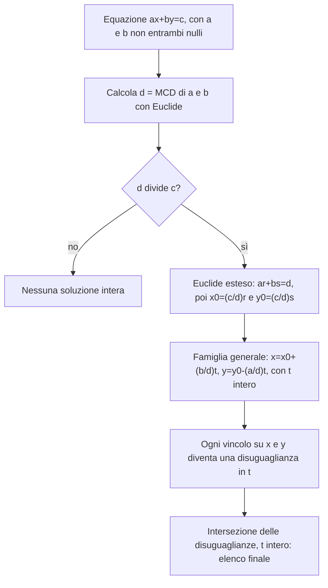

# Equazioni diofantee

Prerequisiti: [[Books/Aritmetica-I/08 - Divisione euclidea e identità di Bezout|divisione euclidea, Bézout e lemma di Euclide]]; per contare le rappresentazioni finali, [[Books/Aritmetica-I/09 - Primi e fattorizzazione unica|divisori e fattorizzazione]]. Torna all’[[Books/Aritmetica-I/00 - Indice e piano di studio|indice]].

> [!info] In questo capitolo
> - Deciderai se $ax+by=c$ ha soluzioni intere guardando soltanto $\gcd(a,b)$ e $c$.
> - Costruirai una soluzione con l'algoritmo di Euclide esteso e le scriverai tutte con un unico parametro intero $t$.
> - Tradurrai vincoli come «non negativo» o «compreso fra $-100$ e $100$» in condizioni su $t$.
> - Userai la stessa idea, trasformare l'equazione in un prodotto di fattori, per $x^2-y^2=n$.
>
> L'idea che lega il capitolo: i punti interi di una retta formano una successione regolare, con un passo fisso, il più piccolo possibile (primitivo), che non salta nessun punto.

## Domande per iniziare dagli esercizi

Prova prima gli esercizi indicati dalla domanda. Se ti manca uno strumento, apri soltanto la sezione collegata, poi torna al problema e ricostruisci il passaggio senza guardare. Per le prove, scrivi ipotesi, tesi e motivo di ogni implicazione. I riscontri sono raccolti dopo la teoria.

La tabella copre tutte le sezioni teoriche del capitolo, compresi casi limite e approfondimenti. Gli esercizi 1–8 conservano la numerazione originaria; dal 9 trovi le integrazioni. Gli esercizi tratti dal PDF fornito hanno un riferimento esplicito alla fonte; gli altri sono redazionali.

| Domanda guida | Esercizi da tentare | Teoria da recuperare |
|---|---|---|
| Perché una retta reale può non avere punti interi? | [[#Esercizio 9 — Una retta dentro un quadrato (vincoli sul parametro e cambi di parametrizzazione)\|9]] | [[#Una retta, ma soltanto punti interi\|Una retta, ma soltanto punti interi]] |
| Quale divisibilità decide se esiste almeno una soluzione? | [[#Esercizio 1 — Esiste un punto intero (criterio di risolubilità diofantea)\|1]], [[#Esercizio 2 — Tutti i punti della retta (parametrizzazione completa)\|2]], [[#Esercizio 3 — Coefficienti nulli (casi degeneri delle diofantee)\|3]], [[#Esercizio 10 — Dal problema generale alla formula (dimostrazione completa delle diofantee lineari)\|10]] | [[#Il massimo comune divisore decide l’esistenza\|Il massimo comune divisore decide l’esistenza]] |
| Come provi che la famiglia parametrica contiene tutte le soluzioni? | [[#Esercizio 1 — Esiste un punto intero (criterio di risolubilità diofantea)\|1]], [[#Esercizio 2 — Tutti i punti della retta (parametrizzazione completa)\|2]], [[#Esercizio 3 — Coefficienti nulli (casi degeneri delle diofantee)\|3]], [[#Esercizio 5 — Un passo troppo lungo (vettore primitivo e completezza)\|5]], [[#Esercizio 10 — Dal problema generale alla formula (dimostrazione completa delle diofantee lineari)\|10]] | [[#Da una soluzione a tutte le altre\|Da una soluzione a tutte le altre]] |
| Quali passi e cambi di parametro saltano punti del reticolo? | [[#Esercizio 5 — Un passo troppo lungo (vettore primitivo e completezza)\|5]], [[#Esercizio 9 — Una retta dentro un quadrato (vincoli sul parametro e cambi di parametrizzazione)\|9]], [[#Esercizio 10 — Dal problema generale alla formula (dimostrazione completa delle diofantee lineari)\|10]] | [[#Il passo fondamentale sul reticolo\|Il passo fondamentale sul reticolo]] |
| Quale sequenza di controlli porta a una soluzione completa? | [[#Esercizio 9 — Una retta dentro un quadrato (vincoli sul parametro e cambi di parametrizzazione)\|9]], [[#Esercizio 10 — Dal problema generale alla formula (dimostrazione completa delle diofantee lineari)\|10]] | [[#Il metodo in uno schema\|Il metodo in uno schema]] |
| Come intersechi i vincoli su entrambe le coordinate? | [[#Esercizio 9 — Una retta dentro un quadrato (vincoli sul parametro e cambi di parametrizzazione)\|9]] | [[#Un esempio completo: una retta dentro un quadrato\|Un esempio completo: una retta dentro un quadrato]] |
| Come cambia il risultato imponendo quantità non negative o positive? | [[#Esercizio 4 — Quaderni in pacchi (vincoli non negativi e positivi)\|4]], [[#Esercizio 9 — Una retta dentro un quadrato (vincoli sul parametro e cambi di parametrizzazione)\|9]] | [[#Quantità non negative e positive\|Quantità non negative e positive]] |
| Come trasformi una differenza di quadrati in fattori di pari parità? | [[#Esercizio 6 — Dalla differenza al prodotto (differenze di quadrati)\|6]], [[#Esercizio 7 — Contare le rappresentazioni (divisori e parità dei fattori)\|7]], [[#Esercizio 8 — Completare un prodotto (trasformazione reversibile di una diofantea)\|8]], [[#Esercizio 9 — Una retta dentro un quadrato (vincoli sul parametro e cambi di parametrizzazione)\|9]] | [[#Differenze di quadrati: trasformare invece di tentare\|Differenze di quadrati: trasformare invece di tentare]] |

## Esercizi per verificare la comprensione

Gli esercizi 1–6 allenano gli strumenti di base; 7–8 li collegano ad altri problemi. Le integrazioni successive completano il controllo della teoria; quelle dalla raccolta fornita sono segnalate con numero e pagina. Non serve riuscire subito: individua che cosa ti manca, studia il passaggio collegato e riprova.

### Esercizio 1 — Esiste un punto intero (criterio di risolubilità diofantea)

Determina se $6x+10y=7$ e $6x+10y=8$ hanno soluzioni in $\mathbb Z^2$. Per ciascuna equazione risolubile, scrivi tutte le soluzioni.

Se ti blocchi: [[#Il massimo comune divisore decide l’esistenza|Il massimo comune divisore decide l’esistenza]] · [[#Da una soluzione a tutte le altre|Da una soluzione a tutte le altre]].

Controllo dopo il tentativo: [[#Riscontro 1|riscontro 1]].

### Esercizio 2 — Tutti i punti della retta (parametrizzazione completa)

Risolvi $18x+30y=12$ in $\mathbb Z^2$, giustificando sia l’esistenza sia la completezza della famiglia.

Se ti blocchi: [[#Il massimo comune divisore decide l’esistenza|Il massimo comune divisore decide l’esistenza]] · [[#Da una soluzione a tutte le altre|Da una soluzione a tutte le altre]].

Controllo dopo il tentativo: [[#Riscontro 2|riscontro 2]].

### Esercizio 3 — Coefficienti nulli (casi degeneri delle diofantee)

Descrivi tutte le soluzioni intere di $0x-7y=21$ e di $5x+0y=-10$. Descrivi poi quelle di $0x+0y=0$ e $0x+0y=1$.

Se ti blocchi: [[#Il massimo comune divisore decide l’esistenza|Il massimo comune divisore decide l’esistenza]] · [[#Da una soluzione a tutte le altre|Da una soluzione a tutte le altre]].

Controllo dopo il tentativo: [[#Riscontro 3|riscontro 3]].

### Esercizio 4 — Quaderni in pacchi (vincoli non negativi e positivi)

Si acquistano pacchi da 4 e da 7 quaderni per un totale di 40 quaderni. Determina tutte le coppie di quantità non negative; determina poi quelle che usano entrambi i formati.

Se ti blocchi: [[#Quantità non negative e positive|Quantità non negative e positive]].

Controllo dopo il tentativo: [[#Riscontro 4|riscontro 4]].

### Esercizio 5 — Un passo troppo lungo (vettore primitivo e completezza)

Uno studente trova la soluzione $(-1,1)$ di $6x+9y=3$ e afferma che tutte le soluzioni sono $x=-1+9t$, $y=1-6t$, $t\in\mathbb Z$. Diagnostica l’errore e fornisci una soluzione che la formula perde.

Se ti blocchi: [[#Da una soluzione a tutte le altre|Da una soluzione a tutte le altre]] · [[#Il passo fondamentale sul reticolo|Il passo fondamentale sul reticolo]].

Controllo dopo il tentativo: [[#Riscontro 5|riscontro 5]].

### Esercizio 6 — Dalla differenza al prodotto (differenze di quadrati)

Determina tutte le soluzioni in $\mathbb Z^2$ di $x^2-y^2=20$ e di $x^2-y^2=-15$. Giustifica perché non ne mancano.

Se ti blocchi: [[#Differenze di quadrati: trasformare invece di tentare|Differenze di quadrati: trasformare invece di tentare]].

Controllo dopo il tentativo: [[#Riscontro 6|riscontro 6]].

### Esercizio 7 — Contare le rappresentazioni (divisori e parità dei fattori)

Per $N\ge1$, indica con $\tau(N)$ il numero dei divisori positivi. Dimostra che per $n\ne0$ il numero di soluzioni intere ordinate di $x^2-y^2=n$ è $2\tau(|n|)$ se $n$ è dispari, $2\tau(|n|/4)$ se $4\mid n$, e zero negli altri casi. Controlla il risultato per $n=45$ e $n=36$.

Se ti blocchi: [[#Differenze di quadrati: trasformare invece di tentare|Differenze di quadrati: trasformare invece di tentare]].

Controllo dopo il tentativo: [[#Riscontro 7|riscontro 7]].

### Esercizio 8 — Completare un prodotto (trasformazione reversibile di una diofantea)

Risolvi $xy+x+y=14$ prima in $\mathbb Z^2$, poi in $\mathbb N^2$, infine con $x,y>0$. Cerca una trasformazione che porti a un prodotto senza perdere soluzioni.

Se ti blocchi: [[#Differenze di quadrati: trasformare invece di tentare|Differenze di quadrati: trasformare invece di tentare]].

Controllo dopo il tentativo: [[#Riscontro 8|riscontro 8]].

### Esercizio 9 — Una retta dentro un quadrato (vincoli sul parametro e cambi di parametrizzazione)

Trova tutte le soluzioni intere di $7x+11y=1$ con $|x|,|y|\le20$. Per la famiglia completa, confronta i cambi $t=s+3$, $t=-s$ e $t=2s$: quali conservano tutte le soluzioni e perché? Dimostra infine il criterio «$n$ è differenza di quadrati interi se e solo se è dispari o multiplo di quattro» e descrivi tutte le soluzioni per $n=0$.

Se ti blocchi: [[#Una retta, ma soltanto punti interi|Una retta, ma soltanto punti interi]] · [[#Il passo fondamentale sul reticolo|Il passo fondamentale sul reticolo]] · [[#Il metodo in uno schema|Il metodo in uno schema]] · [[#Un esempio completo: una retta dentro un quadrato|Un esempio completo: una retta dentro un quadrato]] · [[#Quantità non negative e positive|Quantità non negative e positive]] · [[#Differenze di quadrati: trasformare invece di tentare|Differenze di quadrati: trasformare invece di tentare]].

Controllo dopo il tentativo: [[#Riscontro 9|riscontro 9]].

### Esercizio 10 — Dal problema generale alla formula (dimostrazione completa delle diofantee lineari)

*Dalla raccolta fornita: esercizio preliminare 7, p. 55 stampata / [[Books/Aritmetica-I/Fonti/Esercizi algebra 1 2.pdf#page=66|p. 66 del PDF]]. Enunciato riformulato; riscontro redazionale.*

Per $a,b$ non entrambi nulli, determina in funzione di $a,b,c$ tutte le soluzioni di $ax+by=c$. Devi provare sia il criterio di esistenza sia la completezza della parametrizzazione e l'unicità del parametro. Tratta esplicitamente $a=0$ oppure $b=0$; una sostituzione che verifica alcune soluzioni non conclude la prova.

Se ti blocchi: [[#Il massimo comune divisore decide l’esistenza|Il massimo comune divisore decide l’esistenza]] · [[#Da una soluzione a tutte le altre|Da una soluzione a tutte le altre]] · [[#Il passo fondamentale sul reticolo|Il passo fondamentale sul reticolo]] · [[#Il metodo in uno schema|Il metodo in uno schema]].

Controllo dopo il tentativo: [[#Riscontro 10|riscontro 10]].

## Teoria da recuperare

Usa i collegamenti della tabella iniziale per leggere lo strumento che ti serve. Dopo la lettura, torna all’esercizio e prova a risolverlo senza suggerimenti.

## Una retta, ma soltanto punti interi

Un magazzino prepara confezioni da 6 oppure da 9 pezzi. In quanti modi può spedire esattamente 54 pezzi? Se $x$ conta le confezioni piccole e $y$ quelle grandi, dobbiamo risolvere

$$
6x+9y=54,
\qquad x,y\in\mathbb N.
$$

Nel piano cartesiano l’uguaglianza descrive una retta. Ma quasi tutti i suoi punti non rappresentano spedizioni: non possiamo preparare $\tfrac12$ confezione. Dobbiamo cercare i punti della retta nel **reticolo** $\mathbb Z^2$, cioè le coppie di interi, e poi conservare quelli con coordinate non negative. Qui, come nel resto del libro, $0\in\mathbb N$.

Un’equazione in cui si cercano soluzioni intere si chiama **diofantea**. La forma lineare in due incognite è

$$
ax+by=c,
\qquad a,b,c\in\mathbb Z,
\qquad (x,y)\in\mathbb Z^2.
$$

Assumiamo che $a,b$ non siano entrambi nulli: questa è precisamente l’ipotesi che permette di parlare di una retta. Vogliamo rispondere a tre domande: esistono punti interi? Come ne troviamo uno? Come siamo certi di averli trovati tutti?

## Il massimo comune divisore decide l’esistenza

Poniamo $d=\gcd(a,b)>0$. Il criterio fondamentale è

> [!abstract] Concetto chiave — Criterio di esistenza
> Con $d=\gcd(a,b)$:
> $$
> ax+by=c\text{ ha soluzioni intere}\iff d\mid c.
> $$
> È il primo controllo da fare, prima di cercare qualsiasi soluzione. La stessa idea decide le congruenze lineari ([[Books/Aritmetica-I/11 - Congruenze e inversi modulari|capitolo 11]]) e la compatibilità dei sistemi ([[Books/Aritmetica-I/12 - Sistemi e teorema cinese del resto|capitolo 12]]).

Dimostriamo separatamente le due implicazioni, perché hanno significati diversi.

**Necessità.** Supponiamo di avere una soluzione $(x,y)$. Poiché $d$ divide entrambi i coefficienti, possiamo scrivere $a=da_1$, $b=db_1$. Allora

$$
c=ax+by=d(a_1x+b_1y).
$$

La parentesi è un intero: dunque $d\mid c$. Per esempio, $6x+9y=55$ è impossibile negli interi, perché il primo membro è sempre multiplo di 3 e 55 non lo è.

**Sufficienza.** Supponiamo invece $d\mid c$, e scriviamo $c=d\gamma$ con $\gamma\in\mathbb Z$. L’identità di Bézout, dimostrata nel capitolo 08, fornisce interi $r,s$ tali che

$$
ar+bs=d.
$$

Moltiplicare questa uguaglianza per $\gamma$ produce

$$
a(\gamma r)+b(\gamma s)=d\gamma=c.
$$

Quindi $(x_0,y_0)=(\gamma r,\gamma s)$ è una soluzione. Non abbiamo soltanto provato che esiste: Euclide esteso, cioè l'algoritmo di Euclide percorso all'indietro per scrivere il MCD come combinazione di $a$ e $b$ (capitolo 08), permette di costruirla.

> [!example] Esempi e controesempi — equazione lineare con soluzioni intere
> **Ha soluzioni intere:** $6x+9y=54$ ($d=3$ divide 54; per esempio $(0,6)$); $11x+41y=2$ ($d=1$ divide ogni termine noto; per esempio $(30,-8)$).
> **Non ha soluzioni intere:** $6x+9y=55$, dove fallisce l'unica condizione $d\mid c$ (3 non divide 55: il primo membro è sempre multiplo di 3); $4x+10y=7$ ($d=2$: il primo membro è pari, 7 no).
> **Senza l'ipotesi sui coefficienti:** $0x+0y=c$ non è una retta; il MCD sarebbe 0 e il criterio non ha senso (nessuna soluzione se $c\ne0$, tutte le coppie se $c=0$).

Quando il criterio è soddisfatto possiamo dividere **tutta** l’equazione per $d$:

$$
a_1x+b_1y=c_1,
\qquad a_1=\frac ad,\quad b_1=\frac bd,\quad c_1=\frac cd.
$$

Le soluzioni rimangono identiche e $a_1,b_1$ sono **coprimi**, cioè $\gcd(a_1,b_1)=1$: non hanno divisori comuni oltre a $\pm1$. Un modo rapido per verificarlo è dividere per $d$ la relazione di Bézout: $a_1r+b_1s=1$. Ogni divisore comune di $a_1,b_1$ deve allora dividere 1.

> [!warning] Attenzione — Intero non significa non negativo
> Il criterio $d\mid c$ garantisce soluzioni in $\mathbb Z^2$. Non garantisce confezioni, monete o quantità fisiche ammissibili. Per esempio $6x+9y=3$ ha la soluzione $(-1,1)$, ma nessuna soluzione non negativa: una confezione non vuota contiene già almeno 6 pezzi.

I casi con un coefficiente nullo sono particolarmente trasparenti. Se $a=0$ e $b\ne0$, occorre $b\mid c$; allora $y=c/b$ e $x$ è un intero arbitrario. Se $b=0$ e $a\ne0$, occorre $a\mid c$; allora $x=c/a$ e $y$ è arbitrario. Il criterio comprende entrambi i casi, perché $\gcd(0,b)=|b|$. Se fossero invece $a=b=0$, esclusi dall’enunciato, avremmo tutte le coppie intere per $c=0$ e nessuna per $c\ne0$.

## Da una soluzione a tutte le altre

Una soluzione sola non basta: vogliamo sapere che cosa resta fuori. Supponiamo ora $d\mid c$ e fissiamo una soluzione $(x_0,y_0)$. Il risultato completo è questo.

> [!abstract] Concetto chiave — Tutte le soluzioni di $ax+by=c$
> Se $d=\gcd(a,b)$ divide $c$ e $(x_0,y_0)$ è una soluzione, le soluzioni intere sono tutte e sole
> $$
> \begin{aligned}
> x&=x_0+\frac bd\,t,\\
> y&=y_0-\frac ad\,t,
> \end{aligned}
> \qquad t\in\mathbb Z,
> $$
> con un parametro $t$ diverso per ogni soluzione.
> È il modello per ogni «soluzione particolare più soluzioni dell'omogenea» del libro: lo ritroviamo nelle congruenze lineari ([[Books/Aritmetica-I/11 - Congruenze e inversi modulari|capitolo 11]]) e nei sistemi ([[Books/Aritmetica-I/12 - Sistemi e teorema cinese del resto|capitolo 12]]).

Per dimostrarlo occorre verificare due cose: le coppie scritte funzionano; ogni soluzione è fra quelle coppie.

La prima verifica è diretta. Per ogni intero $t$,

$$
\begin{aligned}
ax+by
&=a\left(x_0+\frac bd t\right)
 +b\left(y_0-\frac ad t\right)\\
&=ax_0+by_0+\frac{ab}{d}t-\frac{ab}{d}t=c.
\end{aligned}
$$

Per la completezza, consideriamo prima $a,b\ne0$. Sia $(x,y)$ una soluzione qualsiasi. Sottraendo l’uguaglianza relativa a $(x_0,y_0)$ eliminiamo il termine noto:

$$
a(x-x_0)+b(y-y_0)=0.
$$

Dividiamo per $d$ e poniamo $u=x-x_0$, $v=y-y_0$:

$$
a_1u=-b_1v.
$$

Questa è l’equazione **omogenea** associata, cioè la stessa equazione con termine noto $0$: le sue soluzioni sono proprio le differenze fra soluzioni dell'equazione originale. Dice che $b_1\mid a_1u$; poiché $\gcd(a_1,b_1)=1$, il lemma di Euclide (un numero che divide un prodotto ed è coprimo con un fattore divide l'altro) dà $b_1\mid u$. Esiste quindi $t\in\mathbb Z$ con $u=b_1t$. Sostituendo,

$$
a_1b_1t=-b_1v.
$$

Qui $b_1\ne0$, dunque possiamo cancellarlo e ottenere $v=-a_1t$. Tornando a $x,y$ troviamo proprio la formula annunciata. Il parametro è unico, perché $b_1t=b_1t'$ implica $t=t'$.

Trattiamo adesso separatamente i coefficienti nulli, senza cancellare uno zero. Se $a=0$, allora $d=|b|$ e $b/d$ è $1$ oppure $-1$: la formula lascia $y=y_0=c/b$ e fa percorrere a $x=x_0+(b/d)t$ tutti gli interi, una volta ciascuno. Se $b=0$, analogamente lascia $x=x_0=c/a$ e fa percorrere a $y=y_0-(a/d)t$ tutti gli interi. Anche in questi casi la famiglia è completa e il parametro è unico.

Abbiamo così distinto una verifica per sostituzione da una dimostrazione di completezza: produrre infinite soluzioni non basta, da solo, a provarne l’esaustività.

> [!example] Esempi e controesempi — la famiglia di tutte le soluzioni
> Prendiamo $2x+3y=18$ (qui $d=1$, il passo è $(3,-2)$).
> **È la famiglia completa:** punto di partenza $(0,6)$ e passo $(3,-2)$: $(0,6),(3,4),(6,2),(9,0),(-3,8),\dots$ Ogni soluzione compare una volta sola.
> **Il punto di partenza non è una soluzione:** $(1,1)$ con lo stesso passo dà $2+3=5\ne18$. Fallisce la condizione «$(x_0,y_0)$ risolve l'equazione».
> **Il passo non è parallelo alla retta:** $(0,6)+t(3,2)$ dà per $t=1$ il punto $(3,8)$, e $6+24=30\ne18$. Fallisce la condizione «il passo $(b/d,-a/d)$».
> **Il passo non è primitivo:** per $6x+9y=54$ il passo corretto è $(3,-2)$; col passo $(9,-6)$ da $(0,6)$ si ottengono $(0,6),(9,0),\dots$ e si salta $(3,4)$. Si perde l'esaustività, non la validità delle coppie trovate.

## Il passo fondamentale sul reticolo

La formula si può leggere geometricamente:

$$
(x,y)=(x_0,y_0)+t\left(\frac bd,-\frac ad\right).
$$

Il vettore $w=(b/d,-a/d)$ è parallelo alla retta, perché $a(b/d)+b(-a/d)=0$. Inoltre le sue coordinate sono coprime. Un vettore intero con questa proprietà si dice **primitivo**.

Perché la primitività conta? Se usassimo $2w$, otterremmo ancora punti della retta, ma salteremmo quelli corrispondenti ai parametri dispari. La dimostrazione precedente ci assicura che $w$ dà il passo fra punti interi consecutivi: fra $(x_0,y_0)+tw$ e $(x_0,y_0)+(t+1)w$ non può esserci un altro punto intero della retta, perché il suo parametro dovrebbe essere un intero strettamente compreso fra $t$ e $t+1$.

Se scegliamo un’altra soluzione iniziale $P_1=P_0+kw$, otteniamo

$$
P_1+sw=P_0+(k+s)w.
$$

Poiché $s\mapsto k+s$ percorre tutti gli interi, la famiglia non cambia. Anche invertire il verso, usando $-w$ e sostituendo $t$ con $-t$, conserva tutti i punti.

> [!warning] Attenzione — Un cambio di parametro deve percorrere tutti gli interi
> Le sostituzioni $t=s+k$ e $t=-s$ conservano l’intera famiglia. La sostituzione $t=2s$ seleziona soltanto i parametri pari: in generale perde metà delle soluzioni. Analogamente, il passo $(b,-a)$ può saltare punti se $d>1$: il passo fondamentale è $(b/d,-a/d)$.

## Il metodo in uno schema

Prima di un esempio completo, ecco i passi nell'ordine in cui si eseguono. Si legge dall'alto verso il basso; il rombo è la sola scelta, e il ramo «no» chiude il problema.

## Un esempio completo: una retta dentro un quadrato

Cerchiamo le soluzioni di

$$
11x+41y=2
$$

che soddisfano anche $|x|\le100$ e $|y|\le100$. Le divisioni di Euclide sono

$$
41=3\cdot11+8,\quad 11=8+3,\quad
8=2\cdot3+2,\quad 3=2+1.
$$

L’ultimo resto non nullo è 1. Risaliamo per scriverlo usando i coefficienti originali:

$$
\begin{aligned}
1&=3-2=3-(8-2\cdot3)=3\cdot3-8\\
 &=3(11-8)-8=3\cdot11-4\cdot8\\
 &=3\cdot11-4(41-3\cdot11)=15\cdot11-4\cdot41.
\end{aligned}
$$

Moltiplicando per 2 troviamo $(x_0,y_0)=(30,-8)$. Tutte le soluzioni sono dunque

$$
x=30+41t,\qquad y=-8-11t,\qquad t\in\mathbb Z.
$$

Il primo vincolo equivale a

$$
-100\le30+41t\le100
\iff -\frac{130}{41}\le t\le\frac{70}{41}.
$$

I soli interi candidati sono $-3,-2,-1,0,1$. Occorre ancora controllare il vincolo su $y$: non possiamo dedurlo dal primo senza una verifica. Otteniamo:

| $t$ | $x$ | $y$ |
|---:|---:|---:|
| $-3$ | $-93$ | $25$ |
| $-2$ | $-52$ | $14$ |
| $-1$ | $-11$ | $3$ |
| $0$ | $30$ | $-8$ |
| $1$ | $71$ | $-19$ |

Tutte e cinque le coppie rispettano entrambi i vincoli. Sono esattamente cinque: la parametrizzazione è completa e parametri diversi danno coppie diverse.

## Quantità non negative e positive

Torniamo al magazzino. Dividendo $6x+9y=54$ per 3 abbiamo $2x+3y=18$. La soluzione $(0,6)$ si vede subito, senza Euclide esteso, e la famiglia completa è

$$
x=3t,\qquad y=6-2t,\qquad t\in\mathbb Z.
$$

La condizione $x,y\ge0$ diventa $t\ge0$ e $t\le3$. Le spedizioni possibili sono perciò

$$
(0,6),\quad(3,4),\quad(6,2),\quad(9,0).
$$

Se chiediamo di usare **entrambi** i formati, imponiamo $x,y>0$: rimangono soltanto $(3,4)$ e $(6,2)$. La teoria prima descrive il reticolo di soluzioni; il significato concreto del problema determina quali punti conservarne.

In generale ogni vincolo sulle coordinate diventa un vincolo sul medesimo parametro $t$. Bisogna intersecarli e infine ricordare che $t$ è intero. Se si divide una disuguaglianza per un coefficiente negativo, il verso si inverte: i segni dei coefficienti non sono un dettaglio del calcolo.

## Differenze di quadrati: trasformare invece di tentare

Consideriamo ora un’equazione non lineare:

$$
x^2-y^2=n,\qquad x,y,n\in\mathbb Z.
$$

Provare quadrati successivi può dare esempi, ma non spiega quando fermarsi. La fattorizzazione suggerisce un cambiamento di variabili:

$$
u=x+y,\qquad v=x-y,\qquad uv=n.
$$

C’è però un vincolo: $u-v=2y$ è pari, dunque $u$ e $v$ hanno la stessa parità. Viceversa, dati interi $u,v$ della stessa parità con $uv=n$, poniamo

$$
x=\frac{u+v}{2},\qquad y=\frac{u-v}{2}.
$$

Sono interi, e

$$
x^2-y^2=\frac{(u+v)^2-(u-v)^2}{4}=uv=n.
$$

Le due trasformazioni sono inverse. Abbiamo quindi una corrispondenza esatta fra soluzioni $(x,y)$ e **coppie ordinate** di fattori $(u,v)$ di uguale parità. Scambiare $u,v$ cambia $y$ nel suo opposto e può dare una soluzione diversa.

> [!example] Esempi e controesempi — coppie $(u,v)$ ammissibili
> **È ammissibile:** per $n=45$, $(u,v)=(9,5)$: stessa parità (dispari) e $uv=45$; dà $(x,y)=(7,2)$. Per $n=20$, $(u,v)=(2,10)$: entrambi pari, $uv=20$; dà $(6,-4)$, e $36-16=20$.
> **Parità diversa (la sola condizione che fallisce):** per $n=26$, $(u,v)=(2,13)$ ha $uv=26$ ma darebbe $x=15/2$, non intero.
> **Prodotto sbagliato (la sola condizione che fallisce):** $(u,v)=(3,5)$ ha la stessa parità, ma $uv=15\ne45$: dà $(4,-1)$, cioè $16-1=15$, non 45.

### Quali interi sono differenze di quadrati?

Se $u,v$ sono entrambi dispari, il loro prodotto è dispari; se sono entrambi pari, il prodotto è divisibile per 4. Non può quindi essere $n=4k+2$ per alcun $k\in\mathbb Z$. In particolare 26 non è una differenza di quadrati interi: in ogni fattorizzazione uno dei fattori è pari e l’altro dispari.

Dimostriamo anche la sufficienza. Se $n$ è dispari, i fattori $u=n$, $v=1$ hanno uguale parità e forniscono

$$
x=\frac{n+1}{2},\qquad y=\frac{n-1}{2}.
$$

Se $n=4m$, scegliamo $u=2m$, $v=2$ e otteniamo

$$
x=m+1,\qquad y=m-1.
$$

Queste costruzioni funzionano anche per $n<0$ e per $m=0$. Dunque, per ogni $n\in\mathbb Z$,

$$
\boxed{x^2-y^2=n\text{ è risolubile}\iff
n\text{ è dispari oppure }4\mid n.}
$$

Per esempio $-12=2^2-4^2$: un risultato negativo significa semplicemente che il secondo quadrato è più grande.

La tabella riassume il criterio: si legge guardando la forma di $n$ nella prima colonna.

| Forma di $n$ | Risolubile in $\mathbb Z^2$? | Esempio o motivo |
|---|---|---|
| dispari | sì | $7=4^2-3^2$, $\ 45=23^2-22^2$ |
| multiplo di 4 | sì | $8=3^2-1^2$, $\ 20=6^2-4^2$ |
| $4k+2$ | no | $26$, $\ 6$: in ogni fattorizzazione un fattore è pari e l'altro dispari |

### Come trovare tutte le rappresentazioni

Per $n\ne0$, ogni coppia di fattori si ottiene scegliendo un **divisore intero non nullo**, anche negativo, $d\mid n$, e ponendo $(u,v)=(d,n/d)$. Conserviamo quelli di uguale parità e applichiamo le formule inverse. Ogni soluzione compare una sola volta, perché da $(x,y)$ recuperiamo univocamente $d=x+y$.

Se $n$ è dispari, ogni divisore intero è ammissibile e tutte le soluzioni sono

$$
(x,y)=\left(\frac{d+n/d}{2},\frac{d-n/d}{2}\right),
\qquad d\in\mathbb Z\setminus\{0\},\quad d\mid n.
$$

Se $n=4m\ne0$, i fattori ammissibili sono entrambi pari. Scrivendoli $u=2d$, $v=2e$ abbiamo $de=m$; quindi tutte le soluzioni sono

$$
(x,y)=\left(d+\frac md,d-\frac md\right),
\qquad d\in\mathbb Z\setminus\{0\},\quad d\mid m.
$$

Per esempio, per $n=45$, le coppie positive di fattori, senza ancora scambiare l’ordine, sono $(45,1),(15,3),(9,5)$. Producono rispettivamente $(23,22),(9,6),(7,2)$. Scambiando i fattori otteniamo il segno opposto di $y$; negandoli entrambi otteniamo gli altri segni. Le dodici soluzioni sono

$$
(\pm23,\pm22),\qquad(\pm9,\pm6),\qquad(\pm7,\pm2),
$$

con i segni scelti indipendentemente. Per controllo: $529-484=45$, $81-36=45$, $49-4=45$.

Per $n=0$ usiamo invece direttamente $(x+y)(x-y)=0$. Un prodotto di interi è zero soltanto se almeno un fattore è zero, dunque

$$
x=y\quad\text{oppure}\quad x=-y.
$$

Sono due rette con infiniti punti interi e con il punto $(0,0)$ in comune. Il procedimento finito tramite i divisori di un intero non nullo non si applica a questo caso.

## Fonti

La struttura delle equazioni lineari segue [[Notes/Aritmetica/Lectures/2026-10-06 - Equazioni diofantee lineari e loro soluzioni|la nota del 6 ottobre]] e [[_transcripts/Aritmetica/2026-10-06 - Equazioni diofantee lineari e loro soluzioni|la relativa trascrizione]]. Il problema $11x+41y=2$ con i vincoli è presente in [[Notes/Aritmetica/Lectures/2026-10-13 - Divisori, algoritmo di Euclide e conteggio combinatorio|nota del 13 ottobre]] e [[_transcripts/Aritmetica/2026-10-13 - Divisori, algoritmo di Euclide e conteggio combinatorio|trascrizione del 13 ottobre]]. La differenza di quadrati e l’esempio 26 provengono dalla parte finale di [[Notes/Aritmetica/Lectures/2026-10-14 - Sviluppi decimali razionali e fattorizzazione dei denominatori|nota del 14 ottobre]] e [[_transcripts/Aritmetica/2026-10-14 - Sviluppi decimali razionali e fattorizzazione dei denominatori|trascrizione del 14 ottobre]].

Sono integrazioni didattiche la narrazione sulle confezioni, l’esplicitazione dei coefficienti nulli, la lettura mediante il vettore primitivo, l’esempio 45 e gli esercizi. Le prove sono riscritte e controllate; la classificazione per parità è esposta senza richiedere le congruenze del capitolo successivo.

## Riscontri degli esercizi

Apri il riscontro soltanto dopo aver scritto un tentativo. Per una dimostrazione, confronta anche le ipotesi e la completezza, non soltanto il risultato.

### Riscontro 1

> [!tip]- Riscontro 1
> Il MCD è 2: non divide 7, ma divide 8. Per la seconda equazione $(3,-1)$ è una soluzione, perché $18-10=8$. Tutte le soluzioni sono $x=3+5t$, $y=-1-3t$, con $t\in\mathbb Z$.

Torna a [[#Esercizio 1 — Esiste un punto intero (criterio di risolubilità diofantea)|esercizio 1]].

### Riscontro 2

> [!tip]- Riscontro 2
> Il MCD è 6 e divide 12. Dividendo otteniamo $3x+5y=2$, con soluzione $(-1,1)$. Sottrarre questa soluzione e usare la coprimalità di 3 e 5 dà $x=-1+5t$, $y=1-3t$, $t\in\mathbb Z$. La sostituzione verifica il viceversa.

Torna a [[#Esercizio 2 — Tutti i punti della retta (parametrizzazione completa)|esercizio 2]].

### Riscontro 3

> [!tip]- Riscontro 3
> Nel primo caso $y=-3$ e $x$ è arbitrario: $(t,-3)$, $t\in\mathbb Z$. Nel secondo $x=-2$ e $y$ è arbitrario: $(-2,t)$. La terza uguaglianza vale per ogni coppia di interi; la quarta per nessuna. Gli ultimi due casi non descrivono una retta.

Torna a [[#Esercizio 3 — Coefficienti nulli (casi degeneri delle diofantee)|esercizio 3]].

### Riscontro 4

> [!tip]- Riscontro 4
> L’equazione è $4x+7y=40$. Partendo da $(3,4)$ troviamo $x=3+7t$, $y=4-4t$. La non negatività impone $t\ge0$ e $t\le1$, dunque $(3,4)$ e $(10,0)$. La positività di entrambe le coordinate lascia soltanto $(3,4)$.

Torna a [[#Esercizio 4 — Quaderni in pacchi (vincoli non negativi e positivi)|esercizio 4]].

### Riscontro 5

> [!tip]- Riscontro 5
> Le coppie proposte soddisfano l’equazione, ma il passo $(9,-6)$ non è primitivo: è tre volte $(3,-2)$. La famiglia completa è $x=-1+3s$, $y=1-2s$, $s\in\mathbb Z$. Per $s=1$ troviamo $(2,-1)$, che la formula proposta non raggiunge: richiederebbe $t=1/3$.

Torna a [[#Esercizio 5 — Un passo troppo lungo (vettore primitivo e completezza)|esercizio 5]].

### Riscontro 6

> [!tip]- Riscontro 6
> Per 20 scriviamo $20=4\cdot5$: i divisori interi di 5 sono $\pm1,\pm5$, e la formula dà $(\pm6,\pm4)$, con segni indipendenti: quattro soluzioni. Per $-15$ usiamo tutti gli otto divisori interi $\pm1,\pm3,\pm5,\pm15$; otteniamo $(\pm7,\pm8)$ e $(\pm1,\pm4)$, ancora con segni indipendenti: otto soluzioni. La corrispondenza con le coppie ordinate di fattori prova la completezza.

Torna a [[#Esercizio 6 — Dalla differenza al prodotto (differenze di quadrati)|esercizio 6]].

### Riscontro 7

> [!tip]- Riscontro 7
> Nel caso dispari la corrispondenza associa una soluzione a ciascun divisore intero di $n$, e ce ne sono $2\tau(|n|)$, positivi e negativi. Per $n=4m\ne0$ si usano invece i divisori interi di $m$, in numero $2\tau(|m|)$. Per $n=4k+2$ la parità impedisce ogni soluzione. Poiché $\tau(45)=6$, troviamo dodici soluzioni. Poiché $36/4=9$ e $\tau(9)=3$, troviamo sei soluzioni: $(\pm10,\pm8)$, con segni indipendenti, e $(\pm6,0)$. Lo zero nella seconda coordinata non dà due scelte diverse di segno.

Torna a [[#Esercizio 7 — Contare le rappresentazioni (divisori e parità dei fattori)|esercizio 7]].

### Riscontro 8

> [!tip]- Riscontro 8
> Aggiungendo 1 otteniamo $(x+1)(y+1)=15$. Tutte le soluzioni intere sono $(d-1,15/d-1)$, con $d\in\{\pm1,\pm3,\pm5,\pm15\}$. Esplicitamente sono $(0,14),(2,4),(4,2),(14,0),(-2,-16),(-4,-6),(-6,-4),(-16,-2)$. Ogni coppia di fattori dà una soluzione e viceversa. Le prime quattro sono le soluzioni non negative; soltanto $(2,4)$ e $(4,2)$ sono positive.

Torna a [[#Esercizio 8 — Completare un prodotto (trasformazione reversibile di una diofantea)|esercizio 8]].

### Riscontro 9

> [!tip]- Riscontro 9
> Una soluzione è $(8,-5)$ e tutte sono $(8+11t,-5-7t)$. Il vincolo su $x$ dà $-2\le t\le1$; quello su $y$ dà $-3\le t\le2$: restano $t=-2,-1,0,1$, cioè $(-14,9),(-3,2),(8,-5),(19,-12)$. Traslazione e negazione sono biiezioni di $\mathbb Z$; $t=2s$ perde i parametri dispari. Fattori $x+y$ e $x-y$ hanno uguale parità, quindi il prodotto è dispari o multiplo di quattro. Viceversa per $n$ dispari usa $x=(n+1)/2,y=(n-1)/2$; per $n=4m$ usa $x=m+1,y=m-1$. Per zero, $x=y$ oppure $x=-y$.

Torna a [[#Esercizio 9 — Una retta dentro un quadrato (vincoli sul parametro e cambi di parametrizzazione)|esercizio 9]].

### Riscontro 10

> [!tip]- Riscontro 10
> Posto $d=\gcd(a,b)>0$, ogni soluzione implica $d\mid c$. Se $d\mid c$, da $au+bv=d$ ottieni $(x_0,y_0)=((c/d)u,(c/d)v)$. Le soluzioni sono $(x_0+(b/d)t,y_0-(a/d)t)$ con $t\in\mathbb Z$. Sottraendo due soluzioni, $(a/d)(x-x_0)=-(b/d)(y-y_0)$; per coprimalità $b/d$ divide $x-x_0$, e ne segue la formula per $y$. Se $a=0$, $b/d=\pm1$ e $y=c/b$ è fisso, mentre $x$ è arbitrario; se $b=0$ si scambiano i ruoli. In tutti i casi almeno una coordinata del passo è non nulla, quindi il parametro è unico.

Torna a [[#Esercizio 10 — Dal problema generale alla formula (dimostrazione completa delle diofantee lineari)|esercizio 10]].

Hai acquisito il metodo quando sai motivare l’esistenza, costruire una soluzione e dimostrare che la tua famiglia non ne perde nessuna. Nei problemi con vincoli o con quadrati, controlla inoltre che la trasformazione scelta possa essere invertita rispettando integrità, segni e dominio.

---

[[Books/Aritmetica-I/09 - Primi e fattorizzazione unica|← 09 · Primi e fattorizzazione unica]] · [[Books/Aritmetica-I/00 - Indice e piano di studio|Indice]] · [[Books/Aritmetica-I/11 - Congruenze e inversi modulari|11 · Congruenze e inversi modulari →]]
