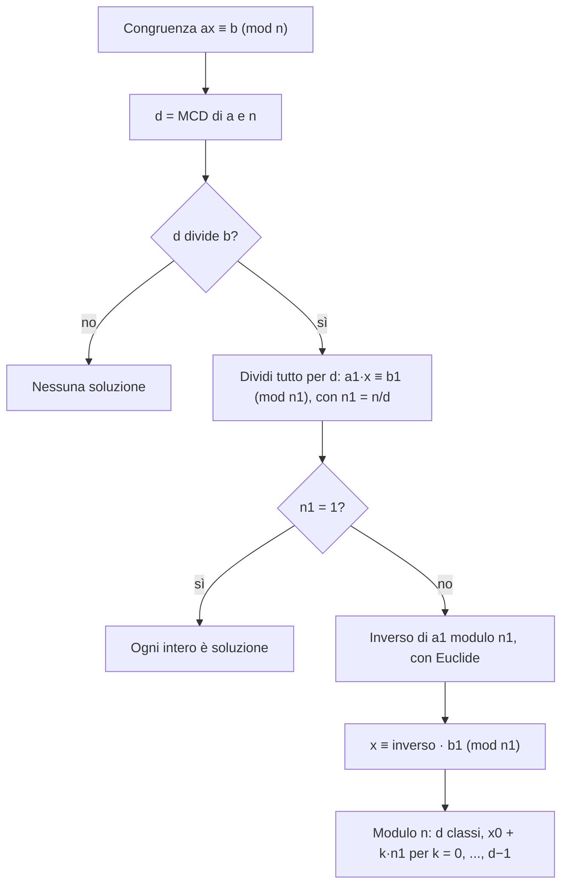

# Congruenze e inversi modulari

Prerequisiti: [[Books/Aritmetica-I/08 - Divisione euclidea e identità di Bezout|divisione euclidea, MCD e Bézout]] e [[Books/Aritmetica-I/10 - Equazioni diofantee|equazioni diofantee]]. Torna all'[[Books/Aritmetica-I/00 - Indice e piano di studio|indice]].

> [!info] In questo capitolo
> - Calcolerai con i resti invece che con numeri grandi, sostituendo ogni numero con uno congruo più piccolo.
> - Capirai quali operazioni si possono fare «modulo $n$» (somma, prodotto, potenza) e quali no (divisione, riduzione dell'esponente).
> - Scoprirai quando un numero ha un inverso modulo $n$ e lo troverai con Euclide.
> - Risolverai ogni congruenza $ax\equiv b\pmod n$ e ne descriverai tutte le soluzioni.
>
> L'idea che lega il capitolo: una congruenza lineare è un'equazione diofantea ([[Books/Aritmetica-I/10 - Equazioni diofantee|capitolo 10]]) travestita, $ax+ny=b$, e si risolve con gli stessi strumenti.

## Un orologio conserva il resto

Sono le 9. Che ora segnerà un orologio di dodici ore dopo altre 17 ore? Sommiamo $9+17=26$, ma sul quadrante leggiamo 2: abbiamo tolto due giri completi. Per questa domanda 26 e 2 portano la stessa informazione. Non sono interi uguali; differiscono di un multiplo di 12.

Lo stesso accade con i giorni della settimana, le posizioni su una ruota e i resti delle divisioni. Il punto è scegliere quale informazione conservare. Se ci interessa soltanto il resto modulo $n$, possiamo sostituire numeri grandi con numeri piccoli senza perdere la risposta cercata.

Siano $a,b\in\mathbb Z$ e $n\geq1$ un intero. Definiamo

$$
a\equiv b\pmod n
\quad\Longleftrightarrow\quad
n\mid(a-b).
$$

Si legge «$a$ è congruo a $b$ modulo $n$». Equivalentemente, $a=b+kn$ per un certo $k\in\mathbb Z$. Per esempio $26\equiv2\pmod{12}$ e $-3\equiv9\pmod{12}$.

Dimostriamo che questa definizione esprime esattamente l'uguaglianza dei resti. Scriviamo le divisioni euclidee

$$
a=q_1n+r_1,\qquad b=q_2n+r_2,
\qquad 0\leq r_1,r_2<n.
$$

Se $r_1=r_2$, sottraendo otteniamo $a-b=(q_1-q_2)n$, dunque $a\equiv b\pmod n$. Viceversa, se $n\mid(a-b)$, dall'uguaglianza

$$
a-b=(q_1-q_2)n+(r_1-r_2)
$$

segue $n\mid(r_1-r_2)$. Ma $|r_1-r_2|<n$ e l'unico multiplo di $n$ con valore assoluto minore di $n$ è zero. Quindi $r_1=r_2$.

Anche gli interi negativi hanno un resto fra $0$ e $n-1$: per esempio $-17=(-4)\cdot5+3$, quindi $-17\equiv3\pmod5$. Modulo 1 tutti gli interi sono congrui, perché 1 divide ogni differenza.

> [!example] Esempi e controesempi — congruenza modulo $n$
> **Sono congrui:** $26$ e $2$ modulo $12$ ($26-2=24=2\cdot12$); $-3$ e $9$ modulo $12$ ($-12$ è multiplo di 12); $-17$ e $3$ modulo $5$ ($-20$).
> **Non sono congrui:** $25$ e $2$ modulo $12$: la differenza $23$ non è multiplo di $12$ (resti $1$ e $2$). È l'unica condizione della definizione, e fallisce.
> **Il modulo conta:** $7\equiv1\pmod6$ ma $7\not\equiv1\pmod4$: la stessa coppia può essere congrua per un modulo e non per un altro.

## Dallo stesso resto alla stessa classe

La congruenza ha tre proprietà concrete, che permettono di usarla con coerenza:

- è **riflessiva**: $a\equiv a\pmod n$, perché $n\mid0$;
- è **simmetrica**: se $n\mid(a-b)$, allora $n\mid-(a-b)=b-a$;
- è **transitiva**: se $n\mid(a-b)$ e $n\mid(b-c)$, allora $n\mid((a-b)+(b-c))=a-c$.

Queste tre proprietà si riassumono dicendo che è una **relazione di equivalenza**: un modo di confrontare elementi che si comporta come un'uguaglianza «a meno di multipli di $n$». Non tutte le relazioni sono così: «$a\le b$» non è simmetrica, e «$a$ e $b$ differiscono al più di 1» non è transitiva ($0$ e $1$, poi $1$ e $2$, ma non $0$ e $2$). Vogliamo trattare come un solo oggetto tutti i numeri con lo stesso resto. Per ora usiamo soltanto il linguaggio che serve ai calcoli: la **classe di $a$ modulo $n$** è

$$
[a]_n=\{a+kn:k\in\mathbb Z\}.
$$

È l'insieme di tutti gli interi con lo stesso resto di $a$. Per esempio

$$
[2]_5=\{\ldots,-8,-3,2,7,12,\ldots\}.
$$

Le classi sono esattamente $[0]_n,[1]_n,\ldots,[n-1]_n$: ogni intero ha uno di questi resti, e resti diversi non sono congrui. Un intero scelto per descrivere una classe si chiama **rappresentante**. La scrittura $[7]_5=[2]_5$ dice che i rappresentanti $7$ e $2$ descrivono il medesimo insieme. Il rappresentante 2 è un intero; la classe $[2]_5$ contiene infiniti interi. Il quadro generale delle equivalenze verrà sviluppato nel [[Books/Aritmetica-I/13 - Equivalenze e insiemi quoziente|capitolo 13]].

## Quali operazioni conservano la congruenza?

Supponiamo che $a\equiv b\pmod n$ e $c\equiv d\pmod n$. Vogliamo sostituire i numeri con rappresentanti più comodi, anche dentro un calcolo. Possiamo farlo per somme, differenze e prodotti:

$$
a+c\equiv b+d,\qquad a-c\equiv b-d,\qquad ac\equiv bd\pmod n.
$$

Per dimostrarlo basta controllare che le differenze dei risultati siano multipli di $n$. Per somma e differenza usiamo

$$
(a\pm c)-(b\pm d)=(a-b)\pm(c-d).
$$

Per il prodotto inseriamo il termine intermedio $bc$, scelto per far apparire le due differenze note:

$$
ac-bd=c(a-b)+b(c-d).
$$

Entrambi gli addendi sono divisibili per $n$, dunque lo è anche $ac-bd$.

> [!abstract] Concetto chiave — Compatibilità con somma e prodotto
> Se $a\equiv b$ e $c\equiv d\pmod n$, allora $a\pm c\equiv b\pm d$ e $ac\equiv bd\pmod n$; di conseguenza $a^k\equiv b^k$ per ogni $k\ge1$.
> Questo permette di calcolare con i resti. Nel [[Books/Aritmetica-I/13 - Equivalenze e insiemi quoziente|capitolo 13]] diventerà la «buona definizione» delle operazioni sulle classi, e nel [[Books/Aritmetica-I/15 - Anelli campi e omomorfismi|capitolo 15]] la struttura di anello degli interi modulo $n$.

Segue la compatibilità con le **potenze intere positive**:

$$
a\equiv b\pmod n\quad\Longrightarrow\quad
a^k\equiv b^k\pmod n\qquad(k\geq1).
$$

La prova è per induzione: il caso $k=1$ è l'ipotesi; moltiplicando $a^k\equiv b^k$ per $a\equiv b$ otteniamo il caso $k+1$. Per $k=0$ e basi non nulle entrambi i membri sono 1. Non occorre attribuire qui un significato a $0^0$.

Per esempio, invece di moltiplicare $85\cdot38$, modulo 7 riduciamo prima i fattori:

$$
85\equiv1,\qquad38\equiv3
\quad\Longrightarrow\quad85\cdot38\equiv3\pmod7.
$$

Possiamo ridurre nuovamente dopo ogni operazione. La congruenza garantisce che il resto finale sarà lo stesso.

## Le cifre decimali spiegano i criteri di divisibilità

Sia $N\in\mathbb N$ scritto in base dieci come

$$
N=a_0+10a_1+10^2a_2+\cdots+10^ka_k,
\qquad a_j\in\{0,1,\ldots,9\}.
$$

L'indice zero indica la cifra delle unità. Per capire quali cifre contano nella divisibilità, guardiamo le potenze della base modulo il divisore.

Modulo 3 e modulo 9 abbiamo $10\equiv1$. La compatibilità con le potenze dà $10^j\equiv1$ per $j\geq1$; il termine delle unità ha già coefficiente 1. Perciò

$$
N\equiv a_0+a_1+\cdots+a_k\pmod3,
\qquad
N\equiv a_0+a_1+\cdots+a_k\pmod9.
$$

Un numero è quindi divisibile per 3, rispettivamente per 9, **se e solo se** lo è la somma delle sue cifre. Per esempio $12345$ ha somma delle cifre 15: è divisibile per 3, mentre modulo 9 ha resto 6 e non è divisibile per 9.

Modulo 11, invece, $10\equiv-1$, dunque $10^j\equiv(-1)^j$. Otteniamo

$$
N\equiv a_0-a_1+a_2-a_3+\cdots+(-1)^ka_k\pmod{11}.
$$

La divisibilità per 11 equivale alla divisibilità della somma alternata delle cifre. Per $50611$ questa somma, partendo dalle unità, è

$$
1-1+6-0+5=11,
$$

quindi $11\mid50611$; infatti $50611=11\cdot4601$. Partendo da sinistra si ottiene la stessa somma oppure il suo opposto: cambia eventualmente il resto, ma non la divisibilità per 11.

## Potenze grandi con quadrati piccoli

Per calcolare un resto di una potenza non serve costruire la potenza intera. Il **metodo dei quadrati successivi** calcola prima gli esponenti $1,2,4,8,\ldots$, riducendo ogni volta; poi combina quelli necessari.

Calcoliamo $7^{45}$ modulo 13. Tutte le congruenze seguenti hanno modulo 13:

$$
\begin{aligned}
7^2&=49\equiv10,\\
7^4&\equiv10^2=100\equiv9,\\
7^8&\equiv9^2=81\equiv3,\\
7^{16}&\equiv3^2=9,\\
7^{32}&\equiv9^2\equiv3.
\end{aligned}
$$

Ora scegliamo gli esponenti usando $45=32+8+4+1$:

$$
7^{45}=7^{32}\cdot7^8\cdot7^4\cdot7
\equiv3\cdot3\cdot9\cdot7
\equiv9\cdot9\cdot7
\equiv3\cdot7\equiv8\pmod{13}.
$$

Ogni passaggio usa soltanto la compatibilità del prodotto. Il metodo funziona per qualsiasi base intera, modulo positivo ed esponente positivo, anche quando base e modulo hanno divisori comuni.

> [!warning] Attenzione — Ridurre la base non significa ridurre l'esponente
> Da $a\equiv r\pmod n$ segue $a^k\equiv r^k\pmod n$. Non segue che si possa sostituire $k$ con il suo resto modulo $n$. Per esempio $2^4\equiv1\pmod5$ e $4\equiv9\pmod5$, ma $2^9\equiv2\pmod5$.

## L'inverso modulare nasce da Bézout

Con somma e prodotto abbiamo molto, ma non la divisione: modulo $n$ non si può «dividere per $a$» come si fa fra i razionali. Serve un sostituto, ed è l'inverso. Fissiamo ora $a\in\mathbb Z$ e $n\geq2$. Un **inverso di $a$ modulo $n$** è un intero $u$ tale che

$$
au\equiv1\pmod n.
$$

È il numero per cui moltiplicare quando vogliamo annullare l'effetto della moltiplicazione per $a$. Non è la frazione $1/a$: $u$ deve essere intero. Un intero (o una classe) che ha un inverso modulo $n$ si dice **invertibile** modulo $n$; in un contesto più generale, un elemento invertibile si chiama **unità** (capitolo 15).

> [!abstract] Concetto chiave — Quando esiste l'inverso
> Per $n\ge2$, $a$ ha un inverso modulo $n$ se e solo se $\gcd(a,n)=1$. L'inverso è unico modulo $n$ e si calcola con Euclide esteso.
> Gli interi invertibili modulo $n$ saranno il cuore dei capitoli [[Books/Aritmetica-I/15 - Anelli campi e omomorfismi|15]] (unità) e [[Books/Aritmetica-I/17 - Lagrange Eulero e Fermat|17]] (funzione di Eulero, teoremi di Eulero e Fermat).

Dimostriamolo. Se l'inverso esiste, $au-1=kn$, dunque $au-kn=1$. Ogni divisore comune di $a$ e $n$ divide il membro sinistro, quindi divide 1: il MCD è 1. Viceversa, se $\gcd(a,n)=1$, Bézout fornisce

$$
au+nv=1.
$$

Passando modulo $n$ si ottiene $au\equiv1$: il coefficiente di $a$ è l'inverso cercato.

L'inverso è unico **modulo $n$**. Se $au\equiv av\equiv1$, moltiplicando $au\equiv av$ per un inverso già trovato otteniamo $u\equiv v$. Possiamo perciò scrivere $a^{-1}$ intendendo la sua classe rispetto al modulo fissato.

Per trovare l'inverso di 17 modulo 43 usiamo Euclide:

$$
43=2\cdot17+9,\qquad17=9+8,\qquad9=8+1.
$$

Risaliamo per ottenere 1 come combinazione dei numeri iniziali:

$$
1=9-8=9-(17-9)=2\cdot9-17
=2(43-2\cdot17)-17=2\cdot43-5\cdot17.
$$

Quindi $17^{-1}\equiv-5\equiv38\pmod{43}$. La verifica è $17\cdot38=646=15\cdot43+1$. Per esempio

$$
17x\equiv6\pmod{43}
\quad\Longleftrightarrow\quad
x\equiv38\cdot6=228\equiv13\pmod{43}.
$$

Moltiplicare per l'inverso conserva tutte le soluzioni: l'operazione si può annullare moltiplicando per 17.

### Classi invertibili e non invertibili

Avere un inverso dipende soltanto dalla classe: se $a\equiv a'$ e $au\equiv1$, per la compatibilità del prodotto anche $a'u\equiv1$. Possiamo quindi dire che una **classe** è invertibile. Modulo 12 la situazione è la seguente.

| classe $a$ | 0 | 1 | 2 | 3 | 4 | 5 | 6 | 7 | 8 | 9 | 10 | 11 |
|---|---|---|---|---|---|---|---|---|---|---|---|---|
| $\gcd(a,12)$ | 12 | 1 | 2 | 3 | 4 | 1 | 6 | 1 | 4 | 3 | 2 | 1 |
| inverso | no | 1 | no | no | no | 5 | no | 7 | no | no | no | 11 |

Le classi invertibili sono $1,5,7,11$: quattro su dodici, quelle con MCD uguale a 1. Verifica: $5\cdot5=25$, $7\cdot7=49$, $11\cdot11=121$ sono tutti $\equiv1\pmod{12}$. Quante siano in generale le classi invertibili modulo $n$ lo diremo con la funzione di Eulero $\varphi(n)$ ([[Books/Aritmetica-I/17 - Lagrange Eulero e Fermat|capitolo 17]]). Se $n=p$ è primo, ogni classe non nulla è invertibile: modulo 7 gli inversi di $1,2,3,4,5,6$ sono $1,4,5,2,3,6$.

> [!example] Esempi e controesempi — inverso modulare
> **Ha inverso:** $5$ modulo $12$ ($\gcd=1$, inverso $5$); $17$ modulo $43$ (inverso $38$). L'inverso non è unico come intero, solo modulo $n$: anche $17$ è un inverso di $5$ modulo $12$, perché $5\cdot17=85=7\cdot12+1$.
> **Non ha inverso:** $4$ modulo $12$: $\gcd(4,12)=4\ne1$, l'unica condizione che fallisce. Infatti $4u-12k=1$ è impossibile, perché il primo membro è pari. Anche $0$ non ha inverso modulo $n\ge2$, perché $\gcd(0,n)=n$.

## Cancellare un fattore cambia talvolta il modulo

Siano $a,b,c\in\mathbb Z$, $n\geq1$ e $d=\gcd(c,n)$. La regola esatta è

$$
\boxed{ca\equiv cb\pmod n
\quad\Longleftrightarrow\quad
a\equiv b\pmod{n/d}.}
$$

Scriviamo $c=dc_1$ e $n=dn_1$, con $\gcd(c_1,n_1)=1$. Traducendo in divisibilità otteniamo

$$
n\mid c(a-b)
\quad\Longleftrightarrow\quad
dn_1\mid dc_1(a-b)
\quad\Longleftrightarrow\quad
n_1\mid c_1(a-b).
$$

Per il lemma di Euclide, essendo $n_1$ e $c_1$ coprimi, l'ultima condizione implica $n_1\mid(a-b)$. Il viceversa è immediato: se $n_1\mid(a-b)$, divide anche $c_1(a-b)$. È precisamente la congruenza annunciata.

Se $d=1$, il modulo rimane $n$ e la cancellazione è lecita senza cambiamenti. Se $c=0$, abbiamo $d=n$ e il risultato diventa $a\equiv b\pmod1$, sempre vero, come sempre vera era la congruenza iniziale $0\equiv0\pmod n$.

Il motivo profondo del fallimento è che modulo $n$ possono esistere prodotti nulli fra numeri non nulli: modulo $12$ vale $3\cdot4\equiv0$, con $3\not\equiv0$ e $4\not\equiv0$. Numeri così si chiamano **divisori dello zero** (capitolo 15) e non si possono «semplificare»: se potessimo cancellare $3$ da $3\cdot4\equiv3\cdot0$ otterremmo $4\equiv0$, che è falso.

> [!warning] Attenzione — Un fattore non nullo può non essere cancellabile allo stesso modulo
> Vale $2\cdot1\equiv2\cdot4\pmod6$, perché $2-8=-6$. Eppure $1\not\equiv4\pmod6$. Cancellando 2 si ottiene correttamente $1\equiv4\pmod3$, poiché $6/\gcd(2,6)=3$. Per conservare il modulo occorre che il fattore sia coprimo con esso.

## Mappa: che cosa si può fare con una congruenza

Prima di passare alle congruenze lineari, riassumiamo quali operazioni conservano la congruenza. Si legge riga per riga: a sinistra l'operazione, poi se la congruenza $a\equiv b\pmod n$ si conserva, a quali condizioni, e un esempio o un controesempio.

| Operazione | Si conserva? | Condizione | Esempio o controesempio |
|---|---|---|---|
| somma, differenza | sì | nessuna | $7\equiv2$ e $4\equiv-1\pmod5$ danno $11\equiv1$ |
| prodotto | sì | nessuna | $7\cdot4=28\equiv3$ e $2\cdot(-1)=-2\equiv3\pmod5$ |
| potenza $a^k$ (esponente $k\ge1$ fissato) | sì | nessuna | $7^3\equiv3\equiv2^3\pmod5$ |
| cancellazione di un fattore $c$ | solo modulo $n/\gcd(c,n)$ | $\gcd(c,n)=1$ per conservare $n$ | $2\cdot1\equiv2\cdot4\pmod6$ ma $1\not\equiv4\pmod6$ (vale mod 3) |
| riduzione dell'esponente modulo $n$ | no, in generale | serve un'altra regola | $4\equiv9\pmod5$ e $2^4\equiv1$, ma $2^9\equiv2\pmod5$ |

L'ultima riga non è un'omissione: la regola corretta per gli esponenti arriverà con Eulero, Fermat e l'ordine (capitoli [[Books/Aritmetica-I/17 - Lagrange Eulero e Fermat|17]] e [[Books/Aritmetica-I/18 - Congruenze esponenziali|18]]).

## Congruenze lineari: esistenza, costruzione, completezza

Cerchiamo tutti gli interi $x$ tali che

$$
ax\equiv b\pmod n,
\qquad a,b\in\mathbb Z,\quad n\geq1.
$$

Per definizione è equivalente a $ax+ny=b$ per qualche $y\in\mathbb Z$: una congruenza lineare è la parte in $x$ di una diofantea. Poniamo $d=\gcd(a,n)>0$. Il risultato completo, dimostrato nei due passi seguenti, è questo.

> [!abstract] Concetto chiave — Congruenza lineare
> Con $d=\gcd(a,n)$, la congruenza $ax\equiv b\pmod n$ ha soluzioni se e solo se $d\mid b$. In tal caso le soluzioni formano una sola classe modulo $n/d$, cioè esattamente $d$ classi modulo $n$.
> È lo strumento di base per i sistemi ([[Books/Aritmetica-I/12 - Sistemi e teorema cinese del resto|capitolo 12]]), per le equazioni con esponenti ([[Books/Aritmetica-I/18 - Congruenze esponenziali|capitolo 18]]) e per i sollevamenti ([[Books/Aritmetica-I/20 - Congruenze polinomiali e sollevamento|capitolo 20]]).

**Esistenza.** Se $x$ è soluzione, $b=ax+ny$ è una combinazione di due multipli di $d$, quindi $d\mid b$. Viceversa, se $b=d\beta$, Bézout dà $au+nv=d$; moltiplicando per $\beta$ otteniamo

$$
a(u\beta)+n(v\beta)=b.
$$

Dunque $x_0=u\beta$ è una soluzione. Abbiamo dimostrato

$$
ax\equiv b\pmod n\text{ è risolvibile}
\quad\Longleftrightarrow\quad \gcd(a,n)\mid b.
$$

**Completezza.** Trovata una soluzione $x_0$, confrontiamo con essa una possibile soluzione $x$. Sottraendo e usando la cancellazione appena provata,

$$
ax\equiv b\pmod n
\quad\Longleftrightarrow\quad
ax\equiv ax_0\pmod n
\quad\Longleftrightarrow\quad
x\equiv x_0\pmod{n/d}.
$$

Perciò tutte e sole le soluzioni intere sono

$$
\boxed{x=x_0+\frac ndt,\qquad t\in\mathbb Z.}
$$

Sono una classe modulo $n/d$, ma **esattamente $d$ classi modulo $n$**:

$$
[x_0]_n,\ [x_0+n/d]_n,\ \ldots,\ [x_0+(d-1)n/d]_n.
$$

Per vedere che sono distinte, due rappresentanti con indici $i,j$ sono congrui modulo $n$ se e solo se $n\mid(i-j)n/d$, ossia $d\mid(i-j)$. Se $0\leq i,j<d$, questo forza $i=j$. Per vedere che non ne mancano, dividiamo un qualsiasi parametro $t$ per $d$: scrivendo $t=qd+r$, con $0\leq r<d$, abbiamo $x_0+(n/d)t\equiv x_0+(n/d)r\pmod n$.

**Calcolo pratico.** Se $d\mid b$, dividiamo coefficienti, termine noto e modulo per $d$:

$$
ax\equiv b\pmod n
\quad\Longleftrightarrow\quad
\frac adx\equiv\frac bd\pmod{n/d}.
$$

Quando $n/d\geq2$, il nuovo coefficiente è coprimo con il nuovo modulo e si usa il suo inverso. Se $n/d=1$, la condizione ridotta è sempre vera e ogni intero è soluzione. In particolare, per $a=0$ la congruenza ha tutte le soluzioni intere se $n\mid b$, nessuna altrimenti. Per $n=1$ ogni intero risolve qualsiasi congruenza lineare: c'è una sola classe modulo 1.

### Il procedimento in uno schema

Lo schema si legge dall'alto verso il basso e ha due controlli: la divisibilità $d\mid b$ e il caso banale di modulo ridotto 1.

### Tre esempi che distinguono le possibilità

Per $14x\equiv15\pmod{21}$ abbiamo $d=7$, ma $7\nmid15$. Non esiste alcuna soluzione: tentare di invertire 14 modulo 21 non può funzionare.

Per $14x\equiv7\pmod{21}$ il criterio è soddisfatto. Dividendo per 7 otteniamo

$$
2x\equiv1\pmod3.
$$

L'inverso di 2 modulo 3 è 2, quindi $x\equiv2\pmod3$. Tutte le soluzioni sono $x=2+3t$; modulo 21 le sette classi hanno rappresentanti

$$
2,5,8,11,14,17,20.
$$

Per $12x\equiv18\pmod{30}$, invece, $d=6$ e riduciamo a

$$
2x\equiv3\pmod5.
$$

Poiché $2\cdot3\equiv1\pmod5$, moltiplichiamo per 3: $x\equiv9\equiv4\pmod5$. Le soluzioni intere sono $4+5t$ e le sei classi modulo 30 hanno rappresentanti $4,9,14,19,24,29$. Il primo rappresentante verifica $12\cdot4-18=30$; aggiungere 5 a $x$ cambia il membro sinistro di 60, ancora un multiplo di 30.

## Fonti e integrazioni

La base del capitolo è la [[Notes/Aritmetica/Lectures/2026-10-07 - Fattorizzazione unica, congruenze e sistemi modulari|nota del 7 ottobre]], confrontata con la [[_transcripts/Aritmetica/2026-10-07 - Fattorizzazione unica, congruenze e sistemi modulari|trascrizione del 7 ottobre]] nei passaggi su resti, operazioni, criteri di divisibilità, cancellazione e congruenze lineari. Il raccordo con Euclide e Bézout usa la [[Notes/Aritmetica/Lectures/2026-10-05 - Divisione euclidea, massimo comun divisore e identità di Bézout|nota del 5 ottobre]] e i passi pertinenti della [[_transcripts/Aritmetica/2026-10-05 - Divisione euclidea, massimo comun divisore e identità di Bézout|trascrizione del 5 ottobre]]. Il rapporto con le diofantee usa la [[Notes/Aritmetica/Lectures/2026-10-06 - Equazioni diofantee lineari e loro soluzioni|nota sulle diofantee del 6 ottobre]] e i passi pertinenti della [[_transcripts/Aritmetica/2026-10-06 - Equazioni diofantee lineari e loro soluzioni|relativa trascrizione]].

L'orologio, i nuovi esempi, l'esposizione dei quadrati successivi, il controllo dei casi limite e gli esercizi sono integrazioni didattiche. Le prove sono ricostruite esplicitamente; i numeri presenti nei passaggi ASR incerti non sono assunti come dati affidabili.

## Esercizi per verificare la comprensione

Gli esercizi 1–6 sono fondamentali; 7–8 collegano i risultati e li trasferiscono ad altri problemi.

1. Trova il resto della divisione euclidea di $-38$ per 7, scrivi la divisione completa e descrivi la classe $[-38]_7$.

> [!tip]- Riscontro 1
> Vale $-38=(-6)\cdot7+4$, con $0\leq4<7$. Quindi $[-38]_7=[4]_7=\{4+7t:t\in\mathbb Z\}$. Il numero $-3$ è congruo a $-38$, ma non è il resto euclideo.

2. Decidi se $75384$ è divisibile per 3, per 9 e per 11, motivando con le cifre. Calcola anche il suo resto modulo 11.

> [!tip]- Riscontro 2
> La somma delle cifre è $7+5+3+8+4=27$, quindi il numero è divisibile per 3 e per 9. La somma alternata dalle unità è $4-8+3-5+7=1$: non è divisibile per 11 e ha resto 1 modulo 11.

3. Calcola il resto di $3^{37}$ modulo 17 mediante quadrati successivi, senza sviluppare la potenza intera.

> [!tip]- Riscontro 3
> Modulo 17 si ha $3^2\equiv9$, $3^4\equiv81\equiv13$, $3^8\equiv169\equiv16\equiv-1$, $3^{16}\equiv1$ e $3^{32}\equiv1$. Poiché $37=32+4+1$, otteniamo $3^{37}\equiv1\cdot13\cdot3=39\equiv5\pmod{17}$.

4. Trova l'inverso di 23 modulo 61 mediante Euclide e usalo per risolvere $23x\equiv7\pmod{61}$.

> [!tip]- Riscontro 4
> Le divisioni sono $61=2\cdot23+15$, $23=15+8$, $15=8+7$, $8=7+1$. Risalendo, $1=8-7=2\cdot8-15=2\cdot23-3\cdot15=8\cdot23-3\cdot61$. L'inverso è dunque 8; tutte le soluzioni sono $x\equiv8\cdot7=56\pmod{61}$, ossia $x=56+61t$ con $t\in\mathbb Z$.

5. Risolvi $18x\equiv12\pmod{30}$ e $18x\equiv13\pmod{30}$. Nel caso risolvibile elenca tutte le classi modulo 30.

> [!tip]- Riscontro 5
> Il MCD è 6. La seconda congruenza non ha soluzioni, perché $6\nmid13$. La prima si riduce a $3x\equiv2\pmod5$; moltiplicando per l'inverso 2 di 3 si ottiene $x\equiv4\pmod5$. Le soluzioni sono $x=4+5t$, $t\in\mathbb Z$, e le sei classi modulo 30 hanno rappresentanti $4,9,14,19,24,29$.

6. Uno studente scrive: «Da $6x\equiv6\pmod{15}$ cancello 6 e ottengo l'unica classe $x\equiv1\pmod{15}$». Individua l'errore, trova tutte le soluzioni e fornisci una soluzione esclusa dalla risposta dello studente.

> [!tip]- Riscontro 6
> Poiché $\gcd(6,15)=3$, cancellando occorre passare al modulo $15/3=5$. Si ottiene $x\equiv1\pmod5$, dunque $x=1+5t$ e tre classi modulo 15: $[1]_{15},[6]_{15},[11]_{15}$. Per esempio $x=6$ soddisfa $6\cdot6-6=30$, ma non appartiene a $[1]_{15}$.

7. Siano $a\in\mathbb Z$ e $n\geq2$. Dimostra che, se esiste $b\in\mathbb Z$ con $ab\equiv1\pmod n$, per ogni $k\geq1$ l'intero $b^k$ è un inverso di $a^k$ modulo $n$. Spiega anche perché $a^k$ non può avere inverso se $\gcd(a,n)>1$.

> [!tip]- Riscontro 7
> Per la compatibilità delle potenze, $a^kb^k=(ab)^k\equiv1^k=1\pmod n$. Se invece $d=\gcd(a,n)>1$, allora $d$ divide $a^k$ e $n$. Un'ipotetica uguaglianza $a^ku-nv=1$ renderebbe 1 divisibile per $d$, impossibile. Sono così giustificate entrambe le affermazioni senza calcolare le potenze.

8. Una ruota ha 30 posizioni, numerate da 0 a 29. Parte da 0 e, a ogni scatto, avanza di 12 posizioni. Determina tutti i numeri di scatti $t\in\mathbb N$ con cui raggiunge 18 e il primo di essi. Può raggiungere 7? Dimostra infine che, per una ruota di $n\geq2$ posizioni e un avanzamento intero $a$, il numero di posizioni raggiungibili da 0 è $n/\gcd(a,n)$.

> [!tip]- Riscontro 8
> Per raggiungere 18 serve $12t\equiv18\pmod{30}$: dal calcolo del capitolo, $t\equiv4\pmod5$. Con $t\geq0$ otteniamo esattamente $t=4+5q$, $q\in\mathbb N$; il primo arrivo è dopo quattro scatti. La posizione 7 è irraggiungibile perché $\gcd(12,30)=6\nmid7$. In generale, posto $d=\gcd(a,n)$, il criterio di esistenza dice che le posizioni raggiungibili sono precisamente i resti $0,d,2d,\ldots,n-d$, in numero di $n/d$. Il criterio assicura inizialmente un tempo intero; un tempo negativo si rende non negativo aggiungendo un multiplo sufficientemente grande di $n$, senza cambiare la posizione.

Hai acquisito gli strumenti del capitolo quando sai scegliere rappresentanti comodi, motivare ogni cancellazione e descrivere tutte le soluzioni al modulo richiesto. Nel problema della ruota, prova a spiegare con parole tue perché il MCD controlla sia le posizioni raggiungibili sia i tempi di ritorno.

---

[[Books/Aritmetica-I/10 - Equazioni diofantee|← 10 · Equazioni diofantee]] · [[Books/Aritmetica-I/00 - Indice e piano di studio|Indice]] · [[Books/Aritmetica-I/12 - Sistemi e teorema cinese del resto|12 · Sistemi e teorema cinese del resto →]]
