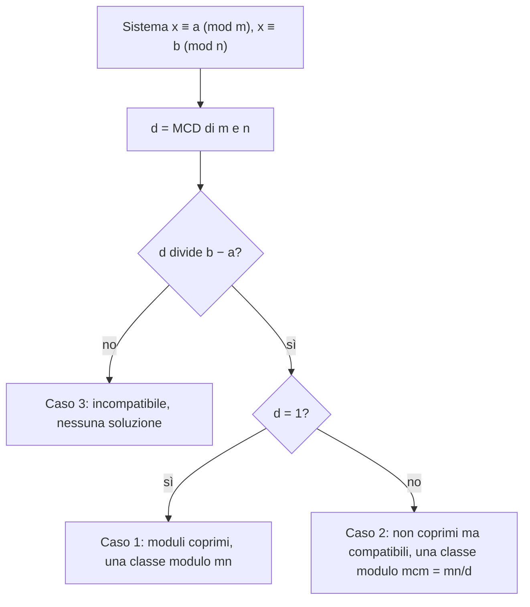

# Sistemi e teorema cinese del resto

Prerequisiti: [[Books/Aritmetica-I/08 - Divisione euclidea e identità di Bezout|Bézout e lemma di Euclide]], [[Books/Aritmetica-I/09 - Primi e fattorizzazione unica|MCD e mcm]], [[Books/Aritmetica-I/11 - Congruenze e inversi modulari|congruenze lineari e inversi]]. Torna all'[[Books/Aritmetica-I/00 - Indice e piano di studio|indice]].

> [!info] In questo capitolo
> - Risolverai sistemi di congruenze sostituendo una congruenza con un'uguaglianza $x=a+mk$.
> - Costruirai con Bézout un numero che ha resti prescritti rispetto a moduli coprimi, e vedrai perché la soluzione è unica modulo il prodotto.
> - Estenderai la costruzione a molti moduli con la formula ricostruttiva.
> - Distinguerai i tre casi (moduli coprimi, non coprimi compatibili, incompatibili) e risolverai il caso generale fondendo due condizioni per volta.
>
> L'idea che lega il capitolo: conoscere un numero attraverso più resti equivale a conoscerlo modulo il mcm, il minimo comune multiplo dei moduli, purché i resti siano compatibili.

## Domande per iniziare dagli esercizi

Prova prima gli esercizi indicati dalla domanda. Se ti manca uno strumento, apri soltanto la sezione collegata, poi torna al problema e ricostruisci il passaggio senza guardare. Per le prove, scrivi ipotesi, tesi e motivo di ogni implicazione. I riscontri sono raccolti dopo la teoria.

La tabella copre tutte le sezioni teoriche del capitolo, compresi casi limite e approfondimenti. Gli esercizi 1–8 conservano la numerazione originaria; dal 9 trovi le integrazioni. Gli esercizi tratti dal PDF fornito hanno un riferimento esplicito alla fonte; gli altri sono redazionali.

| Domanda guida | Esercizi da tentare | Teoria da recuperare |
|---|---|---|
| Come traduci due calendari in un sistema di resti? | [[#Esercizio 1 — Un appuntamento comune (sistemi di congruenze)\|1]], [[#Esercizio 9 — Costruire e provare l’unicità (teorema cinese e coordinate idempotenti)\|9]] | [[#Due calendari, un appuntamento\|Due calendari, un appuntamento]] |
| Come sostituisci una congruenza con un parametro intero? | [[#Esercizio 1 — Un appuntamento comune (sistemi di congruenze)\|1]], [[#Esercizio 2 — Due metodi, una classe (sostituzione e teorema cinese)\|2]], [[#Esercizio 9 — Costruire e provare l’unicità (teorema cinese e coordinate idempotenti)\|9]], [[#Esercizio 10 — Un sistema con parametro (congruenze lineari e compatibilità di moduli non coprimi)\|10]] | [[#Sostituire una congruenza con un'uguaglianza\|Sostituire una congruenza con un'uguaglianza]] |
| Perché la coprimalità garantisce esistenza e unicità per ogni coppia di resti? | [[#Esercizio 2 — Due metodi, una classe (sostituzione e teorema cinese)\|2]], [[#Esercizio 5 — Coprimi a due a due (ipotesi e modulo di unicità)\|5]], [[#Esercizio 9 — Costruire e provare l’unicità (teorema cinese e coordinate idempotenti)\|9]] | [[#Due moduli coprimi: costruzione e unicità\|Due moduli coprimi: costruzione e unicità]] |
| Come costruisci le coordinate che selezionano ciascun resto? | [[#Esercizio 3 — Tre resti (formula ricostruttiva del teorema cinese)\|3]], [[#Esercizio 5 — Coprimi a due a due (ipotesi e modulo di unicità)\|5]], [[#Esercizio 8 — Molte scelte locali (teorema cinese e conteggio delle classi)\|8]], [[#Esercizio 9 — Costruire e provare l’unicità (teorema cinese e coordinate idempotenti)\|9]] | [[#Più resti: ricostruire una coordinata alla volta\|Più resti: ricostruire una coordinata alla volta]] |
| Quando resti prescritti su moduli non coprimi sono compatibili? | [[#Esercizio 4 — Moduli con fattori comuni (teorema cinese generalizzato)\|4]], [[#Esercizio 5 — Coprimi a due a due (ipotesi e modulo di unicità)\|5]], [[#Esercizio 6 — Una condizione ridondante (modulo divisore e compatibilità)\|6]], [[#Esercizio 9 — Costruire e provare l’unicità (teorema cinese e coordinate idempotenti)\|9]], [[#Esercizio 10 — Un sistema con parametro (congruenze lineari e compatibilità di moduli non coprimi)\|10]] | [[#Quando i moduli condividono fattori\|Quando i moduli condividono fattori]] |
| Come fondi più condizioni e scegli il modulo finale? | [[#Esercizio 7 — Fondere e contare (sistemi generali e intervalli)\|7]], [[#Esercizio 9 — Costruire e provare l’unicità (teorema cinese e coordinate idempotenti)\|9]], [[#Esercizio 10 — Un sistema con parametro (congruenze lineari e compatibilità di moduli non coprimi)\|10]] | [[#Molti moduli generali: fondere due condizioni per volta\|Molti moduli generali: fondere due condizioni per volta]] |

## Esercizi per verificare la comprensione

Gli esercizi 1–6 allenano gli strumenti di base; 7–8 li collegano ad altri problemi. Le integrazioni successive completano il controllo della teoria; quelle dalla raccolta fornita sono segnalate con numero e pagina. Non serve riuscire subito: individua che cosa ti manca, studia il passaggio collegato e riprova.

### Esercizio 1 — Un appuntamento comune (sistemi di congruenze)

Due attività ricorrono nei giorni $x\geq0$ con $x\equiv3\pmod4$ e $x\equiv1\pmod5$. Trova tutti i giorni comuni e quelli nell'intervallo $0\leq x<60$.

Se ti blocchi: [[#Due calendari, un appuntamento|Due calendari, un appuntamento]] · [[#Sostituire una congruenza con un'uguaglianza|Sostituire una congruenza con un'uguaglianza]].

Controllo dopo il tentativo: [[#Riscontro 1|riscontro 1]].

### Esercizio 2 — Due metodi, una classe (sostituzione e teorema cinese)

Risolvi in $\mathbb Z$ il sistema $x\equiv-1\pmod7$, $x\equiv4\pmod{11}$, prima con la sostituzione e poi usando $8\cdot7-5\cdot11=1$.

Se ti blocchi: [[#Sostituire una congruenza con un'uguaglianza|Sostituire una congruenza con un'uguaglianza]] · [[#Due moduli coprimi: costruzione e unicità|Due moduli coprimi: costruzione e unicità]].

Controllo dopo il tentativo: [[#Riscontro 2|riscontro 2]].

### Esercizio 3 — Tre resti (formula ricostruttiva del teorema cinese)

Risolvi in $\mathbb Z$ il sistema $x\equiv1\pmod4$, $x\equiv2\pmod5$, $x\equiv3\pmod7$ mediante la formula ricostruttiva. Indica $M_i$, i loro inversi e il rappresentante tra $0$ e $139$.

Se ti blocchi: [[#Più resti: ricostruire una coordinata alla volta|Più resti: ricostruire una coordinata alla volta]].

Controllo dopo il tentativo: [[#Riscontro 3|riscontro 3]].

### Esercizio 4 — Moduli con fattori comuni (teorema cinese generalizzato)

Per ciascuno dei sistemi seguenti, decidi se esistono soluzioni intere e, quando esistono, descrivile tutte: (a) $x\equiv4\pmod6$, $x\equiv1\pmod9$; (b) $x\equiv4\pmod6$, $x\equiv2\pmod9$.

Se ti blocchi: [[#Quando i moduli condividono fattori|Quando i moduli condividono fattori]].

Controllo dopo il tentativo: [[#Riscontro 4|riscontro 4]].

### Esercizio 5 — Coprimi a due a due (ipotesi e modulo di unicità)

Un compagno sostiene: «Poiché $\gcd(6,10,15)=1$, ogni sistema con questi moduli ha un'unica soluzione modulo $900$». Individua l'errore nelle ipotesi e mostra, con due scelte esplicite dei resti, che possono mancare l'esistenza o l'unicità modulo il prodotto.

Se ti blocchi: [[#Due moduli coprimi: costruzione e unicità|Due moduli coprimi: costruzione e unicità]] · [[#Più resti: ricostruire una coordinata alla volta|Più resti: ricostruire una coordinata alla volta]] · [[#Quando i moduli condividono fattori|Quando i moduli condividono fattori]].

Controllo dopo il tentativo: [[#Riscontro 5|riscontro 5]].

### Esercizio 6 — Una condizione ridondante (modulo divisore e compatibilità)

Siano $a,b\in\mathbb Z$. Dimostra che, per $m,n\geq1$ e $n\mid m$, il sistema $x\equiv a\pmod m$, $x\equiv b\pmod n$ è risolvibile se e solo se $a\equiv b\pmod n$. Descrivi tutte le soluzioni nel caso compatibile.

Se ti blocchi: [[#Quando i moduli condividono fattori|Quando i moduli condividono fattori]].

Controllo dopo il tentativo: [[#Riscontro 6|riscontro 6]].

### Esercizio 7 — Fondere e contare (sistemi generali e intervalli)

Risolvi in $\mathbb Z$ il sistema $x\equiv2\pmod6$, $x\equiv5\pmod9$, $x\equiv3\pmod5$ mediante fusioni successive. Determina poi tutte le soluzioni con $0\leq x<200$.

Se ti blocchi: [[#Molti moduli generali: fondere due condizioni per volta|Molti moduli generali: fondere due condizioni per volta]].

Controllo dopo il tentativo: [[#Riscontro 7|riscontro 7]].

### Esercizio 8 — Molte scelte locali (teorema cinese e conteggio delle classi)

Sia $r\geq2$ un intero. Per ogni $i=1,\dots,r$, sia $m_i\geq2$, con moduli a due a due coprimi, e sia $S_i$ un insieme di $s_i$ resti distinti modulo $m_i$. Dimostra che il numero di classi modulo $M=\prod_i m_i$ il cui resto modulo ogni $m_i$ appartiene a $S_i$ è $\prod_i s_i$. Applica il risultato alle classi $x$ modulo $35$ con $x\equiv1$ oppure $2\pmod5$ e $x\equiv0$ oppure $3\pmod7$, elencandole tutte.

Se ti blocchi: [[#Più resti: ricostruire una coordinata alla volta|Più resti: ricostruire una coordinata alla volta]].

Controllo dopo il tentativo: [[#Riscontro 8|riscontro 8]].

### Esercizio 9 — Costruire e provare l’unicità (teorema cinese e coordinate idempotenti)

Per moduli coprimi $m,n$ e $um+vn=1$, costruisci la soluzione con resti $a,b$ e dimostra l'unicità modulo $mn$. Per più moduli a due a due coprimi dimostra la formula $x=\sum_i a_iM_i u_i$ e le identità $e_i^2\equiv e_i$, $e_ie_j\equiv0$ per $i\ne j$, $\sum_i e_i\equiv1\pmod M$, dove $e_i=M_i u_i$. Per moduli generali dimostra il criterio $\gcd(m,n)\mid b-a$ e giustifica il modulo $\operatorname{mcm}(m,n)$. Che cosa impone una congruenza modulo uno?

Se ti blocchi: [[#Due calendari, un appuntamento|Due calendari, un appuntamento]] · [[#Sostituire una congruenza con un'uguaglianza|Sostituire una congruenza con un'uguaglianza]] · [[#Due moduli coprimi: costruzione e unicità|Due moduli coprimi: costruzione e unicità]] · [[#Più resti: ricostruire una coordinata alla volta|Più resti: ricostruire una coordinata alla volta]] · [[#Quando i moduli condividono fattori|Quando i moduli condividono fattori]] · [[#Molti moduli generali: fondere due condizioni per volta|Molti moduli generali: fondere due condizioni per volta]].

Controllo dopo il tentativo: [[#Riscontro 9|riscontro 9]].

### Esercizio 10 — Un sistema con parametro (congruenze lineari e compatibilità di moduli non coprimi)

*Dalla raccolta fornita: esercizio 96, p. 79 stampata / [[Books/Aritmetica-I/Fonti/Esercizi algebra 1 2.pdf#page=89|p. 89 del PDF]]. Enunciato riformulato; riscontro redazionale.*

Al variare di $a\in\mathbb Z$, determina le classi soluzione del sistema $6x\equiv4a\pmod{72}$, $5x\equiv2\pmod{39}$. Specifica il modulo che descrive tutte le soluzioni e il numero di classi modulo $\operatorname{mcm}(72,39)$.

Se ti blocchi: [[#Sostituire una congruenza con un'uguaglianza|Sostituire una congruenza con un'uguaglianza]] · [[#Quando i moduli condividono fattori|Quando i moduli condividono fattori]] · [[#Molti moduli generali: fondere due condizioni per volta|Molti moduli generali: fondere due condizioni per volta]].

Controllo dopo il tentativo: [[#Riscontro 10|riscontro 10]].

## Teoria da recuperare

Usa i collegamenti della tabella iniziale per leggere lo strumento che ti serve. Dopo la lettura, torna all’esercizio e prova a risolverlo senza suggerimenti.

## Due calendari, un appuntamento

Un laboratorio apre nei giorni $2,7,12,17,\dots$: un appuntamento ogni cinque giorni, a partire dal giorno $2$. Una biblioteca organizza un incontro nei giorni $3,10,17,24,\dots$: uno ogni sette giorni, a partire dal giorno $3$. In quali giorni possiamo partecipare a entrambe le attività?

Se $x$ è il numero del giorno, cerchiamo gli interi che soddisfano contemporaneamente

$$
\begin{cases}
x\equiv2\pmod5,\\
x\equiv3\pmod7.
\end{cases}
$$

La parola «contemporaneamente» è tutto il problema. Conoscere separatamente le due progressioni non basta: dobbiamo descriverne l'intersezione. Il giorno $17$ funziona; dopo altri $35$ giorni entrambi i cicli si ripresentano nella stessa posizione. Ma come troviamo $17$ senza compilare liste? E perché tutti gli incontri successivi distano proprio multipli di $35$?

Un **sistema di congruenze** prescrive più resti alla stessa incognita intera. I moduli sono sempre positivi. Una congruenza modulo $1$ non impone alcun vincolo, perché $1$ divide ogni differenza: possiamo eliminarla. Se rimangono soltanto moduli $1$, ogni intero è soluzione. Nei calcoli con inversi assumeremo perciò che i moduli rimasti siano almeno $2$.

## Sostituire una congruenza con un'uguaglianza

La prima condizione dell'esempio equivale a

$$
x=2+5k,\qquad k\in\mathbb Z.
$$

Questa sostituzione incorpora già uno dei vincoli: qualunque valore intero di $k$ scegliamo, la prima congruenza sarà rispettata. Ora imponiamo la seconda:

$$
2+5k\equiv3\pmod7
\quad\Longleftrightarrow\quad
5k\equiv1\pmod7.
$$

L'inverso di $5$ modulo $7$ è $3$, poiché $5\cdot3=15\equiv1\pmod7$. Quindi

$$
k\equiv3\pmod7,
\qquad k=3+7t,\quad t\in\mathbb Z.
$$

Tornando a $x$ otteniamo **tutte** le soluzioni:

$$
x=2+5(3+7t)=17+35t.
$$

Ogni passaggio era un'equivalenza, dunque non abbiamo perso né introdotto soluzioni. Per il calendario, scegliamo i valori $x\geq0$: il primo è $17$, poi $52,87,\dots$.

In generale, per risolvere

$$
\begin{cases}
x\equiv a\pmod m,\\
x\equiv b\pmod n,
\end{cases}
$$

scriviamo $x=a+mk$ e risolviamo

$$
mk\equiv b-a\pmod n.
$$

Un sistema con due condizioni diventa una sola congruenza lineare. Questo metodo funzionerà anche quando i moduli non saranno coprimi.

## Due moduli coprimi: costruzione e unicità

> [!abstract] Concetto chiave — Teorema cinese del resto (due moduli)
> Siano $m,n\geq1$ con $\gcd(m,n)=1$ e $a,b\in\mathbb Z$. Il sistema
> $$
> x\equiv a\pmod m,\qquad x\equiv b\pmod n
> $$
> ammette una soluzione $x_0$, e l'insieme delle soluzioni è esattamente
> $$
> \{x_0+mnt:t\in\mathbb Z\}.
> $$
> Si dice che la soluzione è **unica modulo $mn$**.
> È il pilastro del capitolo: nel [[Books/Aritmetica-I/15 - Anelli campi e omomorfismi|capitolo 15]] sarà riletto come corrispondenza fra classi modulo $mn$ e coppie di classi, e tornerà nei capitoli [[Books/Aritmetica-I/18 - Congruenze esponenziali|18]] e [[Books/Aritmetica-I/20 - Congruenze polinomiali e sollevamento|20]] per scomporre moduli composti.

### Perché esiste

Bézout fornisce interi $u,v$ tali che

$$
um+vn=1.
$$

Il termine $vn$ vale $1$ modulo $m$ e $0$ modulo $n$; il termine $um$ fa il contrario. Sono due strumenti che permettono di assegnare un resto senza disturbare l'altro. Poniamo

$$
\boxed{x_0=a\,vn+b\,um.}
$$

Modulo $m$, il secondo addendo scompare e $vn\equiv1$, dunque $x_0\equiv a$. Modulo $n$ scompare il primo e $um\equiv1$, dunque $x_0\equiv b$. Abbiamo costruito una soluzione per qualunque scelta di $a,b$.

Nell'esempio iniziale $3\cdot5-2\cdot7=1$. La costruzione dà

$$
x_0=2(-2\cdot7)+3(3\cdot5)=-28+45=17.
$$

La sostituzione precedente e la formula di Bézout sono due espressioni della stessa idea: trovare un coefficiente che corregga il secondo resto conservando il primo.

### Perché la classe è unica

Se $x$ e $y$ sono soluzioni, entrambi hanno gli stessi resti prescritti. Quindi

$$
m\mid(x-y),\qquad n\mid(x-y).
$$

Scriviamo $x-y=mh$. La seconda divisibilità dice $n\mid mh$. Poiché $\gcd(n,m)=1$, il lemma di Euclide dà $n\mid h$. Dunque $h=nt$ e

$$
x-y=mnt.
$$

Ogni soluzione differisce da $x_0$ per un multiplo di $mn$. Viceversa, aggiungere $mnt$ a $x_0$ non cambia nessuno dei due resti. Questo prova sia l'unicità della classe sia la completezza della famiglia dichiarata.

> [!warning] Attenzione — Unica classe, infiniti interi
> «Unica modulo $mn$» non significa che esiste un solo intero soluzione. Nell'esempio $17$, $52$ e $-18$ sono soluzioni diverse, ma appartengono alla stessa classe modulo $35$. C'è invece un unico rappresentante nell'intervallo $0\leq x<35$.

La coprimalità garantisce la risolubilità **per ogni coppia di resti**. È anche necessaria per questa garanzia universale: se il sistema $x\equiv0\pmod m$, $x\equiv1\pmod n$ è risolvibile, ogni divisore comune dei moduli divide sia $x$ sia $x-1$, quindi divide $1$. Ne segue $\gcd(m,n)=1$. Un singolo sistema può invece essere risolvibile anche con moduli non coprimi.

> [!example] Esempi e controesempi — coprimalità dei moduli
> **Vale:** $m=5$, $n=7$ sono coprimi; per ogni coppia di resti il sistema ha soluzione, per esempio $x\equiv2\pmod5$, $x\equiv3\pmod7$ dà $17+35t$.
> **Senza coprimalità l'esistenza fallisce:** $m=4$, $n=6$ ($\gcd=2$). Il sistema $x\equiv0\pmod4$, $x\equiv1\pmod6$ è impossibile: la prima condizione rende $x$ pari, la seconda dispari.
> **Senza coprimalità l'unicità modulo $mn$ fallisce:** $x\equiv0\pmod4$, $x\equiv0\pmod6$ ha per soluzioni i multipli di $12$, cioè una sola classe modulo $12$ ma due classi ($0$ e $12$) modulo $mn=24$.

## Più resti: ricostruire una coordinata alla volta

Siano $r\geq2$ e $m_1,\dots,m_r\geq2$ **a due a due coprimi**, cioè

$$
\gcd(m_i,m_j)=1\qquad\text{per ogni }i\neq j.
$$

Vogliamo risolvere $x\equiv a_i\pmod{m_i}$ per tutti gli indici $i$. Poniamo

$$
M=\prod_{i=1}^r m_i,
\qquad M_i=\frac{M}{m_i}.
$$

Il numero $M_i$ contiene tutti i moduli tranne $m_i$. La coprimalità a due a due implica $\gcd(M_i,m_i)=1$: un eventuale primo comune dividerebbe $m_i$ e almeno uno degli altri moduli, contraddicendo l'ipotesi. Possiamo quindi trovare, con Euclide e Bézout, un intero $c_i$ tale che

$$
M_i c_i\equiv1\pmod{m_i}.
$$

Definiamo $e_i=M_i c_i$. Per costruzione,

$$
e_i\equiv1\pmod{m_i},
\qquad
e_i\equiv0\pmod{m_j}\quad(j\neq i).
$$

Il coefficiente $e_i$ seleziona la posizione $i$: agisce soltanto sul resto che vogliamo assegnare in quella posizione. La formula ricostruttiva è la seguente.

> [!abstract] Concetto chiave — Ricostruzione da più resti
> Se $m_1,\dots,m_r\ge2$ sono a due a due coprimi, $M=\prod m_i$, $M_i=M/m_i$ e $c_i$ è un inverso di $M_i$ modulo $m_i$, allora
> $$
> x_0=\sum_{i=1}^r a_i M_i c_i
> $$
> risolve $x\equiv a_i\pmod{m_i}$ per ogni $i$, e le soluzioni sono tutte e sole $x_0+Mt$, $t\in\mathbb Z$.
> Ogni addendo agisce su un solo resto e lascia in pace gli altri; la stessa idea ricompare nel capitolo [[Books/Aritmetica-I/15 - Anelli campi e omomorfismi|15]].

**Prova dell'esistenza.** Fissiamo un indice $j$ e riduciamo la somma modulo $m_j$. Tutti gli addendi con $i\neq j$ sono nulli; l'unico rimasto è $a_j e_j\equiv a_j$. Questo vale per ogni $j$, quindi $x_0$ soddisfa l'intero sistema.

**Prova dell'unicità.** Se $x,y$ sono soluzioni, ogni $m_i$ divide $x-y$. Dimostriamo che il loro prodotto divide la differenza. Se $m_1\cdots m_{s-1}\mid x-y$, scriviamo $x-y=(m_1\cdots m_{s-1})h$. Il modulo $m_s$ è coprimo con questo prodotto per lo stesso argomento sui primi usato sopra. Da $m_s\mid x-y$ e dal lemma di Euclide segue $m_s\mid h$, dunque $m_1\cdots m_s\mid x-y$. Partendo da $s=2$ arriviamo a $M\mid x-y$.

Aggiungere un multiplo di $M$ conserva ogni resto. Abbiamo così dimostrato, per un numero qualsiasi di moduli a due a due coprimi, esistenza e unicità modulo $M$.

I coefficienti $e_i$ sono spesso chiamati **idempotenti modulo $M$** (un numero $e$ è idempotente quando $e^2=e$, come accade a $0$ e $1$ fra i numeri ordinari): infatti $e_i^2-e_i$ è nullo modulo ciascun $m_j$, perché in ogni posizione $e_i$ vale $0$ oppure $1$. Per la divisibilità appena provata,

$$
e_i^2\equiv e_i\pmod M.
$$

Il termine descrive questa precisa proprietà; per usarli basta l'aritmetica delle congruenze.

### Esempio: tre moduli

Risolviamo

$$
\begin{cases}
x\equiv2\pmod3,\\
x\equiv3\pmod5,\\
x\equiv2\pmod7.
\end{cases}
$$

Qui $M=105$ e

$$
M_1=35,\qquad M_2=21,\qquad M_3=15.
$$

Gli inversi necessari sono rispettivamente $2,1,1$: infatti $35\cdot2\equiv1\pmod3$, $21\equiv1\pmod5$, $15\equiv1\pmod7$. Quindi possiamo scegliere

$$
e_1=70,\qquad e_2=21,\qquad e_3=15.
$$

La ricostruzione dà

$$
x_0=2\cdot70+3\cdot21+2\cdot15=233\equiv23\pmod{105}.
$$

Verifichiamo il rappresentante piccolo: $23=7\cdot3+2=4\cdot5+3=3\cdot7+2$. Tutte le soluzioni sono $x=23+105t$, con $t\in\mathbb Z$.

> [!example] Esempi e controesempi — coprimi a due a due
> **Lo sono:** $(3,5,7)$ e $(4,5,9)$: ogni coppia ha MCD 1.
> **Non lo sono, per una sola coppia:** $(3,5,6)$: le coppie $(3,5)$ e $(5,6)$ sono coprime, ma $\gcd(3,6)=3$. Basta quella coppia a rompere l'ipotesi: il sistema $x\equiv1\pmod3$, $x\equiv2\pmod6$ è impossibile, perché i resti modulo 3 differiscono.
> **Non lo sono, pur avendo MCD totale 1:** $(6,10,15)$, descritto qui sotto.

> [!warning] Attenzione — MCD totale $1$ non basta
> Si ha $\gcd(6,10,15)=1$, ma i moduli non sono a due a due coprimi: condividono rispettivamente fattori $2$, $3$ e $5$. Il sistema $x\equiv0\pmod6$, $x\equiv1\pmod{10}$, $x\equiv0\pmod{15}$ è impossibile già per la parità. Non possiamo usare la formula precedente: per esempio $M_1=150$ non è invertibile modulo $6$.
>
> Il guasto ha due volti ($\gcd(6,10)=2$, $\gcd(6,15)=3$, $\gcd(10,15)=5$). Con i resti sopra l'**esistenza** manca. Con tutti i resti uguali a $1$, il sistema è risolvibile ($x=1$), ma le soluzioni sono $1+30t$: una sola classe modulo $\operatorname{mcm}(6,10,15)=30$, cioè $30$ classi modulo il prodotto $900$. Manca allora l'**unicità** modulo $900$.

## Quando i moduli condividono fattori

Con moduli non coprimi, le informazioni sui resti possono sovrapporsi. Per esempio, un resto modulo $6$ stabilisce già la parità e il resto modulo $3$. Una condizione modulo $9$ deve rispettare quest'ultima informazione.

> [!abstract] Concetto chiave — Teorema generale per due moduli
> Siano $m,n\geq1$, $a,b\in\mathbb Z$ e $d=\gcd(m,n)$. Il sistema
> $$
> x\equiv a\pmod m,\qquad x\equiv b\pmod n
> $$
> è risolvibile se e solo se
> $$
> d\mid(b-a).
> $$
> Se è risolvibile, tutte le soluzioni sono
> $$
> x=x_0+\frac{mn}{d}\,t,\qquad t\in\mathbb Z,
> $$
> ossia una sola classe modulo $\operatorname{mcm}(m,n)=mn/d$.
> Contiene il caso coprime ($d=1$, sempre risolvibile, periodo $mn$) e dà la regola per fondere due condizioni alla volta, usata nel resto del capitolo.

**Necessità.** Se $x$ è soluzione, $d$ divide sia $x-a$ sia $x-b$. Sottraendo, divide $b-a$. Le due prescrizioni devono dunque dare lo stesso resto modulo il divisore comune $d$.

**Sufficienza e famiglia completa.** Scriviamo ancora $x=a+mk$. La seconda congruenza equivale a $mk\equiv b-a\pmod n$. Se $d\mid(b-a)$, dividiamo coefficiente, termine noto e modulo per $d$:

$$
\frac md\,k\equiv\frac{b-a}{d}\pmod{n/d}.
$$

I numeri $m/d$ e $n/d$ sono coprimi. Se $n/d>1$, il primo ha inverso modulo il secondo; troviamo quindi un $k_0$, e tutti i valori ammessi sono

$$
k=k_0+\frac nd\,t.
$$

Se $n/d=1$, la congruenza non impone vincoli e la stessa scrittura descrive tutti gli interi scegliendo $k_0=0$. Sostituendo in $x=a+mk$ otteniamo

$$
x=a+mk_0+\frac{mn}{d}\,t.
$$

La riduzione era un'equivalenza, quindi questa è l'intera famiglia. Il periodo è il mcm: il suo essere un multiplo di entrambi i moduli spiega anche perché ogni valore della famiglia conserva le due condizioni.

### Due esempi con moduli $6$ e $9$

Per il sistema $x\equiv2\pmod6$, $x\equiv5\pmod9$, il MCD è $3$ e divide $5-2$. Scriviamo

$$
x=2+6k,
\qquad6k\equiv3\pmod9
\quad\Longleftrightarrow\quad
2k\equiv1\pmod3.
$$

Ne segue $k\equiv2\pmod3$, dunque

$$
x=14+18t,\qquad t\in\mathbb Z.
$$

In particolare $14$ dà resti $2$ e $5$. Modulo $54=6\cdot9$, le soluzioni sono tre classi, rappresentate da $14,32,50$; modulo $18$ sono una sola classe.

Se sostituiamo la seconda condizione con $x\equiv4\pmod9$, il sistema diventa impossibile: $3$ non divide $4-2$. La prima condizione impone $x\equiv2\pmod3$, la seconda $x\equiv1\pmod3$.

### La ridondanza di un modulo divisore

Se $n\mid m$, dalla congruenza $x\equiv a\pmod m$ segue $x\equiv a\pmod n$. Quindi il sistema con $x\equiv b\pmod n$ è compatibile precisamente quando $a\equiv b\pmod n$; in tal caso la seconda condizione è ridondante e rimane $x\equiv a\pmod m$.

Per esempio $x\equiv5\pmod6$ e $x\equiv2\pmod3$ equivalgono alla sola prima condizione. Sostituire $2$ con $1$ modulo $3$ produce invece un sistema impossibile. Moduli non coprimi non significano automaticamente incompatibilità: occorre confrontare i resti.

### Mappa dei tre casi

Per due moduli $m,n$ con $d=\gcd(m,n)$ esiste un solo controllo, quello sulla differenza dei resti. Lo schema si legge dall'alto: il rombo decide fra incompatibilità e compatibilità; poi $d=1$ o $d>1$ dice qual è il periodo.

| Caso | Condizione | Soluzioni | Esempio |
|---|---|---|---|
| 1. moduli coprimi | $d=1$ | sempre, una classe modulo $mn$ | $x\equiv2\pmod5$, $x\equiv3\pmod7$: $x=17+35t$ |
| 2. non coprimi, compatibili | $d>1$, $d\mid b-a$ | una classe modulo $mn/d$ | $x\equiv2\pmod6$, $x\equiv5\pmod9$: $x=14+18t$ ($\gcd=3$, $3\mid3$) |
| 3. incompatibili | $d\nmid b-a$ | nessuna | $x\equiv2\pmod6$, $x\equiv4\pmod9$: modulo 3 i resti sono $2$ e $1$ |

Nel caso 2 il periodo è $18=\operatorname{mcm}(6,9)$, non $54=6\cdot9$: i moduli si sovrappongono e informano due volte sullo stesso resto.

## Molti moduli generali: fondere due condizioni per volta

Anche senza coprimalità possiamo risolvere un sistema finito usando soltanto il teorema per due moduli. Fondiamo le prime due condizioni: se sono incompatibili, il sistema intero è impossibile; se sono compatibili, le sostituiamo con l'unica congruenza $x\equiv c\pmod L$, dove $L$ è il loro mcm. Poi fondiamo questa congruenza con la terza, e continuiamo.

La procedura è giustificata perché ogni fusione è un'equivalenza fra due condizioni e una nuova condizione. Per induzione, dopo ogni passaggio la congruenza ottenuta descrive esattamente tutte le soluzioni delle condizioni già esaminate. Se arriviamo alla fine, il modulo finale è $\operatorname{mcm}(m_1,\dots,m_r)$, perché a ogni passaggio aggiorniamo $L$ con $\operatorname{mcm}(L,m_i)$. Se una fusione fallisce, nessun intero soddisfa tutte le condizioni originarie.

Per esempio,

$$
x\equiv1\pmod6,\qquad x\equiv3\pmod{10},\qquad x\equiv13\pmod{15}.
$$

Dalle prime due: $x=1+6k$, quindi $6k\equiv2\pmod{10}$, ossia $3k\equiv1\pmod5$. Otteniamo $k\equiv2\pmod5$ e $x\equiv13\pmod{30}$. Quest'ultima congruenza implica già $x\equiv13\pmod{15}$: la soluzione finale è $x=13+30t$, con $t\in\mathbb Z$.

Questo modo di procedere sarà utile anche quando i sistemi nasceranno da condizioni sugli esponenti: i periodi incontrati potranno condividere fattori, come vedremo nel [[Books/Aritmetica-I/18 - Congruenze esponenziali|capitolo 18]]. Un'altra rilettura arriverà nel [[Books/Aritmetica-I/15 - Anelli campi e omomorfismi|capitolo 15]]: per moduli coprimi, associare a una classe modulo il prodotto la lista delle sue classi modulo i singoli fattori è una corrispondenza biiettiva (a ogni lista di classi corrisponde una e una sola classe modulo il prodotto) che conserva somme e prodotti. Qui l'abbiamo già costruita e giustificata con interi, divisibilità e Bézout.

## Fonti e integrazioni

La trattazione utilizza le sezioni sui sistemi di [[Notes/Aritmetica/Lectures/2026-10-07 - Fattorizzazione unica, congruenze e sistemi modulari|7 ottobre]] e la [[Notes/Aritmetica/Lectures/2026-10-19 - Dimostrazione del teorema cinese del resto|nota autonoma del 19 ottobre]], che riporta una prova per più moduli tratta da appunti manoscritti. È stata consultata questa nota; il PDF manoscritto indicato al suo interno non è stato consultato.

Sono state lette inoltre le parti pertinenti di [[Notes/Aritmetica/Lectures/2026-10-22 - Omomorfismi tra anelli e teorema cinese|22 ottobre]] e [[Notes/Aritmetica/Lectures/2026-10-27 - Equazioni esponenziali e congruenze modulo potenze prime|27 ottobre]], confrontandole con le sezioni corrispondenti delle trascrizioni [[_transcripts/Aritmetica/2026-10-07 - Fattorizzazione unica, congruenze e sistemi modulari|7 ottobre]], [[_transcripts/Aritmetica/2026-10-22 - Omomorfismi tra anelli e teorema cinese|22 ottobre]] e [[_transcripts/Aritmetica/2026-10-27 - Equazioni esponenziali e congruenze modulo potenze prime|27 ottobre]].

La motivazione dei calendari, gli esempi, la formula ricostruttiva con gli idempotenti e la giustificazione della fusione iterativa sono integrazioni didattiche. Le prove sono riscritte per essere autonome, con moduli positivi e coprimalità a due a due esplicite; nessuna formulazione incerta dell'ASR viene usata come premessa matematica.

## Riscontri degli esercizi

Apri il riscontro soltanto dopo aver scritto un tentativo. Per una dimostrazione, confronta anche le ipotesi e la completezza, non soltanto il risultato.

### Riscontro 1

> [!tip]- Riscontro 1
> Scrivi $x=3+4k$: $4k\equiv-2\equiv3\pmod5$, quindi $k\equiv2\pmod5$. Ne segue $x=11+20t$, con $t\in\mathbb Z$; imponendo $x\geq0$ si ha $t\geq0$. Nell'intervallo richiesto: $11,31,51$.

Torna a [[#Esercizio 1 — Un appuntamento comune (sistemi di congruenze)|esercizio 1]].

### Riscontro 2

> [!tip]- Riscontro 2
> Da $x=-1+7k$ segue $7k\equiv5\pmod{11}$. Poiché l'inverso di $7$ è $8$, $k\equiv40\equiv7$, quindi $x\equiv48\pmod{77}$. La formula di Bézout dà $(-1)(-55)+4\cdot56=279\equiv48\pmod{77}$. In entrambi i casi tutte le soluzioni sono $48+77t$, $t\in\mathbb Z$.

Torna a [[#Esercizio 2 — Due metodi, una classe (sostituzione e teorema cinese)|esercizio 2]].

### Riscontro 3

> [!tip]- Riscontro 3
> $M=140$, $(M_1,M_2,M_3)=(35,28,20)$. Gli inversi nei rispettivi moduli sono $(3,2,6)$: $35\cdot3\equiv1\pmod4$, $28\cdot2\equiv1\pmod5$, $20\cdot6\equiv1\pmod7$. Pertanto $x_0=105+2\cdot56+3\cdot120=577\equiv17\pmod{140}$. Tutte le soluzioni sono $17+140t$, $t\in\mathbb Z$.

Torna a [[#Esercizio 3 — Tre resti (formula ricostruttiva del teorema cinese)|esercizio 3]].

### Riscontro 4

> [!tip]- Riscontro 4
> Il MCD è $3$. In (a), $3\mid1-4$ e $x=4+6k$ porta a $2k\equiv-1\equiv2\pmod3$, dunque $k\equiv1\pmod3$: $x=10+18t$, $t\in\mathbb Z$. In (b), $3\nmid2-4$, quindi non esistono soluzioni.

Torna a [[#Esercizio 4 — Moduli con fattori comuni (teorema cinese generalizzato)|esercizio 4]].

### Riscontro 5

> [!tip]- Riscontro 5
> Serve coprimalità a due a due. I resti $0$ modulo $6$, $1$ modulo $10$, $0$ modulo $15$ danno un sistema impossibile per la parità. Con tutti i resti nulli, le soluzioni sono i multipli di $\operatorname{mcm}(6,10,15)=30$: modulo $900$ sono $30$ classi, rappresentate da $0,30,\dots,870$. Il MCD totale $1$ non elimina le sovrapposizioni fra coppie di moduli.

Torna a [[#Esercizio 5 — Coprimi a due a due (ipotesi e modulo di unicità)|esercizio 5]].

### Riscontro 6

> [!tip]- Riscontro 6
> Se $x=a+mk$, allora $n\mid m$ implica $x\equiv a\pmod n$. Una soluzione deve quindi soddisfare $a\equiv b\pmod n$. Viceversa, sotto questa ipotesi, ogni $x=a+mk$ soddisfa entrambe le congruenze. Tutte le soluzioni sono esattamente $a+m\mathbb Z$; il mcm dei moduli è $m$.

Torna a [[#Esercizio 6 — Una condizione ridondante (modulo divisore e compatibilità)|esercizio 6]].

### Riscontro 7

> [!tip]- Riscontro 7
> Le prime due condizioni equivalgono a $x\equiv14\pmod{18}$. Scrivi $x=14+18k$: modulo $5$ ottieni $4+3k\equiv3$, quindi $3k\equiv4$ e $k\equiv3\pmod5$. Dunque $x=68+90t$, $t\in\mathbb Z$. Nell'intervallo richiesto le soluzioni sono $68$ e $158$. Il periodo è $\operatorname{mcm}(6,9,5)=90$.

Torna a [[#Esercizio 7 — Fondere e contare (sistemi generali e intervalli)|esercizio 7]].

### Riscontro 8

> [!tip]- Riscontro 8
> A ogni scelta di una lista di resti, uno da ciascun $S_i$, il teorema cinese associa un'unica classe modulo $M$. Liste differenti non possono dare la stessa classe, perché differiscono in almeno un resto; ogni classe ammessa proviene dalla sua lista di resti. È dunque una biiezione, e il principio del prodotto dà $\prod_i s_i$, anche quando qualche $S_i$ è vuoto. Nell'esempio le quattro liste $(1,0),(1,3),(2,0),(2,3)$ producono rispettivamente $21,31,7,17$ modulo $35$. I rappresentanti ordinati sono $7,17,21,31$.

Torna a [[#Esercizio 8 — Molte scelte locali (teorema cinese e conteggio delle classi)|esercizio 8]].

### Riscontro 9

> [!tip]- Riscontro 9
> La costruzione è $x=avn+bum$: i due addendi selezionano il resto corretto. Due soluzioni differiscono per un multiplo di entrambi i moduli, dunque del loro prodotto. Per più moduli, $e_i$ è uno nella coordinata $i$ e zero nelle altre; tutte le identità seguono controllando ogni coordinata e applicando l'unicità. Nel caso generale $x=a+mt$ riduce il sistema a $mt\equiv b-a\pmod n$, risolvibile esattamente sotto il criterio; il passo in $t$ è $n/d$, quello in $x$ è $mn/d$. Modulo uno ogni intero è congruo a ogni altro: nessun vincolo.

Torna a [[#Esercizio 9 — Costruire e provare l’unicità (teorema cinese e coordinate idempotenti)|esercizio 9]].

### Riscontro 10

> [!tip]- Riscontro 10
> La prima congruenza richiede $6\mid4a$, cioè $3\mid a$. Scrivi $a=3b$: si riduce a $x\equiv2b\pmod{12}$. La seconda dà $x\equiv16\pmod{39}$, perché $5^{-1}\equiv8$. I resti devono coincidere modulo tre: $2b\equiv1$, ossia $b\equiv2\pmod3$. Dunque esistono soluzioni esattamente per $a=6+9c$. Allora $x=4+6c+12t$ e la seconda condizione dà $4t\equiv4-2c\pmod{13}$, quindi $t\equiv1+6c\pmod{13}$. Risultato $x\equiv16+78c\pmod{156}$. Modulo $\operatorname{mcm}(72,39)=936$ ci sono sei classi, aggiungendo $156j$ per $0\le j<6$.

Torna a [[#Esercizio 10 — Un sistema con parametro (congruenze lineari e compatibilità di moduli non coprimi)|esercizio 10]].

Il capitolo è acquisito quando sai passare dai resti a una famiglia completa di interi e spiegare perché il suo periodo è un prodotto oppure un mcm. Nei sistemi nuovi, il controllo decisivo è riconoscere quali condizioni sono compatibili prima di cercare gli inversi.

---

[[Books/Aritmetica-I/11 - Congruenze e inversi modulari|← 11 · Congruenze e inversi modulari]] · [[Books/Aritmetica-I/00 - Indice e piano di studio|Indice]] · [[Books/Aritmetica-I/13 - Equivalenze e insiemi quoziente|13 · Equivalenze e insiemi quoziente →]]
