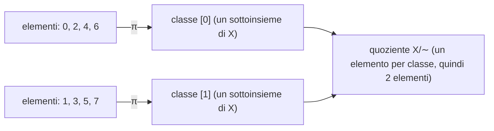
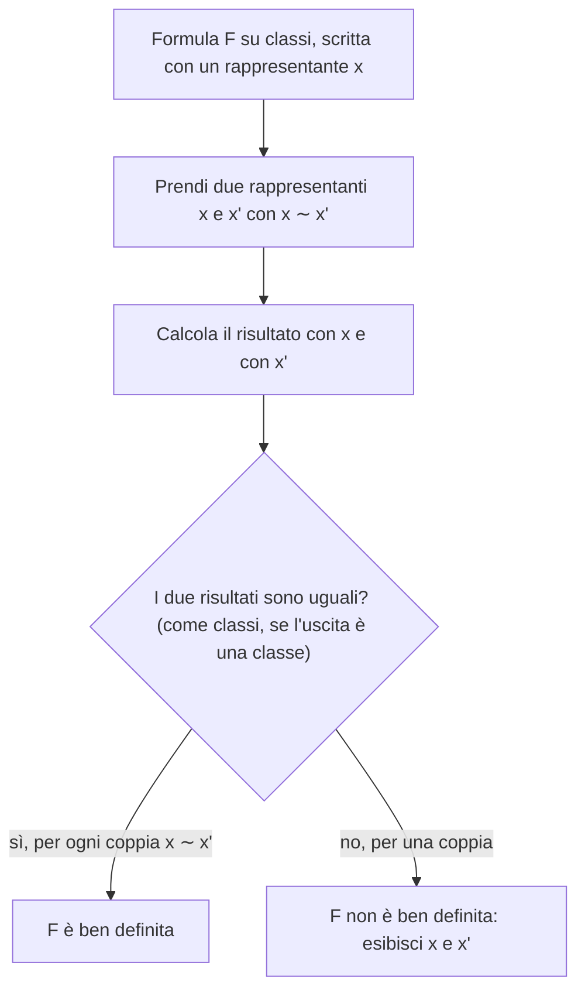

# Equivalenze e insiemi quoziente

Prerequisiti: [[Books/Aritmetica-I/01 - Il linguaggio delle dimostrazioni|linguaggio, insiemi e funzioni]], [[Books/Aritmetica-I/08 - Divisione euclidea e identità di Bezout|divisione euclidea]], [[Books/Aritmetica-I/11 - Congruenze e inversi modulari|congruenze]]. Torna all’[[Books/Aritmetica-I/00 - Indice e piano di studio|indice e piano di studio]].

> [!info] In questo capitolo
> - Riconoscerai quando una relazione è un'equivalenza e, se non lo è, quale delle tre proprietà manca.
> - Passerai da elemento a classe a insieme quoziente, sapendo che le classi formano una partizione.
> - Controllerai quando una formula sulle classi è ben definita, cioè non dipende dal rappresentante scelto.
> - L'idea che lega tutto: per trattare come un solo oggetto cose diverse, si raccolgono in un insieme e si lavora sull'insieme; la fatica sta nel verificare che i risultati non dipendano dal nome scelto.

## Una quantità, molte rappresentazioni

Mezza torta e due quarti di torta sono la stessa quantità. Eppure le scritture $1/2$ e $2/4$ sono diverse: se registriamo numeratore e denominatore, otteniamo le coppie distinte $(1,2)$ e $(2,4)$. Come possiamo costruire un oggetto matematico che conservi la quantità e dimentichi questa differenza di rappresentazione?

La domanda ricompare con l’orologio. Le ore $2$, $14$ e $26$, misurate da una stessa origine, producono la stessa posizione della lancetta su un quadrante di dodici ore. Gli interi sono distinti, ma per leggere quella posizione conta soltanto il resto modulo $12$.

In entrambi i casi scegliamo quali differenze ignorare. Raccogliamo nello stesso insieme tutte le rappresentazioni considerate equivalenti; poi trattiamo quell’intero insieme come un solo nuovo oggetto. Le **relazioni di equivalenza** rendono precisa questa procedura. Gli **insiemi quoziente** sono gli insiemi dei nuovi oggetti così ottenuti.

## Quando una relazione esprime «la stessa cosa»

Una **relazione su un insieme $X$** è un sottoinsieme

$$
R\subseteq X\times X.
$$

Scrivere $xRy$ significa che $(x,y)\in R$. L’ordine conta: una relazione può contenere $(x,y)$ senza contenere $(y,x)$. Per esempio, $2\le 5$ ma $5\nleq 2$.

Una relazione $\sim$ su $X$ è una **relazione di equivalenza** quando soddisfa:

- **riflessività:** $x\sim x$ per ogni $x\in X$;
- **simmetria:** se $x\sim y$, allora $y\sim x$;
- **transitività:** se $x\sim y$ e $y\sim z$, allora $x\sim z$.

Queste richieste traducono tre aspettative: un oggetto rappresenta la stessa cosa di sé stesso; lo scambio delle rappresentazioni non cambia il confronto; due identificazioni successive devono essere compatibili.

La congruenza modulo un intero $n\ge1$ è un esempio. Infatti $n\mid(a-a)$; se $n\mid(a-b)$, allora $n\mid(b-a)$; se inoltre $n\mid(b-c)$, allora

$$
n\mid(a-c),\qquad a-c=(a-b)+(b-c).
$$

Infatti la somma di due multipli di $n$ è ancora un multiplo di $n$.

La divisibilità sui naturali, incontrata nel [[Books/Aritmetica-I/08 - Divisione euclidea e identità di Bezout|capitolo 08]], esprime invece un **ordine parziale**, cioè una relazione riflessiva, transitiva e **antisimmetrica**, ossia

$$
a\mid b\ \text{e}\ b\mid a\quad\Longrightarrow\quad a=b
\qquad(a,b\in\mathbb N).
$$

Non è simmetrica: $2\mid6$ ma $6\nmid2$. È «parziale» perché non tutte le coppie sono confrontabili: né $2\mid3$ né $3\mid2$. Un’equivalenza permette di identificare elementi diversi; un ordine serve a confrontarli.

> [!warning] Attenzione — Antisimmetria non significa assenza di simmetria
> La simmetria richiede $xRy\Rightarrow yRx$. L’antisimmetria richiede che, se valgono entrambe, allora $x=y$. L’uguaglianza soddisfa tutte e due le proprietà. La congruenza modulo $5$ è simmetrica ma non antisimmetrica su $\mathbb Z$, perché $1\equiv6\pmod5$ e $6\equiv1\pmod5$, mentre $1\ne6$.

> [!example] Esempi e controesempi — relazione di equivalenza
> **È un'equivalenza:** l'uguaglianza; «avere la stessa parità» su $\mathbb Z$; la congruenza modulo $n$; «essere nati nello stesso anno» su un gruppo di persone.
>
> **Non è un'equivalenza.** Sull'insieme $X=\{1,2,3\}$ ecco tre relazioni, ciascuna delle quali viola *esattamente una* proprietà (il controllo è lo stesso su ogni coppia: basta una coppia che fallisce).
>
> | Relazione (coppie) | Riflessiva | Simmetrica | Transitiva | Che cosa va storto |
> |---|---|---|---|---|
> | $R_1=\{(1,1),(2,2)\}$ | **no** | sì | sì | manca $(3,3)$: l'elemento $3$ non è in relazione nemmeno con sé stesso, quindi $\{z:zR_13\}=\varnothing$ e non esiste una «classe di $3$» |
> | $R_2=\{(1,1),(2,2),(3,3),(1,2)\}$ | sì | **no** | sì | c'è $(1,2)$ ma non $(2,1)$ |
> | $R_3=\{(1,1),(2,2),(3,3),(1,2),(2,1),(2,3),(3,2)\}$ | sì | sì | **no** | $1R_32$ e $2R_33$, ma non $1R_33$ |
>
> Su $\mathbb Z$ lo stesso accade con $\le$ (riflessiva e transitiva, non simmetrica) e con «$|x-y|\le1$» (riflessiva e simmetrica, non transitiva: esercizio 2). In $R_3$ il difetto è tipico: ogni elemento è «vicino» ai suoi vicini, ma la vicinanza non si propaga.

## Le classi e il motivo per cui non si sovrappongono

Fissata un’equivalenza su $X$, la **classe di equivalenza di $x$** è

$$
[x]=\{z\in X:z\sim x\}.
$$

Per riflessività $x\in[x]$, quindi nessuna classe è vuota. Un elemento della classe si chiama **rappresentante**: è un elemento che usiamo per nominare tutto l’insieme.

Il fatto decisivo, su cui si regge il resto del capitolo, è questo.

> [!abstract] Concetto chiave — Classi uguali o disgiunte
> $$
> [x]=[y]\quad\Longleftrightarrow\quad x\sim y.
> $$
> Di conseguenza due classi sono uguali oppure disgiunte, e le classi di un'equivalenza formano una partizione di $X$.
> È il motivo per cui si può «identificare» senza incoerenze; tornerà con le classi laterali nel [[Books/Aritmetica-I/17 - Lagrange Eulero e Fermat|capitolo 17]] e con $\mathbb Z/n\mathbb Z$ come anello nel [[Books/Aritmetica-I/15 - Anelli campi e omomorfismi|capitolo 15]].

Dimostriamolo senza confondere appartenenza e uguaglianza. Supponiamo $x\sim y$. Se $z\in[x]$, allora $z\sim x$ e dunque $z\sim y$ per transitività: quindi $z\in[y]$. Abbiamo provato $[x]\subseteq[y]$. Per simmetria $y\sim x$, e lo stesso ragionamento dà l’inclusione opposta. Viceversa, se $[x]=[y]$, poiché $x\in[x]$ otteniamo $x\in[y]$, ossia $x\sim y$.

Ne segue che **due classi sono uguali oppure disgiunte**. Se infatti $z\in[x]\cap[y]$, allora $z\sim x$ e $z\sim y$. Per simmetria $x\sim z$, quindi per transitività $x\sim y$. Il risultato appena dimostrato dà $[x]=[y]$.

Questo spiega perché l’identificazione è coerente: non può accadere che due classi condividano un pezzo e poi si separino.

### Esempio svolto: classificare un insieme finito

Su $X=\{0,1,2,3,4,5,6,7\}$ definiamo $x\sim y$ quando $x$ e $y$ hanno la stessa parità. Le classi sono

$$
[0]=\{0,2,4,6\},\qquad [1]=\{1,3,5,7\}.
$$

Per esempio $[2]=[6]=[0]$: i tre nomi indicano lo stesso sottoinsieme di $X$. Le classi distinte sono due, ciascuna con quattro elementi. Attenzione al dominio: qui $[0]$ non contiene $8$, perché $8\notin X$.

## Partizioni e quozienti: due modi di descrivere la stessa scelta

Una **partizione** di $X$ è una famiglia $\mathcal P$ di sottoinsiemi non vuoti di $X$, detti blocchi, tale che la loro unione sia $X$ e due blocchi distinti siano disgiunti. Ogni elemento appartiene dunque a esattamente un blocco. Se $X$ è vuoto, la famiglia vuota è la sua partizione.

> [!example] Esempi e controesempi — partizione
> **È una partizione di $\{1,2,3\}$:** $\{\{1,2\},\{3\}\}$; anche $\{\{1\},\{2\},\{3\}\}$ e $\{\{1,2,3\}\}$.
>
> **Non è una partizione di $\{1,2,3\}$** (ogni famiglia viola una sola condizione):
> - $\{\{1\},\{2\}\}$: l'unione non è $X$, manca il $3$;
> - $\{\{1,2\},\{2,3\}\}$: i blocchi sono distinti ma non disgiunti, perché contengono entrambi $2$;
> - $\{\{1,2\},\varnothing,\{3\}\}$: un blocco è vuoto.

Un’equivalenza produce una partizione: le classi sono non vuote, ricoprono $X$ perché $x\in[x]$, e sono uguali o disgiunte. L’insieme di queste classi è l’**insieme quoziente**:

$$
X/{\sim}=\{[x]:x\in X\}.
$$

Viceversa, data una partizione $\mathcal P$, definiamo

$$
x\sim_{\mathcal P}y
\quad\Longleftrightarrow\quad
x\text{ e }y\text{ appartengono allo stesso blocco}.
$$

Ogni $x$ sta in un blocco, quindi la relazione è riflessiva. La simmetria è immediata. Per la transitività, se $x,y$ stanno in un blocco $A$ e $y,z$ in un blocco $B$, allora $y\in A\cap B$; per la disgiunzione dei blocchi deve essere $A=B$, dunque $x,z$ stanno nello stesso blocco.

Le due costruzioni sono inverse. Partendo da $\sim$, appartenere alla stessa classe equivale a essere in relazione, per il teorema precedente: recuperiamo esattamente $\sim$. Partendo da $\mathcal P$, la classe di $x$ è esattamente l’unico blocco che contiene $x$: recuperiamo tutti e soli i blocchi di $\mathcal P$. Scegliere un’equivalenza e scegliere una partizione sono quindi due modi equivalenti di organizzare $X$.

La funzione

$$
\pi:X\longrightarrow X/{\sim},\qquad \pi(x)=[x]
$$

è la **proiezione canonica**. È suriettiva (ogni elemento d'arrivo è immagine di qualcuno, come nel [[Books/Aritmetica-I/01 - Il linguaggio delle dimostrazioni|capitolo 01]]): ogni elemento del quoziente è, per definizione, $[x]$ per qualche $x\in X$. Generalmente non è iniettiva (elementi distinti possono avere la stessa immagine), proprio perché può identificare elementi distinti.

Lo schema seguente mostra i tre livelli per la parità su $\{0,\ldots,7\}$: si legge da sinistra a destra, dagli elementi alle classi, dalle classi al quoziente. Le frecce dagli elementi alle classi sono la proiezione $\pi$.

Leggi così: $2\in[2]=[0]$ e $[0]\in X/{\sim}$. Un elemento sta in una classe; una classe sta nel quoziente.

> [!warning] Attenzione — Elemento, classe e quoziente sono tre livelli diversi
> Si scrive $x\in[x]$, mentre $[x]\in X/{\sim}$. Nel quoziente gli elementi sono sottoinsiemi di $X$. Da $[x]=[y]$ segue $x\sim y$, non necessariamente $x=y$.

## L’orologio come insieme quoziente

Per la congruenza modulo $n\ge1$,

$$
[a]_n=\{a+kn:k\in\mathbb Z\},\qquad
\mathbb Z/n\mathbb Z=\{[a]_n:a\in\mathbb Z\}.
$$

Ogni classe è infinita, ma il quoziente ha esattamente $n$ elementi. Sono affermazioni compatibili: contano oggetti diversi.

Per dimostrare il conteggio usiamo la divisione euclidea. Ogni intero $a$ si scrive $a=qn+r$ con $0\le r<n$, dunque $[a]_n=[r]_n$. Le classi $[0]_n,\ldots,[n-1]_n$ esauriscono il quoziente. Sono anche distinte: se $[r]_n=[s]_n$ con $0\le r,s<n$, allora $n\mid(r-s)$ e $|r-s|<n$. L’unico multiplo di $n$ con tale proprietà è $0$, quindi $r=s$.

Per $n=1$ esiste una sola classe, $[0]_1=\mathbb Z$. Il conteggio rimane valido.

### Esempio svolto: rappresentanti negativi e lancette

Modulo $12$,

$$
-17=(-2)\cdot12+7,\qquad 31=2\cdot12+7.
$$

Quindi $[-17]_{12}=[31]_{12}=[7]_{12}$. Questa classe è

$$
[7]_{12}=\{\ldots,-17,-5,7,19,31,\ldots\}.
$$

Il numero $7$ è l’unico rappresentante tra $0$ e $11$, ma non è l’unico rappresentante della classe. Il quoziente contiene dodici classi; il quadrante rende visibile la stessa identificazione.

## Che cosa significa definire una funzione sulle classi

Un oggetto del quoziente ha molti nomi: $[2]_6$ e $[8]_6$ sono la stessa classe. Se una formula calcola il risultato guardando il nome scelto, la stessa classe potrebbe ricevere risultati diversi, e allora non descriverebbe una funzione. Serve un controllo, ed è quello che segue.

Supponiamo di avere una funzione $h:X\to Y$ e di voler porre

$$
\overline h:X/{\sim}\longrightarrow Y,
\qquad \overline h([x])=h(x).
$$

Perché sia una funzione, la stessa classe deve avere una sola immagine, qualunque sia il suo nome. La condizione precisa è la seguente.

> [!abstract] Concetto chiave — Buona definizione
> $$
> x\sim x'\quad\Longrightarrow\quad h(x)=h(x').
> $$
> Una formula scritta sui rappresentanti definisce una funzione sulle classi solo se il risultato non dipende dal rappresentante.
> Lo useremo a ogni quoziente: per le operazioni di $\mathbb Z/n\mathbb Z$ qui sotto, per i razionali e, nel [[Books/Aritmetica-I/15 - Anelli campi e omomorfismi|capitolo 15]], per le funzioni che «passano al quoziente».

È necessaria perché $[x]=[x']$ deve dare lo stesso valore. È sufficiente perché garantisce che tutti i rappresentanti della classe producano quel valore. Si dice allora che la formula è **ben definita**, oppure che $h$ passa al quoziente. La funzione ottenuta soddisfa $h=\overline h\circ\pi$ ed è unica, perché ogni classe ha un rappresentante.

Se anche l’uscita è una classe, occorre l’uguaglianza delle classi in uscita, non quella dei rappresentanti. Per esempio, il tentativo

$$
F:\mathbb Z/2\mathbb Z\longrightarrow\mathbb Z/3\mathbb Z,
\qquad F([a]_2)=[a]_3
$$

fallisce: $[0]_2=[2]_2$, ma $[0]_3\ne[2]_3$. Lo stesso input riceverebbe due output diversi.

> [!warning] Attenzione — Scegliere un rappresentante non dimostra la buona definizione
> La regola «scegli il rappresentante $0$ oppure $1$ e riducilo modulo $3$» definisce una funzione, perché impone una scelta precisa. La formula «manda $[a]_2$ in $[a]_3$ per ogni intero $a$» pretende invece di funzionare con ogni rappresentante, e il controesempio mostra che non funziona.

> [!example] Esempi e controesempi — formula ben definita sul quoziente
> **Ben definite:**
> - $[a]_6\mapsto[a]_3$: se $a-a'=6k$, allora $a-a'=3\cdot2k$, quindi $[a]_3=[a']_3$.
> - $[a]_6\mapsto[a]_2$ (la parità): stesso argomento, perché $2\mid6$.
> - $[a]_5\mapsto[3a+1]_5$: se $a\equiv a'\pmod5$, allora $3a+1\equiv3a'+1$.
>
> **Non ben definite** (basta una coppia di rappresentanti dello stesso elemento con risultati diversi):
> - $[a]_5\mapsto a\in\mathbb Z$: $[1]_5=[6]_5$, ma $1\ne6$. Il risultato è un intero, non una classe, quindi serve l'uguaglianza vera e propria.
> - $[a]_6\mapsto[a]_4$: $[0]_6=[6]_6$, ma $[0]_4\ne[6]_4=[2]_4$. Qui $4\nmid6$, e il caso generale è l'esercizio 8.

Per controllare una formula su una classe non c'è bisogno di indovinare: il procedimento è sempre lo stesso. Lo schema si legge dall'alto; il ramo a destra si chiude esibendo una sola coppia di rappresentanti che tradisce la formula.

Per un’operazione su classi ci sono due rappresentanti da controllare. In $\mathbb Z/n\mathbb Z$ poniamo

$$
[a]_n+[b]_n=[a+b]_n,
\qquad [a]_n[b]_n=[ab]_n.
$$

Se $a\equiv a'\pmod n$ e $b\equiv b'\pmod n$, allora

$$
(a+b)-(a'+b')=(a-a')+(b-b'),
$$

$$
ab-a'b'=(a-a')b+a'(b-b')
$$

sono multipli di $n$. Entrambe le operazioni sono dunque ben definite, come già utilizzato nel [[Books/Aritmetica-I/11 - Congruenze e inversi modulari|capitolo 11]]. Per esempio, modulo $5$, usando $[7]_5=[2]_5$ e $[-1]_5=[4]_5$ otteniamo

$$
[7]_5+[-1]_5=[6]_5=[1]_5=[2+4]_5,
$$

$$
[7]_5[-1]_5=[-7]_5=[3]_5=[2\cdot4]_5.
$$

I rappresentanti del risultato cambiano, la classe rimane la stessa.

## Costruire i razionali senza presupporli

Torniamo alla mezza torta, ma questa volta costruiamo formalmente gli oggetti. Partiamo soltanto dagli interi e dall’insieme

$$
S=\mathbb Z\times(\mathbb Z\setminus\{0\}).
$$

Su $S$ definiamo

$$
(a,b)\sim(c,d)\quad\Longleftrightarrow\quad ad=bc.
$$

Non usiamo ancora l’uguaglianza fra frazioni per giustificare questa relazione: i razionali saranno il risultato della costruzione.

La riflessività segue da $ab=ba$. La simmetria segue perché $ad=bc$ equivale a $cb=da$. Per la transitività supponiamo

$$
(a,b)\sim(c,d),\qquad(c,d)\sim(e,f).
$$

Sappiamo $ad=bc$ e $cf=de$. Moltiplicando la prima uguaglianza per $f$ e usando la seconda,

$$
adf=bcf=bde,
\qquad d(af-be)=0.
$$

Poiché $d\ne0$, la cancellazione negli interi dà $af=be$, quindi $(a,b)\sim(e,f)$. Il ragionamento usa soltanto prodotti di interi, senza dividere per un razionale non ancora costruito.

Definiamo ora

$$
\mathbb Q=S/{\sim},\qquad \frac ab:=[(a,b)].
$$

Così $1/2=2/4$ perché $1\cdot4=2\cdot2$. L’intera classe di $(1,2)$ è

$$
[(1,2)]=\{(k,2k):k\in\mathbb Z\setminus\{0\}\}:
$$

infatti $(c,d)\sim(1,2)$ significa $2c=d$, con $d\ne0$. Anche $(-1,-2)$ rappresenta dunque lo stesso razionale. Gli interi si ritrovano tramite $a\mapsto[(a,1)]$, che è iniettiva: $(a,1)\sim(c,1)$ equivale ad $a=c$.

Definiamo somma e prodotto mediante

$$
[(a,b)]+[(c,d)]=[(ad+bc,bd)],
\qquad
[(a,b)]\,[(c,d)]=[(ac,bd)].
$$

Il denominatore $bd$ è non nullo, quindi le coppie prodotte appartengono a $S$. Resta la parte essenziale: cambiare rappresentanti non deve cambiare la classe.

Supponiamo $(a,b)\sim(a',b')$ e $(c,d)\sim(c',d')$, cioè

$$
ab'=a'b,\qquad cd'=c'd.
$$

Per il prodotto calcoliamo

$$
(ac)b'd'=(ab')(cd')=(a'b)(c'd)=(a'c')bd.
$$

È proprio il confronto incrociato che dimostra $(ac,bd)\sim(a'c',b'd')$. Per la somma,

$$
\begin{aligned}
(ad+bc)b'd'
&=(ab')dd'+bb'(cd')\\
&=(a'b)dd'+bb'(c'd)\\
&=(a'd'+b'c')bd.
\end{aligned}
$$

Anche $(ad+bc,bd)\sim(a'd'+b'c',b'd')$. Abbiamo così definito operazioni sui razionali, e non soltanto sulle loro scritture.

Per controllare con numeri concreti, sommiamo $1/2$ e $1/3$. Con i primi rappresentanti otteniamo $[(5,6)]$. Con $(2,4)$ e $(3,9)$ otteniamo

$$
[(2\cdot9+4\cdot3,4\cdot9)]=[(30,36)].
$$

Le classi coincidono perché $5\cdot36=6\cdot30=180$. Analogamente il prodotto dà $[(1,6)]$ oppure $[(6,36)]$, equivalenti perché $1\cdot36=6\cdot6$. Questi esempi mostrano il significato della prova generale: nessuna scelta di rappresentanti può alterare il risultato.

> [!example] Esempi e controesempi — formula sui razionali
> **Ben definita:** $[(a,b)]\mapsto[(2a,b)]$ (raddoppiare). Se $ad=bc$, allora $(2a)d=b(2c)$, quindi $(2a,b)\sim(2c,d)$.
>
> **Non ben definite:** «il numeratore» $[(a,b)]\mapsto a$, perché $(1,2)\sim(2,4)$ ma $1\ne2$; «la somma $a+b$», perché $(1,2)$ dà $3$ e $(2,4)$ dà $6$. Entrambe guardano il nome della frazione e non la quantità. Per questo un razionale non ha un numeratore «suo», a meno di fissare un rappresentante canonico (per esempio la frazione ridotta ai minimi termini con denominatore positivo).

## Fonti e integrazioni

La fonte centrale è [[Notes/Aritmetica/Lectures/2026-10-21 - Relazioni di equivalenza e strutture quoziente|la nota sulle equivalenze, datata 21 ottobre]], associata dal suo frontmatter alla [[_transcripts/Aritmetica/2026-10-22 - Relazioni di equivalenza e strutture quoziente|trascrizione datata 22 ottobre]]. Le due date sono riportate come presenti nei file. La trascrizione sostiene il percorso classi–quozienti, gli esempi dei razionali e dei resti, e l’esigenza di indipendenza dai rappresentanti.

Per le congruenze: [[Notes/Aritmetica/Lectures/2026-10-07 - Fattorizzazione unica, congruenze e sistemi modulari|nota del 7 ottobre]] e [[_transcripts/Aritmetica/2026-10-07 - Fattorizzazione unica, congruenze e sistemi modulari|trascrizione del 7 ottobre]], nelle parti sulle classi e sulle proprietà operative. Per il confronto con l’ordine e la divisione euclidea: [[Notes/Aritmetica/Lectures/2026-10-05 - Divisione euclidea, massimo comun divisore e identità di Bézout|nota del 5 ottobre]].

Sono integrazioni didattiche di questo capitolo la corrispondenza dimostrata in entrambe le direzioni fra partizioni ed equivalenze, il criterio generale per passare una funzione al quoziente, il controesempio fra moduli diversi, le verifiche complete della costruzione di $\mathbb Q$, gli esempi e gli esercizi. Le prove sono ricostruite esplicitando ipotesi e passaggi; non sono citazioni del docente.

## Esercizi per verificare la comprensione

Gli esercizi 1–6 sono fondamentali; 7–8 collegano la costruzione a nuove domande.

1. Su $X=\{1,2,3,4,5,6\}$ definiamo $x\sim y$ se $x\equiv y\pmod3$. Elenca tutte le classi distinte, il quoziente e le immagini di $2$ e $5$ nella proiezione canonica.

> [!tip]- Riscontro 1
> Le classi sono $A=\{1,4\}$, $B=\{2,5\}$ e $C=\{3,6\}$: si raggruppano i numeri con lo stesso resto. Il quoziente è $\{A,B,C\}$ e $\pi(2)=\pi(5)=B$. Le classi contengono soltanto elementi del dominio $X$.

2. Su $\mathbb Z$ considera $xRy$ se $|x-y|\le1$. Verifica riflessività e simmetria, poi stabilisci se $R$ è un’equivalenza. Esamina gli insiemi $\{z:zR0\}$ e $\{z:zR1\}$.

> [!tip]- Riscontro 2
> Si ha $|x-x|=0$ e $|x-y|=|y-x|$, quindi valgono le prime due proprietà. Ma $0R1$ e $1R2$, mentre $0\not R2$: manca la transitività. I due insiemi sono $\{-1,0,1\}$ e $\{0,1,2\}$, distinti e con intersezione non vuota. La proprietà «uguali o disgiunti» richiede un’equivalenza.

3. La famiglia $\mathcal P=\{\{a,c\},\{b\},\{d,e\}\}$ è una partizione di $X=\{a,b,c,d,e\}$. Descrivi la relazione associata e calcola $[c]$, $[b]$ e il numero di elementi del quoziente.

> [!tip]- Riscontro 3
> Due elementi sono in relazione quando stanno nello stesso blocco. Le coppie sono $(a,a),(a,c),(c,a),(c,c),(b,b),(d,d),(d,e),(e,d),(e,e)$. Dunque $[c]=\{a,c\}$, $[b]=\{b\}$ e il quoziente ha tre elementi, uno per blocco.

4. In $\mathbb Z/7\mathbb Z$ trova il rappresentante fra $0$ e $6$ di $[-23]_7$, poi calcola $[-23]_7+[18]_7$ e $[-23]_7[18]_7$.

> [!tip]- Riscontro 4
> Poiché $-23=(-4)7+5$ e $18=2\cdot7+4$, le classi sono $[5]_7$ e $[4]_7$. La somma è $[9]_7=[2]_7$; il prodotto è $[20]_7=[6]_7$. Direttamente, $-23+18=-5\equiv2$ e $-23\cdot18=-414=(-60)7+6$.

5. Sia $\sim$ un’equivalenza su $X$. Dimostra che $[x]\subseteq[y]$ implica $[x]=[y]$. Dedicane un passaggio esplicito al ruolo della riflessività.

> [!tip]- Riscontro 5
> La riflessività dà $x\in[x]$. Per l’inclusione segue $x\in[y]$, quindi $x\sim y$. Il teorema sulle classi dà $[x]=[y]$. Una classe non può essere contenuta propriamente in un’altra classe della stessa equivalenza.

6. Verifica che $(2,-3)$ e $(-4,6)$ rappresentino lo stesso razionale. Somma e moltiplica questo razionale per $[(3,5)]$, usando entrambe le rappresentazioni e confrontando i risultati.

> [!tip]- Riscontro 6
> $2\cdot6=(-3)(-4)=12$. La somma usando $(2,-3)$ dà $[(1,-15)]$; usando $(-4,6)$ dà $[(-2,30)]$. Sono equivalenti perché $1\cdot30=(-15)(-2)=30$, e rappresentano $-1/15$. Il prodotto dà $[(6,-15)]$ oppure $[(-12,30)]$: i prodotti incrociati sono entrambi $180$, e il risultato è $-2/5$.

7. Si propone un’operazione sui razionali con la formula $[(a,b)]\star[(c,d)]=[(a+c,b+d)]$. Esamina prima se produce sempre una coppia ammessa. Anche restringendo il calcolo a rappresentanti con denominatori positivi, verifica se è indipendente dai rappresentanti di $1/2$ e $1/3$.

> [!tip]- Riscontro 7
> Non è sempre ammessa: $(1,1)$ e $(1,-1)$ produrrebbero $(2,0)$. Con denominatori positivi il problema della buona definizione rimane: $(1,2)$ e $(1,3)$ danno $(2,5)$; sostituendo $(1,2)$ con $(2,4)$ si ottiene $(3,7)$. Poiché $2\cdot7=14\ne15=5\cdot3$, i risultati sono classi diverse. La formula non definisce l’operazione proposta su $\mathbb Q$.

8. Siano $m,n\ge1$. Dimostra che la formula $F([a]_n)=[a]_m$, richiesta per ogni $a\in\mathbb Z$, definisce una funzione $\mathbb Z/n\mathbb Z\to\mathbb Z/m\mathbb Z$ se e solo se $m\mid n$. Quando è ben definita, dimostra che è suriettiva.

> [!tip]- Riscontro 8
> Necessità: $[0]_n=[n]_n$ impone $[0]_m=[n]_m$, cioè $m\mid n$. Sufficienza: se $a-a'=kn$ e $n=tm$, allora $a-a'=ktm$, dunque $[a]_m=[a']_m$. Per la suriettività, ogni classe $[b]_m$ è immagine di $[b]_n$. Il risultato comprende i casi $m=1$ o $n=1$ senza eccezioni.

Hai acquisito il passaggio al quoziente quando sai distinguere un rappresentante dalla sua classe e provare che le classi formano una partizione. Per usare davvero la costruzione, devi anche saper controllare se una formula continua a dare lo stesso risultato cambiando tutti i rappresentanti coinvolti.

---

[[Books/Aritmetica-I/12 - Sistemi e teorema cinese del resto|← 12 · Sistemi e teorema cinese del resto]] · [[Books/Aritmetica-I/00 - Indice e piano di studio|Indice]] · [[Books/Aritmetica-I/14 - Gruppi sottogruppi e permutazioni|14 · Gruppi, sottogruppi e permutazioni →]]
