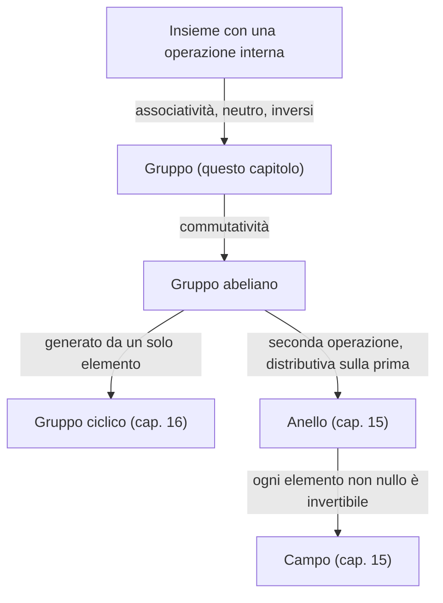
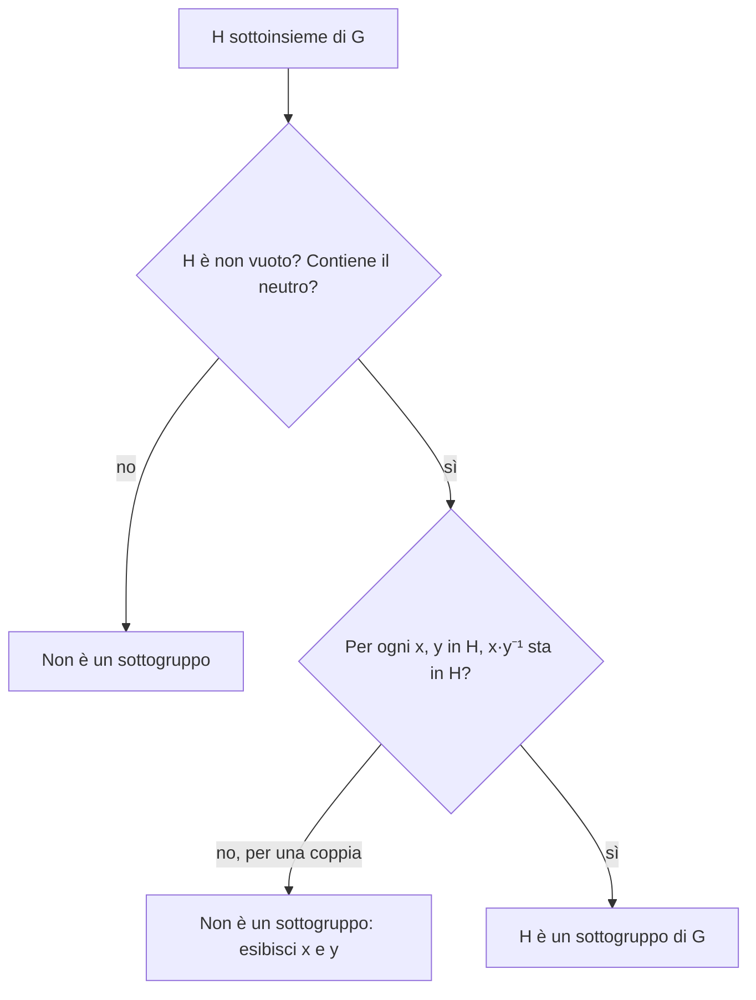

# Gruppi, sottogruppi e permutazioni

Prerequisiti: [[Books/Aritmetica-I/01 - Il linguaggio delle dimostrazioni|funzioni e dimostrazioni]], [[Books/Aritmetica-I/09 - Primi e fattorizzazione unica|divisibilità e mcm]], [[Books/Aritmetica-I/11 - Congruenze e inversi modulari|inversi modulari]]. Torna all’[[Books/Aritmetica-I/00 - Indice e piano di studio|indice]].

> [!info] In questo capitolo
> - Imparerai a decidere se un insieme con un'operazione è un gruppo e, se non lo è, quale assioma fallisce.
> - Dimostrerai le prime conseguenze degli assiomi: unicità del neutro e dell'inverso, inverso di un prodotto, cancellazione.
> - Userai il criterio del sottogruppo e distinguerai ciò che un sottoinsieme eredita da ciò che deve verificare.
> - Calcolerai con le permutazioni: composizione, cicli disgiunti, inverso, potenze e ordine.
> - L'idea che lega tutto: poche regole sull'operazione bastano a trattare allo stesso modo numeri, resti e trasformazioni, a patto di non scambiare mai l'ordine senza motivo.

## Domande per iniziare dagli esercizi

Prova prima gli esercizi indicati dalla domanda. Se ti manca uno strumento, apri soltanto la sezione collegata, poi torna al problema e ricostruisci il passaggio senza guardare. Per le prove, scrivi ipotesi, tesi e motivo di ogni implicazione. I riscontri sono raccolti dopo la teoria.

La tabella copre tutte le sezioni teoriche del capitolo, compresi casi limite e approfondimenti. Gli esercizi 1–8 conservano la numerazione originaria; dal 9 trovi le integrazioni. Gli esercizi tratti dal PDF fornito hanno un riferimento esplicito alla fonte; gli altri sono redazionali.

| Domanda guida | Esercizi da tentare | Teoria da recuperare |
|---|---|---|
| Quali azioni si possono comporre e annullare? | [[#Esercizio 8 — Ruotare un poligono (assiomi di gruppo e commutatività)\|8]] | [[#Comporre azioni che si possono annullare\|Comporre azioni che si possono annullare]] |
| Quali assiomi distinguono un gruppo dagli esempi che falliscono? | [[#Esercizio 1 — Le unità modulo quattordici (gruppo e inversi)\|1]], [[#Esercizio 8 — Ruotare un poligono (assiomi di gruppo e commutatività)\|8]], [[#Esercizio 9 — Da assiomi a strumenti (assiomi di gruppo, inversi e criterio del sottogruppo)\|9]], [[#Esercizio 10 — Tutto il gruppo simmetrico piccolo (cicli, ordini e sottogruppi)\|10]] | [[#Le regole di un gruppo\|Le regole di un gruppo]] |
| Come cancelli e inverti un prodotto senza scambiare i fattori? | [[#Esercizio 2 — Isolare un elemento (cancellazione senza commutatività)\|2]], [[#Esercizio 9 — Da assiomi a strumenti (assiomi di gruppo, inversi e criterio del sottogruppo)\|9]] | [[#Le prime dimostrazioni: annullare senza cambiare l’ordine\|Le prime dimostrazioni: annullare senza cambiare l’ordine]] |
| Come verifichi sottogruppi, intersezioni e unioni? | [[#Esercizio 3 — Tre classi chiuse (criterio del sottogruppo)\|3]], [[#Esercizio 4 — Intersecare e unire (intersezioni e unioni di sottogruppi)\|4]], [[#Esercizio 9 — Da assiomi a strumenti (assiomi di gruppo, inversi e criterio del sottogruppo)\|9]], [[#Esercizio 10 — Tutto il gruppo simmetrico piccolo (cicli, ordini e sottogruppi)\|10]] | [[#Sottogruppi: restringere l’insieme conservando le regole\|Sottogruppi: restringere l’insieme conservando le regole]] |
| Come raccogli gli elementi che commutano con tutti? | [[#Esercizio 7 — Chi commuta con chi (centralizzatore e centro)\|7]] | [[#Il centro: chi commuta con tutti?\|Il centro: chi commuta con tutti?]] |
| Perché le permutazioni formano un gruppo e la composizione può non commutare? | [[#Esercizio 5 — L’ordine delle azioni (composizione e inversa di permutazioni)\|5]], [[#Esercizio 9 — Da assiomi a strumenti (assiomi di gruppo, inversi e criterio del sottogruppo)\|9]], [[#Esercizio 10 — Tutto il gruppo simmetrico piccolo (cicli, ordini e sottogruppi)\|10]] | [[#Le permutazioni come gruppo\|Le permutazioni come gruppo]] |
| Come ricavi inversa, potenze e ordine dai cicli disgiunti? | [[#Esercizio 5 — L’ordine delle azioni (composizione e inversa di permutazioni)\|5]], [[#Esercizio 6 — Ripetere cicli disgiunti (ordine e potenze delle permutazioni)\|6]], [[#Esercizio 9 — Da assiomi a strumenti (assiomi di gruppo, inversi e criterio del sottogruppo)\|9]], [[#Esercizio 10 — Tutto il gruppo simmetrico piccolo (cicli, ordini e sottogruppi)\|10]] | [[#Decomporre, invertire e ripetere\|Decomporre, invertire e ripetere]] |

## Esercizi per verificare la comprensione

Gli esercizi 1–6 allenano gli strumenti di base; 7–8 li collegano ad altri problemi. Le integrazioni successive completano il controllo della teoria; quelle dalla raccolta fornita sono segnalate con numero e pagina. Non serve riuscire subito: individua che cosa ti manca, studia il passaggio collegato e riprova.

### Esercizio 1 — Le unità modulo quattordici (gruppo e inversi)

In $U(14)$ elenca tutti gli elementi e trova l’inverso di ciascuno.

Se ti blocchi: [[#Le regole di un gruppo|Le regole di un gruppo]].

Controllo dopo il tentativo: [[#Riscontro 1|riscontro 1]].

### Esercizio 2 — Isolare un elemento (cancellazione senza commutatività)

In un gruppo $G$, risolvi $axb=c$ rispetto a $x$, per $a,b,c\in G$. Dimostra anche l’unicità della soluzione.

Se ti blocchi: [[#Le prime dimostrazioni: annullare senza cambiare l’ordine|Le prime dimostrazioni: annullare senza cambiare l’ordine]].

Controllo dopo il tentativo: [[#Riscontro 2|riscontro 2]].

### Esercizio 3 — Tre classi chiuse (criterio del sottogruppo)

Dimostra che $H=\{[0]_{18},[6]_{18},[12]_{18}\}$ è un sottogruppo additivo di $\mathbb Z/18\mathbb Z$.

Se ti blocchi: [[#Sottogruppi: restringere l’insieme conservando le regole|Sottogruppi: restringere l’insieme conservando le regole]].

Controllo dopo il tentativo: [[#Riscontro 3|riscontro 3]].

### Esercizio 4 — Intersecare e unire (intersezioni e unioni di sottogruppi)

Calcola $8\mathbb Z\cap12\mathbb Z$. L’unione è un sottogruppo di $(\mathbb Z,+)$? Motiva con un elemento preciso.

Se ti blocchi: [[#Sottogruppi: restringere l’insieme conservando le regole|Sottogruppi: restringere l’insieme conservando le regole]].

Controllo dopo il tentativo: [[#Riscontro 4|riscontro 4]].

### Esercizio 5 — L’ordine delle azioni (composizione e inversa di permutazioni)

In $S_5$ siano $\alpha=(1\ 2\ 3)$ e $\beta=(3\ 4\ 5)$. Scrivi $\alpha\beta$ e $\beta\alpha$ in cicli disgiunti e trova $(\alpha\beta)^{-1}$.

Se ti blocchi: [[#Le permutazioni come gruppo|Le permutazioni come gruppo]] · [[#Decomporre, invertire e ripetere|Decomporre, invertire e ripetere]].

Controllo dopo il tentativo: [[#Riscontro 5|riscontro 5]].

### Esercizio 6 — Ripetere cicli disgiunti (ordine e potenze delle permutazioni)

Per $\rho=(1\ 2\ 3\ 4)(5\ 6\ 7)\in S_7$, trova ordine, inverso e $\rho^{10}$. Diagnostica l’errore: «$\rho^{24}=\operatorname{id}$, dunque l’ordine è $24$».

Se ti blocchi: [[#Decomporre, invertire e ripetere|Decomporre, invertire e ripetere]].

Controllo dopo il tentativo: [[#Riscontro 6|riscontro 6]].

### Esercizio 7 — Chi commuta con chi (centralizzatore e centro)

Per un elemento fissato $a$ di un gruppo $G$, poni $C_G(a)=\{x\in G:xa=ax\}$. Dimostra che è un sottogruppo e spiega perché $Z(G)=\bigcap_{a\in G}C_G(a)$.

Se ti blocchi: [[#Il centro: chi commuta con tutti?|Il centro: chi commuta con tutti?]].

Controllo dopo il tentativo: [[#Riscontro 7|riscontro 7]].

### Esercizio 8 — Ruotare un poligono (assiomi di gruppo e commutatività)

Numera consecutivamente in senso antiorario i vertici di un poligono regolare con $0,1,\ldots,n-1$, per $n\geq3$. Sia $r_k$ la rotazione che manda il vertice $j$ nel vertice di etichetta congrua a $j+k$ modulo $n$. Dimostra che le $n$ rotazioni $r_0,\ldots,r_{n-1}$ formano un gruppo abeliano per composizione; trova l’ordine di $r_1$.

Se ti blocchi: [[#Comporre azioni che si possono annullare|Comporre azioni che si possono annullare]] · [[#Le regole di un gruppo|Le regole di un gruppo]].

Controllo dopo il tentativo: [[#Riscontro 8|riscontro 8]].

### Esercizio 9 — Da assiomi a strumenti (assiomi di gruppo, inversi e criterio del sottogruppo)

Per ciascuno di $(\mathbb N,+)$, $(\mathbb Z,-)$ e delle classi non nulle modulo sei con il prodotto, identifica l'assioma che impedisce di essere un gruppo. In un gruppo dimostra unicità di neutro e inverso, cancellazione e $(ab)^{-1}=b^{-1}a^{-1}$. Dimostra il criterio «$H$ non vuoto e $xy^{-1}\in H$ per $x,y\in H$» e la chiusura delle intersezioni. Perché le biiezioni $X\to X$ sono un gruppo e perché due cicli disgiunti commutano? Deduci la formula dell'ordine come mcm delle lunghezze.

Se ti blocchi: [[#Le regole di un gruppo|Le regole di un gruppo]] · [[#Le prime dimostrazioni: annullare senza cambiare l’ordine|Le prime dimostrazioni: annullare senza cambiare l’ordine]] · [[#Sottogruppi: restringere l’insieme conservando le regole|Sottogruppi: restringere l’insieme conservando le regole]] · [[#Le permutazioni come gruppo|Le permutazioni come gruppo]] · [[#Decomporre, invertire e ripetere|Decomporre, invertire e ripetere]].

Controllo dopo il tentativo: [[#Riscontro 9|riscontro 9]].

### Esercizio 10 — Tutto il gruppo simmetrico piccolo (cicli, ordini e sottogruppi)

*Dalla raccolta fornita: esercizio preliminare 12, con richiesta aggiunta di una prova senza Lagrange, p. 58 stampata / [[Books/Aritmetica-I/Fonti/Esercizi algebra 1 2.pdf#page=69|p. 69 del PDF]]. Enunciato riformulato; riscontro redazionale.*

Elenca tutti gli elementi di $S_3$, calcolane gli ordini e descrivi tutti i sottogruppi. Giustifica la completezza senza usare Lagrange, che verrà provato nel capitolo 17: controlla che due trasposizioni distinte generano tutto $S_3$ e che una trasposizione insieme a un tre-ciclo genera tutto $S_3$.

Se ti blocchi: [[#Le regole di un gruppo|Le regole di un gruppo]] · [[#Sottogruppi: restringere l’insieme conservando le regole|Sottogruppi: restringere l’insieme conservando le regole]] · [[#Le permutazioni come gruppo|Le permutazioni come gruppo]] · [[#Decomporre, invertire e ripetere|Decomporre, invertire e ripetere]].

Controllo dopo il tentativo: [[#Riscontro 10|riscontro 10]].

## Teoria da recuperare

Usa i collegamenti della tabella iniziale per leggere lo strumento che ti serve. Dopo la lettura, torna all’esercizio e prova a risolverlo senza suggerimenti.

## Comporre azioni che si possono annullare

Ruota un triangolo equilatero di un terzo di giro, poi di un altro terzo: ottieni una rotazione di due terzi. Tre rotazioni riportano ogni vertice al punto iniziale. Puoi anche riflettere il triangolo rispetto a un suo asse: ripetere la riflessione annulla il primo movimento.

Qui gli oggetti da studiare sono le trasformazioni. L’operazione consiste nell’eseguirne una dopo l’altra. Comporre due simmetrie produce ancora una simmetria; esiste il movimento che lascia tutto fermo; ogni movimento ammesso può essere annullato. Queste proprietà ricordano la somma degli interi: due spostamenti di $a$ e $b$ passi equivalgono a uno spostamento di $a+b$ passi, zero lascia fermi, $-a$ annulla $a$.

La nozione di **gruppo** isola questo schema comune. Permette di dimostrare una sola volta regole che valgono per numeri, resti e trasformazioni. Occorre però conservare l’ordine delle azioni: riflettere e poi ruotare può dare un risultato diverso da ruotare e poi riflettere.

## Le regole di un gruppo

Per trattare allo stesso modo numeri, resti e trasformazioni servono poche richieste: abbastanza deboli da valere in tutti questi casi, abbastanza forti da permettere di dimostrare qualcosa. Le elenchiamo, sapendo che vanno controllate una per una: nella tabella più sotto vedrai insiemi in cui ne fallisce esattamente una.

Un’operazione binaria interna su un insieme $G$ è una funzione $G\times G\to G$: a ogni coppia $x,y$ associa un elemento $xy$ dello stesso insieme. La parola *interna* esprime la **chiusura**.

L’insieme con questa operazione è un gruppo se valgono tre ulteriori condizioni:

1. **Associatività:** $(xy)z=x(yz)$ per ogni $x,y,z\in G$.
2. **Neutro:** esiste $e\in G$ tale che $ex=xe=x$ per ogni $x\in G$.
3. **Inversi:** per ogni $x\in G$ esiste $y\in G$ tale che $xy=yx=e$.

L’associatività consente di spostare le parentesi, mantenendo l’ordine dei fattori. Se inoltre $xy=yx$ per ogni coppia, il gruppo si dice **abeliano**. Questa è una proprietà aggiuntiva.

In notazione moltiplicativa scriviamo $e$, $x^{-1}$, $xy$. In notazione additiva scriviamo $0$, $-x$, $x+y$: l’inverso diventa l’opposto. Cambiano i simboli, non gli assiomi.

> [!abstract] Concetto chiave — Gruppo
> Un insieme $G$ con un'operazione interna è un **gruppo** quando valgono: chiusura ($xy\in G$), associatività, esistenza del neutro, esistenza degli inversi. È **abeliano** se vale anche $xy=yx$.
> È la definizione su cui poggia tutto il seguito: sottogruppi, ordine e gruppi ciclici ([[Books/Aritmetica-I/16 - Gruppi ciclici e ordine|capitolo 16]]), Lagrange ([[Books/Aritmetica-I/17 - Lagrange Eulero e Fermat|capitolo 17]]), il gruppo additivo e quello delle unità di un anello ([[Books/Aritmetica-I/15 - Anelli campi e omomorfismi|capitolo 15]]).

Gli esempi familiari chiariscono perché bisogna specificare insieme e operazione:

- $(\mathbb Z,+)$ è abeliano: il neutro è $0$ e l’inverso di $a$ è $-a$. Invece $(\mathbb N,+)$ manca degli opposti dei naturali positivi.
- $(\mathbb Z/n\mathbb Z,+)$, per $n\geq2$, è abeliano: $[a]_n+[b]_n=[a+b]_n$, il neutro è $[0]_n$ e l’opposto è $[-a]_n$. La buona definizione delle operazioni è stata verificata nel capitolo sulle congruenze.
- $\mathbb R^\times=\mathbb R\setminus\{0\}$ è un gruppo abeliano per il prodotto: l’inverso di $x$ è $1/x$. Includere zero impedirebbe l’esistenza del suo inverso. Anche $\mathbb C^\times$ ha questa struttura.
- Per $n\geq2$, le classi invertibili formano il gruppo moltiplicativo
  $$
  U(n)=(\mathbb Z/n\mathbb Z)^\times
  =\{[a]_n:\gcd(a,n)=1\}.
  $$
  Il [[Books/Aritmetica-I/11 - Congruenze e inversi modulari|capitolo 11]] garantisce gli inversi. Se $u,v$ sono invertibili, $v^{-1}u^{-1}$ è un inverso di $uv$, perciò il prodotto rimane in $U(n)$; inoltre l’inverso di $u$ è invertibile, avendo inverso $u$. Neutro e associatività sono quelli del prodotto modulare.

Per esempio,
$$
U(10)=\{[1],[3],[7],[9]\}.
$$
Poiché $3\cdot7=21\equiv1\pmod{10}$, $[3]^{-1}=[7]$; inoltre $[9]^{-1}=[9]$. La classe $[2]$ non appartiene a questo gruppo, pur appartenendo all’insieme delle classi modulo $10$.

### Quando un insieme con operazione non è un gruppo

Un candidato si controlla con le quattro condizioni, una dopo l'altra. La commutatività non fa parte della definizione di gruppo: è solo una colonna in più. «n.d.» significa che la condizione non si può nemmeno enunciare (per esempio gli inversi esistono solo rispetto a un neutro).

| Insieme e operazione | Chiusura | Associatività | Neutro | Inversi | Commutatività | Gruppo? |
|---|---|---|---|---|---|---|
| $(\mathbb N,+)$ (con $0\in\mathbb N$) | sì | sì | sì ($0$) | **no** | sì | no: $1$ non ha opposto in $\mathbb N$ |
| $(\mathbb Z,+)$ | sì | sì | sì ($0$) | sì ($-a$) | sì | sì, abeliano |
| $(\mathbb Z,\cdot)$ | sì | sì | sì ($1$) | **no** | sì | no: $2$ non ha inverso intero |
| $(\mathbb Z,-)$ | sì | **no** | **no** | n.d. | no | no: $(5-3)-1=1$ ma $5-(3-1)=3$; inoltre $a-0=a$ ma $0-a=-a$ |
| $(\mathbb Z/n\mathbb Z,+)$, $n\ge2$ | sì | sì | sì ($[0]$) | sì ($[-a]$) | sì | sì, abeliano |
| $(\mathbb Z/n\mathbb Z,\cdot)$, $n\ge2$ | sì | sì | sì ($[1]$) | **no** | sì | no: $[0]$ non ha mai inverso; in $\mathbb Z/6\mathbb Z$ nemmeno $[2],[3],[4]$ |
| $(\mathbb Z/6\mathbb Z\setminus\{[0]\},\cdot)$ | **no** | sì | sì ($[1]$) | **no** | sì | no: $[2][3]=[0]$ esce dall'insieme |
| $(U(n),\cdot)$ | sì | sì | sì ($[1]$) | sì | sì | sì, abeliano |
| $(\mathbb Q,\cdot)$ | sì | sì | sì ($1$) | **no** | sì | no: $0$ non ha inverso |
| $(\mathbb Q^\times,\cdot)$, con $\mathbb Q^\times=\mathbb Q\setminus\{0\}$ | sì | sì | sì ($1$) | sì ($1/q$) | sì | sì, abeliano |
| $(\{1,-1\},\cdot)$ | sì | sì | sì ($1$) | sì (ciascuno è inverso di sé stesso) | sì | sì, abeliano |
| $(S_3,\circ)$ | sì | sì | sì ($\operatorname{id}$) | sì | **no** | sì, ma non abeliano |
| (pari, $+$) in $\mathbb Z$ | sì | sì | sì ($0$) | sì | sì | sì, abeliano |
| (dispari, $+$) in $\mathbb Z$ | **no** | sì | **no** | n.d. | sì | no: $1+3=4$ non è dispari; $0$ non è dispari |

Tre letture della tabella. Primo: la stessa operazione può dare un gruppo o no a seconda dell'insieme ($\mathbb Q$ contro $\mathbb Q^\times$ per il prodotto). Secondo: lo stesso insieme può dare un gruppo o no a seconda dell'operazione ($\mathbb Z$ con $+$ contro $\mathbb Z$ con $\cdot$ o con $-$). Terzo: il fallimento tipico è quello degli inversi; la mancanza di chiusura o di associatività è più rara ma va sempre controllata.

> [!example] Esempi e controesempi — gruppo
> **È un gruppo:** $(\mathbb Z,+)$, $(\mathbb Z/n\mathbb Z,+)$, $(U(10),\cdot)$, $(S_3,\circ)$.
>
> **Non è un gruppo.** Ogni caso mostra una condizione che fallisce:
> - chiusura: $(\mathbb Z/6\mathbb Z\setminus\{[0]\},\cdot)$, perché $[2][3]=[0]$ esce dall'insieme;
> - associatività: $(\mathbb Z,-)$, perché $(5-3)-1\ne5-(3-1)$;
> - neutro: i numeri pari **positivi** con $+$ sono chiusi e associativi, ma $0$ non appartiene all'insieme;
> - inversi: $(\mathbb N,+)$, dove $1$ non ha opposto, e $(\mathbb Z,\cdot)$, dove $2$ non ha inverso intero; in entrambi chiusura, associatività e neutro valgono.
>
> Ogni ipotesi è dunque necessaria. La commutatività, invece, non lo è: $S_3$ è un gruppo.

### La mappa delle strutture: dove stiamo andando

Il gruppo è il primo gradino di una scala. Lo schema è un'anteprima: i nomi a destra del gruppo saranno definiti nei capitoli indicati, qui servono solo a collocare ciò che stai studiando. Si legge dall'alto verso il basso: ogni freccia aggiunge una richiesta.

| Livello | Che cosa si aggiunge | Esempio | Non esempio |
|---|---|---|---|
| Gruppo | un'operazione con neutro e inversi | $S_3$ | $(\mathbb Z,\cdot)$ |
| Gruppo abeliano | $xy=yx$ | $(\mathbb Z/n\mathbb Z,+)$ | $S_3$ |
| Anello (anteprima) | una seconda operazione, il prodotto, compatibile con la somma | $(\mathbb Z,+,\cdot)$ | $(S_3,\circ)$ ha una sola operazione |
| Campo (anteprima) | ogni elemento non nullo ha un inverso moltiplicativo | $\mathbb Q$ | $\mathbb Z$, perché $2$ non è invertibile |
| Gruppo ciclico (anteprima) | tutti gli elementi sono potenze di uno solo | $(\mathbb Z,+)$ generato da $1$ | $S_3$ |

In un anello la parte additiva è un gruppo abeliano (per questo la freccia parte da lì); il prodotto si chiede solo associativo e distributivo. I dettagli sono nel [[Books/Aritmetica-I/15 - Anelli campi e omomorfismi|capitolo 15]].

## Le prime dimostrazioni: annullare senza cambiare l’ordine

Il neutro è unico. Se $e,f$ sono entrambi neutri, allora $e=ef=f$: la prima uguaglianza usa $f$, la seconda $e$.

Anche l’inverso è unico. Se $u,v$ sono inversi di $x$, usando soltanto associatività e definizioni otteniamo
$$
u=ue=u(xv)=(ux)v=ev=v.
$$
Possiamo dunque indicarlo senza ambiguità con $x^{-1}$. Poiché $x$ annulla $x^{-1}$ da entrambi i lati, $(x^{-1})^{-1}=x$.

Come si annulla un prodotto $xy$? Bisogna disfare prima l’ultima azione, poi la prima. Infatti
$$
(xy)(y^{-1}x^{-1})=x(yy^{-1})x^{-1}=e,
$$
$$
(y^{-1}x^{-1})(xy)=y^{-1}(x^{-1}x)y=e.
$$
Per unicità,
$$
\boxed{(xy)^{-1}=y^{-1}x^{-1}.}
$$

La **cancellazione** deriva dall’esistenza degli inversi. Se $ax=ay$, moltiplichiamo a sinistra per $a^{-1}$:
$$
a^{-1}(ax)=a^{-1}(ay)\quad\Longrightarrow\quad x=y.
$$
Da $xa=ya$ si ottiene lo stesso risultato moltiplicando a destra per $a^{-1}$. Il lato della moltiplicazione conta.

> [!warning] Attenzione — Associativo non significa commutativo
> Puoi sostituire $(xy)z$ con $x(yz)$, ma non scambiare $x$ e $y$ senza una ragione. Per questo l’inverso del prodotto richiede l’ordine rovesciato. Anche da $ax=b$ segue $x=a^{-1}b$, mentre $ba^{-1}$ può essere diverso.

## Sottogruppi: restringere l’insieme conservando le regole

Un sottoinsieme $H\subseteq G$ è un **sottogruppo**, scritto $H\leq G$, quando è un gruppo con la stessa operazione di $G$. Per esempio i numeri pari sono un sottogruppo di $(\mathbb Z,+)$: somma e opposto di pari rimangono pari.

Prima di formulare un criterio pratico, controlliamo che il neutro di un sottogruppo sia proprio quello del gruppo ambiente. Indichiamo con $e_H$ il neutro di $H$ e scegliamo $h\in H$. In $G$ valgono
$$
e_Hh=h=eh.
$$
Cancellando $h$ a destra **in $G$**, otteniamo $e_H=e$. Ora l’inverso di $h$ calcolato in $H$ soddisfa anche in $G$ le equazioni dell’inverso rispetto a $e$; per unicità coincide con $h^{-1}$ in $G$.

La cancellazione evita un passaggio ingiustificato: all’inizio sappiamo che $e_H$ è neutro sugli elementi di $H$, non su tutti quelli di $G$.

Possiamo ora ridurre il lavoro: invece di controllare tutti gli assiomi su $H$, basta una sola condizione.

> [!abstract] Concetto chiave — Criterio del sottogruppo
> $$
> H\leq G
> \quad\Longleftrightarrow\quad
> H\neq\varnothing\ \text{ e }\ xy^{-1}\in H\ \text{per ogni }x,y\in H.
> $$
> È lo strumento standard per dimostrare che qualcosa è un sottogruppo; lo useremo per $d\mathbb Z$, per il centro, per i sottogruppi generati ([[Books/Aritmetica-I/16 - Gruppi ciclici e ordine|capitolo 16]]) e per i nuclei degli omomorfismi ([[Books/Aritmetica-I/15 - Anelli campi e omomorfismi|capitolo 15]]).

Se $H$ è un sottogruppo, quanto appena dimostrato garantisce inversi e prodotti in $H$, quindi la condizione è necessaria. Viceversa, scegliamo $a\in H$. Applicando la condizione a $a,a$ troviamo $e=aa^{-1}\in H$. Applicandola a $e,y$ troviamo $y^{-1}\in H$. Infine, poiché $y^{-1}\in H$, applicandola a $x,y^{-1}$ otteniamo
$$
x(y^{-1})^{-1}=xy\in H.
$$
L’associatività è ereditata da $G$; neutro e inversi sono presenti. Dunque $H$ è un gruppo.

In notazione additiva il criterio diventa: insieme non vuoto e chiusura rispetto a $x-y$. Per ogni $d\in\mathbb Z$,
$$
d\mathbb Z=\{dk:k\in\mathbb Z\}\leq(\mathbb Z,+),
$$
perché contiene zero e $dr-ds=d(r-s)$. Sono compresi $0\mathbb Z=\{0\}$ e $1\mathbb Z=\mathbb Z$.

Per interi positivi $d,m$,
$$
d\mathbb Z\subseteq m\mathbb Z\quad\Longleftrightarrow\quad m\mid d.
$$
Se vale l’inclusione, $d\in m\mathbb Z$, quindi $m\mid d$. Se $d=mq$, ogni $dk=m(qk)$ appartiene a $m\mathbb Z$. Il verso dell’inclusione è così spiegato: $6\mathbb Z\subseteq2\mathbb Z$, perché essere multiplo di $6$ è un requisito più restrittivo.

Lo schema seguente riassume come applicare il criterio. Si legge dall'alto; i rami «no» si chiudono con una risposta negativa, che si dimostra esibendo un elemento o una coppia precisa.

> [!example] Esempi e controesempi — sottogruppo
> **È un sottogruppo:** $2\mathbb Z\le(\mathbb Z,+)$; $\{\operatorname{id},(1\ 2)\}\le S_3$ (perché $(1\ 2)^2=\operatorname{id}$); $\{[1],[9]\}\le U(10)$ (perché $9\cdot9=81\equiv1$); i due sottogruppi banali $\{e\}$ e $G$.
>
> **Non è un sottogruppo** (ciascun caso viola una sola richiesta):
> - *non vuoto:* $\varnothing\subseteq\mathbb Z$ soddisfa vacuamente la condizione su $xy^{-1}$, ma non contiene il neutro;
> - *inversi:* $\mathbb N\subseteq\mathbb Z$ è non vuoto, contiene $0$ ed è chiuso per $+$, ma $1-2=-1\notin\mathbb N$: manca l'opposto di $1$;
> - *chiusura:* $\{\operatorname{id},(1\ 2),(1\ 3)\}\subseteq S_3$ contiene il neutro e gli inversi (ogni trasposizione è inversa di sé stessa), ma $(1\ 2)(1\ 3)=(1\ 3\ 2)$ non vi appartiene; analogamente $2\mathbb Z\cup3\mathbb Z$ non contiene $2+3$;
> - *stessa operazione:* $U(10)$ è un gruppo per il prodotto, ma non è un sottogruppo di $(\mathbb Z/10\mathbb Z,+)$, perché $[1]+[3]=[4]\notin U(10)$. Un sottoinsieme che è un gruppo con un'altra operazione non basta.
>
> **Nei gruppi finiti basta meno:** se $G$ è finito e $H\ne\varnothing$ è chiuso per prodotto, allora $H\le G$. Per $x\in H$ le potenze $x,x^2,x^3,\ldots$ stanno in $H$ ma sono in numero finito, quindi $x^i=x^j$ con $i<j$. Cancellando $x^i$ si ottiene $x^{j-i}=e\in H$ e $x^{j-i-1}$ (che è $e$ se $j-i=1$) è l'inverso di $x$. Il controesempio $\mathbb N\subseteq\mathbb Z$ vive perciò in un gruppo infinito.

### Intersezioni e unioni

Se $H,K\leq G$, allora $H\cap K\leq G$: contiene $e$, e per $x,y\in H\cap K$ l’elemento $xy^{-1}$ appartiene a entrambi. Lo stesso argomento funziona per ogni famiglia non vuota di sottogruppi.

Negli interi, per $d,m>0$, l’intersezione contiene esattamente i multipli comuni:
$$
d\mathbb Z\cap m\mathbb Z=\operatorname{mcm}(d,m)\mathbb Z.
$$
Infatti ogni multiplo comune è multiplo del mcm, e viceversa, come dimostrato nel [[Books/Aritmetica-I/09 - Primi e fattorizzazione unica|capitolo 09]]. Per esempio $6\mathbb Z\cap10\mathbb Z=30\mathbb Z$. Se uno dei due parametri è zero, l’intersezione è $\{0\}$.

L’unione si comporta diversamente:
$$
H\cup K\leq G\quad\Longleftrightarrow\quad H\subseteq K\ \text{oppure}\ K\subseteq H.
$$
Se uno è contenuto nell’altro, l’unione coincide con il maggiore. Per il viceversa supponiamo che l’unione sia un sottogruppo, ma nessuna inclusione valga. Scegliamo $h\in H\setminus K$ e $k\in K\setminus H$. Il prodotto $hk$ deve stare nell’unione. Se sta in $H$, anche $h^{-1}(hk)=k$ sta in $H$, assurdo. Se sta in $K$, anche $(hk)k^{-1}=h$ sta in $K$, ancora assurdo.

> [!warning] Attenzione — La chiusura non passa automaticamente ai sottoinsiemi
> Associatività passa da $G$ a un suo sottoinsieme; chiusura e inversi richiedono una verifica. I naturali sono chiusi per somma ma non per opposti. E $2\mathbb Z\cup3\mathbb Z$ non è chiuso per somma: contiene $2$ e $3$, ma non $5$. Nel criterio del sottogruppo anche l’ipotesi «non vuoto» è essenziale.

## Il centro: chi commuta con tutti?

In un gruppo non abeliano alcuni elementi possono comunque commutare con ogni elemento. Il loro insieme è il **centro**:
$$
Z(G)=\{z\in G:zg=gz\text{ per ogni }g\in G\}.
$$
Dimostriamo che è un sottogruppo senza supporre anticipatamente ciò che vogliamo provare. Il neutro è centrale. Se $x,y\in Z(G)$, per ogni $g\in G$ abbiamo
$$
(xy)g=x(yg)=x(gy)=(xg)y=(gx)y=g(xy).
$$
Dunque $xy$ è centrale. Se $x\in Z(G)$, l’inverso $x^{-1}$ esiste già **in $G$**. Dall’uguaglianza $xg=gx$, moltiplicando a sinistra e a destra per $x^{-1}$, ricaviamo
$$
gx^{-1}=x^{-1}g.
$$
Quindi $x^{-1}$ è centrale: abbiamo verificato appartenenza, non assunto un inverso nel centro. Chiusura e inversi concludono la prova. Infine $Z(G)=G$ equivale precisamente a dire che $G$ è abeliano.

## Le permutazioni come gruppo

Una **permutazione** di un insieme $X$ è una biiezione $X\to X$, cioè una funzione sia iniettiva sia suriettiva (si veda il [[Books/Aritmetica-I/01 - Il linguaggio delle dimostrazioni|capitolo 01]]): mescola gli elementi senza perderne né duplicarne. Le permutazioni formano il gruppo $\operatorname{Sym}(X)$ per composizione. Il composto di due biiezioni è biiettivo; la composizione è associativa, perché entrambi i raggruppamenti mandano $x$ in $\sigma(\tau(\rho(x)))$. Il neutro è $\operatorname{id}_X$ e l’inverso è la funzione inversa.

Per $X=\{1,\ldots,n\}$, con $n\geq1$, il gruppo si indica con $S_n$. Fissiamo la convenzione
$$
\sigma\tau=\sigma\circ\tau,
\qquad (\sigma\tau)(x)=\sigma(\tau(x)):
$$
**si applica prima la permutazione a destra**.

Una scrittura a due righe elenca dominio e immagini:
$$
\sigma=\begin{pmatrix}1&2&3&4&5\\3&5&1&4&2\end{pmatrix}.
$$
Qui $1\mapsto3\mapsto1$, $2\mapsto5\mapsto2$ e $4$ rimane fisso. La scrittura in cicli è dunque $\sigma=(1\ 3)(2\ 5)$.

> [!example] Esempi e controesempi — permutazione
> **È una permutazione:** la funzione $1\mapsto3$, $2\mapsto5$, $3\mapsto1$, $4\mapsto4$, $5\mapsto2$ della scrittura a due righe; l'identità; $n\mapsto n+1$ come funzione $\mathbb Z\to\mathbb Z$.
>
> **Non è una permutazione:** $1\mapsto2$, $2\mapsto2$, $3\mapsto1$ su $\{1,2,3\}$: $2$ ha due preimmagini (non iniettiva) e $3$ non è immagine di nessuno (non suriettiva); su un insieme finito le due mancanze si presentano sempre insieme. Invece $n\mapsto n+1$ come funzione $\mathbb N\to\mathbb N$ è iniettiva ma non suriettiva ($0$ non è immagine): su insiemi infiniti si può violare una sola condizione.

Un **ciclo** $(a_1\ a_2\ \cdots\ a_r)$, dove gli $a_i$ sono distinti, manda ogni elemento al successivo e $a_r$ ad $a_1$, fissando gli altri. Un ciclo di lunghezza due è una **trasposizione**. I punti fissi sono cicli di lunghezza uno, normalmente omessi. Si può cambiare il punto iniziale, per esempio $(1\ 2\ 3)=(2\ 3\ 1)$; invertire il verso produce il ciclo inverso, che può essere diverso.

### Un calcolo completo in $S_3$

Prendiamo $\sigma=(1\ 2\ 3)$ e $\tau=(1\ 2)$. Per $\sigma\tau$ seguiamo prima $\tau$:
$$
1\mapsto2\mapsto3,\qquad
2\mapsto1\mapsto2,\qquad
3\mapsto3\mapsto1.
$$
Quindi $\sigma\tau=(1\ 3)$. Cambiando l’ordine otteniamo
$$
1\mapsto2\mapsto1,\qquad
2\mapsto3\mapsto3,\qquad
3\mapsto1\mapsto2,
$$
perciò $\tau\sigma=(2\ 3)$. I risultati sono diversi: $S_3$ non è abeliano. Gli stessi due cicli, fissando gli ulteriori punti, mostrano che $S_n$ non è abeliano per ogni $n\geq3$.

Quante permutazioni contiene $S_n$? L’immagine di $1$ ha $n$ possibilità, quella di $2$ ne ha $n-1$, e così via: le immagini devono essere tutte diverse, e ogni scelta completa produce una biiezione. Pertanto $|S_n|=n!$. In particolare
$$
S_3=\{\operatorname{id},(1\ 2),(1\ 3),(2\ 3),(1\ 2\ 3),(1\ 3\ 2)\}.
$$

Tutti i prodotti possibili stanno nella tabella seguente: nella riga di $\sigma$ e nella colonna di $\tau$ trovi $\sigma\tau$, cioè prima $\tau$ e poi $\sigma$.

| $\sigma\backslash\tau$ | id | $(1\ 2\ 3)$ | $(1\ 3\ 2)$ | $(1\ 2)$ | $(1\ 3)$ | $(2\ 3)$ |
|---|---|---|---|---|---|---|
| **id** | id | $(1\ 2\ 3)$ | $(1\ 3\ 2)$ | $(1\ 2)$ | $(1\ 3)$ | $(2\ 3)$ |
| **$(1\ 2\ 3)$** | $(1\ 2\ 3)$ | $(1\ 3\ 2)$ | id | $(1\ 3)$ | $(2\ 3)$ | $(1\ 2)$ |
| **$(1\ 3\ 2)$** | $(1\ 3\ 2)$ | id | $(1\ 2\ 3)$ | $(2\ 3)$ | $(1\ 2)$ | $(1\ 3)$ |
| **$(1\ 2)$** | $(1\ 2)$ | $(2\ 3)$ | $(1\ 3)$ | id | $(1\ 3\ 2)$ | $(1\ 2\ 3)$ |
| **$(1\ 3)$** | $(1\ 3)$ | $(1\ 2)$ | $(2\ 3)$ | $(1\ 2\ 3)$ | id | $(1\ 3\ 2)$ |
| **$(2\ 3)$** | $(2\ 3)$ | $(1\ 3)$ | $(1\ 2)$ | $(1\ 3\ 2)$ | $(1\ 2\ 3)$ | id |

Ogni riga e ogni colonna contiene ciascun elemento una volta sola: è la cancellazione vista sopra. La tabella non è simmetrica rispetto alla diagonale, per esempio $(1\ 2\ 3)(1\ 2)=(1\ 3)$ ma $(1\ 2)(1\ 2\ 3)=(2\ 3)$, e questo è il segno che $S_3$ non è abeliano.

## Decomporre, invertire e ripetere

Due cicli sono **disgiunti** quando non condividono punti. Commutano: un punto mosso dal primo è fissato dal secondo, prima e dopo il movimento; analogamente per il secondo. Un punto esterno a entrambi rimane fermo.

> [!example] Esempi e controesempi — cicli disgiunti
> **Disgiunti, quindi commutano:** $(1\ 2)(3\ 4)=(3\ 4)(1\ 2)$, perché ciascun ciclo muove punti che l'altro lascia fermi.
>
> **Non disgiunti, non commutano:** $(1\ 2)$ e $(2\ 3)$ condividono il punto $2$. Applicando prima il fattore a destra, $(1\ 2)(2\ 3)$ manda $1\mapsto1\mapsto2$, $2\mapsto3\mapsto3$, $3\mapsto2\mapsto1$, cioè è $(1\ 2\ 3)$; l'ordine opposto dà $(2\ 3)(1\ 2)=(1\ 3\ 2)$. La disgiunzione è necessaria.

Ogni permutazione di un insieme finito si decompone in cicli disgiunti. Ecco perché. Scegli un punto $a$ e segui
$$
a,\sigma(a),\sigma^2(a),\ldots
$$
dove, per $k\geq0$, $\sigma^k$ significa comporre $k$ volte $\sigma$, con $\sigma^0=\operatorname{id}$. La finitezza impone una ripetizione. La prima ripetizione deve tornare ad $a$: se $\sigma^j(a)=\sigma^i(a)$ con $0<i<j$, applicando $i$ volte la funzione inversa avremmo una ripetizione precedente, $\sigma^{j-i}(a)=a$. Otteniamo così un ciclo.

Se restano punti, scegliamone uno esterno al ciclo e ripetiamo. La nuova traiettoria non può incontrare il ciclo precedente: se lo facesse, risalendo con la funzione inversa anche il punto iniziale apparterrebbe a quel ciclo. Si ottengono dunque cicli disgiunti, fino a esaurire i punti. Queste traiettorie, dette **orbite**, sono determinate dalla permutazione: la decomposizione è unica salvo ordine dei cicli e punto iniziale di ciascuno.

L’inverso di un ciclo percorre la traiettoria al contrario:
$$
(a_1\ a_2\ \cdots\ a_r)^{-1}=(a_1\ a_r\ \cdots\ a_2).
$$
Per invertire un prodotto si rovescia anche l’ordine dei fattori; quando i cicli sono disgiunti possiamo poi riordinarli, perché commutano.

Su un ciclo di lunghezza $r$, la potenza $k$ fa avanzare di $k$ posizioni. Scrivendo $k=qr+s$, con $0\leq s<r$, i $q$ giri completi lasciano lo stesso effetto di $s$ passi. Il ciclo torna identità esattamente quando $r\mid k$.

L’**ordine di una permutazione** $\pi$, indicato con $\operatorname{ord}(\pi)$, è il minimo intero positivo $k$ per cui $\pi^k=\operatorname{id}$. Se i cicli disgiunti hanno lunghezze $r_1,\ldots,r_t$, ogni punto ritorna al suo posto esattamente quando tutte le lunghezze dividono $k$. Ne segue il risultato che useremo per ogni calcolo con le permutazioni.

> [!abstract] Concetto chiave — Ordine di una permutazione
> Ogni permutazione di un insieme finito è prodotto di cicli disgiunti, e se questi hanno lunghezze $r_1,\ldots,r_t$ allora
> $$
> \operatorname{ord}(\pi)=\operatorname{mcm}(r_1,\ldots,r_t).
> $$
> Ridurre un problema di permutazioni a un calcolo di mcm è il ponte con l'aritmetica; la nozione di ordine in un gruppo qualsiasi è nel [[Books/Aritmetica-I/16 - Gruppi ciclici e ordine|capitolo 16]].

Per l’identità l’ordine è $1$, includendo i suoi cicli di lunghezza uno.

> [!example] Esempi e controesempi — formula dell'ordine
> **Si applica:** $(1\ 2)(3\ 4\ 5)$ ha cicli disgiunti di lunghezze $2$ e $3$, quindi ordine $\operatorname{mcm}(2,3)=6$.
>
> **Non si applica senza disgiunzione:** $(1\ 2)(2\ 3)$ ha due fattori di lunghezza $2$, e il mcm darebbe $2$. Ma, come visto sopra, il prodotto è il ciclo $(1\ 2\ 3)$, di ordine $3$. La formula va usata dopo aver riscritto la permutazione in cicli disgiunti.

Per esempio, in $S_7$ poniamo
$$
\pi=(1\ 4\ 2)(3\ 5\ 6\ 7).
$$
L’ordine è $\operatorname{mcm}(3,4)=12$. Per calcolare $\pi^{14}$ riduciamo separatamente: $14\equiv2\pmod3$ e $14\equiv2\pmod4$. Il primo ciclo al quadrato è $(1\ 2\ 4)$; sul secondo, avanzare di due posizioni scambia $3$ con $6$ e $5$ con $7$. Dunque
$$
\pi^{14}=(1\ 2\ 4)(3\ 6)(5\ 7),
\qquad
\pi^{-1}=(1\ 2\ 4)(3\ 7\ 6\ 5).
$$

## Fonti

Il capitolo rielabora [[Notes/Aritmetica/Lectures/2026-10-21 - Relazioni di equivalenza e strutture quoziente|la nota sulle strutture e sui quozienti]] e [[Notes/Aritmetica/Lectures/2026-10-27 - Gruppi ciclici, sottogruppi e permutazioni|la nota su gruppi, sottogruppi e permutazioni]], confrontate con i passi pertinenti di [[_transcripts/Aritmetica/2026-10-22 - Relazioni di equivalenza e strutture quoziente|trascrizione del 22 ottobre]] e [[_transcripts/Aritmetica/2026-10-27 - Gruppi ciclici, sottogruppi e permutazioni|trascrizione del 27 ottobre]].

Sono integrazioni didattiche la narrazione attraverso le simmetrie, la sistemazione delle prove di intersezione e unione, la giustificazione del neutro del sottogruppo mediante cancellazione e le prove tramite orbite della decomposizione e della formula dell’ordine. Esempi ed esercizi sono ricostruiti e verificati autonomamente.

## Riscontri degli esercizi

Apri il riscontro soltanto dopo aver scritto un tentativo. Per una dimostrazione, confronta anche le ipotesi e la completezza, non soltanto il risultato.

### Riscontro 1

> [!tip]- Riscontro 1
> Le classi coprime con $14$ sono $[1],[3],[5],[9],[11],[13]$. Gli inversi sono rispettivamente $[1],[5],[3],[11],[9],[13]$: infatti $3\cdot5=15\equiv1$, $9\cdot11=99\equiv1$ e $13^2=169\equiv1\pmod{14}$.

Torna a [[#Esercizio 1 — Le unità modulo quattordici (gruppo e inversi)|esercizio 1]].

### Riscontro 2

> [!tip]- Riscontro 2
> Moltiplicando a sinistra per $a^{-1}$ e a destra per $b^{-1}$ si ottiene necessariamente $x=a^{-1}cb^{-1}$. Sostituendo, $a(a^{-1}cb^{-1})b=c$, quindi la soluzione esiste. Ogni soluzione deve avere questa forma, dunque è unica.

Torna a [[#Esercizio 2 — Isolare un elemento (cancellazione senza commutatività)|esercizio 2]].

### Riscontro 3

> [!tip]- Riscontro 3
> Sono le classi $[6k]_{18}$ con $k\in\mathbb Z$: riducendo $k$ modulo $3$ si ottengono esattamente le tre classi elencate. L’insieme contiene zero e $[6r]-[6s]=[6(r-s)]$ vi appartiene. Si applica il criterio additivo.

Torna a [[#Esercizio 3 — Tre classi chiuse (criterio del sottogruppo)|esercizio 3]].

### Riscontro 4

> [!tip]- Riscontro 4
> L’intersezione è $24\mathbb Z$, perché $\operatorname{mcm}(8,12)=24$. L’unione contiene $8$ e $12$, ma non $20=8+12$, che non è divisibile né per $8$ né per $12$; quindi non è un sottogruppo.

Torna a [[#Esercizio 4 — Intersecare e unire (intersezioni e unioni di sottogruppi)|esercizio 4]].

### Riscontro 5

> [!tip]- Riscontro 5
> Seguendo prima il fattore a destra, $\alpha\beta$ manda $1\mapsto2\mapsto3\mapsto4\mapsto5\mapsto1$, quindi è $(1\ 2\ 3\ 4\ 5)$. Invece $\beta\alpha=(1\ 2\ 4\ 5\ 3)$. L’inverso del primo è $(1\ 5\ 4\ 3\ 2)$, ottenuto percorrendo il ciclo al contrario.

Torna a [[#Esercizio 5 — L’ordine delle azioni (composizione e inversa di permutazioni)|esercizio 5]].

### Riscontro 6

> [!tip]- Riscontro 6
> L’ordine è $\operatorname{mcm}(4,3)=12$ e l’inverso è $(1\ 4\ 3\ 2)(5\ 7\ 6)$. Poiché $10\equiv2\pmod4$ e $10\equiv1\pmod3$, $\rho^{10}=(1\ 3)(2\ 4)(5\ 6\ 7)$. Il ritorno al passo $24$ non è necessariamente il primo: l’ordine divide $24$, e qui è $12$.

Torna a [[#Esercizio 6 — Ripetere cicli disgiunti (ordine e potenze delle permutazioni)|esercizio 6]].

### Riscontro 7

> [!tip]- Riscontro 7
> Il neutro commuta con $a$. Se $x,y$ commutano con $a$, allora $(xy)a=x(ya)=x(ay)=(xa)y=a(xy)$. Da $xa=ax$, moltiplicando a sinistra e a destra per $x^{-1}$, segue $ax^{-1}=x^{-1}a$. Quindi anche inversi e prodotti appartengono a $C_G(a)$. Essere in tutte queste raccolte significa commutare con ogni $a$, esattamente la definizione del centro.

Torna a [[#Esercizio 7 — Chi commuta con chi (centralizzatore e centro)|esercizio 7]].

### Riscontro 8

> [!tip]- Riscontro 8
> La composizione dà $r_kr_h=r_{k+h}$, riducendo l’indice modulo $n$: dunque è chiusa e commutativa. L’associatività è quella delle funzioni, il neutro è $r_0$, l’inverso di $r_k$ è $r_{-k}$. Le rotazioni sono distinte perché mandano il vertice $0$ in vertici distinti. Ripetere $r_1$ avanza di un posto ogni volta: il primo ritorno di tutti i vertici avviene dopo $n$ passi, quindi $\operatorname{ord}(r_1)=n$.

Torna a [[#Esercizio 8 — Ruotare un poligono (assiomi di gruppo e commutatività)|esercizio 8]].

### Riscontro 9

> [!tip]- Riscontro 9
> Nei naturali mancano opposti; la sottrazione non è associativa e non ha neutro bilatero; le classi non nulle modulo sei non sono chiuse perché $[2][3]=[0]$. Se $e,e'$ sono neutri, $e=ee'=e'$; se $u,v$ sono inversi di $a$, $u=u(av)=(ua)v=v$. Moltiplicare dallo stesso lato per l'inverso dà cancellazione; il prodotto $ab$ con $b^{-1}a^{-1}$ vale il neutro in entrambi gli ordini. Dal criterio, scegliendo $x=y$ ottieni $e$, poi inversi e prodotti; il viceversa è immediato. Le intersezioni contengono $e$ e conservano il criterio. La composizione è associativa, ha identità e inverse; cicli disgiunti agiscono su supporti disgiunti. Una potenza è l'identità esattamente quando l'esponente è multiplo di ogni lunghezza: il minimo positivo è il mcm.

Torna a [[#Esercizio 9 — Da assiomi a strumenti (assiomi di gruppo, inversi e criterio del sottogruppo)|esercizio 9]].

### Riscontro 10

> [!tip]- Riscontro 10
> Ci sono identità di ordine uno, tre trasposizioni di ordine due e due tre-cicli inversi di ordine tre. I sottogruppi sono $\{e\}$, i tre $\{e,(ij)\}$, $\{e,(123),(132)\}$ e $S_3$. Se un sottogruppo contiene un tre-ciclo, contiene l'altro per inversione. Due trasposizioni distinte producono un tre-ciclo; un tre-ciclo e una trasposizione producono per composizione le altre trasposizioni, dunque tutti i sei elementi. Queste osservazioni esauriscono i casi senza richiedere Lagrange.

Torna a [[#Esercizio 10 — Tutto il gruppo simmetrico piccolo (cicli, ordini e sottogruppi)|esercizio 10]].

Il capitolo è acquisito quando sai verificare un sottogruppo distinguendo le proprietà ereditate da quelle da provare, e calcolare una composizione conservando l’ordine delle azioni. La decomposizione in cicli deve permetterti di spiegare, oltre che calcolare, inversi, potenze e primo ritorno all’identità.

---

[[Books/Aritmetica-I/13 - Equivalenze e insiemi quoziente|← 13 · Equivalenze e insiemi quoziente]] · [[Books/Aritmetica-I/00 - Indice e piano di studio|Indice]] · [[Books/Aritmetica-I/15 - Anelli campi e omomorfismi|15 · Anelli, campi e omomorfismi →]]
