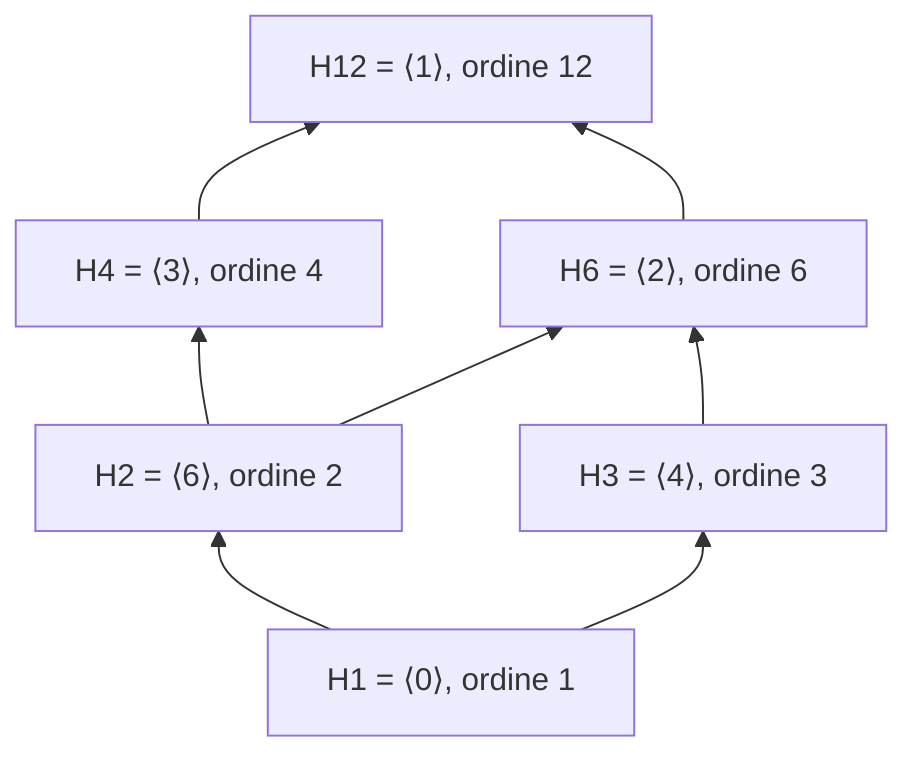

# Gruppi ciclici e ordine

Prerequisiti: [[Books/Aritmetica-I/14 - Gruppi sottogruppi e permutazioni|gruppi e sottogruppi]], [[Books/Aritmetica-I/08 - Divisione euclidea e identità di Bezout|divisione euclidea e Bézout]], [[Books/Aritmetica-I/09 - Primi e fattorizzazione unica|divisori]], [[Books/Aritmetica-I/11 - Congruenze e inversi modulari|congruenze]], [[Books/Aritmetica-I/15 - Anelli campi e omomorfismi|omomorfismi e unità]]. Torna all’[[Books/Aritmetica-I/00 - Indice e piano di studio|indice]].

> [!info] In questo capitolo
> - Imparerai a calcolare potenze (o multipli) di un elemento in un gruppo e a trovarne l'ordine, cioè dopo quanti passi si ritorna al punto di partenza.
> - Saprai trasformare un'uguaglianza di potenze in una divisibilità, e capire da dove nasce il $\gcd$ nella formula $r/\gcd(r,k)$.
> - Descriverai tutti i sottogruppi di un gruppo ciclico: uno per ogni divisore dell'ordine, e nessun altro.
> - L'idea che lega tutto: la divisione euclidea con resto controlla sia il ritorno all'identità sia la struttura dei sottogruppi.

## Ripetere un solo passo

Su un quadrante con dodici posizioni, parti da zero e avanza ogni volta di otto posizioni. Visiti, nell’ordine,
$$
[0]_{12},\quad [8]_{12},\quad [4]_{12},\quad [0]_{12}.
$$
Continuando, ripeti queste tre posizioni. Se invece avanzi di cinque, raggiungi tutte le dodici posizioni prima di tornare a zero. La domanda è: da che cosa dipende la parte del quadrante che riesci a visitare?

La stessa domanda si può porre ripetendo una rotazione, moltiplicando ripetutamente per una classe invertibile o componendo una permutazione con se stessa. In un gruppo possiamo anche annullare il passo, quindi considereremo ripetizioni con esponenti positivi, nulli e negativi. Scopriremo che la divisione euclidea descrive sia il ritorno al punto iniziale sia tutti i sottogruppi costruibili con un solo passo.

## Potenze intere e sottogruppo generato

Sia $G$ un gruppo con neutro $e$, e sia $g\in G$. Definiamo
$$
g^0=e,\qquad g^n=\underbrace{g\cdots g}_{n\text{ fattori}}\quad(n>0),
\qquad g^{-n}=(g^{-1})^n\quad(n>0).
$$
L’associatività rende irrilevanti le parentesi. Per tutti $a,b\in\mathbb Z$ valgono
$$
g^ag^b=g^{a+b},\qquad (g^a)^{-1}=g^{-a},\qquad (g^a)^b=g^{ab}.
$$
Per esponenti nonnegativi la prima uguaglianza si ottiene concatenando i fattori. Per esponenti di segno opposto, si cancellano coppie adiacenti $gg^{-1}$ o $g^{-1}g$: restano le copie indicate dalla somma degli esponenti. Con entrambi gli esponenti negativi si concatenano copie di $g^{-1}$. La seconda uguaglianza segue dalla prima, perché $g^ag^{-a}=e=g^{-a}g^a$. Per $b>0$ la terza segue ripetendo la prima $b$ volte; per $b=0$ entrambi i membri sono $e$; per $b<0$ si usa anche la formula dell’inverso.

> [!warning] Attenzione — Le potenze della stessa base commutano
> Le regole precedenti riguardano un solo elemento $g$. Per elementi diversi, $(gh)^2=ghgh$ non si può trasformare in $g^2h^2$ senza poter scambiare $h$ e $g$. La formula $(gh)^k=g^kh^k$ è valida se $g$ e $h$ commutano, ma non è una regola generale dei gruppi.

L’insieme di tutte le potenze intere è il **sottogruppo generato da $g$**:
$$
\langle g\rangle=\{g^k:k\in\mathbb Z\}.
$$
È davvero un sottogruppo: contiene $e=g^0$ e, se $g^a,g^b$ vi appartengono, anche
$$
g^a(g^b)^{-1}=g^{a-b}
$$
vi appartiene. Possiamo applicare il criterio del capitolo 14.

Inoltre è il **più piccolo sottogruppo contenente $g$**, nel senso dell’inclusione. Infatti ogni sottogruppo che contiene $g$ contiene i suoi prodotti ripetuti, il neutro e le potenze dell’inverso; contiene quindi tutto $\langle g\rangle$.

Questo sottogruppo è sempre abeliano, anche se il gruppo ambiente non lo è:
$$
g^ag^b=g^{a+b}=g^{b+a}=g^bg^a.
$$
Un gruppo $G$ si dice **ciclico** se $G=\langle g\rangle$ per qualche $g$, detto **generatore**. Ogni gruppo ciclico è dunque abeliano. Il viceversa fallisce, come vedremo con $U(8)$.

> [!example] Esempi e controesempi — Gruppo ciclico
> **È ciclico:** $(\mathbb Z,+)=\langle1\rangle$; $(\mathbb Z/12\mathbb Z,+)=\langle[1]\rangle$, ma anche $=\langle[5]\rangle$; il gruppo delle rotazioni di un poligono regolare, generato dalla rotazione di un passo; $U(7)=\langle[3]\rangle$, perché le potenze di $3$ modulo $7$ sono $3,2,6,4,5,1$, cioè tutte le classi non nulle.
> **Non è ciclico:** $U(8)=\{[1],[3],[5],[7]\}$, perché ogni elemento ha ordine $1$ o $2$ e nessuno genera i quattro elementi (il gruppo è abeliano: viola solo l'esistenza del generatore); $\mathbb Z/2\mathbb Z\times\mathbb Z/2\mathbb Z$ (con la somma componente per componente), che ha quattro elementi ma $(a,b)+(a,b)=(0,0)$ per ogni $(a,b)$, quindi nessun elemento ha ordine $4$; $S_3$, che non è nemmeno abeliano ([[Books/Aritmetica-I/14 - Gruppi sottogruppi e permutazioni|capitolo 14]]). Attenzione: $\mathbb Z/4\mathbb Z$, pur avendo anch'esso quattro elementi, è ciclico, generato da $[1]$: avere un dato numero di elementi non basta a decidere.

In notazione additiva, le potenze diventano multipli interi:
$$
\langle g\rangle=\{kg:k\in\mathbb Z\}.
$$
Per esempio $(\mathbb Z,+)=\langle1\rangle$, mentre $\langle5\rangle=5\mathbb Z$ comprende soltanto i multipli di cinque.

## L’ordine: quando le potenze tornano all’identità

L’**ordine di $g$**, indicato con $\operatorname{ord}(g)$, è il minimo intero positivo $r$ tale che $g^r=e$, se esiste. Se non esiste, diciamo che l’ordine è infinito. In particolare $\operatorname{ord}(e)=1$.

Se due potenze coincidono, con $a>b$, cancellando otteniamo
$$
g^a=g^b\quad\Longrightarrow\quad g^{a-b}=e.
$$
Quindi, se l’ordine è infinito, tutte le potenze intere sono distinte. Viceversa, se $\langle g\rangle$ è finito, tra $e,g,g^2,\ldots$ due potenze devono coincidere: esiste allora un esponente positivo che riporta a $e$, e il buon ordinamento ne fornisce uno minimo. In particolare ogni elemento di un gruppo finito ha ordine finito.

Supponiamo ora $\operatorname{ord}(g)=r<\infty$. Il fatto decisivo è
$$
\boxed{g^t=e\quad\Longleftrightarrow\quad r\mid t\qquad(t\in\mathbb Z).}
$$
Se $t=qr$, le regole delle potenze danno $g^t=(g^r)^q=e$. Per l’altra direzione dividiamo $t$ per $r$, anche quando $t$ è negativo:
$$
t=qr+s,\qquad 0\leq s<r.
$$
Allora $g^t=(g^r)^qg^s=g^s$. Se $g^t=e$, anche $g^s=e$; un resto positivo contraddirebbe la minimalità di $r$. Pertanto $s=0$, cioè $r\mid t$.

> [!abstract] Concetto chiave — Una potenza vale l'identità se e solo se l'esponente è multiplo dell'ordine
> Se $\operatorname{ord}(g)=r<\infty$: $g^t=e\Longleftrightarrow r\mid t$, e quindi $g^a=g^b\Longleftrightarrow r\mid(a-b)$. Il gruppo $\langle g\rangle$ ha esattamente $r$ elementi.
> È il passaggio che trasforma un problema su gruppi in un problema di divisibilità tra interi: sostiene tutto il capitolo e il teorema di Lagrange del [[Books/Aritmetica-I/17 - Lagrange Eulero e Fermat|capitolo 17]].

Applicando questo risultato alla differenza degli esponenti troviamo
$$
\boxed{g^a=g^b\quad\Longleftrightarrow\quad r\mid(a-b).}
$$
Ogni potenza è quindi una delle potenze $e,g,\ldots,g^{r-1}$, che sono tutte distinte: se due coincidessero, la loro differenza positiva, minore di $r$, sarebbe divisibile per $r$. Ne segue
$$
\langle g\rangle=\{e,g,\ldots,g^{r-1}\},\qquad
\boxed{|\langle g\rangle|=\operatorname{ord}(g)=r.}
$$
Se l’ordine è infinito, il sottogruppo generato è invece in corrispondenza biunivoca con $\mathbb Z$ attraverso $k\mapsto g^k$.

> [!warning] Attenzione — Una potenza uguale all’identità non determina l’ordine
> Da $g^{12}=e$ segue che $\operatorname{ord}(g)$ divide $12$: potrebbe essere $1,2,3,4,6$ oppure $12$. Per provare che l’ordine è $12$ bisogna escludere i divisori propri. Questa divisibilità deriva dalla divisione euclidea; non abbiamo ancora usato il teorema di Lagrange.

> [!example] Esempi e controesempi — Ordine di un elemento
> **Ha ordine finito:** $[8]\in(\mathbb Z/12\mathbb Z,+)$ ha ordine $3$; $[3]\in U(7)$ ha ordine $6$ ($3^6=729=1+7\cdot104$); l'identità ha sempre ordine $1$.
> **Ha ordine infinito:** $1\in(\mathbb Z,+)$, perché $m\cdot1=m\neq0$ per ogni $m>0$. Un elemento ha ordine finito esattamente quando una sua potenza con esponente positivo è l'identità; ma $g^{12}=e$ non significa che l'ordine sia $12$ (si veda l'avvertenza sopra).

**Esempio svolto.** Nel gruppo additivo $\mathbb Z/12\mathbb Z$, i multipli di $[8]$ sono $[0],[8],[4],[0],\ldots$. I primi tre sono distinti e $3[8]=[24]=[0]$. Dunque $\operatorname{ord}([8])=3$ e $\langle[8]\rangle=\{[0],[4],[8]\}$. Gli interi $a,b$ danno lo stesso multiplo di $[8]$ precisamente quando $a\equiv b\pmod3$, benché il gruppo ambiente sia definito modulo $12$.

## L’ordine di una potenza e i generatori

Sia $\operatorname{ord}(g)=r<\infty$ e sia $k\in\mathbb Z$. Vogliamo trovare il primo ritorno all’identità ripetendo il passo $g^k$. Per $m>0$,
$$
(g^k)^m=e\quad\Longleftrightarrow\quad r\mid km.
$$
Ragioniamo con il quadrante dell'inizio: avanzare di $k$ passi alla volta su $r$ posizioni, dopo $m$ mosse si è tornati a zero quando $km$ è multiplo di $r$. Poniamo $d=\gcd(r,k)>0$ e scriviamo
$$
r=dr_1,\qquad k=dk_1,\qquad \gcd(r_1,k_1)=1.
$$
La condizione equivale a $r_1\mid k_1m$, e quindi a $r_1\mid m$, per il lemma di Euclide. Il minimo $m>0$ possibile è esattamente $r_1$. Abbiamo dimostrato
$$
\boxed{\operatorname{ord}(g^k)=\frac{r}{\gcd(r,k)}.}
$$

> [!abstract] Concetto chiave — Ordine di una potenza
> Se $\operatorname{ord}(g)=r$, allora $\operatorname{ord}(g^k)=r/\gcd(r,k)$. In particolare $g^k$ genera $\langle g\rangle$ se e solo se $\gcd(r,k)=1$, e un gruppo ciclico di ordine $r$ ha tanti generatori quanti sono i resti fra $0$ e $r-1$ coprimi con $r$: il numero $\varphi(r)$, definito poco sotto.
> Dà gli ordini in $\mathbb Z/n\mathbb Z$ e conta i generatori; ritorna nel [[Books/Aritmetica-I/18 - Congruenze esponenziali|capitolo 18]] per le potenze modulo $n$.

La formula comprende $k=0$: $\gcd(r,0)=r$ e $g^0=e$ ha ordine $1$. Comprende anche gli esponenti negativi, perché $\gcd(r,-k)=\gcd(r,k)$. Nella prova, per $k=0$ si hanno $r_1=1,k_1=0$, e la divisibilità rimane valida.

Se invece $g$ ha ordine infinito, $g^k$ ha ordine infinito per ogni $k\neq0$: un’uguaglianza $g^{km}=e$ con $m>0$ darebbe una potenza nonnulla di $g$ uguale all’identità, e passando all’inverso anche una positiva. Per $k=0$ l’ordine è sempre $1$.

In un gruppo ciclico finito $G=\langle g\rangle$ di ordine $r$, un elemento genera tutto il gruppo se e solo se ha ordine $r$. Per la formula,
$$
\langle g^k\rangle=G\quad\Longleftrightarrow\quad\gcd(r,k)=1.
$$
Definiamo allora, per $r\geq1$,
$$
\varphi(r)=\bigl|\{k\in\{0,\ldots,r-1\}:\gcd(k,r)=1\}\bigr|.
$$
La funzione $\varphi$ conta i resti coprimi con $r$; qui ci serve soltanto questa definizione. Poiché le potenze con esponenti da $0$ a $r-1$ sono distinte, **un gruppo ciclico di ordine $r$ ha $\varphi(r)$ generatori**. La definizione dà $\varphi(1)=1$: il solo resto è $0$, e $\gcd(0,1)=1$; il gruppo banale è generato dal suo unico elemento.

**Esempio svolto.** Se $g$ ha ordine $18$, allora
$$
\operatorname{ord}(g^{-6})=\frac{18}{\gcd(18,-6)}=3.
$$
Infatti $(g^{-6})^3=g^{-18}=e$, mentre gli esponenti $-6,-12$ non sono multipli di $18$. I generatori di $\langle g\rangle$ sono invece le potenze con esponenti
$$
1,5,7,11,13,17\pmod{18},
$$
quindi $\varphi(18)=6$.

Per il gruppo additivo delle classi modulo $n\geq2$, il generatore $[1]_n$ ha ordine $n$ e $[a]_n=a[1]_n$. La formula diventa
$$
\boxed{\operatorname{ord}([a]_n)=\frac{n}{\gcd(a,n)}\quad\text{in }(\mathbb Z/n\mathbb Z,+).}
$$
Per esempio i generatori additivi modulo $12$ sono $[1],[5],[7],[11]$. Per vedere la formula all'opera, ecco gli ordini di tutti gli elementi di $(\mathbb Z/12\mathbb Z,+)$, accanto agli ordini moltiplicativi in $U(7)$ e in $U(9)$ (si cerca il minimo $m>0$ con $a^m\equiv1$):

| Gruppo | Elementi e ordini |
|---|---|
| $(\mathbb Z/12\mathbb Z,+)$ | ordine $1$: $[0]$; ordine $2$: $[6]$; ordine $3$: $[4],[8]$; ordine $4$: $[3],[9]$; ordine $6$: $[2],[10]$; ordine $12$: $[1],[5],[7],[11]$ |
| $U(7)$ | ordine $1$: $[1]$; ordine $2$: $[6]$; ordine $3$: $[2],[4]$; ordine $6$: $[3],[5]$ |
| $U(9)$ | ordine $1$: $[1]$; ordine $2$: $[8]$; ordine $3$: $[4],[7]$; ordine $6$: $[2],[5]$ |

In $\mathbb Z/12\mathbb Z$ l'ordine di $[a]$ è $12/\gcd(a,12)$: per $[8]$ è $12/4=3$, per $[10]$ è $12/2=6$. Sia $U(7)$ sia $U(9)$ hanno sei elementi e un elemento di ordine $6$: sono ciclici, con $\varphi(6)=2$ generatori ciascuno, e infatti i due gruppi hanno gli stessi ordini, elemento per elemento nella tabella. In ogni riga il numero di elementi con ordine $d$ è $\varphi(d)$, un fatto che dimostreremo sotto per ogni gruppo ciclico.

> [!warning] Attenzione — Specifica l’operazione
> La formula $n/\gcd(a,n)$ riguarda l’ordine **additivo** di $[a]_n$. L’ordine moltiplicativo riguarda invece $[a]_n\in U(n)$ e cerca il minimo $m>0$ con $a^m\equiv1\pmod n$; non è dato da quella formula.

Il gruppo $U(8)=\{[1],[3],[5],[7]\}$ rende concreta la distinzione. Per il prodotto, $[1]$ ha ordine $1$, mentre
$$
3^2\equiv5^2\equiv7^2\equiv1\pmod8.
$$
Le tre classi diverse da $[1]$ hanno dunque ordine $2$. Nessuna genera tutti i quattro elementi, quindi $U(8)$ è abeliano ma non ciclico. Il gruppo additivo $\mathbb Z/8\mathbb Z$, invece, è ciclico di ordine $8$.

## Perché ogni sottogruppo di un ciclico è ciclico

Siano $G=\langle g\rangle$ e $H\leq G$. Se $H=\{e\}$, allora $H=\langle e\rangle$. Altrimenti contiene $g^a\neq e$, con $a\neq0$. Se l’esponente è negativo, prendiamo l’inverso: esiste quindi un esponente positivo che produce un elemento di $H$.

Scegliamo il più piccolo:
$$
m=\min\{t\in\mathbb N_{>0}:g^t\in H\}.
$$
L’idea è usare $g^m$ come passo fondamentale. Siccome appartiene a $H$, tutte le sue potenze appartengono a $H$, cioè $\langle g^m\rangle\subseteq H$.

Per l’inclusione opposta, prendiamo un qualunque $g^a\in H$ e dividiamo l’esponente per $m$:
$$
a=qm+s,\qquad0\leq s<m.
$$
Essendo $H$ chiuso per prodotti e inversi,
$$
g^s=g^a(g^m)^{-q}\in H.
$$
Se $s>0$, contraddice la scelta di $m$. Dunque $s=0$ e $g^a=(g^m)^q$. Ogni elemento di $H$ è una potenza di $g^m$, perciò
$$
\boxed{H=\langle g^m\rangle.}
$$
La prova funziona sia quando $G$ è finito sia quando è infinito.

> [!abstract] Concetto chiave — I sottogruppi di un gruppo ciclico sono ciclici
> Se $G=\langle g\rangle$ e $H\leq G$, allora $H=\langle g^m\rangle$, dove $m$ è il minimo esponente positivo con $g^m\in H$. Se $G$ è finito di ordine $N$, per ogni $d\mid N$ esiste un unico sottogruppo di ordine $d$ e non ce ne sono altri.
> Classifica completamente i sottogruppi dei gruppi additivi $\mathbb Z$ e $\mathbb Z/n\mathbb Z$; il confronto con i gruppi non ciclici è il contenuto del [[Books/Aritmetica-I/17 - Lagrange Eulero e Fermat|capitolo 17]].

Applicandola a $(\mathbb Z,+)$ otteniamo che **tutti i suoi sottogruppi sono $d\mathbb Z$, con $d\geq0$**. Il caso $d=0$ dà $\{0\}$; negli altri casi $d$ è il minimo elemento positivo del sottogruppo, quindi è unico. Per esempio $6\mathbb Z$ è generato sia da $6$ sia da $-6$. Più in generale, in un gruppo ciclico infinito $\langle g\rangle$ gli unici generatori dell’intero gruppo sono $g$ e $g^{-1}$: se $g\in\langle g^k\rangle$, allora $g=g^{kt}$ per qualche intero $t$, e l’assenza di ripetizioni impone $kt=1$.

## Nel caso finito: un sottogruppo per ogni divisore

Sia ora $G=\langle g\rangle$ di ordine $N$. Per ogni divisore positivo $d\mid N$ poniamo
$$
H_d=\left\langle g^{N/d}\right\rangle.
$$
La formula dell’ordine dà
$$
|H_d|=\frac{N}{\gcd(N,N/d)}=d.
$$
Questo prova l’esistenza. Per l’unicità occorre controllare che non ci siano altre possibilità.

Sia $H$ un sottogruppo qualsiasi, anche banale. L’insieme degli esponenti positivi che portano in $H$ è non vuoto, perché contiene $N$: infatti $g^N=e\in H$. Possiamo dunque scegliere il suo minimo $m$ anche per $H=\{e\}$. L’argomento precedente dimostra $H=\langle g^m\rangle$ e che ogni esponente $a$ con $g^a\in H$ è multiplo di $m$. Applicandolo ad $a=N$ otteniamo **$m\mid N$**. Quindi
$$
|H|=\frac{N}{m}.
$$
Se $|H|=d$, necessariamente $m=N/d$, perciò $H=H_d$. Abbiamo provato, senza ricorrere a Lagrange, che
$$
\boxed{\text{per ogni }d\mid N\text{ esiste un unico sottogruppo di ordine }d.}
$$
Non ci sono sottogruppi di altri ordini. Il loro numero totale è $\tau(N)$, il numero dei divisori positivi di $N$ studiato nel capitolo 09.

Inoltre gli elementi di ordine esattamente $d$ sono precisamente i generatori di $H_d$: un tale elemento genera un sottogruppo di ordine $d$, che per unicità è $H_d$, e viceversa. Sono dunque
$$
\boxed{\varphi(d)\text{ elementi, se }d\mid N;\qquad0\text{ altrimenti}.}
$$
Per $d=1$ si conta il solo neutro, coerentemente con $\varphi(1)=1$.

**Esempio.** In $\mathbb Z/12\mathbb Z$ tutti i sottogruppi sono descritti dalla tabella:

| Ordine $d$ | Sottogruppo $H_d$ | Elementi di ordine esattamente $d$ |
|---|---|---|
| $1$ | $\langle[0]\rangle$ | $[0]$ |
| $2$ | $\langle[6]\rangle$ | $[6]$ |
| $3$ | $\langle[4]\rangle$ | $[4],[8]$ |
| $4$ | $\langle[3]\rangle$ | $[3],[9]$ |
| $6$ | $\langle[2]\rangle$ | $[2],[10]$ |
| $12$ | $\langle[1]\rangle$ | $[1],[5],[7],[11]$ |

Ci sono sei sottogruppi. Il diagramma seguente li dispone secondo l'inclusione: una freccia da $H_d$ a $H_e$ significa $H_d\subseteq H_e$, e coincide con la relazione $d\mid e$ tra i divisori di $12$. Si legge dal basso verso l'alto, dal sottogruppo banale all'intero gruppo.

L'inclusione corrisponde alla divisibilità. Se $d\mid e$, il sottogruppo ciclico $H_e$ di ordine $e$ ha un sottogruppo di ordine $d$; questo è anche un sottogruppo di $G$ di ordine $d$ e, per unicità, è $H_d$. Viceversa, se $H_d\subseteq H_e$, allora $H_d$ è un sottogruppo del gruppo ciclico $H_e$, e la classificazione appena provata, applicata a $H_e$, dice che $d\mid e$. Nota che $H_3\not\subseteq H_4$, perché $3\nmid4$: infatti $[4]\notin\{[0],[3],[6],[9]\}$.

Per leggere una riga, $H_4=\{[0],[3],[6],[9]\}$ ha quattro elementi, ma soltanto $[3]$ e $[9]$ hanno ordine quattro: appartenere a un sottogruppo non significa generarlo.

## Approfondimento geometrico: le radici dell’unità

Questa sezione offre un’immagine dei gruppi ciclici; chi non ha ancora studiato i complessi può proseguire direttamente agli esercizi.

Ricordiamo che $i^2=-1$ e che $a+ib$ si rappresenta con il punto $(a,b)$ del piano. I numeri $\cos\theta+i\sin\theta$ stanno sulla circonferenza di raggio uno. Usiamo qui le note regole trigonometriche del prodotto: gli angoli si sommano e, per la formula di De Moivre,
$$
(\cos\theta+i\sin\theta)^k=\cos(k\theta)+i\sin(k\theta).
$$
Per $n\geq2$ definiamo
$$
\mu_n=\{z\in\mathbb C:z^n=1\}.
$$
È un gruppo moltiplicativo: contiene $1$; se $z,w\in\mu_n$, la commutatività del prodotto complesso dà $(zw)^n=z^nw^n=1$; se $z^n=1$, allora $z\neq0$ e $z^{-1}=z^{n-1}\in\mu_n$, poiché $(z^{n-1})^n=1$. L’associatività è ereditata da $\mathbb C^\times$.

Scrivendo un complesso nonzero come $z=\rho(\cos\theta+i\sin\theta)$, con $\rho>0$, la condizione $z^n=1$ impone $\rho^n=1$ e $n\theta\in2\pi\mathbb Z$. Quindi $\rho=1$ e le radici sono precisamente
$$
\mu_n=\{1,\zeta,\ldots,\zeta^{n-1}\},\qquad
\zeta=\cos\frac{2\pi}{n}+i\sin\frac{2\pi}{n}=e^{2\pi i/n}.
$$
L’ultima scrittura è una notazione equivalente per il punto di angolo $2\pi/n$. Questi $n$ punti sono distinti: gli angoli corrispondenti differiscono di meno di un giro. Per $n\geq3$ sono i vertici di un poligono regolare; per $n=2$ sono $1,-1$.

Poiché $\zeta^k=1$ esattamente quando $n\mid k$, si ha $\operatorname{ord}(\zeta)=n$ e $\mu_n=\langle\zeta\rangle$. La mappa
$$
(\mathbb Z/n\mathbb Z,+)\longrightarrow(\mu_n,\cdot),\qquad[k]_n\longmapsto\zeta^k
$$
è ben definita, perché esponenti congruenti danno la stessa potenza; è biiettiva perché $\zeta$ ha ordine $n$; conserva l’operazione perché $\zeta^{a+b}=\zeta^a\zeta^b$. È dunque un isomorfismo di gruppi, nel senso del [[Books/Aritmetica-I/15 - Anelli campi e omomorfismi|capitolo 15]]. Sommare un passo sul quadrante e moltiplicare per una radice descrivono la stessa struttura.

## Fonti

Il percorso riprende le note [[Notes/Aritmetica/Lectures/2026-10-27 - Gruppi ciclici, sottogruppi e permutazioni|27 ottobre: gruppi ciclici e radici dell’unità]] e [[Notes/Aritmetica/Lectures/2026-11-01 - Gruppi ciclici, ordini e sottogruppi modulari|1° novembre: ordini, generatori e sottogruppi]], confrontate con le trascrizioni [[_transcripts/Aritmetica/2026-10-27 - Gruppi ciclici, sottogruppi e permutazioni|27 ottobre]] e [[_transcripts/Aritmetica/2026-11-01 - Gruppi ciclici, ordini e sottogruppi modulari|1° novembre]].

Le prove complete, i casi con esponenti nulli e negativi, l’unicità dei sottogruppi e gli esercizi sono rielaborazioni didattiche. La distinzione fra $U(8)$ e il gruppo additivo modulo $8$ risolve l’ambiguità della trascrizione. I richiami a Lagrange ed Eulero presenti nelle fonti saranno giustificati nel [[Books/Aritmetica-I/17 - Lagrange Eulero e Fermat|capitolo 17]]; nessuna prova precedente li presuppone. L’approfondimento geometrico assume soltanto per quella sezione la rappresentazione polare e la formula di De Moivre.

## Esercizi per verificare la comprensione

Gli esercizi 1–6 sono fondamentali; 7–8 propongono collegamenti.

1. In $(\mathbb Z/20\mathbb Z,+)$ trova $\operatorname{ord}([6])$, elenca $\langle[6]\rangle$ e determina tutti gli interi $t$ con $t[6]=[0]$.

> [!tip]- Riscontro 1
> L’ordine è $20/\gcd(6,20)=10$. I multipli successivi sono $[0],[6],[12],[18],[4],[10],[16],[2],[8],[14]$: il sottogruppo è l’insieme delle classi pari. Infine $t[6]=[0]$ se e solo se $10\mid t$, quindi $t\in10\mathbb Z$.

2. Sia $g$ di ordine $30$. Calcola gli ordini di $g^{12},g^{-7},g^0$ e determina quali fra questi elementi generano $\langle g\rangle$.

> [!tip]- Riscontro 2
> La formula dà rispettivamente $30/6=5$, $30/1=30$ e $30/30=1$. Soltanto $g^{-7}$ genera tutto il sottogruppo, perché soltanto il suo ordine è $30$.

3. Uno studente sostiene: «Da $h^{15}=e$ e $h^5\neq e$ segue $\operatorname{ord}(h)=15$». Individua il difetto, costruisci un controesempio e aggiungi un’ipotesi sufficiente.

> [!tip]- Riscontro 3
> I possibili ordini sono $1,3,5,15$; l’ipotesi esclude $1$ e $5$, ma non $3$. In $(\mathbb Z/3\mathbb Z,+)$ prendi $h=[1]$: $15h=0$ e $5h=[2]\neq0$, ma l’ordine è $3$. Aggiungendo $h^3\neq e$ si esclude anche $3$, e resta soltanto $15$.

4. Sia $G=\langle g\rangle$ di ordine $24$. Elenca tutti i sottogruppi indicando un generatore e l’ordine. Quanti elementi hanno ordine $8$? Quali sono?

> [!tip]- Riscontro 4
> I divisori sono $1,2,3,4,6,8,12,24$. I corrispondenti sottogruppi sono $\langle g^{24}\rangle,\langle g^{12}\rangle,\langle g^8\rangle,\langle g^6\rangle,\langle g^4\rangle,\langle g^3\rangle,\langle g^2\rangle,\langle g\rangle$, con gli ordini elencati nello stesso ordine. Gli elementi di ordine $8$ sono i $\varphi(8)=4$ generatori di $\langle g^3\rangle$: $g^3,g^9,g^{15},g^{21}$, ottenuti dagli esponenti $1,3,5,7$ coprimi con $8$.

5. Sia $H\leq(\mathbb Z,+)$ con $18,30\in H$. Dimostra che $6\mathbb Z\subseteq H$ e determina tutti i possibili $H$.

> [!tip]- Riscontro 5
> La chiusura per differenze dà $12=30-18\in H$ e $6=18-12\in H$; quindi tutti i multipli di $6$ appartengono a $H$. Scrivi $H=d\mathbb Z$ con $d\geq0$. Poiché contiene $6\neq0$, $d>0$ e $d\mid6$. Le possibilità sono $\mathbb Z,2\mathbb Z,3\mathbb Z,6\mathbb Z$, e tutte contengono $18$ e $30$.

6. Nel gruppo moltiplicativo $U(8)$ trova tutti i sottogruppi. Spiega perché questo esempio impedisce di estendere l’unicità del sottogruppo di ordine $d$ a ogni gruppo finito.

> [!tip]- Riscontro 6
> Sono $\{[1]\}$, $\{[1],[3]\}$, $\{[1],[5]\}$, $\{[1],[7]\}$ e $U(8)$. Per verificare la completezza, un sottogruppo che contiene due elementi distinti diversi dall’identità contiene anche il terzo: $[3][5]=[7]$, $[3][7]=[5]$, $[5][7]=[3]$. Quindi o contiene al più uno dei tre, oppure è tutto $U(8)$. Esistono tre sottogruppi diversi di ordine $2$; l’unicità provata nel testo richiede la ciclicità.

7. Sia $G$ ciclico di ordine $N\geq1$. Dimostra l’identità aritmetica $\sum_{d\mid N}\varphi(d)=N$ senza usare una formula per $\varphi$.

> [!tip]- Riscontro 7
> Ogni elemento ha un unico ordine, che è un divisore di $N$ per la formula dell’ordine di una potenza. Le classi di elementi di ordine $d$, al variare di $d\mid N$, sono quindi disgiunte e ricoprono $G$. Ciascuna ha $\varphi(d)$ elementi: sommandone le cardinalità ottieni $|G|=N$. Per $N=1$ l’identità è $\varphi(1)=1$.

8. Sia $G=\langle g\rangle$ di ordine $N$ e sia $q\in\mathbb Z$. Studia l’applicazione $F_q:G\to G$, $F_q(x)=x^q$: dimostra che è un omomorfismo e determina la cardinalità dell’immagine e del nucleo $\{x:F_q(x)=e\}$. Quando è un isomorfismo?

> [!tip]- Riscontro 8
> Il gruppo è abeliano, quindi $(xy)^q=x^qy^q$: $F_q$ è un omomorfismo anche per $q\leq0$. L’immagine è $\langle g^q\rangle$ e ha $N/\gcd(N,q)$ elementi. Per il nucleo, scrivi $x=g^a$ con $0\leq a<N$: occorre $N\mid qa$. Posto $d=\gcd(N,q)$, questo equivale a $N/d\mid a$. Le soluzioni sono $a=0,N/d,\ldots,(d-1)N/d$, quindi il nucleo ha $d$ elementi. L’applicazione è biiettiva, e dunque un isomorfismo, precisamente quando $d=1$. Se $q=0$, immagine e nucleo sono rispettivamente $\{e\}$ e $G$, in accordo con le formule.

Hai acquisito il passaggio centrale quando sai trasformare un’uguaglianza di potenze in una divisibilità e spiegare perché compare un MCD. Per classificare i sottogruppi, prova a ricostruire la scelta dell’esponente minimo e il ruolo del resto, senza partire dalla formula finale.

---

[[Books/Aritmetica-I/15 - Anelli campi e omomorfismi|← 15 · Anelli, campi e omomorfismi]] · [[Books/Aritmetica-I/00 - Indice e piano di studio|Indice]] · [[Books/Aritmetica-I/17 - Lagrange Eulero e Fermat|17 · Lagrange, Eulero e Fermat →]]
