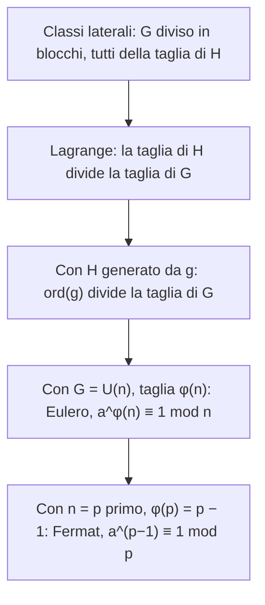

# Lagrange, Eulero e Fermat

Prerequisiti: [[Books/Aritmetica-I/14 - Gruppi sottogruppi e permutazioni|gruppi e sottogruppi]], [[Books/Aritmetica-I/15 - Anelli campi e omomorfismi|unità e teorema cinese]], [[Books/Aritmetica-I/16 - Gruppi ciclici e ordine|ordine di un elemento]]. Torna all’[[Books/Aritmetica-I/00 - Indice e piano di studio|indice]].

> [!info] In questo capitolo
> - Dividerai un gruppo finito in blocchi senza sovrapposizioni (le classi laterali) e ne ricaverai il teorema di Lagrange: la taglia di un sottogruppo divide quella del gruppo.
> - Calcolerai la funzione di Eulero $\varphi(n)$, cioè il numero di classi invertibili modulo $n$.
> - Dedurrai i teoremi di Eulero e di Fermat, e li userai per calcolare potenze enormi e inversi modulari.
> - Imparerai a trovare l'ordine esatto di una classe cercandolo fra i divisori di $\varphi(n)$.
> - L'idea che lega tutto: *contare* i blocchi di una partizione obbliga gli esponenti a comportarsi bene.

## Domande per iniziare dagli esercizi

Prova prima gli esercizi indicati dalla domanda. Se ti manca uno strumento, apri soltanto la sezione collegata, poi torna al problema e ricostruisci il passaggio senza guardare. Per le prove, scrivi ipotesi, tesi e motivo di ogni implicazione. I riscontri sono raccolti dopo la teoria.

La tabella copre tutte le sezioni teoriche del capitolo, compresi casi limite e approfondimenti. Gli esercizi 1–8 conservano la numerazione originaria; dal 9 trovi le integrazioni. Gli esercizi tratti dal PDF fornito hanno un riferimento esplicito alla fonte; gli altri sono redazionali.

| Domanda guida | Esercizi da tentare | Teoria da recuperare |
|---|---|---|
| Come prevedi una potenza mediante il gruppo delle unità? | [[#Esercizio 9 — Dalla partizione ai teoremi (dimostrazione di Lagrange, formula di Eulero e Fermat)\|9]] | [[#Una potenza prevedibile senza calcolarla\|Una potenza prevedibile senza calcolarla]] |
| Perché le classi laterali sono blocchi disgiunti della stessa taglia? | [[#Esercizio 5 — Blocchi della stessa taglia (classi laterali, indice e Lagrange)\|5]], [[#Esercizio 9 — Dalla partizione ai teoremi (dimostrazione di Lagrange, formula di Eulero e Fermat)\|9]] | [[#Traslare un sottogruppo\|Traslare un sottogruppo]] |
| Come la partizione dimostra che l’ordine del sottogruppo divide quello del gruppo? | [[#Esercizio 5 — Blocchi della stessa taglia (classi laterali, indice e Lagrange)\|5]], [[#Esercizio 7 — Un gruppo di ordine primo (conseguenze del teorema di Lagrange)\|7]], [[#Esercizio 9 — Dalla partizione ai teoremi (dimostrazione di Lagrange, formula di Eulero e Fermat)\|9]] | [[#Lagrange: la divisibilità nasce dalla partizione\|Lagrange: la divisibilità nasce dalla partizione]] |
| Come calcoli la funzione di Eulero dalla fattorizzazione? | [[#Esercizio 1 — Contare le unità (funzione di Eulero e moltiplicatività)\|1]], [[#Esercizio 9 — Dalla partizione ai teoremi (dimostrazione di Lagrange, formula di Eulero e Fermat)\|9]], [[#Esercizio 10 — Contare le coppie coprime (funzione di Eulero e simmetria del conteggio)\|10]] | [[#Quante classi sono invertibili? La funzione di Eulero\|Quante classi sono invertibili? La funzione di Eulero]] |
| Quali ipotesi servono per Eulero e per le due forme di Fermat? | [[#Esercizio 2 — Ridurre un esponente (teorema di Eulero)\|2]], [[#Esercizio 3 — Un inverso come potenza (Eulero e inversi modulari)\|3]], [[#Esercizio 6 — Due deduzioni sbagliate (coprimalità e ordine contro cardinalità)\|6]], [[#Esercizio 9 — Dalla partizione ai teoremi (dimostrazione di Lagrange, formula di Eulero e Fermat)\|9]] | [[#Eulero e Fermat\|Eulero e Fermat]] |
| Come escludi i divisori per riconoscere l’ordine minimo? | [[#Esercizio 4 — Scartare i divisori (ordine e teorema di Lagrange)\|4]], [[#Esercizio 6 — Due deduzioni sbagliate (coprimalità e ordine contro cardinalità)\|6]] | [[#Determinare l’ordine: quali divisori sopravvivono?\|Determinare l’ordine: quali divisori sopravvivono?]] |
| Perché il gruppo delle unità può non essere ciclico e Fermat non certifica un primo? | [[#Esercizio 8 — Un ordine massimo più piccolo (unità modulo un prodotto di primi)\|8]], [[#Esercizio 9 — Dalla partizione ai teoremi (dimostrazione di Lagrange, formula di Eulero e Fermat)\|9]] | [[#Due limiti delle conclusioni\|Due limiti delle conclusioni]] |

## Esercizi per verificare la comprensione

Gli esercizi 1–6 allenano gli strumenti di base; 7–8 li collegano ad altri problemi. Le integrazioni successive completano il controllo della teoria; quelle dalla raccolta fornita sono segnalate con numero e pagina. Non serve riuscire subito: individua che cosa ti manca, studia il passaggio collegato e riprova.

### Esercizio 1 — Contare le unità (funzione di Eulero e moltiplicatività)

Calcola $\varphi(72)$ e $\varphi(125)$ spiegando quali fattori primi intervengono. Perché non puoi usare $\varphi(8\cdot9)=\varphi(8)\varphi(9)$ senza controllare un’ipotesi?

Se ti blocchi: [[#Quante classi sono invertibili? La funzione di Eulero|Quante classi sono invertibili? La funzione di Eulero]].

Controllo dopo il tentativo: [[#Riscontro 1|riscontro 1]].

### Esercizio 2 — Ridurre un esponente (teorema di Eulero)

Calcola il resto di $10^{2026}$ modulo $77$ usando Eulero e poi potenze brevi. Specifica perché il teorema è applicabile.

Se ti blocchi: [[#Eulero e Fermat|Eulero e Fermat]].

Controllo dopo il tentativo: [[#Riscontro 2|riscontro 2]].

### Esercizio 3 — Un inverso come potenza (Eulero e inversi modulari)

Trova l’inverso di $[3]_{40}$ usando un esponente garantito da Eulero. Controlla il risultato con una moltiplicazione.

Se ti blocchi: [[#Eulero e Fermat|Eulero e Fermat]].

Controllo dopo il tentativo: [[#Riscontro 3|riscontro 3]].

### Esercizio 4 — Scartare i divisori (ordine e teorema di Lagrange)

Determina $\operatorname{ord}_7(3)$ considerando i divisori di $\varphi(7)$ ed escludendo quelli propri.

Se ti blocchi: [[#Determinare l’ordine: quali divisori sopravvivono?|Determinare l’ordine: quali divisori sopravvivono?]].

Controllo dopo il tentativo: [[#Riscontro 4|riscontro 4]].

### Esercizio 5 — Blocchi della stessa taglia (classi laterali, indice e Lagrange)

Nel gruppo additivo $G=\mathbb Z/15\mathbb Z$ considera $H=\langle[5]_{15}\rangle$. Scrivi tutte le classi laterali distinte, calcola $[G:H]$ e verifica numericamente Lagrange.

Se ti blocchi: [[#Traslare un sottogruppo|Traslare un sottogruppo]] · [[#Lagrange: la divisibilità nasce dalla partizione|Lagrange: la divisibilità nasce dalla partizione]].

Controllo dopo il tentativo: [[#Riscontro 5|riscontro 5]].

### Esercizio 6 — Due deduzioni sbagliate (coprimalità e ordine contro cardinalità)

Diagnostica entrambe le conclusioni: «$\varphi(15)=8$, quindi $[2]_{15}$ ha ordine $8$ e $[3]_{15}^{\,8}=[1]_{15}$». Correggile con calcoli espliciti.

Se ti blocchi: [[#Eulero e Fermat|Eulero e Fermat]] · [[#Determinare l’ordine: quali divisori sopravvivono?|Determinare l’ordine: quali divisori sopravvivono?]].

Controllo dopo il tentativo: [[#Riscontro 6|riscontro 6]].

### Esercizio 7 — Un gruppo di ordine primo (conseguenze del teorema di Lagrange)

Sia $G$ un gruppo con un numero primo $p$ di elementi. Dimostra che ogni $g\ne e$ genera tutto $G$. Devi assumere che $G$ sia commutativo?

Se ti blocchi: [[#Lagrange: la divisibilità nasce dalla partizione|Lagrange: la divisibilità nasce dalla partizione]].

Controllo dopo il tentativo: [[#Riscontro 7|riscontro 7]].

### Esercizio 8 — Un ordine massimo più piccolo (unità modulo un prodotto di primi)

Mostra che ogni elemento di $U(65)$ ha ordine divisore di $12$, mentre $|U(65)|=48$. Determina poi $\operatorname{ord}_{65}(2)$ e spiega perché $[2]_{65}$ non genera tutto $U(65)$.

Se ti blocchi: [[#Due limiti delle conclusioni|Due limiti delle conclusioni]].

Controllo dopo il tentativo: [[#Riscontro 8|riscontro 8]].

### Esercizio 9 — Dalla partizione ai teoremi (dimostrazione di Lagrange, formula di Eulero e Fermat)

Dimostra $gH=kH\iff k^{-1}g\in H$, la disgiunzione o uguaglianza delle classi laterali e la biiezione $H\to gH$. Deduci Lagrange e $\operatorname{ord}(g)\mid|G|$. Conta le unità modulo $p^e$ e usa il teorema cinese per dimostrare $\varphi(n)=n\prod_{p\mid n}(1-1/p)$, precisando $\varphi(1)$. Deduci Eulero e entrambe le forme di Fermat, compreso il caso $p\mid a$. Perché $2^{340}\equiv1\pmod{341}$ non prova la primalità di $341$?

Se ti blocchi: [[#Una potenza prevedibile senza calcolarla|Una potenza prevedibile senza calcolarla]] · [[#Traslare un sottogruppo|Traslare un sottogruppo]] · [[#Lagrange: la divisibilità nasce dalla partizione|Lagrange: la divisibilità nasce dalla partizione]] · [[#Quante classi sono invertibili? La funzione di Eulero|Quante classi sono invertibili? La funzione di Eulero]] · [[#Eulero e Fermat|Eulero e Fermat]] · [[#Due limiti delle conclusioni|Due limiti delle conclusioni]].

Controllo dopo il tentativo: [[#Riscontro 9|riscontro 9]].

### Esercizio 10 — Contare le coppie coprime (funzione di Eulero e simmetria del conteggio)

*Dalla raccolta fornita: esercizio 16, p. 71 stampata / [[Books/Aritmetica-I/Fonti/Esercizi algebra 1 2.pdf#page=81|p. 81 del PDF]]. Enunciato riformulato; riscontro redazionale.*

Sia $X=\{(m,n):1\le m,n\le100,\ \gcd(m,n)=1\}$. Dimostra $|X|+1=2\sum_{k=1}^{100}\varphi(k)$. Quale coppia sulla diagonale deve essere trattata a parte?

Se ti blocchi: [[#Quante classi sono invertibili? La funzione di Eulero|Quante classi sono invertibili? La funzione di Eulero]].

Controllo dopo il tentativo: [[#Riscontro 10|riscontro 10]].

## Teoria da recuperare

Usa i collegamenti della tabella iniziale per leggere lo strumento che ti serve. Dopo la lettura, torna all’esercizio e prova a risolverlo senza suggerimenti.

## Una potenza prevedibile senza calcolarla

Come possiamo sapere che $7^{40}\equiv1\pmod{100}$ senza costruire quell’enorme intero? Nei capitoli precedenti abbiamo imparato che le potenze di una classe invertibile, lavorando fra un numero finito di classi, tornano all’identità. Ma questo assicura l’esistenza di un esponente; non spiega ancora perché proprio $40$ debba funzionare.

La risposta parte da un problema di conteggio. Le potenze di $[7]_{100}$ formano un sottogruppo del gruppo delle classi invertibili. Se riuscissimo a dividere tutto il gruppo in blocchi grandi quanto quel sottogruppo, il numero di elementi del sottogruppo dovrebbe dividere il totale. L’ordine di $[7]_{100}$ dividerebbe allora $40$, e la potenza cercata sarebbe obbligata a valere uno.

Il passaggio decisivo consiste dunque nel costruire blocchi senza sovrapposizioni. Le classi laterali servono esattamente a questo: trasformano una proprietà algebrica in una partizione da contare. (Una **partizione** di un insieme è una famiglia di sottoinsiemi non vuoti, a due a due disgiunti, la cui unione è tutto l'insieme; si veda il [[Books/Aritmetica-I/13 - Equivalenze e insiemi quoziente|capitolo 13]].)

## Traslare un sottogruppo

Sia $H$ un sottogruppo di un gruppo $G$, scritto moltiplicativamente. Per $g\in G$ definiamo la **classe laterale sinistra**

$$
gH=\{gh:h\in H\}.
$$

È una copia di $H$ traslata mediante la moltiplicazione a sinistra per $g$. La parola «sinistra» specifica dove mettiamo $g$: in un gruppo non commutativo l’ordine dei fattori conta.

Per capire perché queste copie non si sovrappongano parzialmente, introduciamo su $G$ una relazione di equivalenza (una relazione riflessiva, simmetrica e transitiva, come nel [[Books/Aritmetica-I/13 - Equivalenze e insiemi quoziente|capitolo 13]]; le sue classi sono i blocchi di una partizione):

$$
x\sim y\quad\Longleftrightarrow\quad x^{-1}y\in H.
$$

Verifichiamo che è un’equivalenza. È riflessiva perché $x^{-1}x=e\in H$. È simmetrica perché, se $x^{-1}y\in H$, il suo inverso $y^{-1}x$ appartiene a $H$. Infine, se $x^{-1}y\in H$ e $y^{-1}z\in H$, la chiusura di $H$ dà

$$
(x^{-1}y)(y^{-1}z)=x^{-1}z\in H,
$$

quindi è transitiva. Non abbiamo scambiato alcun fattore.

La classe di equivalenza di $g$ è precisamente $gH$: infatti

$$
g\sim y
\iff g^{-1}y\in H
\iff y=gh\text{ per qualche }h\in H.
$$

Come per ogni equivalenza, le classi ricoprono $G$ e due classi sono uguali oppure disgiunte. Possiamo anche vedere direttamente il passaggio cruciale: se $z=gh=kh'$ appartiene sia a $gH$ sia a $kH$, allora $k=g h(h')^{-1}$. Dunque ogni $kt$, con $t\in H$, appartiene a $gH$; invertendo i ruoli si ottiene l’altra inclusione. Una sola intersezione forza l’uguaglianza.

Resta da contare gli elementi di ciascun blocco. L’applicazione

$$
H\longrightarrow gH,\qquad h\longmapsto gh
$$

è suriettiva (ogni elemento di $gH$ è un'immagine) per definizione di $gH$ ed è iniettiva (elementi diversi hanno immagini diverse) per cancellazione: $gh_1=gh_2$ implica $h_1=h_2$. La sua inversa manda $x\in gH$ in $g^{-1}x\in H$. Perciò ogni classe laterale ha la stessa cardinalità di $H$.

Qui le classi laterali sono soltanto insiemi. Per contarle non serve definire un’operazione fra classi né chiedere altre proprietà a $H$.

### Un esempio additivo

Nel gruppo $G=(\mathbb Z/12\mathbb Z,+)$ prendiamo

$$
H=\{[0]_{12},[4]_{12},[8]_{12}\}.
$$

Le classi laterali, scritte additivamente, sono

$$
\begin{aligned}
[0]_{12}+H&=\{[0]_{12},[4]_{12},[8]_{12}\},\\
[1]_{12}+H&=\{[1]_{12},[5]_{12},[9]_{12}\},\\
[2]_{12}+H&=\{[2]_{12},[6]_{12},[10]_{12}\},\\
[3]_{12}+H&=\{[3]_{12},[7]_{12},[11]_{12}\}.
\end{aligned}
$$

Ogni elemento compare una volta: abbiamo quattro blocchi da tre elementi. La classe $[4]_{12}+H$ coincide già con $H$, quindi scegliere un nuovo rappresentante non produce necessariamente un nuovo blocco.

Per vedere la partizione a colpo d'occhio, scriviamo i dodici elementi in una tabella: ogni riga è una classe laterale, e leggendo l'intera tabella ogni elemento compare una volta sola (per brevità indichiamo $[k]_{12}$ con $k$).

| Classe laterale | $+0$ | $+4$ | $+8$ |
|---|---|---|---|
| $0+H=H$ | 0 | 4 | 8 |
| $1+H$ | 1 | 5 | 9 |
| $2+H$ | 2 | 6 | 10 |
| $3+H$ | 3 | 7 | 11 |

Quattro righe per tre colonne: $12=4\cdot3$. Questo è il teorema di Lagrange in miniatura.

> [!example] Esempi e controesempi — classe laterale
> **È una classe laterale di $H=\{0,4,8\}$ in $\mathbb Z/12\mathbb Z$:** $\{1,5,9\}=1+H$ (traslata di $H$ per $1$); $\{4,8,0\}=4+H$, che coincide con $H$ stessa (un rappresentante diverso può dare lo stesso blocco); $\{7,11,3\}=7+H=3+H$.
> **Non è una classe laterale:** $\{0,4,9\}$, perché una traslata di $H$ conserva le differenze fra gli elementi, e qui $9-4=5$ non è una differenza fra elementi di $H$ (tutte le differenze di $H$ sono multipli di $4$); $\{0,4\}$, perché ha due elementi e non tre, mentre ogni classe ha la taglia di $H$.
> **Una classe laterale non è un sottogruppo, in generale:** $1+H=\{1,5,9\}$ non contiene lo zero $[0]_{12}$, l'elemento neutro. Solo la classe $H$ stessa lo è.

## Lagrange: la divisibilità nasce dalla partizione

> [!abstract] Concetto chiave — Teorema di Lagrange
> Se $G$ è un gruppo finito e $H\le G$ è un sottogruppo, allora $|H|$ divide $|G|$; in particolare $\operatorname{ord}(g)\mid|G|$ per ogni $g\in G$.
> È il pilastro del capitolo: da qui discendono Eulero e Fermat, e tutti i vincoli sugli ordini usati nel [[Books/Aritmetica-I/18 - Congruenze esponenziali|capitolo 18]] e nel [[Books/Aritmetica-I/19 - Frazioni e sviluppi decimali|capitolo 19]].

**Teorema di Lagrange.** Se $G$ è un gruppo finito e $H\le G$, allora

$$
|H|\mid |G|.
$$

**Dimostrazione.** Le classi laterali sinistre di $H$ costituiscono una partizione di $G$. Poiché $G$ è finito, ci sono un numero finito $k\ge1$ di classi distinte. Ognuna contiene esattamente $|H|$ elementi, quindi il principio della somma dà

$$
|G|=\underbrace{|H|+\cdots+|H|}_{k\text{ volte}}=k|H|.
$$

Questa uguaglianza è precisamente l’affermazione che $|H|$ divide $|G|$. Il numero $k$ si chiama **indice** di $H$ in $G$ e si indica $[G:H]$. $\square$

Applichiamo ora il teorema al sottogruppo ciclico $\langle g\rangle$ generato da un elemento $g\in G$. Dal [[Books/Aritmetica-I/16 - Gruppi ciclici e ordine|capitolo 16]] sappiamo che, in un gruppo finito, l’ordine di $g$ esiste ed è uguale a $|\langle g\rangle|$. Otteniamo così

$$
\boxed{\operatorname{ord}(g)\mid |G|.}
$$

Se $|G|=t\operatorname{ord}(g)$, allora

$$
g^{|G|}=\bigl(g^{\operatorname{ord}(g)}\bigr)^t=e.
$$

Distinguiamo i due argomenti che ora abbiamo a disposizione. La proprietà $g^m=e\iff\operatorname{ord}(g)\mid m$ viene dalla divisione euclidea degli esponenti, già dimostrata nel capitolo 16. La proprietà $\operatorname{ord}(g)\mid|G|$ viene invece dalla partizione di $G$ in classi laterali. La seconda collega il comportamento di un singolo elemento alla dimensione dell’intero gruppo.

> [!example] Esempi e controesempi — teorema di Lagrange
> **Lo rispetta:** in $\mathbb Z/12\mathbb Z$ i sottogruppi $\langle[4]\rangle$ (3 elementi) e $\langle[3]\rangle$ (4 elementi) hanno taglie che dividono $12$. In $U(12)=\{1,5,7,11\}$ gli elementi non neutri hanno ordine $2$, che divide $4$.
> **Senza l'ipotesi «sottogruppo» la conclusione fallisce:** in $\mathbb Z/6\mathbb Z$ il sottoinsieme $S=\{[0],[1],[2],[3]\}$ ha $4$ elementi e $4\nmid6$. Non è un sottogruppo: $[3]+[3]=[0]$ va bene, ma $[2]+[3]=[5]\notin S$ (la chiusura è violata).
> **Senza l'ipotesi «finito» non ha senso:** in $(\mathbb Z,+)$ il sottogruppo $2\mathbb Z$ ha infiniti elementi, come $\mathbb Z$, e nessuna divisione fra taglie.

> [!warning] Attenzione — Il viceversa di Lagrange non vale in generale
> Lagrange dice che la taglia di un sottogruppo *deve* dividere $|G|$, non che per ogni divisore $d$ di $|G|$ *esista* un sottogruppo con $d$ elementi. Nei gruppi ciclici finiti, come $\mathbb Z/12\mathbb Z$, il viceversa vale (c'è un sottogruppo per ogni divisore di $12$). Esistono però gruppi finiti non commutativi in cui fallisce; il più piccolo ha $12$ elementi e non lo studiamo qui. Per questo Lagrange fornisce un elenco di candidati, mai una garanzia di esistenza.

## Quante classi sono invertibili? La funzione di Eulero

Per $n\ge2$ ricordiamo il gruppo

$$
U(n)=(\mathbb Z/n\mathbb Z)^\times
=\{[a]_n:\gcd(a,n)=1\}.
$$

Definiamo la **funzione di Eulero** mediante

$$
\varphi(n)=|U(n)|.
$$

In altre parole, contiamo i rappresentanti $a\in\{0,\ldots,n-1\}$ coprimi con $n$. Poniamo inoltre $\varphi(1)=1$ come convenzione di conteggio; le applicazioni ai gruppi modulari di questo capitolo avranno sempre $n\ge2$.

Se $p$ è primo ed $s\ge1$, un intero non è coprimo con $p^s$ esattamente quando è multiplo di $p$. Fra $0$ e $p^s-1$ questi multipli sono

$$
0,p,2p,\ldots,(p^{s-1}-1)p,
$$

in tutto $p^{s-1}$. Togliendoli dalle $p^s$ classi otteniamo

$$
\boxed{\varphi(p^s)=p^s-p^{s-1}=p^s\left(1-\frac1p\right).}
$$

In particolare, $\varphi(p)=p-1$.

> [!example] Esempi e controesempi — funzione di Eulero
> **Valori:** $\varphi(7)=6$ (tutti i resti $1,\dots,6$ sono coprimi con $7$); $\varphi(9)=9-3=6$ (togliamo i multipli di $3$: $0,3,6$); $\varphi(12)=4$, con unità $1,5,7,11$.
> **Non basta togliere $1$:** $\varphi(9)=6\neq8$. La formula $n-1$ vale solo per $n$ primo; per $p^s$ si tolgono i multipli di $p$, non solo $0$.

Per passare dalle potenze prime a un modulo qualsiasi usiamo il teorema cinese strutturale del [[Books/Aritmetica-I/15 - Anelli campi e omomorfismi|capitolo 15]]. Se $m,n\ge2$ sono coprimi, la mappa

$$
U(mn)\longrightarrow U(m)\times U(n),\qquad
[a]_{mn}\longmapsto([a]_m,[a]_n)
$$

è un isomorfismo, quindi in particolare una biiezione. Ogni coppia di classi invertibili corrisponde a un’unica classe invertibile modulo $mn$. Contando le coppie si conclude

$$
\boxed{\varphi(mn)=\varphi(m)\varphi(n)\quad\text{se }\gcd(m,n)=1.}
$$

Se uno dei moduli è $1$, l’identità vale direttamente grazie a $\varphi(1)=1$.

(Un **isomorfismo** è un omomorfismo biiettivo, cioè una corrispondenza uno a uno che rispetta l'operazione, come visto nel [[Books/Aritmetica-I/15 - Anelli campi e omomorfismi|capitolo 15]]; una **biiezione** è una funzione sia iniettiva sia suriettiva.)

> [!warning] Attenzione — La moltiplicatività richiede moduli coprimi
> $\varphi(4)=2$ e $\varphi(6)=2$, ma $\varphi(24)=8\neq\varphi(4)\varphi(6)=4$: $\gcd(4,6)=2$. La prova cade perché il teorema cinese strutturale richiede moduli coprimi.

Ora fattorizziamo $n\ge2$ come $n=p_1^{s_1}\cdots p_r^{s_r}$, con primi distinti. Le potenze prime sono a due a due coprime: applicando ripetutamente la moltiplicatività,

$$
\begin{aligned}
\varphi(n)
&=\prod_{i=1}^r\varphi(p_i^{s_i})
=\prod_{i=1}^r p_i^{s_i}\left(1-\frac1{p_i}\right)\\
&=\boxed{n\prod_{p\mid n}\left(1-\frac1p\right)}.
\end{aligned}
$$

Nel prodotto ogni primo compare una volta sola. Per esempio, $360=2^3\cdot3^2\cdot5$, dunque

$$
\varphi(360)=360\cdot\frac12\cdot\frac23\cdot\frac45=96.
$$

Equivalentemente, possiamo contare separatamente le unità modulo $8$, $9$ e $5$: sono $4$, $6$ e $4$, quindi in totale $4\cdot6\cdot4=96$.

## Eulero e Fermat

> [!abstract] Concetto chiave — Teorema di Eulero (e Fermat)
> Se $\gcd(a,n)=1$ allora $a^{\varphi(n)}\equiv1\pmod n$; per $n=p$ primo diventa $a^{p-1}\equiv1\pmod p$ (Fermat).
> Permette di ridurre gli esponenti, calcolare inversi e limitare l'ordine ai divisori di $\varphi(n)$; torna in tutto il [[Books/Aritmetica-I/18 - Congruenze esponenziali|capitolo 18]] e nel [[Books/Aritmetica-I/20 - Congruenze polinomiali e sollevamento|capitolo 20]].

Come leggere lo schema seguente: ogni freccia è una deduzione, e ogni risultato nasce dal precedente specializzando il gruppo $G$.

**Teorema di Eulero.** Se $n\ge2$, $a\in\mathbb Z$ e $\gcd(a,n)=1$, allora

$$
\boxed{a^{\varphi(n)}\equiv1\pmod n.}
$$

**Dimostrazione.** La classe $[a]_n$ appartiene al gruppo finito $U(n)$, che contiene $\varphi(n)$ elementi. Lagrange dà $\operatorname{ord}_n(a)\mid\varphi(n)$; elevare $[a]_n$ a un multiplo del suo ordine produce $[1]_n$. $\square$

Il lemma sulle potenze modulari incontrato nella lezione del 14 ottobre assicurava che un ritorno a uno esistesse. Eulero fornisce ora un esponente esplicito, calcolabile dalla fattorizzazione del modulo.

**Piccolo teorema di Fermat.** Se $p$ è primo e $p\nmid a$, allora

$$
\boxed{a^{p-1}\equiv1\pmod p.}
$$

Infatti $\gcd(a,p)=1$ e $\varphi(p)=p-1$, quindi basta applicare Eulero. Una forma valida per **ogni** intero $a$ è

$$
\boxed{a^p\equiv a\pmod p.}
$$

Se $p\nmid a$, moltiplichiamo la precedente congruenza per $a$. Se invece $p\mid a$, entrambi i membri sono congrui a zero. Questo secondo caso va trattato: non possiamo applicare Eulero alla classe zero.

> [!warning] Attenzione — La coprimalità decide se possiamo tornare a uno
> Per $a=2$ e $n=8$ abbiamo $\varphi(8)=4$, ma $2^4\equiv0\pmod8$. Il teorema di Eulero richiede $\gcd(a,n)=1$. La forma $a^p\equiv a\pmod p$ di Fermat ammette anche i multipli di $p$, proprio perché conclude qualcosa di diverso dal ritorno a uno.

> [!example] Esempi e controesempi — teorema di Eulero
> **Vale:** $a=5$, $n=12$: $\gcd(5,12)=1$, $\varphi(12)=4$ e $5^4=625=52\cdot12+1\equiv1$. $a=2$, $p=13$: $2^{12}\equiv1\pmod{13}$ (Fermat).
> **Non vale, ipotesi $\gcd(a,n)=1$ violata:** $a=6$, $n=9$: $\varphi(9)=6$ ma $6^6\equiv0\pmod9$; $a=10$, $n=15$: $\varphi(15)=8$ ma $10^8\equiv10\pmod{15}$, non $1$. In entrambi i casi nessuna potenza positiva può dare $1$, perché il fattore comune con $n$ resta.
> **Vale, ma $\varphi(n)$ non è l'ordine:** $5$ modulo $12$ ha ordine $2$, mentre $\varphi(12)=4$.

### Potenze grandi e inversi

Calcoliamo $7^{2026}\pmod{100}$. Poiché $100=2^2\cdot5^2$,

$$
\varphi(100)=100\cdot\frac12\cdot\frac45=40.
$$

Eulero dà $7^{40}\equiv1$. Scrivendo $2026=50\cdot40+26$, possiamo ridurre l’esponente a $26$. Ma un controllo mirato migliora molto il calcolo:

$$
7^2=49,\qquad 7^4=2401\equiv1\pmod{100}.
$$

Poiché $2026=506\cdot4+2$, otteniamo direttamente

$$
7^{2026}\equiv7^2\equiv49\pmod{100}.
$$

Eulero produce anche un inverso: per una classe invertibile,

$$
a\,a^{\varphi(n)-1}\equiv1\pmod n,
\qquad
[a]_n^{-1}=[a^{\varphi(n)-1}]_n.
$$

Se il modulo è primo, l’inverso di $[a]_p\ne[0]_p$ è $[a^{p-2}]_p$. Per $p=2$ l’esponente è zero: l’unica unità è $[1]_2$, e la sua potenza zero è proprio $[1]_2$.

Nell’esempio modulo $100$, sapere già che $7^4\equiv1$ permette di usare $7^3=343\equiv43$ come inverso: infatti $7\cdot43=301\equiv1\pmod{100}$. L’esponente $\varphi(n)-1$ funziona sempre sotto le ipotesi, ma un ordine più piccolo può abbreviare il lavoro.

## Determinare l’ordine: quali divisori sopravvivono?

Da Lagrange segue

$$
\operatorname{ord}_n(a)\mid\varphi(n)
\qquad(\gcd(a,n)=1).
$$

Quindi si cercano i candidati fra i **divisori** di $\varphi(n)$, non fra tutti gli interi positivi. Se troviamo un divisore $d$ con $a^d\equiv1$, l’ordine divide già $d$. Per concludere che è esattamente $d$, escludiamo i divisori propri di $d$.

Per $7$ modulo $100$, i candidati iniziali sono

$$
1,2,4,5,8,10,20,40.
$$

Il calcolo $7^4\equiv1$ riduce tutto a $1,2,4$. Poiché $7^2\equiv49\not\equiv1$, l’ordine non divide $2$, quindi non può essere né $1$ né $2$. Resta

$$
\boxed{\operatorname{ord}_{100}(7)=4.}
$$

Un criterio utile rende breve anche l’esclusione: sapendo $a^d\equiv1$, basta verificare $a^{d/\ell}\not\equiv1$ per ogni primo $\ell\mid d$. Infatti, se l’ordine $r$ fosse un divisore proprio di $d$, il rapporto $d/r>1$ avrebbe un divisore primo $\ell$. Allora $r\mid d/\ell$, contro quella verifica.

> [!warning] Attenzione — Un esponente che funziona non è necessariamente l’ordine
> Da $a^{\varphi(n)}\equiv1$ segue che l’ordine **divide** $\varphi(n)$. Per $7$ modulo $100$ l’ordine è $4$, mentre il gruppo ha $40$ elementi. Avere un gruppo di $40$ elementi non significa che ogni elemento lo generi.

> [!info] Dove cercare l'ordine
> Dopo aver verificato la coprimalità, i candidati sono i divisori di $\varphi(n)$ (Lagrange); si cerca il più piccolo $d$ con $a^d\equiv1$ escludendo i divisori propri.

## Due limiti delle conclusioni

### Le unità modulo un prodotto di due primi dispari

Siano $p,q$ primi dispari distinti. Il gruppo $U(pq)$ ha $(p-1)(q-1)$ elementi. Poniamo

$$
L=\operatorname{mcm}(p-1,q-1).
$$

Per ogni $[a]_{pq}\in U(pq)$, Fermat dà $a^{p-1}\equiv1\pmod p$ e $a^{q-1}\equiv1\pmod q$. Poiché $L$ è multiplo di entrambi gli esponenti, $a^L\equiv1$ sia modulo $p$ sia modulo $q$. Dal teorema cinese segue $a^L\equiv1\pmod{pq}$, dunque

$$
\operatorname{ord}_{pq}(a)\mid L.
$$

Ma $p-1$ e $q-1$ sono entrambi pari, quindi

$$
L=\frac{(p-1)(q-1)}{\gcd(p-1,q-1)}
\le\frac{\varphi(pq)}2<\varphi(pq).
$$

Nessun elemento ha ordine pari alla cardinalità del gruppo: **$U(pq)$ non è ciclico**. È una conclusione per questi moduli, non una classificazione generale di tutti i gruppi $U(n)$.

### Fermat non certifica la primalità

Se un intero $n>1$ è primo, ogni base $a$ coprima con $n$ soddisfa $a^{n-1}\equiv1\pmod n$. Il contrario per una singola base è falso. Infatti

$$
341=11\cdot31,\qquad 2^{10}=1024=3\cdot341+1.
$$

Quindi $2^{340}=(2^{10})^{34}\equiv1\pmod{341}$, benché $341$ sia composto. Abbiamo controllato la base $2$; non abbiamo affermato nulla su tutte le altre basi. Un fallimento della congruenza, per una base coprima, esclude la primalità; un successo da solo non la dimostra.

## Fonti

L’esposizione riprende [[Notes/Aritmetica/Lectures/2026-11-01 - Gruppi ciclici, ordini e sottogruppi modulari|la nota del 1° novembre]] e i passaggi pertinenti della [[_transcripts/Aritmetica/2026-11-01 - Gruppi ciclici, ordini e sottogruppi modulari|trascrizione]], in particolare ordini, Eulero, l’esempio di $7$ modulo $100$ e il limite alla ciclicità per prodotti di primi dispari. Per il passaggio del teorema cinese alle unità: [[Notes/Aritmetica/Lectures/2026-10-22 - Omomorfismi tra anelli e teorema cinese|nota del 22 ottobre]] e [[_transcripts/Aritmetica/2026-10-22 - Omomorfismi tra anelli e teorema cinese|trascrizione]]. Per il contesto dei sottogruppi: [[Notes/Aritmetica/Lectures/2026-10-27 - Gruppi ciclici, sottogruppi e permutazioni|nota del 27 ottobre]] e [[_transcripts/Aritmetica/2026-10-27 - Gruppi ciclici, sottogruppi e permutazioni|trascrizione]]. Il precedente lemma di esistenza di una potenza congrua a uno compare nella [[Notes/Aritmetica/Lectures/2026-10-14 - Sviluppi decimali razionali e fattorizzazione dei denominatori|nota del 14 ottobre]] e nella [[_transcripts/Aritmetica/2026-10-14 - Sviluppi decimali razionali e fattorizzazione dei denominatori|trascrizione]].

La costruzione delle classi laterali e la dimostrazione completa di Lagrange sono un’integrazione didattica: il risultato è richiamato nelle fonti senza questo sviluppo. Sono inoltre ricostruite le prove della formula di $\varphi$, delle conseguenze di Fermat e dei criteri usati nei calcoli. Il controesempio $341$ e gli esercizi completano autonomamente l’esposizione; non sono citazioni del docente.

## Riscontri degli esercizi

Apri il riscontro soltanto dopo aver scritto un tentativo. Per una dimostrazione, confronta anche le ipotesi e la completezza, non soltanto il risultato.

### Riscontro 1

> [!tip]- Riscontro 1
> $72=2^3\cdot3^2$ e $\gcd(8,9)=1$, quindi $\varphi(72)=4\cdot6=24$. Inoltre $\varphi(125)=125-25=100$. La moltiplicatività richiede moduli coprimi; qui l’ipotesi è soddisfatta.

Torna a [[#Esercizio 1 — Contare le unità (funzione di Eulero e moltiplicatività)|esercizio 1]].

### Riscontro 2

> [!tip]- Riscontro 2
> $\gcd(10,77)=1$ e $\varphi(77)=6\cdot10=60$. Dunque l’esponente può essere ridotto modulo $60$. Ma $10^2\equiv23$ e $10^3\equiv230\equiv-1\pmod{77}$, perciò $10^6\equiv1$. Siccome $2026=337\cdot6+4$, il resto è $10^4\equiv-10\equiv67\pmod{77}$.

Torna a [[#Esercizio 2 — Ridurre un esponente (teorema di Eulero)|esercizio 2]].

### Riscontro 3

> [!tip]- Riscontro 3
> $\varphi(40)=16$, quindi l’inverso è $[3^{15}]_{40}$. Poiché $3^4=81\equiv1$, si ha $3^{15}\equiv3^3=27\pmod{40}$. Il controllo è $3\cdot27=81\equiv1\pmod{40}$.

Torna a [[#Esercizio 3 — Un inverso come potenza (Eulero e inversi modulari)|esercizio 3]].

### Riscontro 4

> [!tip]- Riscontro 4
> Fermat dà $3^6\equiv1\pmod7$, quindi l’ordine divide $6$. I divisori sono $1,2,3,6$. Siccome $3^2\equiv2\ne1$ e $3^3\equiv6\ne1$, escludiamo $2,3$ e anche $1$. L’ordine è $6$.

Torna a [[#Esercizio 4 — Scartare i divisori (ordine e teorema di Lagrange)|esercizio 4]].

### Riscontro 5

> [!tip]- Riscontro 5
> $H=\{[0]_{15},[5]_{15},[10]_{15}\}$. Le cinque classi sono $[r]_{15}+H=\{[r]_{15},[r+5]_{15},[r+10]_{15}\}$ per $r=0,1,2,3,4$. Sono disgiunte perché hanno resti diversi modulo $5$, e ricoprono le quindici classi. Quindi $[G:H]=5$ e $15=5\cdot3$.

Torna a [[#Esercizio 5 — Blocchi della stessa taglia (classi laterali, indice e Lagrange)|esercizio 5]].

### Riscontro 6

> [!tip]- Riscontro 6
> Per $[2]_{15}$ Eulero dice che l’ordine divide $8$. In realtà $2^4=16\equiv1$ e $2^2\equiv4\ne1$, quindi l’ordine è $4$. Per $[3]_{15}$ manca la coprimalità: non è un’unità. Infatti $3^4\equiv6$ e $3^8\equiv36\equiv6\not\equiv1\pmod{15}$.

Torna a [[#Esercizio 6 — Due deduzioni sbagliate (coprimalità e ordine contro cardinalità)|esercizio 6]].

### Riscontro 7

> [!tip]- Riscontro 7
> Lagrange dà $\operatorname{ord}(g)\mid p$, dunque l’ordine è $1$ oppure $p$. Un elemento ha ordine $1$ soltanto se è $e$, quindi per $g\ne e$ l’ordine è $p$. Il sottogruppo $\langle g\rangle$ ha allora tanti elementi quanti $G$ e coincide con $G$. Non serve assumere commutatività; essa segue dalla ciclicità appena dimostrata.

Torna a [[#Esercizio 7 — Un gruppo di ordine primo (conseguenze del teorema di Lagrange)|esercizio 7]].

### Riscontro 8

> [!tip]- Riscontro 8
> $65=5\cdot13$, quindi $\varphi(65)=4\cdot12=48$. Fermat nelle due componenti del teorema cinese dà $a^{12}\equiv1$ modulo $65$ per ogni unità, perché $12=\operatorname{mcm}(4,12)$. Per $2$, $2^6=64\equiv-1$ e $2^4=16\not\equiv1\pmod{65}$. Questi due controlli escludono tutti i divisori propri di $12$: ogni divisore proprio divide $6$ oppure $4$. Quindi $\operatorname{ord}_{65}(2)=12$. Il sottogruppo generato contiene soltanto $12$ delle $48$ unità.

Torna a [[#Esercizio 8 — Un ordine massimo più piccolo (unità modulo un prodotto di primi)|esercizio 8]].

### Riscontro 9

> [!tip]- Riscontro 9
> Se le classi coincidono, $g=kh$ per un $h\in H$; il viceversa segue moltiplicando tutto $H$ per $h$. Un elemento comune riporta a questo criterio. La traslazione è invertita da $x\mapsto g^{-1}x$, quindi tutte le classi hanno $|H|$ elementi e $|G|=[G:H]|H|$. Applica a $\langle g\rangle$. Modulo $p^e$ i non invertibili sono i $p^{e-1}$ multipli di $p$; le coordinate cinesi moltiplicano i conteggi per potenze prime coprime. Per convenzione $\varphi(1)=1$. In $U(n)$ Lagrange dà Eulero; per $n=p$ dà Fermat $a^{p-1}\equiv1$ se $p\nmid a$. Moltiplica per $a$ e tratta separatamente $p\mid a$ per $a^p\equiv a$. Infine $341=11\cdot31$ è composto, ma $2^{10}=1024\equiv1\pmod{341}$, quindi anche la potenza $340$ vale uno.

Torna a [[#Esercizio 9 — Dalla partizione ai teoremi (dimostrazione di Lagrange, formula di Eulero e Fermat)|esercizio 9]].

### Riscontro 10

> [!tip]- Riscontro 10
> Per $k\ge2$, le coppie con massimo $k$ sono $(j,k)$ e $(k,j)$ con $1\le j<k$, $\gcd(j,k)=1$: sono $2\varphi(k)$. La diagonale contiene soltanto $(1,1)$. Quindi $|X|=1+2\sum_{k=2}^{100}\varphi(k)=2\sum_{k=1}^{100}\varphi(k)-1$, dato $\varphi(1)=1$.

Torna a [[#Esercizio 10 — Contare le coppie coprime (funzione di Eulero e simmetria del conteggio)|esercizio 10]].

Il capitolo è acquisito quando sai ricostruire il conteggio delle classi laterali e trasformarlo in un vincolo sugli esponenti. Nei calcoli, devi saper distinguere una potenza che vale uno dall’ordine esatto e controllare la coprimalità prima di applicare Eulero.

---

[[Books/Aritmetica-I/16 - Gruppi ciclici e ordine|← 16 · Gruppi ciclici e ordine]] · [[Books/Aritmetica-I/00 - Indice e piano di studio|Indice]] · [[Books/Aritmetica-I/18 - Congruenze esponenziali|18 · Congruenze esponenziali →]]
