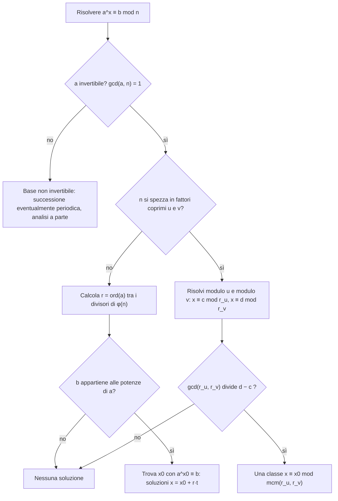

# Congruenze esponenziali

Prerequisiti: [[Books/Aritmetica-I/11 - Congruenze e inversi modulari|congruenze e inversi]], [[Books/Aritmetica-I/12 - Sistemi e teorema cinese del resto|sistemi modulari]], [[Books/Aritmetica-I/16 - Gruppi ciclici e ordine|ordine e gruppi ciclici]], [[Books/Aritmetica-I/17 - Lagrange Eulero e Fermat|Eulero e Fermat]]. Torna all’[[Books/Aritmetica-I/00 - Indice e piano di studio|indice]].

> [!info] In questo capitolo
> - Risolverai equazioni del tipo $a^x\equiv b\pmod n$, dove l'incognita è l'*esponente*.
> - Capirai che il problema si divide in due: trovare il periodo delle potenze (l'ordine di $a$) e collocare $b$ dentro quel periodo.
> - Descriverai *tutte* le soluzioni come una classe $x_0+rt$, e saprai riconoscere quando non ce ne sono.
> - Con modulo composto spezzerai il problema con il teorema cinese e controllerai la compatibilità degli esponenti.

## Cercare l’esponente invece della base

Quali interi $x$ soddisfano

$$
3^x\equiv9\pmod{13}?
$$

Una soluzione si vede subito: $x=2$. Ma cercare una soluzione e descriverle tutte sono due problemi diversi. Le prime potenze ci suggeriscono come affrontare il secondo:

$$
\begin{array}{c|rrrrrrr}
x&0&1&2&3&4&5&6\\\hline
3^x\pmod{13}&1&3&9&1&3&9&1.
\end{array}
$$

Le potenze ripercorrono tre valori. Ci aspettiamo quindi che gli esponenti cercati siano $2,5,8,\ldots$, e anche interi negativi appartenenti alla stessa classe modulo $3$. Occorre spiegare perché il ciclo continua e perché non nasconde altre soluzioni.

Una **congruenza esponenziale** ha la forma

$$
a^x\equiv b\pmod n,
$$

con $a,b$ noti e $x$ incognito. In questo capitolo supponiamo inizialmente $n\ge2$ e $\gcd(a,n)=1$, e cerchiamo $x\in\mathbb Z$. Alla fine vedremo che cosa cambia senza l’ipotesi sulla base.

Qui $U(n)$ indica, come nel [[Books/Aritmetica-I/17 - Lagrange Eulero e Fermat|capitolo 17]], il gruppo delle classi invertibili modulo $n$, cioè quelle $[a]_n$ con $\gcd(a,n)=1$. Per gli esponenti negativi la scrittura va interpretata nelle classi: se $g=[a]_n\in U(n)$, definiamo $g^{-h}=(g^{-1})^h$ per $h>0$. Per esempio $[3]_{13}^{-1}=[9]_{13}$, perché $3\cdot9\equiv1\pmod{13}$. L’inverso usato qui è una classe modulare. Scrivere $a^x\equiv b\pmod n$ per $x<0$ significherà dunque $[a]_n^x=[b]_n$.

## Il periodo esatto delle potenze

Per descrivere tutte le soluzioni serve sapere dopo quanti passi le potenze si ripetono: questo numero è l'ordine. Poniamo $g=[a]_n$. Il gruppo $U(n)$ è finito, quindi $g$ ha ordine finito. Ricordiamo dal [[Books/Aritmetica-I/16 - Gruppi ciclici e ordine|capitolo 16]] che l'**ordine** di $g$ è il più piccolo esponente positivo che riporta a $1$:

$$
r=\operatorname{ord}_n(a)
=\min\{h\in\mathbb N_{>0}:g^h=1\}.
$$

Si può anche vedere direttamente perché l’insieme non sia vuoto. Tra le potenze $g^0,g^1,\ldots,g^{\varphi(n)}$ due coincidono, perché sono $\varphi(n)+1$ elementi di un insieme con $\varphi(n)$ elementi. Se $g^i=g^j$ con $i<j$, moltiplicando per $g^{-i}$ si ottiene $g^{j-i}=1$.

La proprietà decisiva è

> [!abstract] Concetto chiave — Le potenze sono uguali se e solo se gli esponenti sono congrui modulo l'ordine
> $$
> g^x=g^y\quad\Longleftrightarrow\quad r\mid(x-y)\qquad(x,y\in\mathbb Z),\qquad r=\operatorname{ord}(g).
> $$
> Trasforma un'equazione fra potenze in una congruenza fra esponenti. È il pilastro del capitolo: si riusa nelle soluzioni $x_0+rt$, nel prodotto di ordini e nel periodo dei decimali ([[Books/Aritmetica-I/19 - Frazioni e sviluppi decimali|capitolo 19]]).

**Dimostrazione.** La cancellazione nel gruppo dà $g^x=g^y$ se e solo se $g^{x-y}=1$. Per capire gli esponenti che producono $1$, dividiamo un intero qualsiasi $h$ per $r$:

$$
h=qr+s,\qquad 0\le s<r.
$$

Anche se $h$ è negativo la divisione euclidea esiste, e le leggi delle potenze nel gruppo danno

$$
g^h=(g^r)^qg^s=g^s.
$$

Se $g^h=1$, un resto positivo $s$ contraddirebbe la minimalità di $r$. Quindi $s=0$ e $r\mid h$. Viceversa, se $h=qr$, allora $g^h=(g^r)^q=1$. Applicando questo fatto a $h=x-y$ si ottiene l’equivalenza.

In particolare $g^{x+r}=g^x$ per ogni intero $x$: le potenze hanno periodo $r$ fin dall’inizio. Inoltre $g^0,g^1,\ldots,g^{r-1}$ sono distinte, perché due esponenti diversi in quell’intervallo non differiscono di un multiplo di $r$. Il ciclo ha quindi esattamente $r$ valori.

Torniamo a $3$ modulo $13$. Si ha $3^3=27\equiv1$, mentre $3$ e $9$ non sono congruenti a $1$. Dunque $\operatorname{ord}_{13}(3)=3$. L’equivalenza appena dimostrata conclude:

$$
3^x\equiv9\pmod{13}
\iff 3^x\equiv3^2\pmod{13}
\iff x\equiv2\pmod3.
$$

Abbiamo provato anche la completezza della risposta.

## Esistenza e descrizione di tutte le soluzioni

L’applicazione

$$
\mathbb Z\longrightarrow U(n),\qquad x\longmapsto g^x
$$

ha come immagine il sottogruppo ciclico (l'insieme di tutte le potenze di $g$, descritto nel [[Books/Aritmetica-I/16 - Gruppi ciclici e ordine|capitolo 16]])

$$
\langle g\rangle=\{1,g,\ldots,g^{r-1}\}.
$$

Questo traduce la domanda iniziale in una domanda di appartenenza: **il valore cercato compare nel ciclo delle potenze?** Precisamente,

$$
a^x\equiv b\pmod n
\quad\text{è risolvibile}\quad\Longleftrightarrow\quad
[b]_n\in\langle[a]_n\rangle.
$$

Se l’appartenenza vale e $x_0$ è una soluzione, allora

$$
\boxed{x=x_0+rt,\qquad t\in\mathbb Z.}
$$

Infatti la congruenza equivale a $g^x=g^{x_0}$, e la proprietà precedente equivale a $r\mid(x-x_0)$. Questa è sia la prova che tutti gli interi indicati funzionano, sia la prova che non ve ne sono altri.

> [!example] Esempi e controesempi — congruenza esponenziale $a^x\equiv b\pmod n$
> **È risolvibile:** $3^x\equiv9\pmod{13}$ ($b$ compare nel ciclo $1,3,9$: $x\equiv2\pmod3$); $5^x\equiv8\pmod{13}$ ($x\equiv3\pmod4$).
> **Non è risolvibile, $b$ non è invertibile:** $2^x\equiv6\pmod9$. Le potenze di $2$ sono unità modulo $9$, ma $\gcd(6,9)=3$.
> **Non è risolvibile, $b$ è invertibile ma fuori dal ciclo:** $4^x\equiv2\pmod{17}$. Le potenze di $4$ sono $1,4,16,13$, e $2$ non compare.
> **Non è risolvibile, le congruenze locali sono compatibili da sole ma non insieme:** $2^x\equiv7\pmod{15}$ (vedi sotto).
> **La base non è invertibile, la teoria non si applica:** $2^x\equiv0\pmod8$ è vera per tutti gli $x\ge3$ e falsa per $x\le2$ ($x\in\mathbb N$): non è una classe di esponenti $x_0+rt$ (vedi l'ultima sezione).

Se il problema richiede $x\in\mathbb N$, si tengono soltanto gli esponenti non negativi. Scegliendo il rappresentante $0\le x_0<r$, la risposta diventa $x=x_0+rt$ con $t\in\mathbb N$. Ricordiamo che qui $0\in\mathbb N$.

### Esempio svolto: una base che non raggiunge tutte le unità

Modulo $17$ abbiamo

$$
4^0\equiv1,\quad 4^1\equiv4,\quad
4^2\equiv16\equiv-1,\quad
4^3\equiv13\equiv-4,\quad 4^4\equiv1.
$$

Il primo ritorno a $1$ avviene all’esponente $4$, quindi $\operatorname{ord}_{17}(4)=4$. La tabella risolutiva è

$$
\begin{array}{c|cccc}
b\pmod{17}&1&4&16&13\\\hline
x\pmod4&0&1&2&3.
\end{array}
$$

Per esempio $4^x\equiv13\pmod{17}$ ha esattamente le soluzioni $x\equiv3\pmod4$. Invece $4^x\equiv2\pmod{17}$ non ha soluzioni: $[2]_{17}$ è invertibile, ma non compare nella tabella.

> [!warning] Attenzione — Essere invertibile non basta
> Se la base è invertibile, tutte le sue potenze sono invertibili: $\gcd(b,n)=1$ è quindi necessario. Può però accadere che $\langle[a]_n\rangle$ sia un sottogruppo proprio di $U(n)$, come per $4$ modulo $17$. Non basta controllare che $b$ sia coprimo con $n$.

Trovare $x_0$ è il problema del **logaritmo discreto** nella base $g$, quando $[b]_n$ appartiene al sottogruppo. Il nome non fornisce una formula risolutiva: per moduli piccoli possiamo costruire la tabella, mentre per moduli grandi la ricerca può richiedere metodi ulteriori. In particolare non si trasforma $a^x\equiv b$ nella congruenza lineare $ax\equiv b$: sono operazioni diverse.

## Come determinare l’ordine senza provare ogni esponente

Il [[Books/Aritmetica-I/17 - Lagrange Eulero e Fermat|teorema di Eulero]] dà

$$
a^{\varphi(n)}\equiv1\pmod n,
\qquad\text{quindi}\qquad r\mid\varphi(n).
$$

Questo restringe la ricerca ai divisori di $\varphi(n)$. Un procedimento utile parte da $M=\varphi(n)$. Se $q$ è un primo che divide $M$ e

$$
a^{M/q}\equiv1\pmod n,
$$

si sostituisce $M$ con $M/q$ e si ripete. Ogni sostituzione conserva $r\mid M$, perché una potenza uguale a $1$ ha esponente multiplo dell’ordine. Quando nessuna divisione è più possibile, $M=r$.

Perché l’ultimo passo è giustificato? Se fosse $M>r$, il quoziente intero $M/r$ avrebbe un divisore primo $q$. Allora $r\mid M/q$, e quindi $a^{M/q}\equiv1$: una divisione sarebbe ancora possibile. È una contraddizione.

Per esempio, per $a=2$ e $n=21$ si parte da $\varphi(21)=12$. Poiché $2^6=64\equiv1\pmod{21}$, riduciamo $M$ a $6$. Ora

$$
2^{6/2}=2^3=8\not\equiv1,\qquad
2^{6/3}=2^2=4\not\equiv1\pmod{21}.
$$

I primi che dividono $6$ sono $2$ e $3$: non si può più ridurre e l’ordine è $6$.

Conoscere l’ordine limita il numero di potenze da esaminare, ma non individua da solo $x_0$. Sono due passaggi distinti: trovare il periodo e collocare $b$ nel periodo.

## Spezzare il modulo e ricomporre gli esponenti

Supponiamo $n=uv$, con $u,v\ge2$ coprimi, e $\gcd(a,n)=1$. La divisibilità per $uv$ equivale alla divisibilità per entrambi i fattori; quindi

$$
a^x\equiv b\pmod{uv}
\iff
\begin{cases}
a^x\equiv b\pmod u,\\
a^x\equiv b\pmod v.
\end{cases}
$$

L’equivalenza vale anche per gli esponenti negativi: un inverso di $[a]_{uv}$ si riduce a un inverso di $[a]_u$ e di $[a]_v$, perché l’identità $ac\equiv1\pmod{uv}$ rimane vera riducendo modulo ciascun fattore.

Se entrambe le congruenze locali sono risolvibili, si trovano condizioni

$$
x\equiv c\pmod{r_u},\qquad
x\equiv d\pmod{r_v},
\quad r_u=\operatorname{ord}_u(a),\quad r_v=\operatorname{ord}_v(a).
$$

Ora bisogna risolvere un sistema **nell’esponente**. Per il [[Books/Aritmetica-I/12 - Sistemi e teorema cinese del resto|teorema cinese generalizzato]], il sistema è compatibile se e solo se

$$
\gcd(r_u,r_v)\mid(d-c).
$$

Quando è compatibile, le soluzioni formano una classe modulo $\operatorname{mcm}(r_u,r_v)$. Questo coincide proprio con l’ordine globale:

> [!abstract] Concetto chiave — Ordine modulo un prodotto di moduli coprimi
> $$
> \operatorname{ord}_{uv}(a)=\operatorname{mcm}\bigl(\operatorname{ord}_u(a),\operatorname{ord}_v(a)\bigr)\qquad(\gcd(u,v)=1,\ \gcd(a,uv)=1).
> $$
> Permette di calcolare l'ordine modulo un numero composto dai suoi fattori. Verrà usato anche per i periodi decimali ([[Books/Aritmetica-I/19 - Frazioni e sviluppi decimali|capitolo 19]]) e nei moduli composti del [[Books/Aritmetica-I/20 - Congruenze polinomiali e sollevamento|capitolo 20]].

**Dimostrazione.** Per ogni intero positivo $h$,

$$
a^h\equiv1\pmod{uv}
\iff
\begin{cases}r_u\mid h,\\r_v\mid h.\end{cases}
$$

Il minimo intero positivo divisibile sia per $r_u$ sia per $r_v$ è il loro mcm. Per definizione, è anche l’ordine cercato. La stessa prova si estende a più fattori a due a due coprimi.

### Esempio svolto: $3^x\equiv61\pmod{91}$

Poiché $91=7\cdot13$, riduciamo il problema modulo $7$ e modulo $13$. Modulo $7$, le potenze di $3$ sono

$$
\begin{array}{c|rrrrrrr}
x&0&1&2&3&4&5&6\\\hline
3^x\pmod7&1&3&2&6&4&5&1.
\end{array}
$$

L’ordine è $6$ e $61\equiv5\pmod7$, quindi $x\equiv5\pmod6$.

Modulo $13$ conosciamo già il ciclo $1,3,9$. Siccome $61\equiv9\pmod{13}$, otteniamo $x\equiv2\pmod3$. Dunque il sistema finale è

$$
\begin{cases}
x\equiv5\pmod6,\\
x\equiv2\pmod3.
\end{cases}
$$

La seconda condizione segue dalla prima: $5+6t\equiv2\pmod3$. Tutte le soluzioni sono pertanto

$$
\boxed{x\equiv5\pmod6.}
$$

Controlliamo un rappresentante direttamente: $3^5=243=2\cdot91+61$. Inoltre l’ordine modulo $91$ è $\operatorname{mcm}(6,3)=6$, in accordo con la risposta. Il rappresentante negativo della stessa classe è $-1$.

### Quando le due ricerche locali riescono ma la risposta globale è vuota

Consideriamo ora

$$
2^x\equiv7\pmod{15}.
$$

Modulo $3$ diventa $(-1)^x\equiv1$, quindi $x\equiv0\pmod2$. Modulo $5$ diventa $2^x\equiv2$: il ciclo è $1,2,4,3$, dunque $x\equiv1\pmod4$. La prima condizione richiede un esponente pari, la seconda un esponente dispari. Non esiste soluzione, benché ciascuna congruenza locale ne abbia e $7$ sia coprimo con $15$.

> [!warning] Attenzione — I moduli degli esponenti possono non essere coprimi
> Scomporre $n$ in fattori coprimi permette di separare la congruenza nei valori. I successivi moduli per $x$ sono gli ordini delle basi: non ereditano la coprimalità. Per $3$ modulo $7$ e $13$ gli ordini sono $6$ e $3$; per $2$ modulo $3$ e $5$ sono $2$ e $4$. Occorre sempre controllare la compatibilità del sistema nell’esponente.

Il percorso di soluzione è quindi: verificare l’invertibilità della base, determinare gli ordini utili, cercare l’appartenenza ai sottogruppi locali, tradurla in condizioni su $x$, controllare la compatibilità e descrivere tutti gli esponenti. Un controllo diretto di un rappresentante aiuta a intercettare errori di calcolo; la completezza deriva dalle equivalenze dimostrate.

Lo schema seguente riassume il metodo. Si legge dall'alto: ogni rombo è una domanda, e le frecce indicano la risposta. Quando il modulo si spezza, ciascuna delle due congruenze locali si risolve con il ramo «no» del secondo rombo (ordine, appartenenza), e si torna poi al controllo di compatibilità.

## Se la base non è invertibile

Per una base qualsiasi, la successione $[a^0]_n,[a^1]_n,\ldots$ assume solo un numero finito di valori. Due termini $[a^i]_n$ e $[a^j]_n$, con $i<j$, coincidono. Moltiplicando entrambi per $[a^k]_n$ si ottiene

$$
[a^{i+k}]_n=[a^{j+k}]_n\qquad(k\in\mathbb N).
$$

La successione è dunque **eventualmente periodica**: da un certo punto si ripete. Senza un inverso, però, non possiamo cancellare $[a^i]_n$ e concludere $[a^{j-i}]_n=1$. Il tratto iniziale può non ripetersi.

Per esempio, modulo $8$, le potenze di $2$ per $x=0,1,2,3,\ldots$ sono

$$
1,2,4,0,0,0,\ldots.
$$

La coda è costante, ma non esiste un esponente positivo che dia $1$. L’ordine moltiplicativo nel gruppo delle unità non si applica a $[2]_8$.

Un altro esempio distingue bene il tratto iniziale dalla coda: modulo $12$, le potenze di $6$ sono $1,6,0,0,\ldots$. Per $x\in\mathbb N$, l’equazione $6^x\equiv6\pmod{12}$ ha la sola soluzione $x=1$, mentre $6^x\equiv0\pmod{12}$ vale per tutti e soli gli $x\ge2$. Non si descrivono entrambe mediante un’unica classe di esponenti estesa a tutti gli interi. Anche il dominio cambia: le potenze negative non sono definite attraverso un inverso modulare della base.

## Fonti

Il punto di partenza è la [[Notes/Aritmetica/Lectures/2026-10-27 - Equazioni esponenziali e congruenze modulo potenze prime|nota del 27 ottobre sulle equazioni esponenziali]], confrontata con la [[_transcripts/Aritmetica/2026-10-27 - Equazioni esponenziali e congruenze modulo potenze prime|trascrizione della lezione]]. Da queste fonti provengono i problemi con $3$ modulo $13$, $4$ modulo $17$ e $3^x\equiv61\pmod{91}$. In quest’ultimo esempio il passaggio ASR con esponente $-2$ è incoerente con le potenze: il calcolo dà $x\equiv5\pmod6$, cioè $x\equiv-1\pmod6$.

La [[Notes/Aritmetica/Lectures/2026-11-01 - Gruppi ciclici, ordini e sottogruppi modulari|nota del 1° novembre]] e la relativa [[_transcripts/Aritmetica/2026-11-01 - Gruppi ciclici, ordini e sottogruppi modulari|trascrizione]], nelle parti dedicate all’ordine e alle potenze, offrono il raccordo con i gruppi ciclici. Sono integrazioni didattiche la formulazione sistematica con le classi e gli esponenti negativi, il metodo di riduzione dei divisori di $\varphi(n)$, la prova dell’ordine sul prodotto, gli esempi di incompatibilità e di basi non invertibili, e gli esercizi seguenti.

## Esercizi per verificare la comprensione

Gli esercizi 1–6 sono fondamentali; 7–8 collegano questi risultati alle congruenze lineari e alle successioni di potenze.

1. Calcola $\operatorname{ord}_{13}(5)$ e risolvi $5^x\equiv8\pmod{13}$ per $x\in\mathbb Z$ e per $x\in\mathbb N$.

> [!tip]- Riscontro 1
> Le potenze sono $1,5,12,8,1$: infatti $5^2\equiv-1$, $5^3\equiv-5\equiv8$ e $5^4\equiv1$. Il primo ritorno è all’esponente $4$. In $\mathbb Z$ le soluzioni sono $x=3+4t$, $t\in\mathbb Z$; in $\mathbb N$ sono $x=3+4t$, $t\in\mathbb N$.

2. Risolvi $4^x\equiv13\pmod{17}$ con $x\in\mathbb Z$ e $-10\le x\le10$. Spiega anche perché $4^x\equiv2\pmod{17}$ non ha soluzioni intere.

> [!tip]- Riscontro 2
> Dal ciclo di ordine $4$ segue $x\equiv3\pmod4$. Nell’intervallo richiesto si ottengono $-9,-5,-1,3,7$. La classe di $2$ non appartiene a $\{[1]_{17},[4]_{17},[16]_{17},[13]_{17}\}$, benché sia invertibile; quindi la seconda congruenza è impossibile.

3. Partendo da $\varphi(21)=12$, determina l’ordine di $2$ modulo $21$ con il metodo di riduzione e risolvi $2^x\equiv16\pmod{21}$ per $x\in\mathbb Z$.

> [!tip]- Riscontro 3
> $2^6\equiv1$, mentre $2^3\equiv8$ e $2^2\equiv4$ non sono $1$: dall’invariante «l’ordine divide il candidato» segue che l’ordine è $6$. Poiché $16=2^4$, tutte e sole le soluzioni sono $x\equiv4\pmod6$.

4. Siano $n\ge2$ e $\gcd(a,n)=1$. Dimostra che se $a^x\equiv b\pmod n$ è risolvibile in $\mathbb Z$, allora $\gcd(b,n)=1$. Fornisci un controesempio alla sufficienza di questa condizione.

> [!tip]- Riscontro 4
> Nel gruppo $U(n)$ ogni potenza, anche negativa, di $[a]_n$ è invertibile: l’inverso di $[a]_n^x$ è $[a]_n^{-x}$. Dunque $[b]_n$ è un’unità, equivalente a $\gcd(b,n)=1$. Il caso $a=4$, $b=2$, $n=17$ confuta il viceversa, come mostra il ciclo $1,4,16,13$.

5. Uno studente sostiene che $3^x\equiv2\pmod{35}$ abbia soluzione perché le congruenze modulo $5$ e $7$ sono entrambe risolvibili e $\gcd(5,7)=1$. Verifica le due risolubilità locali e diagnostica l’errore. Il dominio è $x\in\mathbb Z$.

> [!tip]- Riscontro 5
> Modulo $5$, il ciclo di $3$ è $1,3,4,2$, quindi $x\equiv3\pmod4$. Modulo $7$, il ciclo è $1,3,2,6,4,5$, quindi $x\equiv2\pmod6$. La prima condizione impone $x$ dispari, la seconda $x$ pari: non esiste soluzione. Il teorema cinese va applicato ai moduli degli esponenti $4$ e $6$, che non sono coprimi; $\gcd(4,6)=2$ non divide $2-3=-1$.

6. Risolvi $2^x\equiv18\pmod{35}$ per $x\in\mathbb Z$, lavorando prima modulo $5$ e modulo $7$. Controlla un rappresentante e determina l’ordine della base modulo $35$.

> [!tip]- Riscontro 6
> Modulo $5$, $18\equiv3$ e il ciclo $1,2,4,3$ dà $x\equiv3\pmod4$. Modulo $7$, $18\equiv4$ e il ciclo $1,2,4$ dà $x\equiv2\pmod3$. Scrivendo $x=3+4t$, la seconda condizione diventa $t\equiv2\pmod3$. Quindi $x=11+12s$, $s\in\mathbb Z$. Il controllo è $2^{11}=2048=58\cdot35+18$. L’ordine è $\operatorname{mcm}(4,3)=12$.

7. Siano $n\ge2$, $\gcd(a,n)=1$, $r=\operatorname{ord}_n(a)$, $k\in\mathbb N_{>0}$ e $c,s\in\mathbb Z$. Per $x\in\mathbb Z$, trasforma $a^{kx+c}\equiv a^s\pmod n$ in una congruenza lineare in $x$. Dimostra che essa è risolvibile se e solo se $\gcd(k,r)\mid(s-c)$ e descrivi la forma di tutte le soluzioni quando esistono.

> [!tip]- Riscontro 7
> L’uguaglianza delle potenze equivale a $r\mid(kx+c-s)$, cioè $kx\equiv s-c\pmod r$. Posto $d=\gcd(k,r)$, il criterio delle congruenze lineari dà esistenza se e solo se $d\mid(s-c)$. In tal caso, se $r/d\ge2$, si divide per $d$ e si risolve con il coefficiente invertibile $k/d$ modulo $r/d$: tutte le soluzioni sono $x\equiv x_0\pmod{r/d}$. Se $r/d=1$, ogni intero è soluzione, perché $r\mid k$ e $r\mid(s-c)$. Si tratta di un’equazione lineare dopo aver uguagliato due potenze della stessa base e usato l’ordine.

8. Per $x\in\mathbb N$ risolvi separatamente $6^x\equiv6\pmod{12}$ e $6^x\equiv0\pmod{12}$. Individua il tratto iniziale prima della coda costante e spiega quali passaggi della teoria per le basi invertibili non si possono applicare.

> [!tip]- Riscontro 8
> La successione è $1,6,0,0,\ldots$, perché $6^2=36\equiv0$ e moltiplicare ancora per $6$ conserva $0$. La prima congruenza ha la sola soluzione $x=1$; la seconda ha tutte e sole le soluzioni $x\ge2$. Il tratto iniziale è formato dai termini con esponente $0$ e $1$; la coda inizia con $x=2$ e ha periodo $1$. Non esiste una potenza positiva uguale a $1$, non si può cancellare la base e non si definiscono esponenti negativi tramite un suo inverso modulo $12$.

Il capitolo è acquisito quando sai separare l’appartenenza al sottogruppo dalla ricerca del periodo e giustificare che la classe trovata contiene tutte le soluzioni. Nei problemi con modulo composto, controlla autonomamente la compatibilità degli esponenti e riconosci quando una base non invertibile richiede un’analisi diversa.

---

[[Books/Aritmetica-I/17 - Lagrange Eulero e Fermat|← 17 · Lagrange, Eulero e Fermat]] · [[Books/Aritmetica-I/00 - Indice e piano di studio|Indice]] · [[Books/Aritmetica-I/19 - Frazioni e sviluppi decimali|19 · Frazioni e sviluppi decimali →]]
