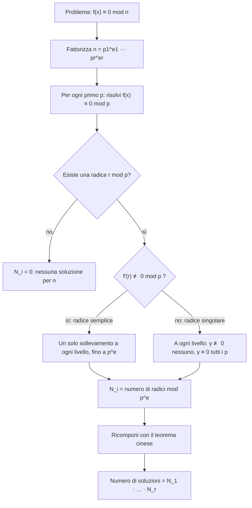

# Congruenze polinomiali e sollevamento

Prerequisiti: [[Books/Aritmetica-I/11 - Congruenze e inversi modulari|congruenze e inversi]], [[Books/Aritmetica-I/12 - Sistemi e teorema cinese del resto|teorema cinese]], [[Books/Aritmetica-I/15 - Anelli campi e omomorfismi|anelli e campi]], [[Books/Aritmetica-I/17 - Lagrange Eulero e Fermat|aritmetica dei gruppi modulari]]. Torna all'[[Books/Aritmetica-I/00 - Indice e piano di studio|indice]].

> [!info] In questo capitolo
> - Risolverai congruenze $f(x)\equiv0\pmod n$ con $f$ polinomio a coefficienti interi, spezzando il modulo $n$ in potenze di primi.
> - Modulo un primo risolverai le quadratiche con il discriminante; modulo una potenza prima passerai da $p^k$ a $p^{k+1}$ risolvendo una congruenza lineare (sollevamento).
> - Distinguerai le radici semplici, che si sollevano in un solo modo, da quelle singolari, che non si sollevano affatto oppure si sollevano in $p$ modi.
> - Ricomporrai le soluzioni con il teorema cinese e conterai le radici come prodotto dei conteggi locali.

## Un problema finito, ma organizzato meglio

Quali interi soddisfano $x^2\equiv2\pmod{49}$? Potremmo provare tutti i resti da $0$ a $48$. Ma modulo $7$ le prove sono soltanto sette: troviamo $3^2\equiv4^2\equiv2$. Ogni soluzione cercata deve quindi essere congrua a $3$ oppure a $4$ modulo $7$. Possiamo correggere questi due resti, aggiungendo un multiplo di $7$, fino a ottenere soluzioni modulo $49$?

Questo passaggio da un'informazione meno precisa a una più precisa si chiama **sollevamento**. Vedremo che, sotto un'ipotesi controllabile, la correzione si trova risolvendo una congruenza lineare. Prima occorre però capire quali problemi conviene separare.

Sia $f\in\mathbb Z[x]$ (la scrittura indica un polinomio a coefficienti interi) e sia $n\ge2$. Risolvere

$$
f(x)\equiv0\pmod n
$$

significa trovare le classi $[x]_n$ che annullano $f$. Le chiamiamo **radici modulo $n$**. Se sostituiamo $x$ con un intero congruo modulo $n$, anche tutte le sue potenze, e quindi $f(x)$, rimangono congrue. La domanda dipende dunque dalla classe: ci sono sempre soltanto $n$ candidati, anche se gli interi sono infiniti.

> [!example] Esempi e controesempi — radice modulo $n$
> **È una radice:** per $f(x)=x^2-2$, la classe di $3$ modulo $7$, perché $3^2-2=7$; e lo è anche $10$, perché $10\equiv3\pmod 7$ dà la stessa classe e $10^2-2=98$ è multiplo di $7$.
> **Non è una radice:** la classe di $5$ modulo $7$, perché $5^2-2=23$ non è divisibile per $7$. Per decidere basta provare un solo rappresentante della classe, perché $f$ rispetta le congruenze.

La fattorizzazione del modulo ci permette di organizzarli. Scriviamo

$$
n=p_1^{e_1}\cdots p_r^{e_r},
$$

con primi distinti ed esponenti positivi. Le potenze $p_i^{e_i}$ sono a due a due coprime, perciò

$$
f(x)\equiv0\pmod n
\quad\Longleftrightarrow\quad
f(x)\equiv0\pmod{p_i^{e_i}}\quad\text{per ogni }i.
$$

Infatti un intero è divisibile per $n$ esattamente quando contiene tutte le potenze prime della sua fattorizzazione. Il teorema cinese aggiunge qualcosa di decisivo: per ogni scelta di una radice modulo ciascuna potenza prima esiste un'unica classe modulo $n$ con quei resti. Quella classe è una radice di $f$, per l'equivalenza appena dimostrata.

Se $N_i$ è il numero delle radici modulo $p_i^{e_i}$, otteniamo quindi

$$
\#\{[x]_n:f(x)\equiv0\pmod n\}=N_1\cdots N_r.
$$

Scelte locali diverse danno classi globali diverse: differiscono in almeno un resto. Se anche un solo $N_i$ è zero, non esiste alcuna soluzione globale. Lavorare localmente serve tanto a costruire soluzioni quanto a escluderle.

> [!abstract] Concetto chiave — Si risolve primo per primo e si ricompone
> Se $n=p_1^{e_1}\cdots p_r^{e_r}$ e $N_i$ è il numero di radici di $f$ modulo $p_i^{e_i}$, allora $f(x)\equiv0\pmod n$ ha esattamente $N_1\cdots N_r$ radici modulo $n$ (in particolare nessuna se un $N_i=0$).
> È la conseguenza del teorema cinese ([[Books/Aritmetica-I/12 - Sistemi e teorema cinese del resto|capitolo 12]]) che riduce ogni modulo a potenze di primi; il resto del capitolo studia le potenze di primi.

> [!example] Esempi e controesempi — contare le radici come prodotto
> **Vale (moduli coprimi):** $x^2\equiv1$ ha $1$ radice modulo $2$ e $2$ modulo $5$ ($\pm1$) con moduli coprimi, quindi $1\cdot2=2$ radici modulo $10$. In effetti sono $1$ e $9$.
> **Non vale (moduli non coprimi):** $8=2\cdot4$, ma $\gcd(2,4)=2\neq1$. Modulo $2$ la congruenza $x^2\equiv1$ ha $1$ radice, modulo $4$ ne ha $2$ ($1,3$): il prodotto darebbe $1\cdot2=2$, mentre modulo $8$ le radici sono $4$ ($1,3,5,7$). Il teorema cinese richiede una scomposizione in fattori a due a due coprimi, qui $8$ non si spezza affatto.

## Quadratiche modulo un primo

Cominciamo con un primo dispari $p$ e una congruenza

$$
Ax^2+Bx+C\equiv0\pmod p,\qquad p\nmid A.
$$

La formula delle equazioni di secondo grado nasce dal completamento del quadrato. L'identità intera

$$
4A(Ax^2+Bx+C)=(2Ax+B)^2-(B^2-4AC)
$$

suggerisce di porre $\Delta=B^2-4AC$. Poiché $4A$ è invertibile modulo $p$, l'equazione è equivalente a

$$
(2Ax+B)^2\equiv\Delta\pmod p.
$$

Anche $2A$ è invertibile: l'applicazione $x\mapsto2Ax+B$ è una corrispondenza fra le classi modulo $p$. Se troviamo le radici $y$ di $y^2\equiv\Delta$, ricaviamo precisamente tutte le soluzioni

$$
x\equiv(2A)^{-1}(-B+y)\pmod p.
$$

In particolare, se $s^2\equiv\Delta$, scriviamo $x\equiv(2A)^{-1}(-B\pm s)\pmod p$, ricordando che i due segni coincidono quando $s\equiv0$.

Il simbolo di radice quadrata qui indica classi che, elevate al quadrato, danno $\Delta$; non un numero reale da approssimare.

Per cercarle basta elencare

$$
0^2,1^2,\ldots,\left(\frac{p-1}{2}\right)^2\pmod p,
$$

perché ogni classe non nulla è rappresentata da uno dei numeri $\pm1,\ldots,\pm(p-1)/2$, e i segni opposti hanno lo stesso quadrato. Un valore ottenuto si dice un **quadrato modulo $p$**; qui includiamo anche zero nell'elenco.

Perché una quadratica ha al massimo due radici? Se $u^2\equiv v^2\pmod p$, allora

$$
(u-v)(u+v)\equiv0\pmod p.
$$

Nel campo $\mathbb Z/p\mathbb Z$ un prodotto nullo ha un fattore nullo: dunque $u\equiv v$ oppure $u\equiv-v$. Se un quadrato è non nullo, queste due radici sono distinte, perché $v\equiv-v$ implicherebbe $2v\equiv0$, quindi $v\equiv0$. Zero ha invece una sola radice. Trasportando il risultato attraverso $y=2Ax+B$, la quadratica ha zero, una o due radici secondo che $\Delta$ sia un non quadrato, zero oppure un quadrato non nullo.

Consideriamo l'esempio

$$
x^2+5x+3\equiv0\pmod{11}.
$$

Qui $\Delta=25-12=13\equiv2$. I quadrati dei rappresentanti $0,1,2,3,4,5$ sono rispettivamente

$$
0,1,4,9,5,3\pmod{11}.
$$

L'elenco completo è quindi $\{0,1,3,4,5,9\}$: manca $2$, perciò non esistono soluzioni. La stessa congruenza non potrebbe avere soluzioni modulo un multiplo di $11$.

> [!example] Esempi e controesempi — quadrato modulo $p$
> **È un quadrato modulo $11$:** $3$, perché $5^2=25\equiv3$; $4$, perché $2^2=4$; anche $0$, che qui includiamo.
> **Non è un quadrato modulo $11$:** $2$, perché l'elenco $0,1,4,9,5,3$ dei quadrati dei rappresentanti non lo contiene (e gli opposti ripetono gli stessi quadrati).

Le ipotesi sulla formula contano. Se $p\mid A$, riduciamo prima i coefficienti: rimane $Bx+C\equiv0\pmod p$. Se $p\nmid B$ c'è un'unica soluzione; se $p\mid B$ ci sono tutte le classi quando $p\mid C$, nessuna altrimenti. Se $p=2$, controlliamo direttamente $x=0,1$: dividere per $2$ non è consentito.

## Che cosa cambia per una potenza prima

Passando da $p$ a $p^e$, con $e>1$, perdiamo il campo. Per esempio $5\cdot5\equiv0\pmod{25}$, ma nessuno dei fattori è nullo modulo $25$. La divisibilità richiesta può distribuirsi fra i fattori.

Il linguaggio delle [[Books/Aritmetica-I/09 - Primi e fattorizzazione unica|valutazioni prime]] rende precisa questa osservazione. La valutazione $v_p(a)$ è l'esponente con cui il primo $p$ compare nella fattorizzazione di $a$ (per esempio $v_5(50)=2$). Per interi non nulli $a,b$,

$$
v_p(ab)=v_p(a)+v_p(b).
$$

Per avere $p^e\mid ab$ basta che la somma sia almeno $e$; non occorre che uno degli addendi sia almeno $e$. Se un fattore è zero, il prodotto è già divisibile per ogni potenza, senza dover assegnare una valutazione finita a zero.

> [!warning] Attenzione — Annullamento e cancellazione richiedono ipotesi
> Da $ab\equiv0\pmod{p^e}$ non segue in generale che $a$ oppure $b$ sia nullo. Anche cancellare un fattore mantenendo il modulo richiede che quel fattore sia invertibile. Per esempio $5a\equiv5b\pmod{25}$ equivale ad $a\equiv b\pmod5$, non necessariamente modulo $25$.

Già i quadrati modulo $4$ mostrano una restrizione utile: se $x=2t$, allora $x^2\equiv0$; se $x=2t+1$, allora $x^2=4t(t+1)+1\equiv1$. Quindi $x^2\equiv2\pmod4$ è impossibile, sebbene modulo $2$ abbia la radice zero. Una radice può dunque scomparire quando chiediamo maggiore precisione.

Può anche moltiplicarsi. Modulo $8$, ogni dispari $x=2t+1$ soddisfa

$$
x^2-1=4t(t+1)\equiv0\pmod8,
$$

perché $t(t+1)$ è pari; nessun pari funziona. Le quattro radici sono $1,3,5,7$. Il limite di due radici dimostrato sopra usa il campo e non si trasferisce automaticamente ai moduli composti.

## Una correzione che si calcola linearmente

Supponiamo di avere una radice $x_0$ modulo $p^k$, con $k\ge1$. Le classi modulo $p^{k+1}$ che si riducono a essa sono precisamente

$$
x=x_0+p^kh,\qquad h=0,1,\ldots,p-1.
$$

Infatti ogni intero che si riduce a $x_0$ ha la forma $x_0+p^kq$; sostituire $q$ con il suo resto modulo $p$ non cambia la classe modulo $p^{k+1}$.

Sono distinte: se due differiscono di un multiplo di $p^{k+1}$, dividendo la differenza per $p^k$ otteniamo che i rispettivi $h$ sono congrui modulo $p$. Fra questi $p$ candidati dobbiamo scegliere quelli che annullano ancora $f$.

Introduciamo una scrittura algebrica, senza ricorrere al calcolo differenziale. Se

$$
f(x)=a_0+a_1x+\cdots+a_dx^d,
$$

la sua **derivata formale** è il polinomio

$$
f'(x)=a_1+2a_2x+\cdots+da_dx^{d-1}.
$$

Per un polinomio costante poniamo $f'=0$. È il coefficiente che compare nel termine lineare dello [[Books/Aritmetica-I/04 - Sottoinsiemi e coefficienti binomiali|sviluppo binomiale]]. Infatti, per ogni monomio di grado $j\ge1$,

$$
(x_0+p^kh)^j=x_0^j+jx_0^{j-1}p^kh+
\sum_{i=2}^j\binom ji x_0^{j-i}p^{ki}h^i.
$$

Nella somma finale $ki\ge2k\ge k+1$: tutti quei termini sono divisibili per $p^{k+1}$. Sommando i monomi, compreso il termine costante, segue

$$
\boxed{f(x_0+p^kh)\equiv f(x_0)+p^khf'(x_0)\pmod{p^{k+1}}.}
$$

Poiché $p^k\mid f(x_0)$, il numero $\gamma=f(x_0)/p^k$ è un intero. La condizione per il sollevamento è quindi

$$
p^{k+1}\mid p^k\bigl(\gamma+hf'(x_0)\bigr)
\quad\Longleftrightarrow\quad
\boxed{\gamma+hf'(x_0)\equiv0\pmod p.}
$$

Abbiamo diviso una divisibilità intera per $p^k$, riducendo anche il modulo: proprio il passaggio lecito ricordato nell'avvertenza.

Ora il problema è lineare. Se $f'(x_0)\not\equiv0\pmod p$, il coefficiente è invertibile e troviamo un unico

$$
h\equiv-\gamma\bigl(f'(x_0)\bigr)^{-1}\pmod p.
$$

Si parla di **radice semplice** e di sollevamento semplice di Hensel. Se invece $f'(x_0)\equiv0\pmod p$, la radice è detta **singolare**: per $\gamma\not\equiv0$ non esiste alcun sollevamento, mentre per $\gamma\equiv0$ tutti i $p$ valori di $h$ funzionano. Queste alternative sono conseguenze complete della congruenza lineare, non eccezioni da verificare con una nuova formula.

> [!abstract] Concetto chiave — Sollevamento di Hensel
> Sia $x_0$ una radice di $f$ modulo $p^k$ e $\gamma=f(x_0)/p^k$. Le radici modulo $p^{k+1}$ che si riducono a $x_0$ sono $x_0+p^kh$ con $\gamma+hf'(x_0)\equiv0\pmod p$. Se $f'(x_0)\not\equiv0\pmod p$ ce n'è esattamente una; se $f'(x_0)\equiv0$ ce ne sono $0$ (quando $\gamma\not\equiv0$) oppure $p$ (quando $\gamma\equiv0$).
> È lo strumento che porta una soluzione modulo $p$ a una modulo $p^e$; torna ogni volta che si risolve una congruenza modulo un numero con fattori ripetuti.

> [!example] Esempi e controesempi — radice semplice e singolare
> **Radice semplice:** $x_0=3$ per $x^2-2$ modulo $7$, perché $f'(3)=6\not\equiv0\pmod7$: si solleva in un solo modo (a $10$ modulo $49$).
> **Radice singolare con $p$ sollevamenti:** $x_0=0$ per $x^2$ modulo $5$, perché $f'(0)=0$ e $\gamma=0$: si sollevano tutte le classi $5h$.
> **Radice singolare senza sollevamenti:** $x_0=0$ per $x^2-5$ modulo $5$, perché $f'(0)=0$ ma $\gamma=-1\not\equiv0$.
> Se togli l'ipotesi $f'(x_0)\not\equiv0$, l'unicità del sollevamento cade, e nei due esempi singolari le uniche alternative sono nessuno oppure tutti.

La procedura si ripete alle potenze successive. Ogni radice superiore si riduce a una radice inferiore, quindi partire da tutte le radici modulo $p$ e conservare tutti i sollevamenti dà una ricerca completa. Se una radice è semplice, resta tale lungo il processo: $x\equiv x_0\pmod p$ implica $f'(x)\equiv f'(x_0)\pmod p$. Ogni suo passaggio è unico. I rami singolari possono invece ramificarsi o interrompersi.

## Due comportamenti, con tutti i conti

Torniamo a $f(x)=x^2-2$. Modulo $7$ le radici sono $3$ e $4$, perché i quadrati di $0,1,2,3$ sono $0,1,4,2$ e le altre classi sono i loro opposti.

Per $x_0=3$ abbiamo $\gamma=(9-2)/7=1$ e $f'(3)=6$. La correzione soddisfa

$$
1+6h\equiv0\pmod7,
$$

quindi $h\equiv1$ e $x=3+7=10$. Per $x_0=4$, invece, $\gamma=2$ e $f'(4)=8\equiv1$; dunque $2+h\equiv0$, ossia $h\equiv5$, e $x=4+35=39$. Le sole radici modulo $49$ sono

$$
\boxed{x\equiv10,39\pmod{49}.}
$$

Il controllo diretto dà $10^2-2=98=2\cdot49$ e $39^2-2=1519=31\cdot49$. La completezza segue dalle due radici iniziali e dall'unicità di ciascun sollevamento.

Confrontiamo ora $x^2\equiv0\pmod{25}$ e $x^2\equiv5\pmod{25}$. Entrambe hanno come unica radice modulo $5$ la classe zero, ed entrambe hanno derivata formale $2x$, nulla in quella classe.

Per $f(x)=x^2$, scegliendo $x_0=0$ si ha $\gamma=0$: tutti i candidati $x=5h$ funzionano. Otteniamo esattamente

$$
x\equiv0,5,10,15,20\pmod{25}.
$$

Per $g(x)=x^2-5$, invece, $\gamma=-1$. La congruenza di correzione diventa $-1\equiv0\pmod5$, impossibile. Non c'è alcuna radice modulo $25$. Direttamente, un eventuale $x$ dovrebbe essere multiplo di $5$, ma il suo quadrato sarebbe allora zero modulo $25$, anziché $5$.

> [!warning] Attenzione — Una radice iniziale non garantisce una radice finale
> Non basta risolvere modulo $p$ per avere risolto modulo $p^e$. Occorre seguire ogni correzione. Nel caso singolare una radice può produrre $p$ figli al passaggio successivo oppure nessuno; i figli vanno a loro volta controllati. Non presumere né l'esistenza né un numero fisso di radici.

### Un albero di sollevamenti: $x^2\equiv25\pmod{125}$

Mettiamo insieme i due comportamenti sullo stesso polinomio $f(x)=x^2-25$, con $f'(x)=2x$. Modulo $5$ l'unica radice è $0$, ed è singolare. Il primo passo ($k=1$) ha $\gamma=f(0)/5=-5\equiv0$, quindi tutti i cinque candidati funzionano: le radici modulo $25$ sono $0,5,10,15,20$.

Al passo successivo ($k=2$), ogni $x_0$ è multiplo di $5$, perciò $f'(x_0)\equiv0\pmod5$ e la condizione diventa soltanto $\gamma\equiv0\pmod5$, con $\gamma=f(x_0)/25$ (il valore non dipende dal rappresentante scelto, perché $25f'(x_0)\equiv0\pmod{125}$):

| $x_0\pmod{25}$ | $f(x_0)$ | $\gamma=f(x_0)/25$ | $\gamma\bmod5$ | Radici modulo $125$ sopra $x_0$ |
|---|---|---|---|---|
| $0$ | $-25$ | $-1$ | $4$ | nessuna |
| $5$ | $0$ | $0$ | $0$ | $5,30,55,80,105$ |
| $10$ | $75$ | $3$ | $3$ | nessuna |
| $15$ | $200$ | $8$ | $3$ | nessuna |
| $20$ | $375$ | $15$ | $0$ | $20,45,70,95,120$ |

Dei cinque rami, tre si interrompono e due producono ciascuno $5$ radici: in totale $10$ radici modulo $125$. Il controllo diretto con $x=5y$ lo conferma: $25y^2\equiv25\pmod{125}$ equivale a $y^2\equiv1\pmod5$, cioè $y\equiv\pm1\pmod5$.

## Il metodo completo, passo per passo

Per qualunque $n$ e qualunque polinomio $f$ a coefficienti interi, il diagramma raccoglie quanto visto. Si legge dall'alto: ogni primo del modulo si tratta separatamente e i risultati si riuniscono in fondo.

Un esempio completo: risolviamo $x^2\equiv25\pmod{875}$, con $875=5^3\cdot7$.

- **Fattorizza.** $875=125\cdot7$, con $\gcd(125,7)=1$.
- **Modulo $7$.** $x^2\equiv25\equiv4$, quindi $x\equiv2,5$. La derivata è $2x\equiv4,3\not\equiv0$: sono radici semplici, e $N=2$ (esponente $1$, nessun sollevamento da fare).
- **Modulo $125$.** Dall'albero precedente, $N=10$ (caso singolare).
- **Ricomponi.** In totale $2\cdot10=20$ radici modulo $875$. Per esempio, per $x\equiv5\pmod{125}$ e $x\equiv2\pmod7$ scriviamo $x=5+125k$: $125\equiv6$, quindi $5+6k\equiv2\pmod7$, $k\equiv3$ e $x\equiv380$. Verifica: $380^2-25=144375=165\cdot875$.

Un secondo esempio con soli sollevamenti semplici: $x^2\equiv2\pmod{98}$, con $98=2\cdot49$. Modulo $2$ la radice è $0$ (da $x^2\equiv0$) e non c'è nulla da sollevare; modulo $49$ le radici sono $10,39$. La ricomposizione con la parità dà $x\equiv10$ e $x\equiv88\pmod{98}$, e $88^2-2=7742=79\cdot98$. Sono $1\cdot2=2$ radici.

## Un prodotto speciale: due interi consecutivi

La congruenza $x(x-1)\equiv0\pmod n$ sembra esposta al problema dei divisori dello zero. Tuttavia i fattori sono consecutivi e

$$
\gcd(x,x-1)=1,
$$

poiché ogni divisore comune divide la loro differenza $1$. Nessun primo divide entrambi. Di conseguenza, se $p^e\mid x(x-1)$, tutti gli $e$ fattori $p$ devono trovarsi nello stesso fattore. Dunque

$$
x(x-1)\equiv0\pmod{p^e}
\quad\Longleftrightarrow\quad
x\equiv0\text{ oppure }1\pmod{p^e}.
$$

Anche per $x=0,1$ la conclusione è immediata. Negli altri casi la giustificazione può essere letta come $v_p(x)+v_p(x-1)\ge e$, con almeno uno dei due addendi nullo.

Se $n$ ha $r$ primi distinti, per ogni potenza prima scegliamo quindi fra zero e uno. Il teorema cinese dà esattamente $2^r$ radici modulo $n$. Non abbiamo applicato l'annullamento del prodotto in un anello qualsiasi: abbiamo usato la coprimalità di questi particolari fattori.

Per $n=72=8\cdot9$ le quattro scelte sono:

| $x\pmod8$ | $x\pmod9$ | $x\pmod{72}$ |
|---|---|---|
| $0$ | $0$ | $0$ |
| $1$ | $1$ | $1$ |
| $1$ | $0$ | $9$ |
| $0$ | $1$ | $64$ |

Per costruire l'ultima riga scriviamo $x=8t$: modulo $9$ chiediamo $-t\equiv1$, quindi $t\equiv8$ e $x\equiv64$. Per la terza riga, $x=9t$ e $9t\equiv t\equiv1\pmod8$, dunque $x\equiv9$. I controlli $9\cdot8=72$ e $64\cdot63=56\cdot72$ confermano i due casi meno immediati. La completezza viene dalle quattro combinazioni possibili, non dalla sola verifica dei numeri trovati.

## Fonti

Il nucleo proviene dalla [[Notes/Aritmetica/Lectures/2026-10-27 - Equazioni esponenziali e congruenze modulo potenze prime|nota del 27 ottobre]] e dalla [[_transcripts/Aritmetica/2026-10-27 - Equazioni esponenziali e congruenze modulo potenze prime|trascrizione corrispondente]], nei passaggi sulle quadratiche, sul sollevamento e su $x(x-1)$. I quadrati modulo $4$ sono ripresi dalla [[Notes/Aritmetica/Lectures/2026-10-14 - Sviluppi decimali razionali e fattorizzazione dei denominatori|nota del 14 ottobre]] e dal relativo passaggio della [[_transcripts/Aritmetica/2026-10-14 - Sviluppi decimali razionali e fattorizzazione dei denominatori|trascrizione]]. Il confronto con le quattro radici dell'unità modulo $8$ si collega alla [[Notes/Aritmetica/Lectures/2026-11-01 - Gruppi ciclici, ordini e sottogruppi modulari|nota del 1° novembre]] e al relativo esempio nella [[_transcripts/Aritmetica/2026-11-01 - Gruppi ciclici, ordini e sottogruppi modulari|trascrizione]].

Sono integrazioni didattiche la prova per polinomi generali a ogni livello $p^k$, l'esplicitazione completa dei casi singolari, il conteggio generale tramite radici locali e gli esempi numerici aggiuntivi. Le formule sono ricostruite algebricamente, senza riprodurre le ambiguità dell'ASR.

## Esercizi per verificare la comprensione

Gli esercizi 1–6 sono fondamentali; 7–8 collegano il capitolo ad altre idee.

1. Risolvi $x^2+3x+2\equiv0\pmod7$ mediante il discriminante e controlla il risultato fattorizzando.

> [!tip]- Riscontro 1
> $\Delta=9-8=1$, le cui radici sono $\pm1$. L'inverso di $2$ modulo $7$ è $4$, quindi $x\equiv4(-3+1)\equiv6$ oppure $x\equiv4(-3-1)\equiv5$. La fattorizzazione $(x+1)(x+2)$ conferma entrambe le radici e, poiché $7$ è primo, esclude altre soluzioni.

2. Risolvi separatamente $2x^2+x+1\equiv0\pmod2$ e $7x^2+3x+1\equiv0\pmod7$. Perché la formula quadratica non è lo strumento adatto?

> [!tip]- Riscontro 2
> Nella prima congruenza resta $x+1\equiv0\pmod2$: la sola radice è $1$; anche provare $0,1$ lo conferma. Nella seconda resta $3x+1\equiv0\pmod7$, dunque $x\equiv-3^{-1}\equiv-5\equiv2$. In entrambi i casi il coefficiente quadratico si annulla; inoltre modulo $2$ non esiste l'inverso di $2$.

3. Solleva le radici $10,39$ di $x^2\equiv2\pmod{49}$ a tutte le radici modulo $343$.

> [!tip]- Riscontro 3
> Per $10$, $\gamma=98/49=2$ e $f'(10)=20\equiv6\pmod7$: $2+6h\equiv0$ dà $h=2$, quindi $x=108$. Per $39$, $\gamma=1519/49=31\equiv3$ e $f'(39)=78\equiv1$: $h=4$, quindi $x=235$. Sono le sole radici, perché entrambi i sollevamenti sono semplici. Il controllo dà $108^2-2=34\cdot343$ e $235^2-2=161\cdot343$.

4. Trova tutte le radici di $x^2\equiv0\pmod{27}$ e stabilisci se $x^2\equiv3\pmod9$ ha soluzioni.

> [!tip]- Riscontro 4
> Se $x$ non è multiplo di $3$, nemmeno $x^2$ lo è. Se $x=3t$, la prima congruenza richiede $27\mid9t^2$, cioè $3\mid t^2$, equivalente a $3\mid t$. Dunque $9\mid x$: le radici modulo $27$ sono $0,9,18$. Per la seconda, una radice dovrebbe essere multipla di $3$, ma avrebbe quadrato zero modulo $9$. Non ci sono soluzioni.

5. Diagnostica questo ragionamento: «Da $(x-1)(x+1)\equiv0\pmod8$ segue $x\equiv1$ oppure $-1$, quindi $x^2\equiv1\pmod8$ ha due radici». Trova tutte le radici e indica anche un esempio di cancellazione illecita modulo $8$.

> [!tip]- Riscontro 5
> Il principio di annullamento non vale modulo $8$: per $x=3$ i fattori sono $2$ e $4$, entrambi non nulli ma con prodotto nullo. Le radici sono tutti e soli i dispari, cioè $1,3,5,7$. Quanto alla cancellazione, $2\cdot1\equiv2\cdot5\pmod8$, ma $1\not\equiv5\pmod8$. Cancellando $2$ si può concludere soltanto modulo $4$.

6. Risolvi $x^2\equiv1\pmod{45}$, giustificando sia la costruzione sia il numero delle soluzioni.

> [!tip]- Riscontro 6
> Modulo $9$ le radici sono $1,8$: partono da $\pm1$ modulo $3$ e si sollevano unicamente, oppure si usa che $x-1,x+1$ non possono essere entrambi divisibili per $3$. Modulo $5$ le radici sono $1,4$. Le quattro coppie $(x\bmod9,x\bmod5)=(1,1),(1,4),(8,1),(8,4)$ danno rispettivamente $1,19,26,44$ modulo $45$. Per esempio, nella seconda $x=1+9t$ impone $1+4t\equiv4\pmod5$, quindi $t\equiv2$. Verifica: i quattro valori di $x^2-1$ sono $0,360,675,1935$, tutti multipli di $45$. Il teorema cinese garantisce che non manca nessuna radice.

7. Per ogni primo $p$ ed $e\ge1$, dimostra che $x^2\equiv0\pmod{p^e}$ ha esattamente $p^{\lfloor e/2\rfloor}$ radici. Descrivile tutte, senza supporre $x\ne0$.

> [!tip]- Riscontro 7
> Per $x\ne0$, la condizione è $2v_p(x)\ge e$, equivalente a $p^{\lceil e/2\rceil}\mid x$. Anche zero soddisfa entrambe le condizioni. Le radici sono quindi $x=p^{\lceil e/2\rceil}t$, con $0\le t<p^{e-\lceil e/2\rceil}$; sono distinte modulo $p^e$ e sono $p^{\lfloor e/2\rfloor}$. Il conteggio spiega perché una quadratica possa avere molte radici su una potenza prima.

8. Siano $n\ge2$ e $d\in\mathbb Z$ con $\gcd(d,n)=1$. Trasferisci il risultato su $y(y-1)$ alla congruenza $x(x-d)\equiv0\pmod n$: dimostra che ha $2^r$ radici, dove $r$ è il numero dei primi distinti di $n$. Trovale per $n=72$, $d=5$.

> [!tip]- Riscontro 8
> Poiché $d$ è invertibile, $x=dy$ è una corrispondenza fra classi modulo $n$. Sostituendo si ottiene $d^2y(y-1)\equiv0$, equivalente a $y(y-1)\equiv0$ perché $d^2$ è invertibile. Il numero di radici è quindi $2^r$ e tutte si ottengono moltiplicando per $d$ le radici già note. Per $72$, da $y=0,1,9,64$ otteniamo $x\equiv0,5,45,32\pmod{72}$. I prodotti $x(x-5)$ sono rispettivamente $0,0,1800,864$, tutti multipli di $72$.

Hai acquisito il metodo quando sai scegliere se fattorizzare il polinomio o il modulo, seguire tutti i sollevamenti e spiegare perché l'elenco finale è completo. Controlla in particolare di saper riconoscere il passaggio in cui serve un campo oppure un elemento invertibile.

---

[[Books/Aritmetica-I/19 - Frazioni e sviluppi decimali|← 19 · Frazioni e sviluppi decimali]] · [[Books/Aritmetica-I/00 - Indice e piano di studio|Indice]] · [[Books/Aritmetica-I/90 - Fonti e criteri editoriali|Fonti e criteri editoriali →]]
