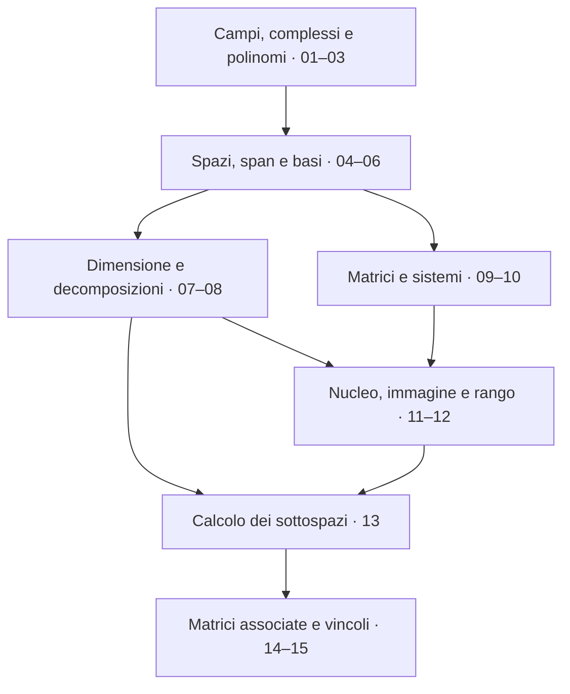

# Geometria I — Dalle coordinate alle trasformazioni

Questo libro rielabora **tutte le 15 note e le 15 trascrizioni di Geometria 1 disponibili al 4 novembre 2026**, dal 23 settembre al 4 novembre. Il filo conduttore è una domanda concreta: come descrivere oggetti e trasformazioni usando poche informazioni, senza perdere ciò che serve per ricostruirli? Le coordinate, le basi, la riduzione di un sistema e le matrici associate rispondono a questa domanda in modi diversi ma collegati.

Il percorso segue le dipendenze fra le idee. Le lezioni tornano più volte sugli stessi concetti; qui quelle riprese diventano un'esposizione progressiva. Prima impariamo a riconoscere gli oggetti e a formulare domande precise; poi scegliamo riferimenti e misuriamo le libertà disponibili; infine costruiamo strumenti di calcolo e rappresentiamo le trasformazioni.

Ogni capitolo intreccia spiegazioni pratiche, definizioni rigorose, dimostrazioni motivate, esempi e controesempi, avvertenze ed esercizi con riscontri richiudibili. Le fonti originarie e le correzioni sono documentate in [[Books/Geometria-I/90 - Fonti e criteri editoriali|fonti e criteri editoriali]]. I termini si ritrovano nel [[Books/Geometria-I/91 - Glossario|glossario]].

## Come studiare

Puoi seguire due ingressi. Per costruire l'intuizione, leggi il problema iniziale e prova a prevedere la risposta prima della definizione. Per verificare ciò che sai già, parti dalla tabella «Domande per iniziare dagli esercizi»: tenta il problema e apri la sezione di teoria soltanto quando sai identificare ciò che manca.

Ogni capitolo segue questo percorso: **prerequisiti → obiettivi → domande guida → esercizi → teoria → fonti → riscontri richiudibili**. Gli enunciati precedono la teoria per favorire un tentativo personale; i riscontri sono raccolti alla fine del capitolo. Il percorso di studio è domanda → tentativo → concetto → nuovo tentativo → controllo. Gli esempi svolti dentro la teoria servono a imparare il ragionamento; gli esercizi richiedono di riutilizzarlo autonomamente.

Per ogni dimostrazione, scrivi prima le ipotesi e ciò che vuoi ottenere. A ogni passaggio chiediti quale definizione o risultato lo autorizza. Un calcolo corretto non sostituisce la spiegazione del perché un metodo funzioni; una buona intuizione deve diventare una catena di implicazioni controllabili.

Un capitolo è acquisito quando sai rispondere alle domande iniziali, risolvere gli esercizi senza aprire i riscontri e spiegare perché le ipotesi sono necessarie. Se sbagli, individua il primo passaggio non giustificato e riparti da lì. Le avvertenze raccolgono errori effettivamente discussi nelle lezioni e ulteriori controlli redazionali, distinti nelle fonti dei capitoli.

### Domande da cui partire

| Capitolo | Domanda di ingresso | Prerequisiti |
|---|---|---|
| [[Books/Geometria-I/01 - Il linguaggio della geometria e i campi\|01 - Il linguaggio della geometria e i campi]] | Come si scrive una condizione senza ambiguità? | Nessuno |
| [[Books/Geometria-I/02 - Numeri complessi e geometria del piano\|02 - Numeri complessi e geometria del piano]] | Come può una moltiplicazione diventare una rotazione? | 01 |
| [[Books/Geometria-I/03 - Polinomi radici e fattorizzazioni\|03 - Polinomi radici e fattorizzazioni]] | Che cosa ci dice una radice sulla forma di un polinomio? | 01, 02 |
| [[Books/Geometria-I/04 - Spazi vettoriali e operazioni lineari\|04 - Spazi vettoriali e operazioni lineari]] | Che cosa hanno in comune frecce, polinomi, matrici e funzioni? | 01; 02, 03 per alcuni esempi |
| [[Books/Geometria-I/05 - Sottospazi e combinazioni lineari\|05 - Sottospazi e combinazioni lineari]] | Qual è il più piccolo spazio che contiene i vettori dati? | 04 |
| [[Books/Geometria-I/06 - Indipendenza basi e coordinate\|06 - Indipendenza basi e coordinate]] | Quando una descrizione esiste ed è unica? | 05 |
| [[Books/Geometria-I/07 - Dimensione scambio e completamento\|07 - Dimensione scambio e completamento]] | Perché tutte le basi finite hanno lo stesso numero di vettori? | 06 |
| [[Books/Geometria-I/08 - Somme dirette e decomposizioni\|08 - Somme dirette e decomposizioni]] | Quando puoi scomporre un vettore in modo unico? | 07 |
| [[Books/Geometria-I/09 - Matrici e sistemi lineari\|09 - Matrici e sistemi lineari]] | Come diventano le equazioni una combinazione di colonne? | 06; 03 per esempi polinomiali |
| [[Books/Geometria-I/10 - Il metodo di Gauss\|10 - Il metodo di Gauss]] | Come puoi semplificare un sistema senza perderne le soluzioni? | 09 |
| [[Books/Geometria-I/11 - Applicazioni lineari nucleo e immagine\|11 - Applicazioni lineari nucleo e immagine]] | Quale informazione si perde e quali risultati si raggiungono? | 07, 09; 10 per il calcolo |
| [[Books/Geometria-I/12 - Rango invertibilità e matrici elementari\|12 - Rango invertibilità e matrici elementari]] | Come riconosci una trasformazione reversibile? | 10, 11 |
| [[Books/Geometria-I/13 - Calcolare basi somme e intersezioni\|13 - Calcolare basi somme e intersezioni]] | Quale descrizione di un sottospazio rende più semplice il problema? | 08, 10, 11, 12 |
| [[Books/Geometria-I/14 - Matrici associate e composizione\|14 - Matrici associate e composizione]] | Come traduci una trasformazione tra spazi astratti in un calcolo? | 06, 11, 12, 13 |
| [[Books/Geometria-I/15 - Basi adattate e spazi di applicazioni\|15 - Basi adattate e spazi di applicazioni]] | Come si trasforma un vincolo geometrico in un blocco di zeri? | 08, 14 |

### Come leggere i blocchi

> [!info] In questo capitolo
> Gli obiettivi dicono quali problemi saprai affrontare, non soltanto quali parole incontrerai.

> [!abstract] Concetto chiave
> Isola una definizione o un risultato e il suo ruolo nel percorso. Non sostituisce la dimostrazione: serve a ritrovare il punto da cui ricostruirla.

> [!example] Esempi e controesempi
> Confrontano ciò che soddisfa una definizione e ciò che fallisce una sua condizione. Cerca sempre l'ipotesi precisa che cambia il risultato.

> [!warning] Attenzione
> Segnala un passaggio fragile o un errore frequente. I richiami ai docenti hanno un riferimento alla lezione; le ulteriori cautele sono redazionali.

I riscontri degli esercizi sono blocchi richiudibili: aprili dopo un tentativo e confronta ragionamento, ipotesi e risultato. Un riscontro breve non rende superflua la dimostrazione completa richiesta nell'enunciato.

## La mappa del percorso

Il percorso si biforca quando possediamo le basi: possiamo studiare le dimensioni e le decomposizioni oppure imparare a risolvere sistemi. I due rami si riuniscono quando nucleo e immagine spiegano il significato dei calcoli.

- **[[Books/Geometria-I/01 - Il linguaggio della geometria e i campi|01 - Il linguaggio della geometria e i campi]].** Insiemi, quantificatori, prove, funzioni, composizione, inversa; campi e primi esempi, incluso il campo con due elementi.
- **[[Books/Geometria-I/02 - Numeri complessi e geometria del piano|02 - Numeri complessi e geometria del piano]].** Costruzione dei complessi, coniugio e modulo, inverso, forma polare, potenze e radici ennesime.
- **[[Books/Geometria-I/03 - Polinomi radici e fattorizzazioni|03 - Polinomi radici e fattorizzazioni]].** Polinomi formali, divisione e fattore, induzione, teorema fondamentale ammesso, molteplicità, coniugate e derivata.
- **[[Books/Geometria-I/04 - Spazi vettoriali e operazioni lineari|04 - Spazi vettoriali e operazioni lineari]].** Motivazione geometrica, assiomi, conseguenze e varietà degli esempi; il campo è parte della struttura.
- **[[Books/Geometria-I/05 - Sottospazi e combinazioni lineari|05 - Sottospazi e combinazioni lineari]].** Criterio di sottospazio, intersezione e unione, span finito e infinito, descrizioni mediante equazioni e generatori.
- **[[Books/Geometria-I/06 - Indipendenza basi e coordinate|06 - Indipendenza basi e coordinate]].** Relazioni lineari, ridondanza, basi e coordinate ordinate; campo degli scalari e supporto finito.
- **[[Books/Geometria-I/07 - Dimensione scambio e completamento|07 - Dimensione scambio e completamento]].** Lemma di scambio, esistenza e cardinalità delle basi, dimensione, estrazione e completamento, criteri numerici.
- **[[Books/Geometria-I/08 - Somme dirette e decomposizioni|08 - Somme dirette e decomposizioni]].** Somma, formula di Grassmann, supplementari, somme dirette di più sottospazi, matrici simmetriche e antisimmetriche.
- **[[Books/Geometria-I/09 - Matrici e sistemi lineari|09 - Matrici e sistemi lineari]].** Operazioni sulle matrici, prodotto e trasposta, sistemi Ax=b, matrici complete, interpretazioni geometriche.
- **[[Books/Geometria-I/10 - Il metodo di Gauss|10 - Il metodo di Gauss]].** Operazioni reversibili, forma a scala, pivot, variabili libere, soluzioni particolari e omogenee, parametri.
- **[[Books/Geometria-I/11 - Applicazioni lineari nucleo e immagine|11 - Applicazioni lineari nucleo e immagine]].** Linearità, nucleo, immagine, iniettività, fibre come traslati e teorema rango-nullità.
- **[[Books/Geometria-I/12 - Rango invertibilità e matrici elementari|12 - Rango invertibilità e matrici elementari]].** Rouché-Capelli, rango per righe e colonne, matrici elementari, invertibilità, gruppo lineare, equivalenze e forma ridotta.
- **[[Books/Geometria-I/13 - Calcolare basi somme e intersezioni|13 - Calcolare basi somme e intersezioni]].** Basi da equazioni e generatori, colonne pivot originali, passaggi fra descrizioni, completamenti, somme e intersezioni.
- **[[Books/Geometria-I/14 - Matrici associate e composizione|14 - Matrici associate e composizione]].** Valori su una base, matrice associata, ritorno dalle coordinate ai vettori, esempio del commutatore, composizione e raccordo sul cambio di base.
- **[[Books/Geometria-I/15 - Basi adattate e spazi di applicazioni|15 - Basi adattate e spazi di applicazioni]].** Spazio delle applicazioni lineari, dimensione, basi elementari, vincoli su sottospazi, nucleo e immagine, matrici a blocchi.

## La mappa delle strutture

| Oggetto | Che cosa varia | Struttura e significato | Dove studiarlo |
|---|---|---|---|
| Campo $K$ | Somme, prodotti e divisioni per non nulli | L'ambiente dei coefficienti; non tutti i campi hanno le abitudini dei reali | [[Books/Geometria-I/01 - Il linguaggio della geometria e i campi\|01]] |
| Complessi $\mathbb C$ | Modulo e argomento | Un campo il cui prodotto ruota e dilata il piano | [[Books/Geometria-I/02 - Numeri complessi e geometria del piano\|02]] |
| Polinomi $K[t]$ | Coefficienti a supporto finito | Oggetti formali; radici e fattori descrivono aspetti diversi dello stesso oggetto | [[Books/Geometria-I/03 - Polinomi radici e fattorizzazioni\|03]] |
| Spazio $V$ e sottospazio $U$ | Combinazioni lineari | Ciò che possiamo costruire usando coefficienti in $K$ | [[Books/Geometria-I/04 - Spazi vettoriali e operazioni lineari\|04]] · [[Books/Geometria-I/05 - Sottospazi e combinazioni lineari\|05]] |
| Base e coordinate | Scelta del riferimento | Esistenza e unicità di una descrizione; la dimensione misura quante informazioni indipendenti servono | [[Books/Geometria-I/06 - Indipendenza basi e coordinate\|06]] · [[Books/Geometria-I/07 - Dimensione scambio e completamento\|07]] |
| Somma diretta | Componenti in sottospazi | Decomposizione senza ambiguità | [[Books/Geometria-I/08 - Somme dirette e decomposizioni\|08]] |
| Matrice e sistema | Colonne, equazioni e incognite | Due letture dello stesso problema: generare un termine noto e soddisfare vincoli | [[Books/Geometria-I/09 - Matrici e sistemi lineari\|09]] · [[Books/Geometria-I/10 - Il metodo di Gauss\|10]] |
| Applicazione $F:V\to W$ | Vettori del dominio | Nucleo e immagine misurano perdita e raggiungibilità; rango-nullità ne collega le dimensioni | [[Books/Geometria-I/11 - Applicazioni lineari nucleo e immagine\|11]] |
| Matrici invertibili | Trasformazioni reversibili | Gauss, rango e operazioni elementari riconoscono e costruiscono l'inversa | [[Books/Geometria-I/12 - Rango invertibilità e matrici elementari\|12]] |
| Sottospazi e spazi di applicazioni | Descrizioni e vincoli | Le basi traducono i problemi in coefficienti e blocchi, conservando il significato degli oggetti | [[Books/Geometria-I/13 - Calcolare basi somme e intersezioni\|13]] · [[Books/Geometria-I/14 - Matrici associate e composizione\|14]] · [[Books/Geometria-I/15 - Basi adattate e spazi di applicazioni\|15]] |

## I pilastri del libro

**Esistenza e unicità sono domande diverse.** Generare significa poter costruire ogni vettore; essere indipendenti significa non avere descrizioni diverse dello stesso vettore. Una base riunisce entrambe le richieste. Ritroverai questa distinzione nelle inverse, nelle soluzioni dei sistemi e nelle decomposizioni dirette.

**La rappresentazione cambia, l'oggetto rimane riconoscibile.** Un vettore e la sua colonna di coordinate non sono lo stesso tipo di oggetto. Una matrice dipende dalle basi con cui descrive un'applicazione. Un'operazione di riga deve essere interpretata attraverso ciò che conserva: soluzioni, relazioni, dimensioni, non ogni sottoinsieme coinvolto.

**Le ipotesi autorizzano i passaggi.** Una divisione richiede uno scalare non nullo; una formula dimensionale richiede le condizioni dichiarate; il numero di soluzioni dipende anche dal campo. Gli esempi limite aiutano a capire perché un enunciato abbia proprio quella forma.

**Un metodo di calcolo deve avere una ragione.** La reversibilità giustifica Gauss; l'indipendenza giustifica la lettura dei parametri; il completamento di una base giustifica rango-nullità. Il libro collega ogni procedura a una proprietà già dimostrata.

## Parte I — Dare un significato ai simboli

Il capitolo 01 costruisce gli strumenti per leggere definizioni e prove e chiarisce che cosa intendiamo per campo degli scalari. Il 02 mostra come un calcolo algebrico abbia una geometria concreta nel piano complesso. Il 03 usa questi numeri per comprendere radici e fattorizzazioni. Qui il teorema fondamentale dell'algebra è assunto come nel corso; la fattorizzazione che ne consegue viene invece dimostrata.

## Parte II — Descrivere gli oggetti senza ridondanza

Dagli spostamenti del piano passiamo a spazi di polinomi, matrici e funzioni. Una combinazione lineare descrive ciò che possiamo costruire; l'indipendenza riconosce le informazioni ridondanti; una base garantisce descrizioni esistenti e uniche. Solo dopo il lemma di scambio definiamo la dimensione. La somma diretta usa questi strumenti per separare un oggetto in componenti e capire quando la separazione sia unica.

## Parte III — Trasformare le idee in procedure

Matrici e sistemi traducono equazioni e combinazioni di vettori nello stesso linguaggio. Gauss fornisce una procedura reversibile. Nucleo e immagine spiegano perché quella procedura misura libertà e vincoli; il rango collega le due letture. Il capitolo 13 riunisce i metodi per scegliere la descrizione conveniente di un sottospazio, con esempi completi di conversione, somma e intersezione.

## Parte IV — Rappresentare e progettare trasformazioni

Una trasformazione lineare è determinata dalle immagini di una base. La sua matrice registra queste immagini in coordinate; la composizione spiega l'ordine del prodotto matriciale. Infine, basi adattate ai sottospazi traducono vincoli geometrici in coefficienti obbligatoriamente nulli e permettono di contare i gradi di libertà di interi spazi di applicazioni.

## Convenzioni di lettura

$K$ indica un campo con $0\ne1$; $\mathbb N=\{0,1,2,\ldots\}$. Il campo è parte della struttura: gli stessi elementi possono avere proprietà di indipendenza diverse su $\mathbb R$ e su $\mathbb C$. Le coordinate sono colonne, riferite a basi ordinate. $K[t]_{\le d}$ comprende il polinomio nullo e i polinomi di grado al più $d$; $M_{m,n}(K)$ è lo spazio delle matrici con $m$ righe e $n$ colonne. Nelle combinazioni lineari si usano sempre somme finite, anche se l'insieme dei generatori è infinito.

Il percorso principale riguarda la dimensione finita. Gli esempi infiniti servono a chiarire supporto finito e differenza fra polinomi e funzioni; non richiedono teoremi di esistenza di basi arbitrarie. Sui campi finiti, avere parametri liberi non significa avere infinite soluzioni: il numero viene precisato quando occorre.

## Perimetro del libro e integrazioni

Questa è un'esposizione completa del **materiale attualmente disponibile**, non dell'intero futuro programma di Geometria I. Prodotti scalari e coniche sono annunciati nelle lezioni introduttive ma non sviluppati nel corpus; determinanti e autovalori non sono prerequisiti impliciti dei capitoli.

Gli esempi, gli esercizi e i riscontri sono rielaborazioni didattiche. I raccordi aggiunti per rendere il percorso autonomo sono segnalati nelle fonti: fra questi la prova della formula per la matrice della composizione, la giustificazione della forma ridotta e un breve passaggio sul cambio di base. Quest'ultimo è un'anticipazione redazionale, perché nelle lezioni disponibili viene soltanto annunciato.

## Tre momenti di verifica

1. **Dopo il capitolo 03:** risolvi un'equazione complessa in due modi quando possibile, distingui radici distinte e molteplicità, prova il criterio del fattore e spiega dove entra il teorema fondamentale dell'algebra. Devi saper controllare un calcolo e leggere correttamente le sue ipotesi.
2. **Dopo il capitolo 08:** descrivi uno stesso sottospazio mediante generatori e condizioni, costruisci una base senza presumere la dimensione, ricostruisci il lemma di scambio e la formula di Grassmann, e riconosci quando una decomposizione è unica.
3. **Dopo il capitolo 15:** parti da un sistema o da un'applicazione tra spazi di polinomi o matrici. Scegli basi, imposta Gauss, ricostruisci nucleo e immagine negli oggetti originali, verifica rango-nullità e traduci un vincolo su sottospazi in un blocco di coefficienti nulli.

In ogni verifica includi una domanda teorica e un controesempio: riuscire in un calcolo senza saper riconoscere un'ipotesi mancante non basta per proseguire con sicurezza.

## Checklist di avanzamento

Spunta un capitolo quando sai risolverne gli esercizi e ricostruire le prove senza leggere i riscontri.

- [ ] [[Books/Geometria-I/01 - Il linguaggio della geometria e i campi|01 - Il linguaggio della geometria e i campi]]
- [ ] [[Books/Geometria-I/02 - Numeri complessi e geometria del piano|02 - Numeri complessi e geometria del piano]]
- [ ] [[Books/Geometria-I/03 - Polinomi radici e fattorizzazioni|03 - Polinomi radici e fattorizzazioni]]
- [ ] [[Books/Geometria-I/04 - Spazi vettoriali e operazioni lineari|04 - Spazi vettoriali e operazioni lineari]]
- [ ] [[Books/Geometria-I/05 - Sottospazi e combinazioni lineari|05 - Sottospazi e combinazioni lineari]]
- [ ] [[Books/Geometria-I/06 - Indipendenza basi e coordinate|06 - Indipendenza basi e coordinate]]
- [ ] [[Books/Geometria-I/07 - Dimensione scambio e completamento|07 - Dimensione scambio e completamento]]
- [ ] [[Books/Geometria-I/08 - Somme dirette e decomposizioni|08 - Somme dirette e decomposizioni]]
- [ ] [[Books/Geometria-I/09 - Matrici e sistemi lineari|09 - Matrici e sistemi lineari]]
- [ ] [[Books/Geometria-I/10 - Il metodo di Gauss|10 - Il metodo di Gauss]]
- [ ] [[Books/Geometria-I/11 - Applicazioni lineari nucleo e immagine|11 - Applicazioni lineari nucleo e immagine]]
- [ ] [[Books/Geometria-I/12 - Rango invertibilità e matrici elementari|12 - Rango invertibilità e matrici elementari]]
- [ ] [[Books/Geometria-I/13 - Calcolare basi somme e intersezioni|13 - Calcolare basi somme e intersezioni]]
- [ ] [[Books/Geometria-I/14 - Matrici associate e composizione|14 - Matrici associate e composizione]]
- [ ] [[Books/Geometria-I/15 - Basi adattate e spazi di applicazioni|15 - Basi adattate e spazi di applicazioni]]

---

Inizia da [[Books/Geometria-I/01 - Il linguaggio della geometria e i campi|01 - Il linguaggio della geometria e i campi]].
