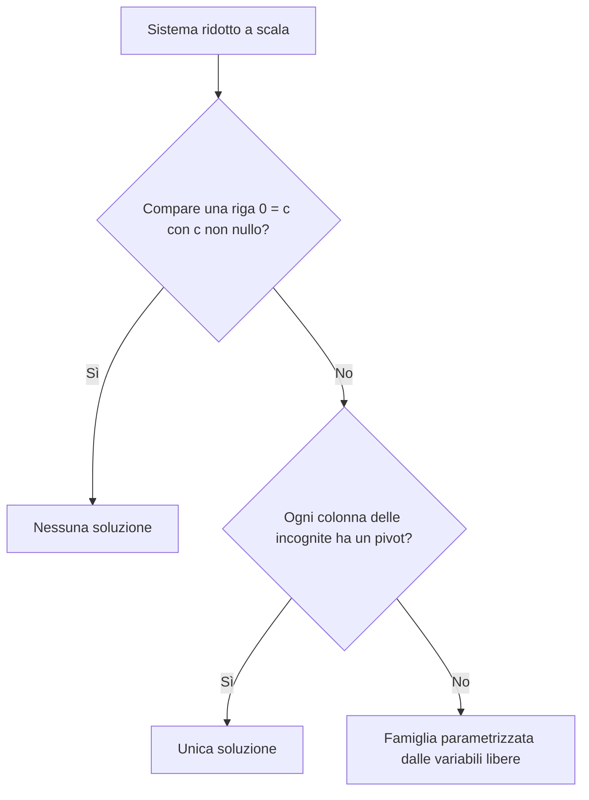

# Il metodo di Gauss

Prerequisiti: [[Books/Geometria-I/09 - Matrici e sistemi lineari|matrici, prodotto matrice-vettore e sistemi lineari]], [[Books/Geometria-I/06 - Indipendenza basi e coordinate|indipendenza e basi]] e [[Books/Geometria-I/07 - Dimensione scambio e completamento|dimensione e criteri per una base]]. Torna all'[[Books/Geometria-I/00 - Indice e piano di studio|indice e piano di studio]].

> [!info] In questo capitolo
> - Trasformerai un sistema in uno più semplice usando operazioni che ne conservano **esattamente le soluzioni**.
> - Imparerai a costruire e leggere una **matrice a scala**, distinguendo pivot, variabili libere e colonna dei termini noti.
> - Descriverai tutte le soluzioni mediante una soluzione particolare e una base delle soluzioni dell'omogenea.
> - Dimostrerai perché il numero dei parametri è $n-r$, dove $r$ è il numero dei pivot nelle colonne delle incognite.
> - Gestirai i valori eccezionali dei parametri e controllerai i risultati nel sistema originario, anche quando il campo è finito.

## Domande per iniziare dagli esercizi

Tenta prima l'esercizio collegato. Quando un passaggio non è chiaro, recupera la sezione indicata e poi riprendi il problema senza leggere il riscontro. In questo capitolo è importante distinguere due verifiche: un'operazione conserva davvero le soluzioni? La famiglia che hai scritto le descrive davvero tutte?

| Domanda guida | Esercizi da tentare | Teoria da recuperare |
|---|---|---|
| Come elimini un'equazione senza cancellare un'informazione utile? | [[#Esercizio 1 — Una mossa può perdere un vincolo (equivalenza)\|1]], [[#Esercizio 3 — Costruire la scala prima di risolvere (eliminazione)\|3]] | [[#Eliminare una dipendenza senza perdere un vincolo\|Il problema iniziale]] |
| Perché le tre mosse di riga sono reversibili e quando non lo sono? | [[#Esercizio 1 — Una mossa può perdere un vincolo (equivalenza)\|1]] | [[#Tre operazioni reversibili\|Le mosse e le loro inverse]] |
| Come riconosci pivot e variabili libere senza risolvere il sistema? | [[#Esercizio 2 — Leggere anche le colonne saltate (forma a scala)\|2]] | [[#Leggere una matrice a scala\|La forma da cercare]] |
| Perché Gauss termina e perché salta certe colonne? | [[#Esercizio 3 — Costruire la scala prima di risolvere (eliminazione)\|3]], [[#Esercizio 12 — Che cosa dimostra il numero dei pivot (prove e limiti)\|12]] | [[#L'algoritmo che costruisce la scala\|L'algoritmo e il suo invariante]] |
| Come distingui nessuna soluzione, una sola e una famiglia? | [[#Esercizio 4 — Uno zero a sinistra non basta (incompatibilità)\|4]], [[#Esercizio 5 — Nessun coefficiente da eliminare (casi limite)\|5]] | [[#Risolvere dalla fine e riconoscere le possibilità\|Sostituzione e compatibilità]] |
| Che cosa separa una soluzione particolare dalle direzioni libere? | [[#Esercizio 7 — Spostare il punto di partenza (particolare e omogenea)\|7]], [[#Esercizio 11 — Controllare la famiglia e non solo un punto (verifica)\|11]] | [[#Una soluzione particolare più le libertà dell'omogenea\|La struttura delle soluzioni]] |
| Perché i vettori ricavati dai parametri formano una base e quante soluzioni ottieni? | [[#Esercizio 6 — Dai parametri ai vettori (base dell'omogenea)\|6]], [[#Esercizio 8 — Quattro soluzioni sono già tutte (campo finito)\|8]], [[#Esercizio 12 — Che cosa dimostra il numero dei pivot (prove e limiti)\|12]] | [[#Dalle variabili libere a una base\|Base, dimensione e conteggio]] |
| Come eviti di perdere i valori che annullano un divisore? | [[#Esercizio 9 — Due valori richiedono attenzione (sistema con parametro)\|9]] | [[#Quando i coefficienti contengono un parametro\|Separare i casi prima di dividere]] |
| Che cosa conservano le operazioni sulle righe e che cosa possono cambiare? | [[#Esercizio 10 — Le colonne si muovono ma le relazioni restano (invarianti)\|10]] | [[#Che cosa rimane uguale fra righe e colonne\|Span e relazioni]] |
| Come controlli correttezza e completezza della risposta? | [[#Esercizio 11 — Controllare la famiglia e non solo un punto (verifica)\|11]], [[#Esercizio 12 — Che cosa dimostra il numero dei pivot (prove e limiti)\|12]] | [[#Verificare e scegliere il passo successivo\|Il controllo finale]] |

## Esercizi per verificare la comprensione

Gli esercizi 1–5 allenano la riduzione e la lettura della scala; 6–8 ricostruiscono lo spazio delle soluzioni; 9–12 mettono alla prova le ipotesi e il controllo del metodo. Gli enunciati e i riscontri sono redazionali. Scrivi le operazioni effettuate e controlla ogni risultato nel sistema iniziale.

### Esercizio 1 — Una mossa può perdere un vincolo (equivalenza)

Parti dal sistema reale $x+y=1$, $x-y=3$. Classifica le seguenti modifiche, considerate separatamente a partire dal sistema originario: scambiare le equazioni; moltiplicare la seconda per $-2$; sostituire la seconda con la seconda meno la prima; sostituire la seconda con $0=0$; sommare la prima alla seconda modificando soltanto i coefficienti e lasciando il termine noto uguale a $3$.

Per ogni trasformazione lecita indica l'inversa; per quelle non equivalenti mostra che le soluzioni cambiano. Perché la regola $R_i\leftarrow R_i+\lambda R_j$ richiede $i\ne j$? Che cosa accade se prendi $j=i$ e $\lambda=-1$?

Se ti blocchi: [[#Eliminare una dipendenza senza perdere un vincolo|il problema iniziale]] · [[#Tre operazioni reversibili|le mosse e le loro inverse]].

Controllo dopo il tentativo: [[#Riscontro 1|riscontro 1]].

### Esercizio 2 — Leggere anche le colonne saltate (forma a scala)

Sul campo reale considera la matrice completa

$$
\left(\begin{array}{ccccc|c}
0&2&1&-1&3&4\\
0&0&0&-3&6&3\\
0&0&0&0&0&0
\end{array}\right).
$$

Indica i pivot, le variabili libere e il numero dei parametri senza effettuare nuove operazioni di riga. Risolvi il sistema scegliendo $x_1=t$, $x_3=s$, $x_5=u$. Spiega perché una variabile libera può precedere la prima variabile pivot e perché un pivot non deve essere uguale a $1$.

Se ti blocchi: [[#Leggere una matrice a scala|la forma a scala]] · [[#Risolvere dalla fine e riconoscere le possibilità|sostituzione all'indietro]].

Controllo dopo il tentativo: [[#Riscontro 2|riscontro 2]].

### Esercizio 3 — Costruire la scala prima di risolvere (eliminazione)

Risolvi con Gauss il sistema reale

$$
\begin{cases}
x_2+x_3=3,\\
x_1+x_2=3,\\
2x_1+3x_2+2x_3=10.
\end{cases}
$$

Scegli una prima mossa che eviti di usare uno zero come pivot, annota ogni operazione e verifica la soluzione nelle tre equazioni originarie. Descrivi poi il procedimento generale: quale colonna cerchi nel blocco attivo, perché la divisione usata per eliminare è lecita e perché il lavoro già fatto rimane valido?

Se ti blocchi: [[#L'algoritmo che costruisce la scala|costruzione della scala]].

Controllo dopo il tentativo: [[#Riscontro 3|riscontro 3]].

### Esercizio 4 — Uno zero a sinistra non basta (incompatibilità)

Studia il sistema reale

$$
x_1-x_2+2x_3=1,\qquad
2x_1-2x_2+4x_3=3.
$$

Che cosa appare dopo $R_2\leftarrow R_2-2R_1$? Perché non puoi trattare quella riga come un'equazione ridondante? Ripeti il ragionamento sostituendo il termine noto $3$ con $2$: quante variabili libere rimangono e qual è la soluzione generale?

Se ti blocchi: [[#Risolvere dalla fine e riconoscere le possibilità|righe nulle e contraddizioni]].

Controllo dopo il tentativo: [[#Riscontro 4|riscontro 4]].

### Esercizio 5 — Nessun coefficiente da eliminare (casi limite)

Sia $A$ la matrice nulla $3\times4$ su un campo $K$. Descrivi le soluzioni di $Ax=b$ nei due casi $b=0$ e $b\ne0$. Quanti pivot e quanti parametri ci sono nel caso compatibile? Se $K$ ha $q$ elementi, quante sono le soluzioni?

Spiega anche che cosa significa un sistema senza equazioni e che cosa significa un sistema senza incognite. Nell'ultimo caso quando la tupla vuota è una soluzione?

Se ti blocchi: [[#Risolvere dalla fine e riconoscere le possibilità|i casi limite]] · [[#Dalle variabili libere a una base|conteggio delle soluzioni]].

Controllo dopo il tentativo: [[#Riscontro 5|riscontro 5]].

### Esercizio 6 — Dai parametri ai vettori (base dell'omogenea)

Su un campo qualsiasi $K$, risolvi

$$
\begin{cases}
x_1+2x_2-x_3=0,\\
x_3-2x_4=0.
\end{cases}
$$

Usa $x_2,x_4$ come parametri e trova una base dello spazio delle soluzioni. Dimostra generazione e indipendenza leggendo le coordinate libere. La dimostrazione rimane valida se $1+1=0$ in $K$? Spiega in generale perché un sistema omogeneo con $n$ incognite e $r$ pivot ha uno spazio delle soluzioni di dimensione $n-r$.

Se ti blocchi: [[#Dalle variabili libere a una base|costruire e giustificare la base]].

Controllo dopo il tentativo: [[#Riscontro 6|riscontro 6]].

### Esercizio 7 — Spostare il punto di partenza (particolare e omogenea)

Sul campo reale considera

$$
x_1+x_2+x_3=2,\qquad x_2-x_3=0.
$$

Trova una soluzione particolare e una base delle soluzioni dell'omogenea. Verifica che $(0,1,1)$ è un'altra soluzione particolare e descrivi la stessa famiglia partendo da essa. Prova in generale entrambe le inclusioni nell'identità «soluzioni del non omogeneo = una particolare + soluzioni dell'omogeneo». L'insieme ottenuto in questo esempio è un sottospazio di $\mathbb R^3$?

Se ti blocchi: [[#Una soluzione particolare più le libertà dell'omogenea|particolare e direzioni libere]].

Controllo dopo il tentativo: [[#Riscontro 7|riscontro 7]].

### Esercizio 8 — Quattro soluzioni sono già tutte (campo finito)

In $\mathbb F_2$, dove $1+1=0$, risolvi

$$
x_1+x_2+x_4=1,\qquad x_2+x_3=0.
$$

Parametrizza le soluzioni e scrivile tutte. Perché non sono infinite, benché ci siano variabili libere? Dimostra il conteggio generale $q^{n-r}$ per un sistema compatibile su un campo con $q$ elementi, spiegando perché ogni scelta dei parametri produce una soluzione diversa.

Se ti blocchi: [[#Dalle variabili libere a una base|parametri e cardinalità]].

Controllo dopo il tentativo: [[#Riscontro 8|riscontro 8]].

### Esercizio 9 — Due valori richiedono attenzione (sistema con parametro)

Per $a\in\mathbb R$ studia

$$
\begin{cases}
x+y+z=1,\\
x+ay+z=a,\\
x+y+(a+1)z=2.
\end{cases}
$$

Inizia con operazioni valide per ogni $a$; distingui tutti i casi prima di dividere. In quali casi hai una soluzione unica, nessuna soluzione o una famiglia? Controlla le risposte nelle equazioni originarie.

Uno studente cancella il fattore $a-1$ dall'equazione $(a-1)y=a-1$ e conclude $y=1$ per ogni $a$. Quale insieme di soluzioni rischia di perdere?

Se ti blocchi: [[#Quando i coefficienti contengono un parametro|separare i casi]].

Controllo dopo il tentativo: [[#Riscontro 9|riscontro 9]].

### Esercizio 10 — Le colonne si muovono ma le relazioni restano (invarianti)

Siano

$$
A=\begin{pmatrix}1&0\\1&0\end{pmatrix},
\qquad
S=\begin{pmatrix}1&0\\0&0\end{pmatrix},
$$

con $S$ ottenuta da $A$ mediante $R_2\leftarrow R_2-R_1$. Confronta gli span delle righe e quelli delle colonne. Risolvi $Ac=0$ e $Sc=0$ e interpreta il risultato come conservazione delle relazioni fra le colonne.

Dimostra in generale che una mossa elementare conserva lo span delle righe e che $Ac=0$ equivale a $Sc=0$ dopo qualsiasi successione di mosse di riga. Perché le nuove colonne non sono, in generale, vettori utilizzabili come base dello span delle colonne originarie?

Se ti blocchi: [[#Che cosa rimane uguale fra righe e colonne|span e relazioni]].

Controllo dopo il tentativo: [[#Riscontro 10|riscontro 10]].

### Esercizio 11 — Controllare la famiglia e non solo un punto (verifica)

Per il sistema reale

$$
x_1-2x_2+x_3=3,\qquad x_2+x_3=1,
$$

uno studente propone

$$
x(t)=(5-t,\ 1-t,\ t).
$$

La scelta $t=0$ supera la verifica. Questo basta? Sostituisci la famiglia con $t$ arbitrario, individua il vettore direttore errato e correggilo. Formula poi il controllo di una risposta scritta come $x_p+\sum_jt_jh_j$: che cosa devi verificare su $x_p$, su ogni $h_j$ e sulla completezza della parametrizzazione?

Se ti blocchi: [[#Una soluzione particolare più le libertà dell'omogenea|particolare e omogenea]] · [[#Verificare e scegliere il passo successivo|verifica e completezza]].

Controllo dopo il tentativo: [[#Riscontro 11|riscontro 11]].

### Esercizio 12 — Che cosa dimostra il numero dei pivot (prove e limiti)

Una matrice $m\times n$ viene portata a scala mediante due successioni diverse di mosse elementari. Dimostra che il numero dei pivot è lo stesso nelle due forme usando lo spazio delle soluzioni dell'omogenea e la sua dimensione, senza presupporre un teorema sul rango.

Deduci che $m<n$ garantisce una soluzione non nulla dell'omogeneo su ogni campo. Per il non omogeneo, quella disuguaglianza garantisce l'esistenza di soluzioni? Infine, quando le colonne della matrice sono indipendenti? Motiva ogni risposta con le variabili libere.

Se ti blocchi: [[#Dalle variabili libere a una base|dimensione e numero dei pivot]] · [[#Verificare e scegliere il passo successivo|ciò che il metodo permette di decidere]].

Controllo dopo il tentativo: [[#Riscontro 12|riscontro 12]].

## Teoria da recuperare

Usa la tabella iniziale per tornare al passaggio che manca al tentativo. Il metodo sarà sviluppato in questo ordine: mosse reversibili, forma a scala, costruzione della scala, lettura delle soluzioni e giustificazione dei parametri. I risultati sul rango verranno collegati a questa procedura nei capitoli successivi.

## Eliminare una dipendenza senza perdere un vincolo

Supponi di sapere che

$$
x+y=2,\qquad 2x+2y=4.
$$

La seconda equazione non aggiunge un vincolo: dice due volte ciò che dice la prima. Sottraendo il doppio della prima dalla seconda otteniamo

$$
x+y=2,\qquad 0=0.
$$

Il sistema è più leggibile. Ora vediamo che possiamo scegliere liberamente $y$ e ricavare $x=2-y$.

Se invece il secondo termine noto fosse $5$, la stessa sottrazione darebbe $0=1$: nessuna coppia potrebbe soddisfare entrambe le richieste. La differenza fra ridondanza e contraddizione è diventata visibile perché abbiamo confrontato le equazioni.

L'idea di Gauss è ripetere questo confronto in modo organizzato. Eliminiamo un'incognita dalle equazioni successive, poi un'altra e così via, fino a una forma in cui ogni riga utile permette di ricavare una nuova incognita. Ma una trasformazione è utile soltanto se non altera la domanda: **il sistema nuovo deve avere esattamente le soluzioni del sistema iniziale**.

Per questo non basta dire che «le soluzioni vecchie vanno bene anche dopo». Quel verso da solo consente di perdere vincoli e aggiungere soluzioni. Ci servirà anche il ritorno: ogni soluzione nuova deve soddisfare le equazioni vecchie.

## Tre operazioni reversibili

Lavoriamo su un campo $K$, con $A\in M_{m,n}(K)$ e $b\in K^m$. Scriviamo il sistema $Ax=b$ nella sua matrice completa $[A\mid b]$. Una riga rappresenta un'intera equazione, compreso il termine noto. Le mosse ammesse sono tre.

### Scambiare due righe

L'ordine delle equazioni non cambia ciò che devono soddisfare. Lo scambio $R_i\leftrightarrow R_j$ è inverso di sé stesso: rifacendolo torniamo alla situazione iniziale.

### Moltiplicare una riga per uno scalare non nullo

Per $\lambda\in K$, $\lambda\ne0$, sostituiamo

$$
R_i\longleftarrow \lambda R_i.
$$

L'equazione $a_{i1}x_1+\cdots+a_{in}x_n=b_i$ diventa la stessa uguaglianza moltiplicata per $\lambda$. L'inversa moltiplica per $\lambda^{-1}$, che esiste perché $K$ è un campo e $\lambda\ne0$.

La richiesta non è formale. Moltiplicando $x=1$ per zero otteniamo $0=0$: qualunque $x$ soddisfa la nuova equazione, ma soltanto $1$ soddisfaceva la precedente.

### Aggiungere a una riga un multiplo di un'altra

Per $i\ne j$ e per qualsiasi $\lambda\in K$ possiamo eseguire

$$
R_i\longleftarrow R_i+\lambda R_j.
$$

Chi soddisfa le due equazioni soddisfa anche la loro combinazione. Viceversa, la riga $R_j$ è rimasta invariata, quindi dalla nuova equazione possiamo sottrarre $\lambda$ volte $R_j$ e recuperare quella vecchia. L'inversa è

$$
R_i\longleftarrow R_i-\lambda R_j.
$$

Qui $\lambda$ può essere zero: in quel caso la mossa non fa nulla ed è ancora reversibile. La condizione $i\ne j$ evita di trasformare questa regola in un riscalamento potenzialmente nullo. Usando $j=i$ si otterrebbe $(1+\lambda)R_i$, lecito come riscalamento solo se $1+\lambda\ne0$.

> [!abstract] Concetto chiave — L'equivalenza viene dalla reversibilità
> Ogni mossa elementare sulla matrice completa conserva esattamente l'insieme delle soluzioni. Una successione di mosse lo conserva ancora: possiamo ripercorrere le inverse in ordine contrario.

**Esempio svolto.** Da

$$
\left(\begin{array}{cc|c}
1&2&5\\
3&5&13
\end{array}\right)
$$

con $R_2\leftarrow R_2-3R_1$ otteniamo

$$
\left(\begin{array}{cc|c}
1&2&5\\
0&-1&-2
\end{array}\right).
$$

La seconda equazione dà $y=2$, la prima $x=1$. Per tornare al sistema precedente basta aggiungere $3R_1$ alla seconda riga. La soluzione soddisfa infatti $1+2\cdot2=5$ e $3\cdot1+5\cdot2=13$.

> [!warning] Attenzione — Anche il termine noto deve partecipare
> La mossa dell'esempio sottrae $3\cdot5$ anche da $13$. Se modificassi solo i coefficienti, scriveresti $-y=13$ anziché $-y=-2$, cambiando sistema. La riduzione si applica all'intera riga della matrice completa.

## Leggere una matrice a scala

La forma utile per risolvere un sistema somiglia a una scala: a ogni riga il primo coefficiente non nullo si trova più a destra.

Una matrice è **a scala per righe** se:

1. le righe interamente nulle si trovano in fondo;
2. il primo elemento non nullo di ciascuna riga non nulla è più a destra del primo elemento non nullo della riga precedente.

Il primo elemento non nullo di una riga non nulla è il suo **pivot**. La definizione implica che sotto ogni pivot ci siano zeri. Non richiede che il pivot sia $1$, né che sopra di esso ci siano zeri.

Per esempio, sul campo reale,

$$
\left(\begin{array}{cccc|c}
0&2&1&3&4\\
0&0&-3&6&3\\
0&0&0&0&0
\end{array}\right)
$$

è a scala. I pivot sono $2$ e $-3$, nelle colonne $2$ e $3$ della parte dei coefficienti. Le variabili corrispondenti, $x_2$ e $x_3$, sono **variabili pivot**. Le altre, $x_1,x_4$, sono **variabili libere**.

Una colonna senza pivot non deve essere tutta nulla: la quarta colonna dell'esempio ha un coefficiente non nullo, ma nessun primo coefficiente di riga. Dire che la variabile è libera non significa che non compaia nelle equazioni; significa che la potremo scegliere e usare nelle formule delle variabili pivot.

> [!example] Esempi e controesempi — Non basta vedere degli zeri
> Una matrice con pivot $2$ e $-3$ può essere a scala. Invece $\begin{pmatrix}0&1\\1&0\end{pmatrix}$ non lo è: il secondo primo elemento non nullo è più a sinistra del primo. Anche $\begin{pmatrix}0&0\\1&2\end{pmatrix}$ non lo è, perché una riga nulla precede una non nulla. La matrice nulla è a scala e non ha pivot.

### La colonna dei termini noti non è un'incognita

Considera

$$
\left(\begin{array}{cc|c}
1&2&3\\
0&0&1
\end{array}\right).
$$

L'intera matrice completa è a scala e contiene un pivot nell'ultima colonna. Quella colonna non corrisponde a una variabile: la sua riga dice $0=1$.

Quando contiamo le variabili pivot di un sistema, contiamo soltanto i pivot nelle prime $n$ colonne, quelle dei coefficienti. Un pivot nella colonna aggiunta segnala un'ostruzione all'esistenza delle soluzioni, non una nuova incognita da ricavare.

È possibile portare a scala soltanto la parte dei coefficienti effettuando le stesse mosse anche sul termine noto. In quel caso si devono comunque ispezionare tutte le righe con coefficienti nulli: un termine noto non nullo dà subito una contraddizione. Ridurre ulteriormente l'ultima colonna non è necessario per riconoscerla.

## L'algoritmo che costruisce la scala

Finora abbiamo detto quale forma desideriamo. Ora mostriamo che possiamo raggiungerla mediante le sole mosse ammesse.

Descriviamo l'algoritmo per una matrice con $m$ righe e $p$ colonne. Per un sistema possiamo applicarlo alla completa, con $p=n+1$, oppure fermare la ricerca dei pivot alle colonne dei coefficienti e controllare le righe finali.

All'inizio la prima riga è disponibile. Dopo avere fissato alcuni pivot, lavoriamo soltanto con le righe sottostanti e con le colonne a destra dell'ultimo pivot: è il **blocco attivo**.

*Passo 1 — Cercare la prima colonna utile nel blocco attivo.* Se una colonna è tutta nulla fra le righe ancora disponibili, passiamo alla successiva. Non cancelliamo la colonna: registriamo soltanto che non può dare il prossimo pivot. Se tutte le entrate del blocco sono nulle, il lavoro è finito.

*Passo 2 — Portare un elemento non nullo nella prima riga disponibile.* Nella prima colonna utile scegliamo una riga con coefficiente non nullo e la scambiamo con la prima riga del blocco. Indichiamo la posizione del nuovo pivot con $(i,j)$ e il suo valore con $s_{ij}\ne0$.

*Passo 3 — Annullare sotto il pivot.* Per ogni $k>i$ eseguiamo

$$
R_k\longleftarrow R_k-\frac{s_{kj}}{s_{ij}}R_i.
$$

Le entrate sono quelle correnti, prima di questa singola mossa. La nuova entrata in colonna $j$ vale

$$
s_{kj}-\frac{s_{kj}}{s_{ij}}s_{ij}=0.
$$

Il denominatore è non nullo per la scelta del pivot. Non è necessario riscalare la riga per rendere il pivot $1$: possiamo farlo se semplifica i conti, ma non è una condizione dell'algoritmo.

*Passo 4 — Passare al blocco successivo.* Lasciamo fissata la riga $i$ e cerchiamo il prossimo pivot fra le righe successive, nelle colonne a destra di $j$.

### Perché il lavoro precedente rimane valido

Prima di ogni nuovo pivot, le righe del blocco attivo hanno zero nelle colonne dei pivot già scelti e nelle colonne saltate alla loro sinistra. Quando scambiamo due di queste righe o ne sommiamo un multiplo a un'altra, quegli zeri rimangono tali.

Inoltre non modifichiamo più le righe dei pivot precedenti. I primi elementi non nulli delle nuove righe si spostano dunque strettamente verso destra e non distruggono la scala già costruita. Questo è il fatto che rende possibile lavorare su un blocco più piccolo senza rifare l'intero problema.

### Perché il procedimento termina

Ogni pivot utilizza una nuova riga e una nuova colonna più a destra della precedente. Ce ne possono essere al massimo $\min(m,p)$. Fra due pivot si possono saltare soltanto un numero finito di colonne. Quando finiscono le righe o le colonne, oppure rimane un blocco nullo, l'algoritmo termina.

Quando la ricerca comprende tutte le $p$ colonne, le righe non utilizzate sono nulle e stanno sotto quelle con pivot: la matrice ottenuta è a scala. Abbiamo una prova dell'esistenza della forma a scala, non soltanto una ricetta che funziona negli esempi. Se in un sistema ci fermiamo alle colonne dei coefficienti, è quella parte della matrice a essere a scala: nelle righe rimanenti i termini noti vanno ancora controllati, perché potrebbero esprimere $0=c$ con $c\ne0$.

> [!warning] Attenzione — Saltare non significa cancellare
> Nella [[_transcripts/Geometria 1/2026-10-22 - Sistemi lineari e algoritmo di eliminazione di Gauss|lezione del 22 ottobre]] viene chiarito il ruolo del blocco su cui si continua a lavorare. Una colonna dei coefficienti senza pivot rimane nella matrice e continua a rappresentare un'incognita; una riga già sistemata rimane un'equazione da soddisfare. Gli indici del blocco vanno ricondotti alle posizioni della matrice completa.

### Esempio svolto: uno scambio e una colonna senza pivot

Consideriamo, su $\mathbb R$,

$$
\left(\begin{array}{cccc|c}
0&0&2&2&-2\\
1&1&-1&2&2\\
2&2&1&7&1
\end{array}\right).
$$

La prima colonna non è nulla, ma il suo primo elemento è zero. Scambiamo $R_1$ e $R_2$:

$$
\left(\begin{array}{cccc|c}
1&1&-1&2&2\\
0&0&2&2&-2\\
2&2&1&7&1
\end{array}\right).
$$

Usiamo il primo pivot con $R_3\leftarrow R_3-2R_1$:

$$
\left(\begin{array}{cccc|c}
1&1&-1&2&2\\
0&0&2&2&-2\\
0&0&3&3&-3
\end{array}\right).
$$

Nel blocco delle ultime due righe, la seconda colonna è tutta nulla. La saltiamo e scegliamo il pivot $2$ nella terza colonna. Possiamo riscalare $R_2$ per $1/2$ e poi sottrarre $3R_2$ a $R_3$:

$$
\left(\begin{array}{cccc|c}
1&1&-1&2&2\\
0&0&1&1&-1\\
0&0&0&0&0
\end{array}\right).
$$

La scala è costruita. La seconda colonna non è stata eliminata: $x_2$ compare ancora nella prima equazione, ma non ha un pivot. Le variabili libere saranno $x_2$ e $x_4$. Il sistema finale è quello discusso nella lezione del 22 ottobre; la matrice iniziale e il percorso che vi conduce sono una rielaborazione numerica.

## Risolvere dalla fine e riconoscere le possibilità

In un sistema a scala compatibile, l'ultima riga con coefficienti non nulli contiene l'ultima variabile pivot e soltanto variabili più a destra. È dunque naturale cominciare da lì.

Nell'esempio appena ridotto, le equazioni non nulle sono

$$
\begin{cases}
x_1+x_2-x_3+2x_4=2,\\
x_3+x_4=-1.
\end{cases}
$$

Scegliamo liberamente $x_2=s$ e $x_4=t$. La seconda equazione dà $x_3=-1-t$; tornando alla prima,

$$
x_1+s-(-1-t)+2t=2,
$$

quindi $x_1=1-s-3t$. Tutte le soluzioni sono

$$
x(s,t)=
\begin{pmatrix}
1-s-3t\\s\\-1-t\\t
\end{pmatrix},
\qquad s,t\in\mathbb R.
$$

Le scelte di $s,t$ non erano tentativi da controllare una per una: ciascuna produce una soluzione, perché le altre variabili sono state ricavate soddisfacendo le equazioni. Viceversa, una soluzione qualunque ha valori precisi di $x_2,x_4$ e le due equazioni ne forzano le altre componenti. Abbiamo quindi descritto tutte le soluzioni.

### Il risultato generale e la sua prova

Supponiamo di avere ridotto la completa di $Ax=b$ a scala. Chiamiamo $r$ il numero dei pivot nelle $n$ colonne dei coefficienti.

**Teorema.** Il sistema è compatibile se e solo se ogni riga con coefficienti tutti nulli ha anche termine noto nullo. Nel caso compatibile, ogni assegnazione delle $n-r$ variabili libere determina una e una sola soluzione.

*Passo 1 — Riconoscere l'impossibilità.* Una riga $[0\ \cdots\ 0\mid c]$ con $c\ne0$ richiede $0=c$, quindi impedisce qualsiasi soluzione. Se la completa è interamente a scala, questa è precisamente la situazione di un pivot nell'ultima colonna.

*Passo 2 — Costruire una soluzione per qualsiasi scelta libera.* Supponiamo che tutte le righe con coefficienti nulli dicano $0=0$. Assegniamo valori arbitrari alle variabili senza pivot. Se il pivot della riga $i$ è nella colonna $j_i$, l'equazione permette di scrivere

$$
x_{j_i}=
\frac{d_i-\sum_{j=j_i+1}^{n}s_{ij}x_j}{s_{i j_i}},
$$

dove $d_i$ è il termine noto ridotto. Il divisore è non nullo. Procedendo dall'ultima riga non nulla verso la prima, tutte le variabili a destra sono già note: o erano libere, oppure sono variabili pivot determinate nei passi precedenti. Otteniamo così un vettore che soddisfa tutte le righe.

*Passo 3 — Provare l'unicità dopo la scelta libera.* Due soluzioni con gli stessi valori delle variabili libere devono avere la stessa ultima variabile pivot, per l'ultima equazione non nulla. Risalendo, devono coincidere anche tutte le altre variabili pivot. Sono dunque lo stesso vettore.

Le righe $0=0$ non impongono condizioni. La prova vale in ogni campo: richiede soltanto di dividere per pivot non nulli.

> [!abstract] Concetto chiave — I parametri non sono un'ipotesi sul risultato
> In un sistema compatibile, le scelte delle coordinate libere sono in corrispondenza biunivoca con le soluzioni. Esistenza e unicità dopo ogni scelta sono dimostrate dalla sostituzione all'indietro.

Il diagramma ordina le domande: si controlla prima la compatibilità e soltanto dopo si contano le libertà. Avere un pivot in ogni colonna dei coefficienti non rende innocua un'ulteriore riga $0=1$.

### Nessuna riga utile: che cosa succede?

Se tutti i coefficienti e tutti i termini noti sono nulli, il sistema impone soltanto $0=0$: ogni vettore di $K^n$ è soluzione e tutte le $n$ variabili sono libere. Se invece una riga ha coefficienti nulli e termine noto non nullo, non c'è soluzione.

Un sistema senza equazioni non impone vincoli, quindi ha come soluzioni tutti i vettori di $K^n$. Un sistema senza incognite ha come unico candidato la tupla vuota di $K^0$: è soluzione se e solo se tutti i termini noti sono zero. Questi casi rispettano la stessa distinzione fra vincoli impossibili e vincoli assenti.

## Una soluzione particolare più le libertà dell'omogenea

La parametrizzazione dell'esempio si può riscrivere come

$$
x(s,t)=
\underbrace{\begin{pmatrix}1\\0\\-1\\0\end{pmatrix}}_{x_p}
+s\begin{pmatrix}-1\\1\\0\\0\end{pmatrix}
+t\begin{pmatrix}-3\\0\\-1\\1\end{pmatrix}.
$$

Il primo vettore è una **soluzione particolare**: otteniamo un punto della famiglia ponendo le coordinate libere uguali a zero. Gli altri due vettori descrivono spostamenti che non alterano i termini noti.

Per capire il motivo, definiamo

$$
S_b=\{x\in K^n:Ax=b\},
\qquad
S_0=\{h\in K^n:Ah=0\}.
$$

L'equazione $Ah=0$ è il **sistema omogeneo associato**. Il suo insieme di soluzioni è un sottospazio: contiene zero e, se $Ah=Ak=0$, allora

$$
A(h+k)=Ah+Ak=0,\qquad A(\lambda h)=\lambda Ah=0.
$$

Qui usiamo le proprietà del prodotto matrice-vettore, già dimostrate nel capitolo precedente.

**Proposizione.** Se $x_p\in S_b$, allora

$$
S_b=x_p+S_0
=\{x_p+h:h\in S_0\}.
$$

*Prima inclusione.* Se $x\in S_b$, allora

$$
A(x-x_p)=Ax-Ax_p=b-b=0.
$$

Dunque $x-x_p\in S_0$ e $x=x_p+(x-x_p)$ appartiene a $x_p+S_0$.

*Inclusione opposta.* Se $h\in S_0$, allora

$$
A(x_p+h)=Ax_p+Ah=b+0=b.
$$

Quindi ogni vettore di $x_p+S_0$ è una soluzione.

Il risultato spiega perché un unico punto e tutte le direzioni dell'omogenea descrivano l'intera famiglia. Non occorre risolvere due volte da capo: le mosse usate sui coefficienti servono anche per l'omogenea, sostituendo i termini noti con zero.

> [!warning] Attenzione — Porre i parametri a zero non significa ottenere il vettore nullo
> Nell'esempio, $x_p=(1,0,-1,0)$: le coordinate libere sono zero, ma quelle pivot devono ancora soddisfare le equazioni. Il vettore nullo risolve il non omogeneo soltanto quando $b=0$.

### Cambiare soluzione particolare non cambia la famiglia

Se $x_p$ e $x_p'$ risolvono lo stesso sistema, la loro differenza appartiene a $S_0$. Pertanto $x_p'=x_p+h_0$ per un certo $h_0\in S_0$, e

$$
x_p'+S_0=x_p+(h_0+S_0)=x_p+S_0.
$$

La particolare fissa da dove iniziamo a percorrere la famiglia, non quali punti contiene. La descrizione come traslato ha un significato geometrico: sull'insieme delle soluzioni di $Ax=b$ si possono applicare gli spostamenti di $S_0$.

Se $b\ne0$, il vettore zero non è una soluzione, quindi $S_b$ non è un sottospazio. Se $b=0$, invece, $S_b=S_0$. Nel [[Books/Geometria-I/11 - Applicazioni lineari nucleo e immagine|capitolo sulle applicazioni lineari]] questo stesso fenomeno verrà interpretato attraverso il nucleo di una trasformazione.

## Dalle variabili libere a una base

Risolviamo l'omogenea mediante la stessa scala dei coefficienti. Supponiamo che le colonne libere siano $j_1,\ldots,j_k$, con $k=n-r$. Per ciascun $\ell$ scegliamo le coordinate libere uguali a zero tranne la $\ell$-esima, che poniamo uguale a $1$, e ricaviamo le coordinate pivot. Chiamiamo $h_\ell$ il vettore ottenuto.

È immediato verificare $Ah_\ell=0$, ma per parlare di base dobbiamo provare sia generazione sia indipendenza.

*Passo 1 — La generazione.* Sia $h\in S_0$ e siano $t_1,\ldots,t_k$ le sue coordinate nelle posizioni libere. Il vettore

$$
\widetilde h=t_1h_1+\cdots+t_kh_k
$$

è ancora in $S_0$, perché quel sottoinsieme è un sottospazio. Nella posizione libera $j_\ell$ ha valore $t_\ell$: i vettori costruiti hanno in quelle posizioni le coordinate della base canonica di $K^k$.

Dunque $h$ e $\widetilde h$ sono due soluzioni dell'omogenea con gli stessi valori liberi. Per l'unicità nella sostituzione all'indietro sono uguali. Tutte le soluzioni sono quindi generate dagli $h_\ell$.

*Passo 2 — L'indipendenza.* Se

$$
c_1h_1+\cdots+c_kh_k=0,
$$

leggendo la posizione $j_\ell$ otteniamo $c_\ell=0$. Questo vale per ogni $\ell$, quindi la relazione è banale.

Abbiamo dimostrato che $(h_1,\ldots,h_k)$ è una base di $S_0$ e che

$$
\boxed{\dim S_0=n-r.}
$$

Per $k=0$, non ci sono vettori $h_\ell$: la base è vuota e l'omogenea ha soltanto la soluzione nulla. Per $k>0$, ogni $h_\ell$ è non nullo perché ha una coordinata libera uguale a $1$.

**Esempio svolto.** Sul campo reale, il sistema

$$
x_1+3x_2-x_4=0,\qquad x_3+2x_4=0
$$

ha variabili libere $x_2=s$, $x_4=t$. Ne ricaviamo

$$
x=(-3s+t,\ s,\ -2t,\ t)
=s(-3,1,0,0)+t(1,0,-2,1).
$$

La famiglia $((-3,1,0,0),(1,0,-2,1))$ è una base: genera per la formula e i suoi coefficienti in una relazione nulla si leggono nelle posizioni $2$ e $4$. Non dobbiamo usare un nuovo sistema per verificare l'indipendenza.

> [!warning] Attenzione — La base canonica dei parametri non è quella dell'ambiente
> Nella [[_transcripts/Geometria 1/2026-11-04 - Sistemi lineari e somme dirette di sottospazi|lezione del 4 novembre]] si distingue l'uso della base canonica dello spazio dei parametri dall'uso diretto dei vettori canonici dell'ambiente. Per costruire $h_\ell$ bisogna assegnare i valori liberi e **ricostruire le coordinate pivot**. Un vettore canonico di $K^n$ può non soddisfare le equazioni.

### Quante soluzioni ci sono?

Nel caso compatibile, l'assegnazione

$$
(t_1,\ldots,t_k)\longmapsto x_p+\sum_{\ell=1}^k t_\ell h_\ell
$$

è una biezione da $K^k$ all'insieme delle soluzioni. La suriettività segue dalla descrizione appena provata; l'iniettività segue dall'indipendenza, oppure leggendo direttamente le coordinate libere. Scegliendo $x_p$ con coordinate libere nulle, queste sono proprio $t_1,\ldots,t_k$.

Se $K$ è finito con $q$ elementi, ci sono $q$ scelte per ciascuno dei $k=n-r$ parametri, indipendenti fra loro. Pertanto il numero delle soluzioni è

$$
q^{\,n-r}.
$$

Se $K$ è infinito e $n-r>0$, le soluzioni sono infinite: basta variare uno dei parametri e tenere fissi gli altri. Se $n-r=0$, la soluzione è unica su qualsiasi campo, perché $K^0$ ha un solo elemento.

La distinzione è esplicita nella [[_transcripts/Geometria 1/2026-10-22 - Sistemi lineari e algoritmo di eliminazione di Gauss|lezione del 22 ottobre]]: avere variabili libere non implica da solo un'infinità di soluzioni. Serve anche un'infinità di valori disponibili per almeno un parametro.

### Perché il numero dei pivot non dipende dalle mosse

Due riduzioni di una stessa matrice $A$ possono produrre forme a scala diverse. Indichiamo con $r$ e $r'$ i rispettivi numeri di pivot. Le mosse di riga conservano le soluzioni dell'omogenea, quindi le due costruzioni danno basi dello stesso spazio $S_0$, rispettivamente di $n-r$ e $n-r'$ elementi.

L'unicità della dimensione, dimostrata mediante lo scambio, impone

$$
n-r=n-r',
$$

quindi $r=r'$. Questo argomento non usa ancora la teoria del rango: deriva il numero invariabile dei pivot dalla base delle soluzioni. Nel [[Books/Geometria-I/12 - Rango invertibilità e matrici elementari|capitolo 12]] collegheremo lo stesso numero agli span delle righe e delle colonne.

## Quando i coefficienti contengono un parametro

Un parametro nel testo dell'esercizio non è una variabile libera del sistema. Il parametro determina quale sistema stiamo studiando; una variabile libera descrive invece le diverse soluzioni di un sistema già fissato.

Consideriamo, per $a\in\mathbb R$,

$$
\begin{cases}
x+y=1,\\
x+\bigl(1+a(a-1)\bigr)y=a.
\end{cases}
$$

La mossa $R_2\leftarrow R_2-R_1$ è lecita per ogni $a$ e dà

$$
\begin{cases}
x+y=1,\\
a(a-1)y=a-1.
\end{cases}
$$

Ora la seconda riga cambia significato secondo il valore di $a$.

**Se $a\ne0,1$**, il coefficiente $a(a-1)$ è non nullo. Possiamo dividere e ricavare

$$
y=\frac1a,\qquad x=1-\frac1a.
$$

La soluzione è unica. Nel sistema originario il primo membro della seconda equazione vale

$$
1-\frac1a+\frac{1+a(a-1)}a
=1+(a-1)=a,
$$

come richiesto.

**Se $a=1$**, la seconda riga ridotta è $0=0$. Rimane $x+y=1$, quindi abbiamo la famiglia $(1-t,t)$, con $t\in\mathbb R$.

**Se $a=0$**, la seconda riga ridotta è $0=-1$ e il sistema non ha soluzioni.

La distinzione deve precedere la cancellazione di $a-1$. Se cancellassimo quel fattore senza controllarlo, il caso $a=1$ verrebbe trattato come se imponesse ancora $y=1$, perdendo quasi tutte le sue soluzioni.

> [!warning] Attenzione — Sommare un multiplo non richiede un multiplo non nullo
> Nella [[_transcripts/Geometria 1/2026-11-04 - Sistemi lineari e somme dirette di sottospazi|lezione del 4 novembre]] viene sottolineata la differenza fra $R_i\leftarrow R_i+\lambda(a)R_j$ e il riscalamento per un'espressione che può annullarsi. La prima mossa è reversibile anche quando $\lambda(a)=0$, purché $\lambda(a)$ sia **definita**; dividere per $a-1$, invece, richiede $a\ne1$. Una funzione razionale come $\lambda(a)=1/(a-1)$ non è definita in $a=1$ neppure se compare come coefficiente di un'aggiunta.

Conviene quindi rinviare le divisioni parametriche quando è possibile semplificare con somme di multipli di righe. Non significa proibire le frazioni: significa annotare esattamente dove ciascuna operazione è valida.

## Che cosa rimane uguale fra righe e colonne

Le mosse di riga conservano l'insieme delle soluzioni del sistema quando agiscono anche sui termini noti. Possiamo descrivere altre informazioni conservate, ma dobbiamo distinguere le righe dalle colonne.

### Lo span delle righe è lo stesso

Uno scambio riordina i generatori; un riscalamento non nullo permette di recuperare il vettore vecchio mediante l'inverso dello scalare. Per la terza mossa, se una riga $u$ viene sostituita con $u+\lambda v$, tutte le righe nuove sono combinazioni delle precedenti. Lo span nuovo è quindi contenuto nel vecchio.

Viceversa $u=(u+\lambda v)-\lambda v$, e la riga $v$ è ancora presente: tutte le righe vecchie sono combinazioni delle nuove. L'inclusione opposta dà l'uguaglianza.

Questa dimostrazione vale sia per le righe della sola $A$, viste come vettori di $K^n$, sia per le righe della completa, viste come vettori di $K^{n+1}$; bisogna dichiarare quale delle due matrici si sta studiando.

### Lo span delle colonne può essere diverso

Consideriamo

$$
A=\begin{pmatrix}1&0\\1&0\end{pmatrix}
\quad\longrightarrow\quad
S=\begin{pmatrix}1&0\\0&0\end{pmatrix}
$$

mediante $R_2\leftarrow R_2-R_1$. Le colonne di $A$ generano la retta $\operatorname{span}((1,1))$; quelle di $S$ generano $\operatorname{span}((1,0))$. Sono rette diverse di $K^2$: il primo vettore non ha seconda coordinata nulla e $1\ne0$ in ogni campo.

Le righe nuove possono dunque cambiare i vettori-colonna e la loro posizione nell'ambiente. Non si può leggere una base dello span originario prendendo senza controllo le colonne trasformate. La cautela è già discussa nella [[_transcripts/Geometria 1/2026-10-22 - Sistemi lineari e algoritmo di eliminazione di Gauss|lezione del 22 ottobre]].

### Le relazioni fra colonne hanno gli stessi coefficienti

Se $A$ ha colonne $a_1,\ldots,a_n$, una loro relazione è

$$
c_1a_1+\cdots+c_na_n=0,
$$

cioè $Ac=0$. Dopo le mosse di riga questa equazione è equivalente a $Sc=0$. Pertanto **gli stessi coefficienti** danno una relazione nulla fra le colonne vecchie e fra quelle nuove.

Non stiamo dicendo che $Ac$ e $Sc$ siano sempre lo stesso vettore: nell'esempio non lo sono. Stiamo dicendo che uno è nullo se e solo se lo è l'altro. Questa è l'informazione che Gauss conserva e che rende possibile riconoscere le dipendenze senza conservare le singole colonne. Il [[Books/Geometria-I/13 - Calcolare basi somme e intersezioni|capitolo 13]] svilupperà la scelta delle colonne originali nelle posizioni pivot.

## Verificare e scegliere il passo successivo

Una risposta corretta non è soltanto una matrice finale. Deve permettere di ritrovare le soluzioni nella notazione del problema iniziale.

Quando hai scritto

$$
x=x_p+t_1h_1+\cdots+t_kh_k,
$$

controlla prima $Ax_p=b$ e poi $Ah_\ell=0$ per ogni $\ell$. Per le proprietà del prodotto matrice-vettore ne segue che tutta la famiglia soddisfa il sistema. Una verifica con un solo valore dei parametri controllerebbe un solo punto, lasciando possibili errori nelle direzioni.

Per provare che non manchi alcuna soluzione, usa inoltre il procedimento: ogni scelta delle variabili libere è ammessa e determina un unico vettore, oppure dimostra che gli $h_\ell$ sono una base di $S_0$. Esibire una famiglia di soluzioni non prova da solo che sia completa: anche un unico punto corretto è una famiglia di soluzioni, ma può essere una porzione molto piccola dell'insieme cercato.

> [!warning] Attenzione — La verifica va fatta nel sistema iniziale
> Nella [[_transcripts/Geometria 1/2026-11-04 - Sistemi lineari e somme dirette di sottospazi|lezione del 4 novembre]] il controllo per sostituzione permette di correggere un risultato numerico. Una verifica nelle ultime righe ricopiate potrebbe ripetere lo stesso errore di trascrizione. Torna ai coefficienti e ai termini noti del problema originario: è spesso un controllo molto più semplice dell'intera riduzione.

### Tre conseguenze che puoi già giustificare

**Indipendenza delle colonne.** Le colonne di $A$ sono indipendenti se e solo se $Ac=0$ ha soltanto la soluzione nulla. Gauss mostra che ciò accade se e solo se non ci sono variabili libere, cioè se ogni colonna di $A$ contiene un pivot nella forma a scala. Se una variabile è libera, la scelta $1$ in quella posizione produce una soluzione non nulla dell'omogenea e dunque una relazione non banale.

**Più incognite che equazioni.** Se $m<n$, i pivot sono al massimo $m$, quindi $n-r>0$. L'omogenea possiede sempre una soluzione non nulla, su qualunque campo. Per il non omogeneo serve ancora la compatibilità: una riga $0=1$ non viene eliminata dal semplice fatto di avere molte incognite.

**Più equazioni non significa necessariamente più vincoli.** Una riga può essere combinazione delle altre; una lunga lista può ridursi a poche equazioni non nulle. Per sapere quante libertà rimangono contiamo i pivot della riduzione, non le equazioni scritte all'inizio.

Il metodo ha così collegato un procedimento concreto a nozioni già conosciute: indipendenza, generazione, base e dimensione. Nel capitolo successivo nucleo e immagine renderanno esplicito il significato delle trasformazioni che queste matrici descrivono.

## Fonti

Forma a scala, pivot, variabili libere, operazioni elementari e algoritmo di eliminazione provengono dalla [[Notes/Geometria 1/Lectures/2026-10-22 - Sistemi lineari e algoritmo di eliminazione di Gauss|nota del 22 ottobre su Gauss]] e dalla relativa [[_transcripts/Geometria 1/2026-10-22 - Sistemi lineari e algoritmo di eliminazione di Gauss|trascrizione]]. Lo stesso materiale distingue il ruolo delle righe e delle colonne e precisa il conteggio sui campi finiti. Il sistema a quattro incognite con soluzione $(1-s-3t,s,-1-t,t)$ riprende un esempio leggibile di quella lezione; la matrice da cui partiamo per raggiungerlo è una costruzione redazionale.

La struttura «particolare più omogenea» è discussa nella [[Notes/Geometria 1/Lectures/2026-10-22 - Sistemi lineari, nucleo, immagine e rango|nota del 22 ottobre su nucleo e immagine]], nella corrispondente [[_transcripts/Geometria 1/2026-10-22 - Sistemi lineari, nucleo, immagine e rango|trascrizione]] e nella ripresa del [[Notes/Geometria 1/Lectures/2026-10-27 - Rango, sistemi lineari e matrici elementari|27 ottobre]], con la relativa [[_transcripts/Geometria 1/2026-10-27 - Rango, sistemi lineari e matrici elementari|trascrizione]]. Qui è dimostrata direttamente per i sistemi, senza usare i risultati successivi sul rango.

Le cautele sulle divisioni parametriche, sulla verifica nel sistema originario e sulla distinzione fra base canonica dei parametri e dell'ambiente sono riprese dalla [[Notes/Geometria 1/Lectures/2026-11-04 - Sistemi lineari e somme dirette di sottospazi|nota del 4 novembre sui sistemi]] e dalla relativa [[_transcripts/Geometria 1/2026-11-04 - Sistemi lineari e somme dirette di sottospazi|trascrizione]]. Gli esempi parametrici e gli esercizi sono redazionali: non ricostruiscono i coefficienti poco leggibili degli esercizi della registrazione.

La formulazione dettagliata dell'invariante dell'algoritmo, le prove di esistenza e unicità dopo ogni scelta libera, la giustificazione della base delle soluzioni e la deduzione dell'invarianza del numero dei pivot sono completamenti didattici esplicitati. Anche i casi senza equazioni o senza incognite, il diagramma e tutti i riscontri sono redazionali. Per il quadro complessivo: [[Books/Geometria-I/90 - Fonti e criteri editoriali|fonti e criteri editoriali]].

## Riscontri degli esercizi

Apri il riscontro dopo un tentativo scritto. Confronta non solo il vettore finale, ma anche le operazioni ammesse, i valori esclusi dai divisori e il motivo per cui la famiglia è completa.

### Riscontro 1

> [!tip]- Riscontro 1
> Il sistema originario ha soluzione $(2,-1)$. Lo scambio è inverso di sé stesso; il riscalamento per $-2$ si inverte moltiplicando per $-1/2$; la sostituzione della seconda riga con la seconda meno la prima si inverte sommando la prima. Tutte conservano le soluzioni. Sostituire la seconda con $0=0$ lascia soltanto $x+y=1$, aggiungendo infinite coppie, per esempio $(1,0)$. Sommare i coefficienti delle due righe senza i termini noti produce $2x=3$ insieme a $x+y=1$, con soluzione $(3/2,-1/2)$: il sistema è cambiato. La regola con $i=j$ moltiplicherebbe la riga per $1+\lambda$; per $\lambda=-1$ la annulla e perde il vincolo. Per questo l'aggiunta elementare usa un'altra riga.

Torna a [[#Esercizio 1 — Una mossa può perdere un vincolo (equivalenza)|esercizio 1]].

### Riscontro 2

> [!tip]- Riscontro 2
> I pivot sono $2$ e $-3$, nelle colonne $2$ e $4$; le libere sono $x_1,x_3,x_5$. Dall'ultima equazione non nulla, $-3x_4+6u=3$, ottieni $x_4=2u-1$. La prima diventa $2x_2+s-(2u-1)+3u=4$, quindi $x_2=(3-s-u)/2$. Tutte le soluzioni sono $(t,(3-s-u)/2,s,2u-1,u)$ con $s,t,u\in\mathbb R$. Le tre scelte sono arbitrarie e le altre variabili sono forzate. Una colonna iniziale nulla non impone vincoli sulla sua variabile; i pivot servono a dividere per elementi non nulli, non necessariamente per $1$.

Torna a [[#Esercizio 2 — Leggere anche le colonne saltate (forma a scala)|esercizio 2]].

### Riscontro 3

> [!tip]- Riscontro 3
> Scambia le prime due righe della completa. Poi $R_3\leftarrow R_3-2R_1$ produce la riga $(0,1,2\mid4)$; sottraendo $R_2=(0,1,1\mid3)$ ottieni $(0,0,1\mid1)$. La scala dà $x_3=1$, $x_2=2$ e $x_1=1$. Nelle equazioni iniziali: $2+1=3$, $1+2=3$, $2+6+2=10$. In generale cerchi la prima colonna attiva non nulla, scegli un pivot non nullo e annulli sotto dividendo solo per quel pivot. Le righe attive hanno zero nelle colonne già sistemate: le loro combinazioni mantengono quegli zeri. A ogni pivot avanzi di riga e di colonna; con una matrice finita il procedimento termina.

Torna a [[#Esercizio 3 — Costruire la scala prima di risolvere (eliminazione)|esercizio 3]].

### Riscontro 4

> [!tip]- Riscontro 4
> Sottraendo il doppio della prima riga dalla seconda ottieni $(0,0,0\mid1)$: è $0=1$, quindi non ci sono soluzioni. Una riga ridondante deve avere anche il termine noto nullo. Se il termine noto iniziale è $2$, la riga finale è interamente nulla e rimane $x_1-x_2+2x_3=1$. Scegliendo $x_2=s$, $x_3=t$, tutte le soluzioni sono $(1+s-2t,s,t)$: un pivot e due variabili libere.

Torna a [[#Esercizio 4 — Uno zero a sinistra non basta (incompatibilità)|esercizio 4]].

### Riscontro 5

> [!tip]- Riscontro 5
> La matrice nulla manda ogni vettore in zero. Se $b=0$, ogni $x\in K^4$ è soluzione: nessun pivot, quattro parametri, $q^4$ soluzioni sul campo finito. Se $b\ne0$, almeno un'equazione richiede $0=b_i\ne0$ e non esistono soluzioni. Senza equazioni ogni vettore è ammesso. Senza incognite c'è un solo candidato, la tupla vuota, e i primi membri sono tutti zero: quel candidato è soluzione esattamente quando tutti i termini noti sono nulli.

Torna a [[#Esercizio 5 — Nessun coefficiente da eliminare (casi limite)|esercizio 5]].

### Riscontro 6

> [!tip]- Riscontro 6
> Poni $x_2=s$, $x_4=t$. La seconda equazione dà $x_3=2t$ e la prima $x_1=-2s+2t$, dunque $x=s(-2,1,0,0)+t(2,0,2,1)$. Questi due vettori generano tutte le soluzioni; in una relazione nulla i coefficienti si leggono nelle posizioni $2$ e $4$, quindi sono indipendenti. Se $2=0$ nel campo, diventano $(0,1,0,0)$ e $(0,0,0,1)$ e la stessa prova funziona. In generale costruisci un vettore per ciascuna scelta libera unitaria: le coordinate libere formano una matrice identità, che prova indipendenza; ogni soluzione ha una scelta libera e si ricostruisce come la relativa combinazione. Sono $n-r$ vettori di una base, dunque la dimensione è $n-r$.

Torna a [[#Esercizio 6 — Dai parametri ai vettori (base dell'omogenea)|esercizio 6]].

### Riscontro 7

> [!tip]- Riscontro 7
> Da $x_2=x_3=t$ ricavi $x_1=2-2t$, quindi $S_b=(2,0,0)+\operatorname{span}((-2,1,1))$. La particolare $(0,1,1)$ si ottiene per $t=1$; scrivendo $u=t-1$ ottieni la stessa famiglia $(0,1,1)+u(-2,1,1)$. La differenza di due soluzioni soddisfa l'omogenea perché $A(x-x_p)=b-b=0$; viceversa aggiungere una soluzione dell'omogenea a $x_p$ mantiene il termine noto. L'insieme non è un sottospazio: non contiene zero, che non soddisfa la prima equazione.

Torna a [[#Esercizio 7 — Spostare il punto di partenza (particolare e omogenea)|esercizio 7]].

### Riscontro 8

> [!tip]- Riscontro 8
> Scegli $x_3=s$, $x_4=t$ in $\mathbb F_2$. La seconda equazione dà $x_2=s$ e la prima $x_1=1+s+t$, quindi $x=(1+s+t,s,s,t)$. Le quattro scelte $(s,t)=(0,0),(1,0),(0,1),(1,1)$ producono rispettivamente $(1,0,0,0)$, $(0,1,1,0)$, $(0,0,0,1)$ e $(1,1,1,1)$. Sono tutte le soluzioni e sono diverse perché si distinguono nelle posizioni libere. In generale ciascuno degli $n-r$ parametri ha $q$ valori e ogni scelta dà un'unica soluzione distinta: le soluzioni sono $q^{n-r}$. Qui $q=2$ e $n-r=2$, quindi sono quattro.

Torna a [[#Esercizio 8 — Quattro soluzioni sono già tutte (campo finito)|esercizio 8]].

### Riscontro 9

> [!tip]- Riscontro 9
> Sottrai la prima equazione dalla seconda e dalla terza, senza divisioni: ottieni $(a-1)y=a-1$ e $az=1$. Se $a\ne0,1$, segue $y=1$, $z=1/a$ e $x=-1/a$: sostituendo, la prima dà $1$, la seconda $a$ e la terza $2$. Se $a=0$, l'ultima richiede $0=1$ e non c'è soluzione. Se $a=1$, la seconda è ridondante, la terza impone $z=1$ e la prima dà $x=-y$: tutte le soluzioni sono $(-t,t,1)$. Nel sistema originario per $a=1$ le prime due equazioni coincidono e la terza ha primo membro $-t+t+2=2$. Cancellare $a-1$ senza distinguere il caso $a=1$ imporrebbe erroneamente $y=1$ e conserverebbe soltanto uno dei punti della famiglia.

Torna a [[#Esercizio 9 — Due valori richiedono attenzione (sistema con parametro)|esercizio 9]].

### Riscontro 10

> [!tip]- Riscontro 10
> Le righe di entrambe le matrici generano $\operatorname{span}((1,0))$. Le colonne di $A$ generano invece $\operatorname{span}((1,1))$ e quelle di $S$ generano $\operatorname{span}((1,0))$, rette diverse. In entrambi gli omogenei la condizione è $c_1=0$, mentre $c_2$ è libero: le relazioni fra le colonne hanno gli stessi coefficienti. Per lo span delle righe, ogni riga nuova è combinazione delle vecchie e le inverse ricostruiscono le vecchie dalle nuove: doppia inclusione. Per le relazioni, applica le stesse mosse alla completa $[A\mid0]$: il termine noto rimane zero e l'insieme delle soluzioni non cambia. Le colonne trasformate possono quindi uscire dallo span originario pur mantenendo le relazioni: nell'esempio $(1,0)$ non appartiene alla retta generata da $(1,1)$.

Torna a [[#Esercizio 10 — Le colonne si muovono ma le relazioni restano (invarianti)|esercizio 10]].

### Riscontro 11

> [!tip]- Riscontro 11
> La seconda equazione è soddisfatta per ogni $t$, ma nella prima ottieni $(5-t)-2(1-t)+t=3+2t$, uguale a $3$ solo per $t=0$. La particolare $(5,1,0)$ è corretta; è errata la direzione $(-1,-1,1)$, il cui primo vincolo omogeneo vale $2$. Risolvendo con $x_3=t$, hai $x_2=1-t$ e $x_1=5-3t$: la famiglia corretta è $(5,1,0)+t(-3,-1,1)$. In generale $Ax_p=b$ e $Ah_j=0$ assicurano che tutti i punti scritti siano soluzioni. Per la completezza occorre anche mostrare che le direzioni generano tutte le soluzioni dell'omogenea, per esempio identificando i parametri con tutte le coordinate libere della scala.

Torna a [[#Esercizio 11 — Controllare la famiglia e non solo un punto (verifica)|esercizio 11]].

### Riscontro 12

> [!tip]- Riscontro 12
> Le due riduzioni conservano lo stesso insieme $S_0$ delle soluzioni dell'omogenea. Dalle variabili libere ricavi due basi rispettivamente di $n-r$ e $n-r'$ elementi; l'unicità della dimensione forza $r=r'$. Se $m<n$, allora $r\le m<n$ e c'è una coordinata libera: assegnarle $1$ produce una soluzione omogenea non nulla su ogni campo. Per il non omogeneo l'esistenza non è garantita: una sola equazione $0x_1+0x_2=1$ ha più incognite che equazioni ma nessuna soluzione. Le colonne sono indipendenti esattamente quando l'omogenea ha solo la soluzione nulla, cioè quando non ci sono libere e ogni colonna della matrice dei coefficienti ha un pivot nella forma a scala.

Torna a [[#Esercizio 12 — Che cosa dimostra il numero dei pivot (prove e limiti)|esercizio 12]].

Il capitolo è acquisito quando sai giustificare le inverse delle tre mosse, costruire una scala senza perdere colonne o termini noti, ricostruire tutte le soluzioni e dimostrare perché i parametri forniscono una base dell'omogenea. Nei problemi con un parametro assegnato, prova a indicare prima dei conti quali divisioni potrebbero richiedere casi separati; alla fine verifica il risultato nel sistema iniziale.

---

[[Books/Geometria-I/09 - Matrici e sistemi lineari|← 09 · Matrici e sistemi lineari]] · [[Books/Geometria-I/00 - Indice e piano di studio|Indice e piano di studio]] · [[Books/Geometria-I/11 - Applicazioni lineari nucleo e immagine|11 · Applicazioni lineari nucleo e immagine →]]
